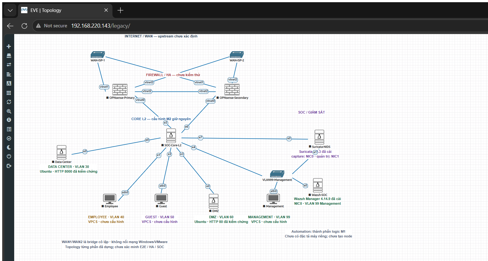

# CHƯƠNG 1. ĐÍNH CHÍNH TRẠNG THÁI CÀI ĐẶT TRÊN TOPOLOGY EVE-NG

## 1.1. Phạm vi kiểm tra

Ngày 05/11/2026, đã đối chiếu chú thích trên topology với log, ảnh console và kết quả runtime đã lưu. Việc kiểm tra không yêu cầu bật node. Sau khi xác định bốn chú thích lỗi thời, topology được sao lưu và chỉ dữ liệu của textobject ID 4, 7, 10 và 11 được cập nhật. Không thay node, link, segment, cấu hình guest hoặc trạng thái nguồn.

## 1.2. Kết quả đối chiếu

| Node | Bằng chứng đã có | Kết luận | Xử lý chú thích |
|---|---|---|---|
| Data-Center | Ubuntu đã boot; `192.168.30.10/24`; HTTP 8000 trả mã 200; tiếp tục được dùng trong M2/M3.4 | Đã cài và cấu hình dịch vụ lab | Bỏ `CREATED_NOT_INSTALLED`; thay bằng `Ubuntu · HTTP 8000 đã kiểm chứng` |
| Employee | Node VPCS; lần đọc lịch sử không nhận được cấu hình IP có thể nghiệm thu | VPCS không cần cài hệ điều hành, nhưng chưa xác nhận cấu hình | Giữ `VPCS · chưa cấu hình` |
| Guest | Node VPCS; chưa có kết quả cấu hình IP có thể nghiệm thu | VPCS không cần cài hệ điều hành, nhưng chưa xác nhận cấu hình | Giữ `VPCS · chưa cấu hình` |
| DMZ | Ubuntu đã boot; `192.168.60.10/24`; HTTP 80 trả mã 200 | Đã cài và cấu hình dịch vụ lab | Bỏ `CREATED_NOT_INSTALLED`; thay bằng `Ubuntu · HTTP 80 đã kiểm chứng` |
| Management | Node VPCS; chưa có kết quả cấu hình IP có thể nghiệm thu | VPCS không cần cài hệ điều hành, nhưng chưa xác nhận cấu hình | Giữ `VPCS · chưa cấu hình` |
| Suricata-NIDS | Gói Suricata 7.0.3; kiểm tra cấu hình PASS; service active; đã có alert marker thật | Đã cài và kiểm chứng trong phạm vi M4 | Bỏ `Suricata chưa cài`; thay bằng phiên bản và mapping NIC |
| Wazuh-SOC | `wazuh-manager` 4.14.9-1; service active/enabled sau sửa timeout; xử lý replay thành alert | Wazuh Manager đã cài; chưa có Indexer/Dashboard/Filebeat | Bỏ `Wazuh chưa cài` và `NIC chưa nối`; ghi Manager và VLAN 99 |

Không dùng từ “đã cài” cho Employee, Guest và Management vì đây là VPCS (Virtual PC Simulator), không phải máy ảo Linux cần cài hệ điều hành. Trạng thái “chưa cấu hình” được giữ vì chưa có bằng chứng IP/gateway lưu bền và kiểm thử tương ứng.

**Hình 1.3. Topology EVE-NG sau khi đính chính trạng thái Data-Center, DMZ, Suricata và Wazuh.**

Mục đích của hình là xác nhận các chú thích trên canvas phù hợp với minh chứng runtime đã có. Ảnh thật chụp sau khi tải lại trang cho thấy Data-Center và DMZ là Ubuntu có HTTP đã kiểm chứng; Suricata 7.0.3 và Wazuh Manager 4.14.9 đã cài; Wazuh nối VLAN 99. Employee, Guest và Management tiếp tục mang trạng thái VPCS chưa cấu hình. Kết quả loại bỏ các phát biểu “chưa cài” sai mà không nâng trạng thái các endpoint chưa được kiểm chứng. Ý nghĩa là tránh dùng chú thích lịch sử làm kết luận hiện hành trong báo cáo.

## 1.3. Sao lưu, kiểm tra thay đổi và giới hạn

Backup EVE lưu tại `/root/soc-m1-label-correction-20261105T092555Z`, gồm lab trước/sau và receipt, quyền giới hạn root. SHA-256 lab trước là `94e4c6380f776ca9b154c5c068a3b2ee20f1f90c03005e9790e94543300e7a6f`; sau là `2540b7ed54266134679023595125c5db0abcb659416a3a9a0f518d154d0c805c`. So sánh ngữ nghĩa xác nhận chỉ bốn trường dữ liệu nhãn thay đổi; vẫn có 10 node và 11 segment.

Kết quả này không xác nhận runtime hiện tại vì các node vẫn tắt. Nó dựa trên nghiệm thu lịch sử có thời điểm cụ thể. Wazuh chỉ xác nhận Manager; pipeline log live, Indexer/Dashboard và Filebeat chưa được suy là đã cài. Suricata đã phát hiện marker thật nhưng vận chuyển trực tiếp sang Wazuh chưa được nghiệm thu.
