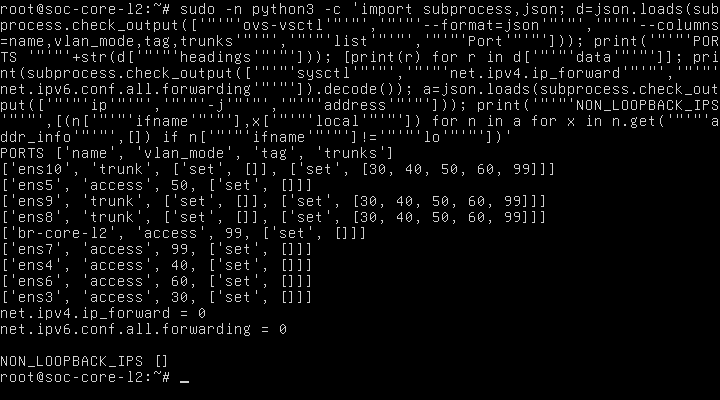
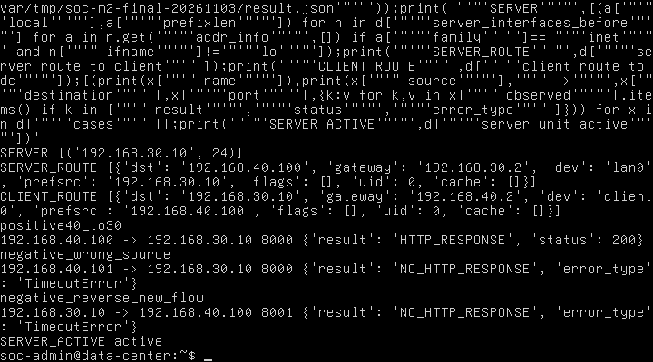
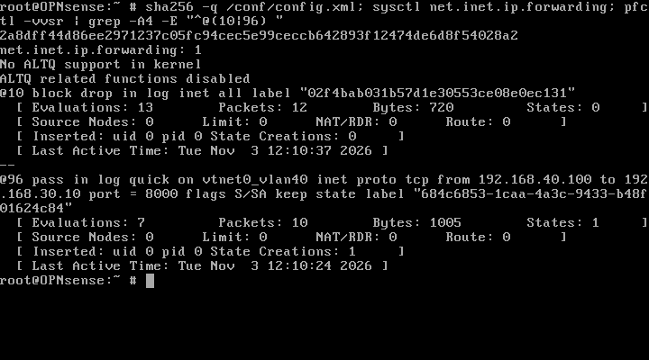
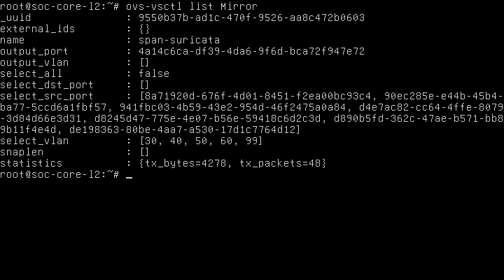

# CHƯƠNG 2. CẤU HÌNH CORE L2 SWITCH (OPEN vSWITCH) VÀ NGHIỆM THU M2

## 2.1. Kết quả tổng kết

Ngày 03/11/2026, **M2 hoàn thành trong phạm vi nghiệm thu người dùng đã xác nhận**. Không chuyển sang M3, không cấu hình CARP/HA, NAT hoặc DHCP. Kết quả sau dựa trên traffic thật, log, PCAP và ảnh console; không đánh dấu PASS chỉ từ cấu hình.

| Hạng mục | Kết quả | Minh chứng chính |
|---|---|---|
| Core L2 | PASS | Suite frame lịch sử 95/95; runtime mới forwarding0/0, không IP ngoài loopback; HTTP thực qua Core |
| Inter-VLAN Routing | PASS | HTTP200 .40.100 → .30.10:8000; cùng SYN có tag40→30, TTL64→63 và MAC Primary |
| ACL/firewall giữa VLAN | PASS | Một ca dương, hai ca âm; PCAP kết hợp bộ đếm pass/default deny |
| Access/trunk | PASS | Năm VLAN có suite frame lịch sử; runtime giữ đúng mapping; access untagged và trunk tagged trong ca mới |
| LACP | N/A | Hai trunk nối hai firewall riêng; không có đối tác LAG chung được thiết kế |
| SPAN/Port Mirroring | PASS | Marker GET trong PCAP cổng mirror, counter mirror tăng, giữ bằng chứng lịch sử |

PASS của ACL áp dụng cho các ca đã chạy trong mục 2.5, không tuyên bố đã thử mọi cặp VLAN, mọi port hoặc IPv6. Hai rule LAN parent rộng đã ghi nhận ở Nhóm 2C vẫn giữ nguyên; không suy M2 thành chứng nhận least-privilege toàn hệ thống. HA/CARP, NAT/DHCP, IDS và pipeline live Suricata/Wazuh không được coi là đã nghiệm thu từ kết quả này.

## 2.2. Kiến trúc thử, tài nguyên, backup và phục hồi

### 2.2.1. Nhóm node và RAM

Chỉ dùng Primary 3072 MiB, Core 2048 MiB và Data-Center 1024 MiB: tổng 6144 MiB. Không bật Secondary, Wazuh, Suricata, DMZ hoặc VPCS. Trước mỗi start: kiểm tra MemAvailable lớn hơn RAM node cộng1 GiB dự phòng, tổng guest không vượt MemTotal trừ1 GiB, swap dùng0, Windows còn ít nhất2 GiB commit khả dụng. Không giảm/tăng RAM guest, không tải image hoặc cài package.

Guard tổ hợp cũ là5120 MiB. Script đợt mới theo quyền đã cấp kiểm tra tổ hợp6144 MiB dựa trên MemTotal/MemAvailable thực tế thay vì bỏ kiểm soát tài nguyên. `prepare-receipt.json` lưu số đo trước từng start. Khi ba VM hoạt động, một mốc quan sát EVE còn khoảng4059 MiB MemAvailable, swap0; không nhầm RAM khai báo với RAM thực đã dùng. Bộ nhớ bàn giao nằm trong `cleanup-receipt.json`.

### 2.2.2. HTTP client Linux thật thay VPCS

Đã dùng Linux network namespace `m2-client40` bên trong VM Data-Center hiện có, với **NIC thứ hai nối segment VLAN40**. Client và server có TCP/IP stack, interface và routing table tách biệt. Đây không phải truy cập cùng VLAN hoặc hai IP trên cùng interface. VPCS Employee giữ tắt để không trùng .40.100.

| Vai trò | Namespace/interface | IPv4/mask | Gateway | MAC |
|---|---|---|---|---|
| Web server | Namespace gốc / lan0 | 192.168.30.10/24 | 192.168.30.2 | 02:54:bc:2f:0c:00 |
| HTTP client | m2-client40 / client0 | 192.168.40.100/24 | 192.168.40.2 | 02:54:bc:2f:0c:01 |
| Nguồn âm cùng VLAN40 | Đổi IP tạm trên client0 trong ca âm | 192.168.40.101/24 | 192.168.40.2 | MAC client giữ nguyên; sau ca khôi phục .100 |

Đường thực: client0 → VLAN40 → access ens4 → Core OVS → trunk ens8 → Primary VLAN40 → routing/firewall → Primary VLAN30 → trunk ens8 → Core access ens3 → VLAN30 → lan0 server. Không bridge trực tiếp hai NIC trong guest. Ngoại lệ vẫn đúng nguồn .40.100, không sửa rule để khớp IP khác.

### 2.2.3. Thay đổi tạm và tính toàn vẹn

Backup trước thay đổi: `/root/soc-m2-final-20261103-backup/lab-before.unl`, thư mục0700/tệp0600. Hash gốc:

`df605adcb3b50a83f20ba99f0a7b7b18eedf3428f6fe370a03c631841f2f58ba`

Chỉ thêm NIC1 của Data-Center vào segment7/VLAN40; NIC0 giữ segment6/VLAN30. API EVE tự đổi visibility segment7 từ0 sang1; đây là cờ trình bày. Các node/cổng Core/Primary và liên kết khác được đối chiếu giữ nguyên. Trong guest tạo namespace/IP/route runtime, helper kết quả và HTTP server đối chứng TCP8001 tạm; không sửa netplan, seed, image hoặc unit server TCP8000. Server TCP8001 đã terminate sau ca.

Không sửa Core OVS hoặc firewall/NAT/DHCP/CARP/HA SYNC. Hash `config.xml` Primary trước/sau bằng nhau:

`2a8dff44d86ee2971237c05fc94cec5e99ceccb642893f12474de6d8f54028a2`

Không export raw cấu hình hoặc khóa/mật khẩu. Vì không ghi firewall nên không tạo backup firewall mới; ảnh/hash bảo toàn nội dung. Sau thử đã tắt mềm DC, xác nhận QEMU dừng rồi khôi phục lab **đúng nguyên byte** từ backup, chỉ khi hash topology còn khớp snapshot sau thêm NIC. NIC/visibility tạm được gỡ, namespace runtime mất khi guest tắt. Core + Primary giữ chạy, tổng5120 MiB. Receipt chuẩn bị/phục hồi lưu đầy đủ trong thư mục minh chứng cuối.

## 2.3. Core Layer 2 và access/trunk

| Port | Vai trò | VLAN | Kiểm chứng |
|---|---|---|---|
| ens3/ens4/ens5/ens6/ens7 | Access | Lần lượt30/40/50/60/99 | Runtime mới và suite frame năm VLAN lịch sử |
| ens8 | Trunk Primary | 30,40,50,60,99 | Runtime; PCAP tag30/40 mới; suite lịch sử |
| ens9 | Trunk Secondary | 30,40,50,60,99 | Runtime và suite lịch sử; không bật Secondary ở ca HTTP |
| ens10 | Output mirror | Port mang danh sách30/40/50/60/99 | Chức năng Mirror output, không dùng làm gateway/endpoint thông thường |

Local port `br-core-l2` có tag99 nhưng không IP. Console mới xác nhận IPv4 forwarding0, IPv6 forwarding0, `NON_LOOPBACK_IPS []`. Inter-VLAN được routing tại Primary. Suite ngày01/11 có95 ca frame thật PASS, không FAIL, gồm VLAN/access/trunk, mirror và sau reboot. Không chạy lại suite khi cấu hình không đổi, không cộng snapshot trùng vào95. Hồ sơ cũ vẫn ở `docs/evidence/M2/live-tests-20261101/`.

## 2.4. HTTP và bằng chứng định tuyến qua OPNsense

GET thật từ .40.100 tới `http://192.168.30.10:8000/?soc_m2=soc-m2-final-20261103` trả **HTTP200 OK**, server `SimpleHTTP/0.6 Python/3.12.3`, body164 byte chứa “SOC Data-Center”. Body SHA-256:

`3bab0b6226fd128b770bca8e63c8b2abe89b8ee53fc6998557dbf5dffb273426`

Đây là web lab Python `http.server`, không phải dịch vụ AI/API. Header/body trích từ request thật; không gửi lại chỉ để tạo ảnh. Journal server có nguồn .40.100, cùng marker GET và status200.

| Trường SYN tương quan tại TAP trunk Primary | Trước routing | Sau routing |
|---|---|---|
| VLAN | 40 | 30 |
| IP/TCP | .40.100:55077 → .30.10:8000 | Giữ nguyên |
| IP ID / TCP sequence | 60023 / 3060261172 | Giữ nguyên |
| TTL | 64 | 63 |
| MAC nguồn | 02:54:bc:2f:0c:01 | 50:00:00:01:00:00 — Primary |
| MAC đích | 50:00:00:01:00:00 — Primary | 02:54:bc:2f:0c:00 — DC |

PCAP access hai endpoint không tag; GET tới server và HTTP200 tới client đều có trong capture. Cùng SYN đổi tag, giảm TTL và thay MAC tại NIC Primary chứng minh routing qua OPNsense; không có đường tắt nội bộ giữa hai namespace. `packet-analysis.json` lưu cặp gói, `packets-decoded.csv` lưu từng packet đã giải mã.

## 2.5. Firewall: ca dương/âm và bộ đếm

| Ca | Luồng/đối chứng | Kết quả | Phân loại |
|---|---|---|---|
| M2-P01 | .40.100 → .30.10 TCP8000 | HTTP200/164 byte; cùng SYN tag40→30/TTL64→63; rule pass xử lý | PASS |
| M2-N01 | .40.101 → cùng server TCP8000 đã có đối chứng dương | Timeout; 6 SYN ingress VLAN40, 0 frame tương ứng egress VLAN30 | PASS — bị deny đúng kỳ vọng |
| M2-N02 | .30.10 → .40.100 TCP8001; server tạm có HTTP200 khi gọi cục bộ trong namespace | Request liên VLAN timeout; 6 SYN ingress VLAN30, 0 frame tương ứng egress VLAN40 | PASS — kết nối mới chiều ngược bị deny |

Không dùng timeout đơn lẻ để kết luận chặn. Mỗi ca có dịch vụ đối chứng, SYN tới Primary và không được chuyển tiếp sang VLAN đích. Default deny tăng12 packet trong cùng cửa sổ. Chỉ chạy ba ca HTTP/kiểm soát nêu trên, không quét cổng hoặc tấn công.

Rule hiện có `SOC TEST EMPLOYEE TO DC HTTP`, UUID `684c6853-1caa-4a3c-9433-b48f01624c84`, vẫn pass IPv4 ingress opt2, .40.100/32 → .30.10/32 TCP8000, sequence101, log bật. PF @96 trước thử0 packet/0 state creations; sau thử10 packet,1005 byte,1 state creation. Default deny IPv4 PF @10 trước0 packet; sau12 packet,720 byte. `firewall-counter-observations.json` là trích đọc từ ảnh console có ghi nguồn ảnh/phương pháp, không giả làm JSON native của pfctl.

Không thêm allow-any, không reset state hoặc sửa rule. Stateful firewall cho response của phiên được phép; không cần pass chiều ngược. Ca M2-N02 là kết nối **mới** DC→Employee, khác response của phiên client→DC.

Giới hạn: không kiểm mọi cặp VLAN50/60/99, mọi cổng, IPv6, WAN/NAT/DHCP, failover HA hoặc quản trị qua VLAN99. Không ghi các mục này PASS từ ba ca. Bộ frame lịch sử chứng minh hành vi L2 năm VLAN, không thay thế chính sách ứng dụng từng VLAN. Rule quản trị LAN/HA SYNC hiện có được giữ nguyên; nguồn quản trị VLAN99 và hai rule LAN rộng vẫn là ghi chú chính sách ở Nhóm2C.

## 2.6. SPAN và LACP

Capture filter TCP8000/8001 trên hai access TAP, trunk Primary, output mirror Core lần lượt có16/16/32/32 packet; cả bốn ghi0 packet dropped by kernel. PCAP SPAN có hai frame chứa marker GET của ca dương.

Mirror `span-suricata` giữ select_all=false, select_dst_port rỗng, select_vlan30/40/50/60/99, nguồn ingress ens3–ens9 và output ens10 theo mapping đã kiểm. Counter trước0/0, sau tx_packets48/tx_bytes4278. Counter mirror gồm cả frame ngoài filter HTTP, như ARP, nên không buộc bằng32 packet PCAP. Không cần bật Suricata để chứng minh Mirror output; không suy IDS/Wazuh PASS.

LACP (Link Aggregation Control Protocol — giao thức điều khiển gộp liên kết) là **N/A**. ens8/ens9 nối hai firewall riêng; topology không thiết kế một đối tác LAG/MLAG chung. Không cấu hình LAG giả để tạo PASS.

## 2.7. Hình minh chứng

**Hình 2.1. Core Open vSwitch giữ vai trò Layer 2.**

Mục đích: xác minh runtime sau boot. Nội dung: bảng Port, forwarding0/0 và không IP ngoài loopback. Kết quả: khớp mapping đã đạt. Ý nghĩa: kết hợp packet proof để tách chuyển mạch Core khỏi routing Primary. Thu lúc17:17:04 UTC+07:00.

**Hình 2.2. IP/mask/gateway của hai endpoint cô lập.**

Mục đích: xác minh nguồn/đích thật. Nội dung: server .30.10/24 qua .30.2; client .40.100/24 qua .40.2. Kết quả: đúng IP rule. Ý nghĩa: Linux thay VPCS được ghi rõ, không đổi rule/IP ngoại lệ. Thu lúc17:21:20 UTC+07:00.

**Hình 2.3. Một ca HTTP200 và hai ca âm.**

Mục đích: trình bày kết quả ứng dụng. Nội dung: HTTP200 và hai TimeoutError. Kết quả: đúng kỳ vọng khi đối chiếu PCAP/counter. Ý nghĩa: không dùng TCP probe hoặc HTTP cục bộ thay ca liên VLAN. Ảnh là đọc lại kết quả đã lưu, không phát request mới. Thu lúc17:19:59 UTC+07:00.

**Hình 2.4. Mốc bộ đếm và hash trước thử.**

Mục đích: tạo đối chứng. Nội dung: hash config, forwarding1, @10/@96 có0 packet. Kết quả: có điểm đầu. Ý nghĩa: đánh giá traffic thật qua delta. Thu lúc17:17:31 UTC+07:00.

**Hình 2.5. Rule xử lý traffic, cấu hình không đổi.**

Mục đích: chứng minh pass/default deny. Nội dung: @96 có10 packet/1 state creation, @10 có12 packet, hash không đổi. Kết quả: tương quan ca dương/12 SYN âm. Ý nghĩa: không tạo rule để làm PASS. Thu lúc17:18:53 UTC+07:00.

**Hình 2.6. Mirror đã phát bản sao traffic.**

Mục đích: bổ sung counter cho PCAP SPAN. Nội dung: cấu hình Mirror và tx_packets48. Kết quả: bản sao GET có trong PCAP. Ý nghĩa: chứng minh chức năng SPAN, không đồng nghĩa IDS/pipeline hoàn thành. Thu lúc17:19:23 UTC+07:00.

Ảnh là framebuffer thật, không chỉnh nội dung kỹ thuật. Thời gian dùng máy thu UTC+07:00. Đồng hồ guest/HTTP Date/PCAP có thể lệch; tương quan bằng marker, sequence, địa chỉ, MAC, tag, TTL và thứ tự packet, không suy giờ tuyệt đối từ guest. Các ảnh/log lịch sử vẫn giữ nguyên vị trí.

## 2.8. Thuật ngữ, nguyên lý và vai trò SOC

| Khái niệm, tên đầy đủ/nghĩa | Nguyên lý và vai trò | Ví dụ, mức kiểm chứng |
|---|---|---|
| SOC — Security Operations Center, trung tâm giám sát an ninh | Phân tích dữ liệu an ninh; cần nền mạng và điểm quan sát | M2 cung cấp mạng/mirror đã kiểm; SOC end-to-end không thuộc kết quả |
| VLAN — Virtual Local Area Network, mạng LAN ảo; IEEE802.1Q | Tách miền L2, tag nhận diện VLAN trên trunk | Năm VLAN có suite lịch sử; tag40/30 có PCAP mới |
| Access port — cổng truy cập; trunk — liên kết mang nhiều VLAN | Access gắn endpoint vào một VLAN; trunk vận chuyển các VLAN có tag | ens3/ens4 untagged ở endpoint, ens8 tagged: đã kiểm |
| Open vSwitch (OVS); bridge — cầu chuyển mạch | Tên sản phẩm chuyển mạch ảo; bridge chuyển frame theo miền L2 | br-core-l2 hoạt động, forwarding0/0 |
| LACP — Link Aggregation Control Protocol | Thương lượng thành viên nhóm liên kết với đối tác; hỗ trợ băng thông/dự phòng khi được thiết kế | N/A, hai firewall riêng |
| SPAN — Switched Port Analyzer; port mirroring — sao chép lưu lượng cổng | Sao chép frame đã chọn ra output phục vụ quan sát | span-suricata ra ens10, marker trong PCAP: đã kiểm |
| Linux network namespace — không gian tên mạng | Cô lập interface/stack/routing; tạo endpoint kiểm thử nhẹ | m2-client40 dùng NIC VLAN40 thật: đã kiểm |
| HTTP — Hypertext Transfer Protocol; TCP — Transmission Control Protocol | HTTP trao đổi yêu cầu/phản hồi trên kết nối TCP; kiểm tới lớp ứng dụng | GET TCP8000 trả200/164 byte: đã kiểm |
| TTL — Time to Live; PCAP — định dạng lưu gói tin | Router giảm giới hạn hop; bản ghi packet cho phép tương quan đường đi | SYN64→63 tại Primary: đã kiểm |
| ACL — Access Control List; stateful firewall — tường lửa có trạng thái | Lọc nguồn/đích/giao thức/port và theo dõi phiên; thực thi phân vùng | Firewall Primary thay ACL CoreL3; một ca dương/hai ca âm đã kiểm |
| OPNsense | Tên sản phẩm chính thức, làm gateway/routing/firewall | Primary giữa .40.2 và .30.2: đã kiểm |
| QEMU; QCOW2 — QEMU Copy On Write version2 | QEMU là tên phần mềm ảo hóa; QCOW2 lưu đĩa copy-on-write, phục vụ lab | Boot VM có sẵn, không tạo/sửa backing image |
| cloud-init; NoCloud | Tên dự án khởi tạo guest và datasource metadata/user-data/network-config | Seed DC là hồ sơ lịch sử; đợt này không sửa seed |
| SSH — Secure Shell | Kênh quản trị xác thực/mã hóa, bí mật giữ ngoài minh chứng | Khóa có sẵn tới EVE; user tự nhập xác thực console |
| HA — High Availability; CARP — Common Address Redundancy Protocol; pfsync | HA là sẵn sàng cao; CARP địa chỉ ảo; pfsync là tên giao thức đồng bộ state PF | Giải thích thiết kế, không cấu hình/kiểm HA ở M2 |
| NAT — Network Address Translation; DHCP — Dynamic Host Configuration Protocol | Chuyển đổi địa chỉ và cấp tham số mạng động; không thay chức năng firewall | M2 dùng IP tĩnh, không thay NAT/DHCP hoặc ghi PASS cho chúng |
| IDS/IPS — Intrusion Detection/Prevention System; Suricata; Wazuh | Hệ phát hiện/ngăn chặn; Suricata/Wazuh là tên sản phẩm phục vụ giám sát/phân tích | M2 chỉ xác minh output mirror, không bật sensor/Wazuh |

Tên sản phẩm không tự khai triển. Nghĩa tiếng Việt của các nhóm cuối lần lượt là sẵn sàng cao/giao thức dự phòng địa chỉ chung/đồng bộ trạng thái; chuyển đổi địa chỉ/cấp cấu hình mạng động; phát hiện/ngăn chặn xâm nhập. Các ví dụ chưa chạy được ghi theo thiết kế, không biến thành kết quả. Giải thích bổ sung dùng `docs/TOPOLOGY_TERMS.md` cùng trạng thái mới này.

## 2.9. Lỗi chuẩn bị, giới hạn và bàn giao

Lỗi kiểm tra đường dẫn XML networks và kiểm tra visibility xảy ra trước phát traffic. Sau lỗi đã đọc lại backup/trạng thái, sửa kiểm tra đúng cấp XML và chấp nhận riêng thay đổi trình bày đã xác minh; không chạy lại editNode/connectNode mù quáng. Log lỗi giữ nguyên, ghi là lỗi chuẩn bị đã xử lý, không phải FAIL của routing. Core cần sudo; người dùng tự mở root shell, không sửa xác thực hoặc lưu mật khẩu.

Báo cáo Word dùng exporter thư viện chuẩn có sẵn, không cài package. A4, Times New Roman13; bảng/chú thích12; lề trái3 cm, các lề còn lại2 cm. Kiểm tra gói OOXML và hash ảnh nhúng, chưa kiểm phân trang bằng ứng dụng Word thực tế; cần rà phân trang khi ghép báo cáo chung.

`docs/SOC_TO_DO.md` là bản theo dõi riêng của workspace. Không tìm thấy SOC TO DO hiện hữu để sửa tại chỗ nên tạo bản và dẫn từ README/PROGRESS. Công việc mới ghi **Cấu hình Core L2 Switch (Open vSwitch)**; không sửa tài liệu nhóm gốc hoặc hàng loạt báo cáo lịch sử mô tả phương án L3 cũ.

Minh chứng cuối ở `docs/evidence/M2/final-acceptance-20261103/`: PCAP gốc, bản giải mã CSV, header/body HTTP, log ca, ảnh console, receipt chuẩn bị/phục hồi, bảng `M2-results.json/csv` và `evidence-index.csv` có thời điểm UTC+07:00/đường dẫn/vị trí báo cáo/SHA-256. Nguồn lịch sử được tham chiếu nguyên vị trí; không di chuyển/xóa bằng chứng cũ.

Sau bàn giao chỉ Core + Primary chạy; DC tắt mềm, NIC client tạm gỡ, topology phục hồi nguyên byte. Không commit/push, không sửa tài liệu chung ngoài quyền, không chuyển M3. **M2 hoàn thành; dừng chờ người dùng.**

## 2.10. Nguồn chính thức và hồ sơ thực nghiệm

1. [Open vSwitch — Basic Configuration](https://docs.openvswitch.org/en/stable/faq/configuration/): cơ sở access/trunk/mirroring; tài liệu hiện hành không thay đầu ra phiên bản lab.
2. [Linux man-pages — network_namespaces(7)](https://man7.org/linux/man-pages/man7/network_namespaces.7.html): cơ sở cô lập stack/interface/routing.
3. [OPNsense — Rules](https://docs.opnsense.org/manual/firewall.html): cơ sở stateful filtering và xử lý ingress/rule.
4. Hồ sơ nội bộ: `live-tests-20261101/final-collection/frame-cases.csv`, `group2b2-20261103/` và `final-acceptance-20261103/`. Tài liệu ngoài đối chiếu ngày03/11/2026; PASS dựa vào minh chứng thật, không dựa riêng hướng dẫn.
