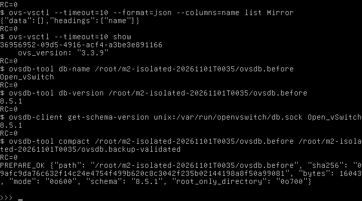
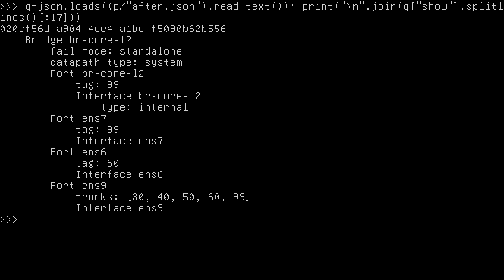
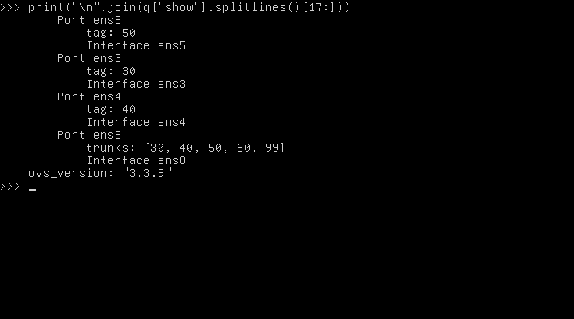
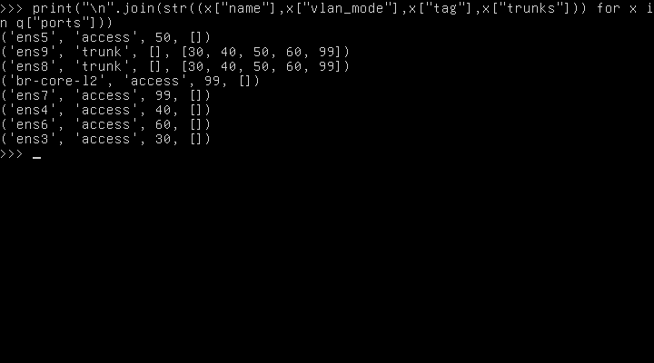
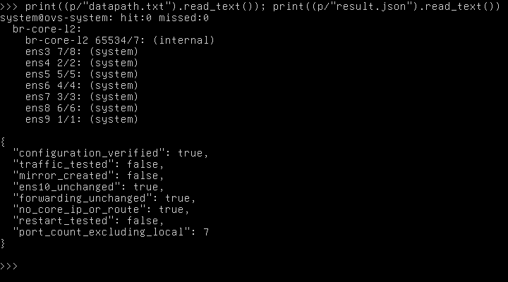
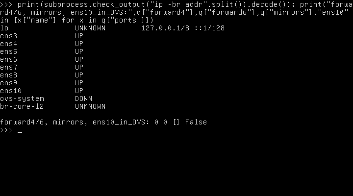

## 2.28. Triển khai Open vSwitch cô lập theo phạm vi đã phê duyệt

### 2.28.1. Phạm vi và các mốc lịch sử

Người dùng đã phê duyệt tạo bridge br-core-l2 cùng năm access ens3–ens7 và hai trunk ens8/ens9 trong guest SOC-Core-L2. Mẫu cũ ở mục 2.22 có ens10/Mirror được giữ làm lịch sử thiết kế; **phạm vi hiện hành không triển khai ens10 hoặc SPAN**. Mục 2.28–2.33 ghi kết quả cấu hình thực tế; các nhận định chưa tạo bridge ở phần trước chỉ áp dụng tại mốc cũ. Tất cả peer, đường mạng và kiểm thử lưu lượng vẫn chưa triển khai.

Trước thao tác đã đọc AGENTS.md, báo cáo mapping Word và mẫu đề xuất. Đã xác minh hostname soc-core-l2, UUID QEMU 2b295168-b72e-4de7-b364-37298252dd9f, OVS 3.3.9, ba unit active và tám MAC giữ nguyên. Phiên sudo cũ hết hạn; chỉ thực hiện đặc quyền sau khi xác thực, không ghi thông tin đăng nhập vào log dự án hoặc báo cáo. Script đã được chuyển qua console và đối chiếu SHA-256 trước khi chạy. Không giả định có SSH trực tiếp vào guest.

### 2.28.2. Kiểm tra xung đột và sao lưu

Bước prepare xác nhận OVS chưa có Bridge/Port/Interface/Mirror, Linux chưa có interface br-core-l2, tám NIC chưa có địa chỉ, route và forwarding được lưu làm đường cơ sở. Đã đọc các mục Match và chính sách mạng liên quan trong cấu hình systemd-networkd, không sửa netplan hoặc cấu hình NIC cũ. Bước preapply đọc lại và so trạng thái ngay trước giao dịch; nếu xuất hiện cấu hình khác thì dừng.

Sao lưu dùng ovsdb-client backup qua socket DB đang chạy, không đọc/ghi QCOW2 từ host. Bản backup raw giữ trong guest root-only; đã xác nhận tên Open_vSwitch, schema 8.5.1 khớp server và đọc/compact bản backup sang một tệp kiểm tra riêng. Không compact hoặc ghi đè DB đang chạy. Rollback dùng ovsdb-client restore snapshot với schema trùng, không --force và không dừng dịch vụ/VM. Restore có thể sinh UUID hàng mới, nên kiểm tra cấu hình tương đương. [Tài liệu ovsdb-client](https://www.openvswitch.org/support/dist-docs/ovsdb-client.1.html).

Lần áp dụng đầu tiên bị chặn tại kiểm tra route: kernel sinh thêm route multicast IPv6 ff00::/8 thuộc interface mới br-core-l2, không phải default gateway hoặc route liên VLAN. Script đã restore snapshot, mã thoát 0, rồi xác nhận OVS về cấu hình rỗng và link/address/route trở lại đường cơ sở. Đây là rollback thực tế đã kiểm chứng. Các tệp attempt1-* và commands.jsonl giữ nguyên diễn biến lỗi/khôi phục; failure.json và rollback-result.json còn lại là lịch sử lần đầu, không phải trạng thái kết quả cuối. Không phát hiện cấu hình bridge/port có sẵn xung đột. Sau khi xác minh khôi phục hoàn toàn, phiên bản script thứ hai ngăn route tự sinh bằng cách tắt IPv6 host stack chỉ trên bridge mới rồi áp dụng lại trong phạm vi Core cô lập đã duyệt.

Bản sao: /root/m2-isolated-20261101T0035/ovsdb.before; kích thước 16043 byte; mode 0o600; thư mục 0o700; SHA-256 09afc9da76c632f14c24e4754f499b620c8c3042f235b02144198a8f50a99081. rollback.sh và snapshot nằm cùng thư mục, không xuất nội dung raw DB vào báo cáo.


## 2.29. Cấu hình thực tế đã áp dụng

### 2.29.1. Bridge và bảy cổng vật lý

Một giao dịch ovs-vsctl tạo br-core-l2, datapath_type=system, fail_mode=standalone, local Port access VLAN 99 không IP; tạo năm access và hai trunk như bảng. Không có controller hoặc bond/LACP. Đã kiểm tra tham số giao dịch không chứa ens10 hoặc thao tác Mirror. Giao dịch thực tế lưu tại guest/applied-transaction.json và trong commands.jsonl; không chạy nguyên mẫu có SPAN cũ.

| Backend | TAP EVE | NIC Ubuntu | MAC | Chế độ thực tế | Tag | Trunks | Bridge | Kiểm thử |
|---|---|---|---|---|---|---|---|---|
| net0 | vunl0_3_0 | ens3 | 02:53:45:f2:19:00 | access | 30 | — | br-core-l2 | Chưa nối peer; chưa thử lưu lượng |
| net1 | vunl0_3_1 | ens4 | 02:53:45:f2:19:01 | access | 40 | — | br-core-l2 | Chưa nối peer; chưa thử lưu lượng |
| net2 | vunl0_3_2 | ens5 | 02:53:45:f2:19:02 | access | 50 | — | br-core-l2 | Chưa nối peer; chưa thử lưu lượng |
| net3 | vunl0_3_3 | ens6 | 02:53:45:f2:19:03 | access | 60 | — | br-core-l2 | Chưa nối peer; chưa thử lưu lượng |
| net4 | vunl0_3_4 | ens7 | 02:53:45:f2:19:04 | access | 99 | — | br-core-l2 | Chưa nối peer; chưa thử lưu lượng |
| net5 | vunl0_3_5 | ens8 | 02:53:45:f2:19:05 | trunk | — | 30,40,50,60,99 | br-core-l2 | Chưa nối peer; chưa thử lưu lượng |
| net6 | vunl0_3_6 | ens9 | 02:53:45:f2:19:06 | trunk | — | 30,40,50,60,99 | br-core-l2 | Chưa nối peer; chưa thử lưu lượng |
| net7 | vunl0_3_7 | ens10 | 02:53:45:f2:19:07 | Ngoài OVS | — | — | Không có | Chưa nối peer; chưa thử lưu lượng |


Local Port br-core-l2 là interface nội bộ do OVS tạo, thuộc VLAN 99 và không có IP; không tính là một vNIC mới thay cho tám thiết bị VirtIO đã xác minh. Hai trunk mang đúng 30,40,50,60,99, không native VLAN; ens10 không có Port/Interface trong OVS, không mirror và trạng thái Linux được so bằng dữ liệu trước/sau.

### 2.29.2. Giữ Core không có IP và không định tuyến

Đã đặt addrgenmode none và net.ipv6.conf.br-core-l2.disable_ipv6=1 chỉ trên interface nội bộ br-core-l2 mới tạo rồi bật interface này để bridge admin UP. Thiết lập disable_ipv6 ngăn kernel tạo địa chỉ/route multicast cục bộ trên interface mới; không thay sysctl forwarding hoặc IPv6 trên NIC cũ. Việc tắt host IPv6 trên interface nội bộ không cấu hình rule chặn Ethernet IPv6 trong OVS; chuyển tiếp frame IPv6 vẫn cần kiểm thử riêng. Script cũng có nhánh chỉ loại bỏ link-local tự sinh trên interface mới khi cần; log commands.jsonl xác định chính xác nhánh thực sự chạy. Không gán IP/gateway.

Sau cấu hình, các interface Core không có địa chỉ IP, bảng route giữ nguyên đường cơ sở và net.ipv4.ip_forward/net.ipv6.conf.all.forwarding vẫn 0. Loopback vẫn có các địa chỉ cục bộ hệ thống như trước, không phải IP/gateway VLAN. Chính sách addrgenmode mới là trạng thái runtime của interface; chưa chứng minh duy trì qua reboot và chưa thay cấu hình quản lý mạng để bảo đảm persistence.

### 2.29.3. Kết quả ovs-vsctl show thực tế

```text
020cf56d-a904-4ee4-a1be-f5090b62b556
    Bridge br-core-l2
        fail_mode: standalone
        datapath_type: system
        Port br-core-l2
            tag: 99
            Interface br-core-l2
                type: internal
        Port ens7
            tag: 99
            Interface ens7
        Port ens6
            tag: 60
            Interface ens6
        Port ens9
            trunks: [30, 40, 50, 60, 99]
            Interface ens9
        Port ens5
            tag: 50
            Interface ens5
        Port ens3
            tag: 30
            Interface ens3
        Port ens4
            tag: 40
            Interface ens4
        Port ens8
            trunks: [30, 40, 50, 60, 99]
            Interface ens8
    ovs_version: "3.3.9"
```

Nội dung trên lấy nguyên từ output guest sau kiểm tra, không dựng từ thiết kế. Đây là minh chứng cấu hình DB và trạng thái daemon, chưa phải kết quả chuyển tiếp frame giữa peer.

## 2.30. Kiểm chứng cấu hình tĩnh và datapath

| Hạng mục | Kết quả thực tế | Phạm vi kết luận |
|---|---|---|
| Bridge | Đúng một br-core-l2, system/standalone, admin UP | Đạt cấu hình/runtime trong phiên |
| Access | ens3/30, ens4/40, ens5/50, ens6/60, ens7/99; không trunks | Đạt thuộc tính Port; chưa thử tag hoặc cách ly |
| Trunk | ens8 và ens9: 30,40,50,60,99; không tag/native | Đạt thuộc tính Port; chưa thử 802.1Q bằng frame |
| Port count | 7 port vật lý + local Port br-core-l2 | Đúng phạm vi duyệt, không thêm vNIC |
| Interface | ofport hợp lệ, error rỗng | Datapath đã nhận interface; chưa đo thông lượng |
| ens10 | Ngoài bridge/OVS; link trước/sau giống nhau | Giữ nguyên, chưa SPAN |
| Mirror/controller/bond | Không tạo | Chưa triển khai SPAN/SDN/LACP |
| IP/route/forwarding | Không địa chỉ trên Core; route không đổi; forwarding 0/0 | Core không làm gateway/định tuyến liên VLAN |
| Dịch vụ | openvswitch-switch, ovsdb-server, ovs-vswitchd active | Daemon hoạt động tại thời điểm đọc |
| Datapath và flow | dpif/show và dump-flows được thu thực tế | Đối chiếu cổng và pipeline; counter không chứng minh đã thử peer |
| EVE/VM/image | Hash lab, image gốc, seed không đổi; PID QEMU giữ nguyên; 8 TAP chưa bridge master | Không nối link, không bật VM, không sửa image/seed |
| Reboot/persistence | Chưa restart và chưa kiểm tra sau reboot | Chưa đạt nghiệm thu persistence |
| Lưu lượng thực tế | Không phát gói kiểm thử giữa endpoints | Chưa nghiệm thu switching/VLAN/trunk hoặc M2 đầy đủ |

### 2.30.1. Datapath ghi nhận

```text
system@ovs-system: hit:0 missed:0
  br-core-l2:
    br-core-l2 65534/7: (internal)
    ens3 7/8: (system)
    ens4 2/2: (system)
    ens5 5/5: (system)
    ens6 4/4: (system)
    ens7 3/3: (system)
    ens8 6/6: (system)
    ens9 1/1: (system)
```

### 2.30.2. Flow ghi nhận

```text
NXST_FLOW reply (xid=0x4):
 cookie=0x0, duration=2.438s, table=0, n_packets=0, n_bytes=0, idle_age=2, priority=0 actions=NORMAL
```

Không gọi dump-flows là kiểm thử chuyển mạch bằng lưu lượng. Thuộc tính Bridge/Port là trạng thái cấu hình; datapath, ofport và Interface.error là kiểm tra runtime; chỉ capture/counter gắn với frame thử qua hai peer độc lập mới chứng minh chức năng chuyển tiếp. ofport do OVS cấp động, không được suy từ QEMU net0 hoặc tên ens3 thành một số OpenFlow cố định; CSV cấu hình có cột ofport đọc thực tế.

Ảnh ip -br addr có thể hiển thị operstate UNKNOWN cho interface nội bộ br-core-l2 dù cờ quản trị UP đã được kiểm tra bằng ip -j link. Thiết bị ovs-system trong Linux là phần datapath, không phải một port gateway được cấp IP; dòng DOWN của thiết bị này không thay cho kiểm tra dpif/show, ofport hoặc Interface.error. Báo cáo chỉ kết luận trạng thái quản trị và datapath nhận cổng, không kết luận carrier hoặc kết nối end-to-end với peer chưa có.

## 2.31. Nguyên lý và vai trò trong SOC

OVS là Open vSwitch, tên chính thức của bộ chuyển mạch phần mềm. Bridge là cầu nối lớp liên kết, chuyển frame theo MAC trong VLAN; br-core-l2 hiện đã được tạo làm điểm tập trung bảy cổng. ovsdb-server lưu cấu hình, ovs-vswitchd điều khiển datapath; lưu lượng SOC dự kiến đi qua đó khi có link/peer. [OVS overview](https://docs.openvswitch.org/en/stable/intro/what-is-ovs/).

VLAN là Virtual Local Area Network, mạng cục bộ ảo, chia miền quảng bá. Access port phân loại frame endpoint vào một VLAN theo tag cấu hình, như ens3 tag=30 cho Data Center; trạng thái này đã xác minh tĩnh. Trunk dùng cơ chế gắn thẻ IEEE 802.1Q để mang nhiều VLAN trên một liên kết, như ens8/ens9 mang năm VLAN đã quy định. Chưa thử frame ingress/egress nên không coi cấu hình đúng là tag/cách ly đã được kiểm chứng. [OVS VLAN FAQ](https://docs.openvswitch.org/en/stable/faq/vlan/), [OVS configuration](https://docs.openvswitch.org/en/stable/faq/configuration/).

SOC là Security Operations Center, trung tâm điều hành an ninh mạng. Core cung cấp hạ tầng chuyển mạch giữa các vùng; OPNsense xử lý gateway, định tuyến liên VLAN, firewall rules và NAT. Thiết kế HA (High Availability, tính sẵn sàng cao) dùng CARP (Common Address Redundancy Protocol, dự phòng địa chỉ chung) VIP làm gateway và pfsync đồng bộ trạng thái trên firewall; chưa triển khai firewall trong giai đoạn này. SPAN (Switched Port Analyzer) và port mirroring là sao chép lưu lượng để quan sát; ens10/Suricata được hoãn theo phê duyệt mới. Không coi Suricata IDS thụ động là IPS đã chặn gói. Các thuật ngữ còn lại và ví dụ được giữ ở mục 2.20 của báo cáo trước.

## 2.32. Minh chứng console thực tế



**Hình 2.20. Sao lưu OVSDB và xác nhận schema/checksum trước thay đổi**

Mục đích là xác nhận có snapshot có thể dùng cho rollback. Nội dung thể hiện đường dẫn root-only, schema và metadata/checksum. Kết quả cho biết backup đã tạo và được đọc kiểm tra; không phải kiểm thử restore thực tế. Ý nghĩa là giữ đường phục hồi trước giao dịch.



**Hình 2.21 (1/2). Cấu hình OVS bridge và bảy port sau giao dịch**

Mục đích là đối chiếu cấu hình thực tế với phạm vi duyệt. Nội dung hiển thị các phần của output ovs-vsctl show; kết quả có đúng access/trunk và không có ens10/Mirror. Ý nghĩa là xác nhận DB, không thay capture lưu lượng.



**Hình 2.21 (2/2). Cấu hình OVS bridge và bảy port sau giao dịch**

Mục đích là đối chiếu cấu hình thực tế với phạm vi duyệt. Nội dung hiển thị các phần của output ovs-vsctl show; kết quả có đúng access/trunk và không có ens10/Mirror. Ý nghĩa là xác nhận DB, không thay capture lưu lượng.



**Hình 2.22. Bảng VLAN access/trunk đọc lại từ OVS**

Mục đích là kiểm tra mode, tag và trunks của từng Port. Kết quả dùng để so với bảng mapping; ý nghĩa là loại trừ nhầm cấu hình VLAN trước khi nối peer.



**Hình 2.23. Datapath và interface OVS sau cấu hình cô lập**

Mục đích là kiểm tra daemon đã đưa cổng vào datapath và không có lỗi Interface. Kết quả là kiểm chứng runtime ở trạng thái cô lập; chưa kết luận thông lượng hoặc chuyển tiếp qua peer.



**Hình 2.24. Core không có IP/gateway và forwarding giữ nguyên sau cấu hình**

Mục đích là kiểm tra giới hạn Layer 2 và ens10. Nội dung thể hiện địa chỉ/forwarding/mirror hoặc dữ liệu đọc lại tương ứng. Kết quả không có IP mới, forwarding 0/0, ens10 ngoài OVS; ý nghĩa là không chuyển vai trò gateway lên Core.


## 2.33. Giới hạn nghiệm thu và kế hoạch tiếp theo

Đã đạt bước cấu hình cô lập và kiểm tra tĩnh/runtime trong guest. Chưa có peer/link EVE nên chưa thử switching cùng VLAN, cách ly khác VLAN, tag 802.1Q, trunk allowed/denied, mirror, gateway hoặc HA. Chưa restart để kiểm tra duy trì cấu hình. Không tuyên bố hoàn tất hoặc nghiệm thu chức năng chuyển mạch M2.

Đợt tiếp theo cần phê duyệt riêng về endpoint, cổng hai đầu, link/network_id, tài nguyên và địa chỉ thử; chọn hai peer độc lập để tránh đi tắt trên cùng EVE segment. Thực hiện các ca T02–T09 trong mục 2.25 với đối chứng dương, capture nguồn/đích, FDB và counter. Bước SPAN ens10 hoãn hoàn toàn; phải duyệt phạm vi nguồn/hướng và sensor riêng trước khi cấu hình. Bước restart/persistence cũng cần đợt riêng.

Giữ nguyên mọi ảnh/log trước đây, gồm docs/evidence/eve-ng/. Các bản báo cáo cũ không bị ghi đè. Thời điểm minh chứng lấy từ Windows UTC+07:00 trong JSON, giờ bên trong guest chỉ tham khảo. Log guest được thu qua console bằng truyền base64 có SHA-256 toàn bộ khớp; không xuất raw OVSDB backup hoặc dữ liệu đăng nhập. Ảnh là framebuffer thật, không sửa nội dung. Chưa có ảnh topology GUI mới do công cụ hiện tại chỉ truy cập console: có thể mở lab SOC-M2-Core-L2 trên EVE Web, giữ nguyên canvas không link, chụp toàn màn hình có tên lab/node bằng Win+Shift+S và lưu cùng thư mục minh chứng với giờ UTC+07:00. Không coi ảnh chưa chụp là minh chứng đã có.
