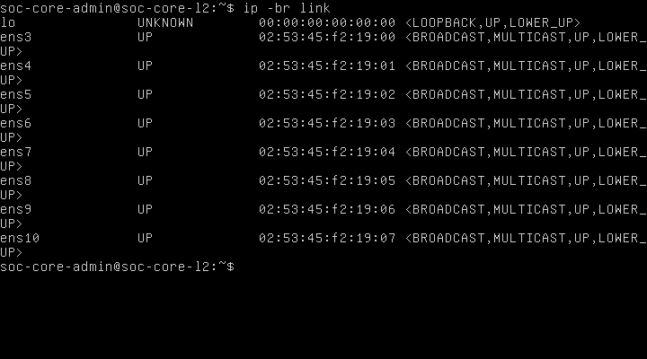
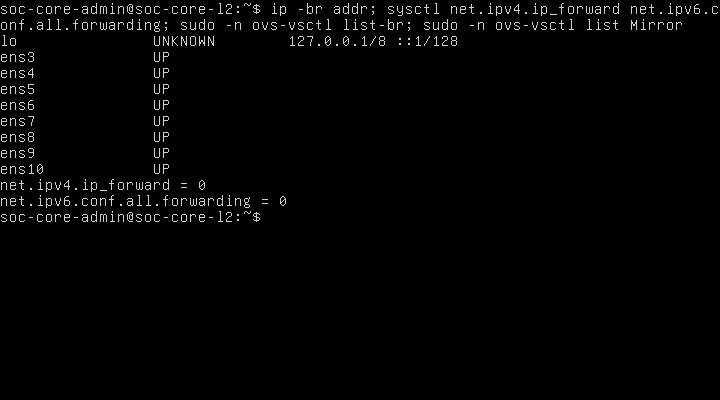

## 2.21. Xác minh ánh xạ cổng sau cài Open vSwitch

### 2.21.1. Phạm vi và nguồn dữ liệu

Ngày kiểm tra: 01/11/2026, múi giờ UTC+07:00. Chỉ thực hiện kiểm kê EVE qua SSH, đọc tiến trình QEMU, XML các lab, TAP, tài nguyên và chạy lệnh chẩn đoán trên console guest đã đăng nhập. Không tạo bridge, sửa VLAN, nối link, thay firewall/NAT, thay vòng đời node, sửa image hoặc seed. Báo cáo M2-report-ovs-offline-installed-20261101.docx đã được đọc trực tiếp từ XML bên trong DOCX; nội dung OVS 3.3.9 và giới hạn nghiệm thu được giữ nguyên. CSV mapping cũ là đầu vào đối chiếu, không được ghi đè.

Snapshot host thu từ 00:14:02 đến 00:14:09 UTC+07:00; ảnh guest NIC từ 00:14:43 đến 00:14:49; ảnh trạng thái Layer 2 từ 00:15:23 đến 00:15:35. Dùng thời gian bộ thu Windows; đồng hồ guest/EVE không thay thời điểm thu thập. Log và ảnh nằm tại docs/evidence/M2/port-design-20261101T001402+0700/.

### 2.21.2. Kết quả kiểm chứng

Tiến trình QEMU thực tế PID 13455, UUID 2b295168-b72e-4de7-b364-37298252dd9f, tên SOC-Core-L2, cấu hình 1 vCPU/2048 MiB/8 VirtIO NIC. Với mỗi đối số device, đã ghép netdev với backend TAP và so MAC với ảnh ip -br link mới. Tám dòng khớp bảng CSV trước, không có MAC trùng. Tên ens3–ens10 được xác nhận bằng console, không suy đoán từ số thứ tự.



**Hình 2.18. Đối chiếu tám giao diện Ubuntu và MAC thực tế sau cài OVS**

Mục đích là xác nhận mapping vẫn đúng ở thời điểm thiết kế mạng. Nội dung hình thể hiện ip -br link với ens3–ens10 và tám MAC. Kết quả khớp MAC trong tiến trình QEMU và mapping đã lưu. Ý nghĩa là có thể đề xuất vai trò trên các NIC đã nhận dạng, nhưng chưa chứng minh peer hoặc các VLAN đã hoạt động.

| QEMU backend | TAP thực tế trên EVE | NIC Ubuntu | MAC thực tế | Vai trò dự kiến | Peer hiện tại |
|---|---|---|---|---|---|
| net0 | vunl0_3_0 | ens3 | 02:53:45:f2:19:00 | Access VLAN 30 — Data Center | Chưa nối |
| net1 | vunl0_3_1 | ens4 | 02:53:45:f2:19:01 | Access VLAN 40 — Employee | Chưa nối |
| net2 | vunl0_3_2 | ens5 | 02:53:45:f2:19:02 | Access VLAN 50 — Guest | Chưa nối |
| net3 | vunl0_3_3 | ens6 | 02:53:45:f2:19:03 | Access VLAN 60 — DMZ | Chưa nối |
| net4 | vunl0_3_4 | ens7 | 02:53:45:f2:19:04 | Access VLAN 99 — Management | Chưa nối |
| net5 | vunl0_3_5 | ens8 | 02:53:45:f2:19:05 | Trunk riêng tới OPNsense Primary LAN | Chưa có peer trong EVE |
| net6 | vunl0_3_6 | ens9 | 02:53:45:f2:19:06 | Trunk riêng tới OPNsense Secondary LAN | Chưa có peer trong EVE |
| net7 | vunl0_3_7 | ens10 | 02:53:45:f2:19:07 | Mirror output tới Suricata capture | Chưa có peer trong EVE |

Các cột backend/TAP/NIC/MAC là dữ liệu đã xác minh; cột vai trò là đề xuất chưa áp dụng. XML node chưa có interface nối network nên chưa gắn nhãn e0–e7 như tên cổng GUI đã kiểm chứng. Khi được phép nối link, cần mở GUI và đối chiếu lại tên cổng EVE với đúng MAC/index QEMU; không chọn theo vị trí biểu tượng hoặc thứ tự hiển thị đơn thuần.

### 2.21.3. Kết nối và trạng thái Layer 2 hiện tại

Lab SOC-M2-Core-L2 chỉ có node ID 3; không có network object, không có interface/network_id nối topology. Tám TAP vunl0_3_0–vunl0_3_7 đều tồn tại và không có bridge master trong ip -j link trên EVE. Cờ UP/LOWER_UP của vNIC chỉ phản ánh thiết bị ảo; không chứng minh đã có peer hoặc kết nối VLAN/Internet.



**Hình 2.19. Trạng thái địa chỉ, forwarding và OVS trước thiết kế kết nối**

Mục đích là xác định đường cơ sở trước thay đổi mạng. Nội dung gồm ip -br addr, hai sysctl forwarding, ovs-vsctl list-br và ovs-vsctl list Mirror. Tám NIC không hiển thị địa chỉ IP; net.ipv4.ip_forward=0 và net.ipv6.conf.all.forwarding=0; hai truy vấn OVS không trả bản ghi. Kết quả phù hợp mô hình Core chưa có bridge/mirror và không chuyển tiếp IP. Ý nghĩa là các cấu hình sau đây phải được xem là dự kiến; không dùng kết quả OVS đã cài thay cho kết quả VLAN/trunk.

## 2.22. Thiết kế bridge trung tâm và chính sách VLAN dự kiến

### 2.22.1. Bridge và các cổng

Đề xuất một bridge br-core-l2, datapath system, chuyển mạch NORMAL ở chế độ standalone và không dùng OpenFlow controller trong phạm vi M2. Năm access port có vlan_mode=access với tag lần lượt 30,40,50,60,99. Endpoint trên access gửi/nhận Ethernet không gắn thẻ VLAN; tag là thuộc tính phân loại trong OVS, không phải yêu cầu endpoint tự gắn thẻ. Hai port ens8 và ens9 là vlan_mode=trunk, trunks=30,40,50,60,99, không gán native VLAN và không gộp LACP. Cấu hình và phép thử tag phải được đánh giá theo normal switching; flow tùy biến có thể làm thay đổi đường xử lý. [OVS VLAN FAQ](https://docs.openvswitch.org/en/stable/faq/vlan/).

Trong thiết kế tagged-only, không đưa VLAN 0 vào danh sách trunk; frame untagged trên trunk không được dùng như một mạng native. Cần kiểm thử riêng frame untagged, priority-tag VLAN 0, VLAN ngoài danh sách và frame gắn tag không phù hợp trên access. OVS có thể xử lý priority-tag khác frame có VID khác 0; không mô tả chính sách thành câu tuyệt đối “mọi frame có thẻ trên access đều bị chặn” khi chưa thử. [Mô tả Port của OVS 3.3](https://raw.githubusercontent.com/openvswitch/ovs/branch-3.3/vswitchd/vswitch.xml).

Bridge tạo thêm một interface nội bộ cùng tên br-core-l2; đây không phải vNIC thứ chín. Đề xuất local Port br-core-l2 thuộc access VLAN 99 để tránh mặc định VLAN 0, nhưng chưa gán IP, route, DHCP client hoặc gateway cho interface này. Địa chỉ quản trị Core nếu cần sẽ được chốt ở một thay đổi riêng, thuộc VLAN 99, không làm gateway cho các VLAN người dùng. Chưa thay netplan/systemd-networkd/NetworkManager; phải kiểm tra trình quản lý NIC và phương án duy trì sau reboot trước khi triển khai.

### 2.22.2. Mirror/SPAN dành cho Suricata

Đề xuất ens10 chỉ làm output_port của một Mirror tên span-suricata. Chọn ingress của cả ens3–ens9, select_vlan=30,40,50,60,99, select_all=false và không chọn select_dst_port. Chính sách này quan sát frame vào Core từ các vùng và cả hai firewall; lưu lượng do chính host Core sinh ra không thuộc phạm vi ingress bảy cổng đó. Đây là đề xuất hướng mirror cụ thể, thay cho ví dụ select-all ở mục 2.19 trước; chưa tạo Mirror trong hệ thống.

output_port là cổng giám sát dành riêng: không dùng làm endpoint thông thường hoặc NIC quản trị; frame gửi ngược từ sensor vào cổng này bị bỏ theo cơ chế mirror OVS. Việc OVS tránh sao chép cùng một lần vào bridge nhiều lần tới cùng đích không đồng nghĩa một phiên liên VLAN chỉ có một bản tin quan sát: gói đi qua firewall rồi quay lại Core là một lần vào khác. Không kết luận giữ nguyên/tự bổ sung mọi thẻ VLAN trên bản sao trước khi capture kiểm chứng. [Mô tả Mirror của OVS 3.3](https://raw.githubusercontent.com/openvswitch/ovs/branch-3.3/vswitchd/vswitch.xml).

Suricata dự kiến có ít nhất hai NIC: capture nhận ens10 không đặt IP/gateway và NIC quản trị đi riêng về segment Management VLAN 99; cần xác minh MAC/tên NIC của sensor trước khi nối. Với bản sao lưu lượng, Suricata hoạt động như IDS thụ động; không coi đây là IPS inline. [Tài liệu Suricata](https://docs.suricata.io/en/latest/what-is-suricata.html).

### 2.22.3. Mẫu cấu hình để xem xét, chưa thực thi

Tệp M2-ovs-config-PROPOSED-20261101.txt chứa một giao dịch mẫu cho bridge, tám port và Mirror. Đây là tài liệu thiết kế, không phải script đã chạy. Chỉ áp dụng sau phê duyệt, kiểm tra MAC/peer và xác nhận OVS vẫn chưa có bridge cùng tên; mẫu cố ý không dùng may-exist để không âm thầm sửa cấu hình đã có. Thêm ens10 và gắn vai trò output mirror trong cùng giao dịch nhằm tránh giai đoạn port capture trở thành port chuyển tiếp thông thường. Giao dịch OVSDB không làm cho thao tác nối link EVE, bật interface hoặc cấu hình firewall trở thành nguyên tử; cần kiểm tra từng lớp riêng.

Mẫu không bật IP forwarding, không gán IP/subnet và không chứa rule firewall/NAT. Sau phê duyệt cần sao lưu DB OVS vào vị trí root-only bên trong guest, ghi cấu hình đọc lại và dùng console làm đường phục hồi. Trước kết nối mạng phải kiểm tra bridge/port/datapath không lỗi, trạng thái link, cấu hình quản lý mạng và IPv4/IPv6 forwarding vẫn 0. Thiết kế một Core với các peer định tuyến không tạo vòng Layer 2; không nối thêm đường bridge trên firewall hoặc vòng ngoài. STP/RSTP và chính sách phòng vòng phải được duyệt lại nếu topology thay đổi.

## 2.23. Sơ đồ kết nối dự kiến và vai trò gateway

### 2.23.1. Các segment trên EVE

```text
Data Center (VLAN 30, untagged) -------- ens3 --+
Employee    (VLAN 40, untagged) -------- ens4 --+
Guest       (VLAN 50, untagged) -------- ens5 --+
DMZ         (VLAN 60, untagged) -------- ens6 --+-- br-core-l2
Management  (VLAN 99, untagged) -------- ens7 --+       |
OPNsense Primary LAN (802.1Q 30/40/50/60/99) -- ens8 --+
OPNsense Secondary LAN (802.1Q 30/40/50/60/99) - ens9 --+
Suricata capture <----- mirror only -------- ens10 --+

OPNsense Primary SYNC <---- segment rieng ----> Secondary SYNC
WAN firewall: thiet ke rieng, khong noi vao access/capture Core
Suricata management ----> Management VLAN 99 (NIC rieng)
```

Sơ đồ là thiết kế, không phải ảnh topology EVE thực tế. Dự kiến cần tám segment cách ly cho tám cổng Core: năm segment endpoint untagged, hai segment trunk riêng và một segment capture chỉ nối Core với sensor. Mỗi đường trunk phải là segment riêng cho đúng hai đầu; không đặt ens8 và ens9 vào cùng một bridge ngoài EVE rồi lại nối cả hai vào cùng OVS. Mạng SYNC/WAN không tiêu tốn thêm cổng Core trong phương án này và cần tài nguyên/cổng trên firewall riêng. Nhãn và network_id thực tế chưa tạo, cổng LAN/SYNC/WAN của firewall và capture/management của sensor chưa có mapping.

Nhiều endpoint đặt cùng một segment EVE có thể trao đổi ngay trên segment ngoài Core; mirror OVS không quan sát được đường đó. Với yêu cầu quan sát mọi lưu lượng cùng VLAN, phải thiết kế topology buộc frame đi qua OVS bằng các cổng/peer VLAN-aware riêng hoặc bổ sung access switch có cơ chế giám sát thích hợp. Không dùng hai endpoint cùng một EVE bridge ngoài Core để tuyên bố đã nghiệm thu OVS switching hoặc mirror east-west.

### 2.23.2. Gateway và HA

Mỗi VLAN dự kiến có một CARP VIP làm default gateway trên cặp OPNsense. Primary/Secondary có địa chỉ riêng, cùng VLAN/subnet; CARP quyết định máy đang giữ VIP, pfsync đồng bộ trạng thái kết nối và cơ chế đồng bộ cấu hình là phần riêng. Hai trunk nối hai firewall độc lập; không bond/LACP xuyên cặp firewall. [OPNsense CARP](https://docs.opnsense.org/manual/how-tos/carp.html).

Core chỉ chuyển frame theo MAC/VLAN. Luồng cùng VLAN đi qua Layer 2; luồng khác VLAN phải đi tới gateway OPNsense, chịu firewall rules rồi quay lại trunk tương ứng. NAT chỉ xử lý tại firewall theo thiết kế WAN sau này. Địa chỉ 192.168.<VLAN>.1 cho VIP, .2/.3 cho hai firewall và 192.168.99.10 cho Core trong M1 chỉ là ví dụ, chưa được kiểm chứng và chưa được đưa vào cấu hình. Không tạo SVI/gateway hoặc route liên VLAN trên Ubuntu.

## 2.24. Khả năng triển khai với tài nguyên hiện có

### 2.24.1. Số đo và kiểm kê

| Hạng mục | Số liệu thực tế | Đánh giá |
|---|---|---|
| Windows | 2.220 GiB khả dụng trên khoảng 15.71 GiB RAM nhìn thấy; 12 logical processor | Headroom nhỏ; chưa đủ căn cứ bật thêm nhiều VM |
| EVE | 7897 MiB tổng, 5602 MiB available; swap dùng 0/4095 MiB | Khoảng 5.47 GiB available; không thay số RAM khả dụng của Windows |
| EVE CPU | 4 CPU; load 0.49/0.47/0.59; mẫu vmstat ngắn idle 97%, không swap-in/out | Phù hợp kiểm tra hiện tại, chưa chứng minh tải mirror/IDS |
| Đĩa EVE | / và /opt/unetlab cùng filesystem, còn khoảng 40 GiB | Không cộng hai dòng df thành 80 GiB |
| Core | Một QEMU đang chạy; RAM khai báo 2048 MiB, RSS khoảng 1053 MiB | RSS tức thời không phải mức RAM tối đa |
| Ubuntu-Test và Ubuntu-Console-Test | Hai node ở lab khác, mỗi node 1 vCPU/2048 MiB/1 NIC; không có QEMU tương ứng trong lần kiểm kê | Chưa có hai guest đang chạy để thử ngay; không tự khởi động, chuyển lab hoặc tái cấu hình |
| R1 ở M2_Core_L3 | Node IOL/router nối network kiểu pnet1 tên Link_OPNsense | Tên network không chứng minh có OPNsense; chưa xác minh vận hành IOL, không tái dùng router này làm Core L2 |
| Image QEMU | Chỉ thấy ba thư mục Ubuntu trong /opt/unetlab/addons/qemu | Không thấy image OPNsense/Suricata trong phạm vi kho đã quét |
| VPCS | Binary /opt/vpcsu/bin/vpcs hiện mode 777 root:root | Chưa có node VPCS dùng cho đợt thử; chưa đánh giá quyền hoặc thay quyền |

Giá trị RAM Windows từ mẫu 00:14:09 UTC+07:00. Không suy ra không có firewall/VM ở mọi nơi khác trên Windows từ kiểm kê EVE; các VM VMware ngoài EVE không được khảo sát trong nhiệm vụ này. Không coi pnet1 trong một lab khác là đường kết nối đã xác nhận của SOC-Core-L2.

### 2.24.2. Các mức khả thi và điều kiện thiếu

| Mức triển khai dự kiến | Điều kiện tối thiểu cần bổ sung | Kết luận hiện tại |
|---|---|---|
| Tạo cấu hình Core cô lập, chưa link | Phê duyệt mapping, giao dịch mẫu, backup DB, kiểm tra quản lý NIC và đường console | Có thể chuẩn bị kỹ thuật; chưa được phép thực thi |
| Thử switching/VLAN cơ bản | Ít nhất hai endpoint có khả năng gửi/capture 802.1Q trên hai cổng độc lập; đo lại RAM trước boot | Chưa sẵn sàng; hiện chỉ Core chạy |
| Thử mirror bằng capture | Một capture peer riêng và công cụ capture đã có, hoặc cảm biến có NIC capture + management; nguồn phát và đích độc lập | Chưa có sensor/capture peer đã xác minh |
| Thử đủ hai firewall HA | Hai image/node OPNsense, mapping LAN/WAN/SYNC, VIP/subnet, mạng SYNC/WAN và tài nguyên phù hợp | Chưa có node/image trong EVE; chưa khả thi với ngân sách hiện tại |
| Thử Suricata thật | Image/node, bộ quy tắc, hai NIC và ngân sách tài nguyên theo lưu lượng kiểm thử | Chưa có; không thay bằng ảnh hoặc kết quả giả |

OPNsense công bố tối thiểu 3 GB RAM mỗi VM. Để lập ngân sách bảo thủ dùng 3072 MiB mỗi firewall: cặp firewall cần 6144 MiB, lớn hơn 5602 MiB available hiện tại; Core 2048 MiB cộng cặp này thành 8192 MiB, vượt tổng EVE 7897 MiB trước cả overhead host, sensor và endpoints. Vì vậy không đề xuất bật cặp HA trong EVE hiện tại. [Yêu cầu VM OPNsense](https://docs.opnsense.org/manual/virtuals.html).

Đề xuất lập ngân sách mới theo công thức Core + hai firewall + sensor + các endpoint hoạt động đồng thời + overhead host; không lấy “12 GB” hoặc “16 GB” làm bảo đảm hiệu năng khi chưa chốt image/tải. Windows chỉ còn khoảng 2.22 GiB nên mọi phương án tăng RAM EVE cũng cần đánh giá host và phê duyệt riêng. Với M2 nhỏ nên chạy từng nhóm thử, ưu tiên endpoint hỗ trợ VLAN/capture có RAM thấp đã được chọn và kiểm chứng. Không tự tạo helper VM, không coi bản Ubuntu hiện có đã cài tcpdump/Scapy hay có nhiều NIC. Nếu cần dùng hai Ubuntu cũ phải xin phép tái sử dụng và có kế hoạch giữ dữ liệu, lab và nối mạng riêng.

## 2.25. Kế hoạch kiểm thử chi tiết sau phê duyệt

### 2.25.1. Nguyên tắc đo

Tất cả bài thử dưới đây **chưa thực hiện**. Dùng địa chỉ/MAC thử được chốt riêng; không tự dùng IP M1 làm dữ liệu thật. Trước mỗi nhóm đo lại tài nguyên, ghi MAC/interface/peer/network_id, cấu hình đọc lại, pcap đầu nguồn/đích và thời gian UTC+07:00. Ping thành công chỉ là một chỉ báo; cần MAC table, counter và capture để chứng minh frame đã đi qua OVS. Có bài đối chứng dương trên cùng VLAN trước khi diễn giải timeout là cách ly đúng; loại trừ lỗi endpoint firewall/routing hoặc phát gói không thành công.

| ID / nội dung | Điều kiện và thao tác dự kiến | Kết quả kỳ vọng / minh chứng | Trạng thái |
|---|---|---|---|
| T00 — Đường cơ sở | Đọc ip -br link/addr, QEMU/TAP, list-br/Mirror, forwarding, tài nguyên; so MAC trước tác động | Đúng tám MAC; không bridge/mirror ban đầu; forwarding=0; ảnh và JSON | Đã có đường cơ sở; phải đọc lại ngay trước triển khai |
| T01 — Tạo bridge cô lập | Sau phê duyệt, backup DB root-only; áp dụng giao dịch chỉ trong guest, chưa nối link | Đúng một bridge, tám port vật lý và local port; Interface.error rỗng, ofport hợp lệ; list Port/Mirror và show | Chưa thực hiện |
| T02 — Mapping peer | Sau phê duyệt nối từng link; đối chiếu MAC cả hai đầu, EVE network_id và capture khung đánh dấu | Đúng cổng nguồn/đích; không nhầm trunk hoặc mirror; ảnh GUI và bảng đủ peer | Chưa thực hiện |
| T03 — Access 5 VLAN | Với từng access, endpoint A gửi untagged; endpoint B trên trunk độc lập tạo VLAN tương ứng; gửi gói thử giới hạn | Chuyển đúng VLAN, access egress untagged, trunk egress đúng VID; FDB/counter/pcap | Chưa thực hiện |
| T04 — Hai access cùng VLAN | Cần port thử thứ hai đã duyệt hoặc VLAN-aware peer độc lập; không nối cả hai endpoint chung EVE bridge để bypass Core | Giao tiếp cùng VLAN qua hai cổng OVS và FDB học đúng; không suy ra từ bypass | Chưa thực hiện; 5 access cuối cùng mỗi VLAN chỉ có 1 cổng |
| T05 — Cách ly VLAN | Sau đối chứng T03, gửi frame unicast/broadcast nhận dạng giữa hai VLAN khác nhau khi chưa có router peer | Không rò frame sang VLAN kia; pcap bên nhận và counter bên gửi; timeout đơn lẻ không đủ | Chưa thực hiện |
| T06 — Allowed trunk | Lần lượt phát VID 30/40/50/60/99 trên từng trunk và đối chiếu access | Đúng phân loại cả 5 VID trên cả 2 trunk; không mất tag ngoài chính sách | Chưa thực hiện |
| T07 — Trunk âm tính | Endpoint có khả năng tạo frame phát untagged, VID 0 và VID ngoài danh sách, ví dụ 10 đã duyệt | Không chuyển vào 5 VLAN cho trunk tagged-only; capture chứng minh frame đã phát trước khi kết luận drop | Chưa thực hiện |
| T08 — Access âm tính | Phát frame có VID khác 0 trên access, gồm VID đúng/sai và ca priority-tag VID 0 riêng | Không VLAN hopping; ghi hành vi thực tế VID 0, không nhập nhằng với VID thông thường | Chưa thực hiện |
| T09 — Hai trunk độc lập | Kiểm tra Port ens8/ens9 chỉ có một Interface, không Bond; thử từng đường với peer VLAN-aware | Từng trunk chuyển đúng VLAN; hai firewall là peer riêng; không LACP xuyên HA | Chưa thực hiện |
| T10 — Mirror ingress | Phát số gói nhỏ có dấu nhận dạng từ mỗi ens3–ens9; capture ens10, so counter Mirror | Đúng phạm vi ingress/VLAN và đủ hai hướng phiên từ các port khác nhau; ghi tag thật trên bản sao | Chưa thực hiện |
| T11 — Capture chuyên dụng | Từ sensor phát gói đánh dấu ngược qua ens10; đồng thời duy trì đối chứng lưu lượng hợp lệ | Gói từ output mirror không đi vào VLAN/forwarding; NIC quản trị sensor độc lập; pcap hai phía | Chưa thực hiện |
| T12 — Gateway liên VLAN | Khi có OPNsense và rules đã duyệt, ping/flow giữa hai VLAN với gateway VIP; thử allow và deny rõ ràng | Khác VLAN chỉ qua firewall; capture hai trunk, firewall log và route endpoint; Core forwarding vẫn 0 | Chưa thực hiện; thuộc tích hợp M3 |
| T13 — CARP/pfsync/failover | Cần cặp HA, tài nguyên và phê duyệt thao tác gây failover; ghi MASTER/BACKUP, trạng thái kết nối và VIP | VIP đổi chủ đúng, trạng thái được đồng bộ, đo gián đoạn và mirror trên đường Secondary; không khẳng định mất gói bằng 0 trước đo | Chưa thực hiện; không dừng node trong phiên này |
| T14 — Mất gói/hiệu năng mirror | Sau thử chức năng, tăng tải từng nấc có giới hạn; theo dõi CPU/RAM, interface/capture/Suricata drop | Báo tỷ lệ loss và mức tải đo được; chưa đặt SLA khi không có dữ liệu; không gây cạn RAM | Chưa thực hiện |
| T15 — Duy trì/khôi phục | Sau phê duyệt riêng, kiểm tra DB/port sau restart và kế hoạch hoàn nguyên khi mạng lỗi | Cấu hình, mapping và forwarding đúng sau restart; console phục hồi và bản backup có thể sử dụng | Chưa thực hiện; chưa restart |

### 2.25.2. Lệnh đọc lại và tệp kết quả dự kiến

```sh
sudo ovs-vsctl show
sudo ovs-vsctl --columns=name,vlan_mode,tag,trunks list Port
sudo ovs-vsctl --columns=name,ofport,error list Interface
sudo ovs-vsctl --columns=name,select_all,select_src_port,select_dst_port,select_vlan,output_port,statistics list Mirror
sudo ovs-appctl fdb/show br-core-l2
sudo ovs-ofctl dump-ports br-core-l2
ip -br addr
sysctl net.ipv4.ip_forward net.ipv6.conf.all.forwarding
```

Đây là danh mục kiểm tra dự kiến, không phải output đã có của bridge chưa tạo. Trên endpoint/sensor đã xác minh có tcpdump có thể dùng tcpdump -eni <NIC> -c <SO_GOI> -w <PCAP> để ghi frame có giới hạn; dùng capture hiển thị VID và MAC tương ứng. Không cài công cụ capture hoặc sửa offload trong phiên này. Nếu capture bị ảnh hưởng offload cần ghi giới hạn và trình thay đổi riêng, không sửa thầm để làm đẹp kết quả.

Tệp dự kiến cho mỗi test: Txx-<ten>-<UTC+0700>.log, Txx-<nguon>.pcap, Txx-<dich>.pcap và ảnh console/topology thật. Bảng kết quả phải có thời điểm, cấu hình/đường truyền, số gói gửi/nhận, tiêu chí đạt, kết luận đạt/chưa đạt và lỗi tồn tại. Tệp chưa tạo không được liệt kê là minh chứng đã thu.

## 2.26. Rủi ro và bước triển khai đầu tiên đề xuất

### 2.26.1. Rủi ro cần kiểm soát

| Rủi ro cụ thể | Hệ quả | Điều kiện kiểm soát trước/sau phê duyệt |
|---|---|---|
| Nhầm tên cổng EVE/peer hoặc đổi MAC sau clone/restart | VLAN hoặc capture nối sai vùng | Giữ bảng MAC; ghi tên cổng GUI, network_id và MAC peer thật ngay trước nối |
| Core đơn | Điểm lỗi đơn của mọi VLAN đi qua nó | Ghi giới hạn sẵn sàng; HA firewall không khắc phục lỗi Core |
| Vòng Layer 2 ngoài Core | Broadcast storm và MAC flapping | Hai segment trunk riêng, SYNC riêng; không bridge hai LAN firewall hoặc tạo vòng ngoài; duyệt lại STP/RSTP nếu đổi topology |
| Native VLAN/tag sai hoặc flow tùy biến | Rò VLAN hoặc mất kết nối | Chốt tagged-only; kiểm thử T03/T05/T07/T08, không suy từ ping một ca |
| Chọn sensor capture làm NIC quản trị | Mất quản trị hoặc hiểu sai dữ liệu mirror | Hai NIC sensor, ens10 chỉ output mirror; quản trị qua VLAN 99 riêng |
| Lưu lượng ngoài đường OVS | Thiếu quan sát east-west trên segment EVE dùng chung | Buộc đường cần quan sát qua cổng OVS; đánh dấu phạm vi không quan sát |
| Mirror tổng hợp nhiều cổng/cả hai phía firewall | Quá tải capture, nhiều lần quan sát cùng phiên hoặc sai giả định tag | Dùng phạm vi ingress đã chốt; đo counter/pcap/loss; phân biệt gói tái vào sau định tuyến |
| RAM Windows/EVE ít và sensor/HA chưa có | Swap, treo host, sai kết quả tải | Chia đợt thử; đo cả host lẫn EVE; lập ngân sách trước boot, không tự dừng VM |
| Quản lý NIC/khởi động chưa kiểm tra | Sau reboot mất cổng hoặc tự có địa chỉ/route | Đọc cấu hình quản lý mạng và thử persistence trong đợt được duyệt riêng |
| Cảnh báo OVS_CTL_OPTS của lần cài trước | Gây nhầm cảnh báo với lỗi daemon | Giữ log gốc; đọc trạng thái daemon trước triển khai, không sửa unit khi chỉ thiết kế |

### 2.26.2. Bước đầu tiên sau khi được phê duyệt

Đề xuất bước đầu chỉ cấu hình Core cô lập: đọc lại MAC/tài nguyên/trạng thái, xác nhận không có bridge cùng tên, sao lưu OVSDB root-only, áp dụng một giao dịch tạo br-core-l2 + 5 access + 2 trunk + mirror ens10 theo mẫu; chưa nối link, chưa bật VM khác, chưa gán IP hoặc đổi firewall/NAT. Kiểm tra T01 qua console, chụp ảnh cấu hình đọc lại, ghi lỗi/rollback nếu có. Việc bật interface, xử lý quản lý mạng, nối link và bổ sung peer phải nằm trong phạm vi được duyệt cụ thể tiếp theo; không suy ra quyền từ việc duyệt tài liệu.

Hiện chưa đề nghị triển khai toàn bộ topology HA vì thiếu hai firewall, cảm biến, mapping peer và ngân sách tài nguyên. Trước đợt thử chức năng cần chốt lựa chọn endpoint VLAN-aware/capture, nơi đặt node, image hợp lệ, số NIC và cổng peer, địa chỉ thử, chính sách firewall và tài nguyên. Toàn bộ công việc của phiên này dừng ở kiểm chứng chỉ đọc và tài liệu thiết kế.

## 2.27. Danh mục minh chứng và giới hạn công cụ

Danh mục CSV/Markdown, mapping có cột trạng thái riêng và SHA-256 được lưu trong thư mục evidence của phiên. Ảnh Hình 2.18–2.19 là framebuffer console QEMU thật; sơ đồ ở mục 2.23 là bản thiết kế, không phải ảnh chụp EVE. Chưa có công cụ điều khiển trình duyệt EVE để chụp GUI topology trong phiên này.

Hướng dẫn bổ sung ảnh thủ công: mở giao diện EVE-NG, vào lab SOC-M2-Core-L2; không sửa node/link hoặc bấm start/stop. Hiển thị tên lab, node SOC-Core-L2 và toàn bộ canvas để thấy chưa có peer/link. Dùng Win+Shift+S chụp rõ, không cắt mất nhãn, lưu docs/evidence/M2/port-design-20261101T001402+0700/M2-topology-current-<thoi-diem-UTC+0700>.png; ghi giờ thực tế và múi giờ. Khi nối link sau phê duyệt, chụp lại canvas và màn hình cổng hai đầu, không dùng hình thiết kế thay minh chứng. Các ảnh GUI này hiện chưa có.

Các thuật ngữ SOC, VLAN, 802.1Q, access/trunk, LACP, SPAN/port mirroring, OVS/bridge, QEMU/QCOW2, cloud-init/NoCloud, SSH, OPNsense/CARP/pfsync/HA, NAT/DHCP, IDS/IPS, Suricata và Wazuh đã được giải thích ở mục 2.20 và giữ nguyên trong bản báo cáo tích hợp. Những ví dụ ở chương thiết kế này vẫn chưa được triển khai.
