# CHƯƠNG 2. CORE LAYER 2 BẰNG UBUNTU VÀ OPEN vSWITCH

## 2.1. Mục tiêu, phạm vi và trạng thái mới nhất

Bản hợp nhất phục vụ rà soát trước hạn nộp 05/11/2026, lập ngày 01/11/2026 (UTC+07:00). Báo cáo này tổ chức lại các kết quả quan trọng từ ba mốc cài OVS, xác minh mapping và cấu hình bridge cô lập; giữ nguyên báo cáo cũ làm lịch sử. Không trình bày đề xuất như kết quả triển khai.

Đã kiểm chứng khi Core chạy lúc 01:03–01:13: cài offline OVS 3.3.9, br-core-l2, năm access và hai trunk, không IP/gateway, forwarding 0/0. Chưa thử lưu lượng, SPAN, persistence hoặc HA. Kiểm kê mới lúc 07:57–07:58: không QEMU chạy, lab Core vẫn một node/không network/link. Vì vậy các bảng runtime là kết quả của mốc đã thu, không khẳng định daemon đang active khi node tắt.

Người dùng hiện học Labtainer và yêu cầu chế độ nhẹ: giữ VM SOC tắt, không thay EVE/VMware/Windows/Labtainer, không tải OPNsense, không chạy bài thử. Chỉ tiếp tục máy ảo sau khi người dùng xác nhận tài nguyên sẵn sàng. Đã hoàn thành tài liệu và chuẩn bị script không đồng nghĩa hoàn tất nghiệm thu chuyển mạch M2.

## 2.2. Kiến trúc và vai trò trong SOC

Core Ubuntu cung cấp chuyển mạch Ethernet Layer 2, phân chia vùng bằng VLAN và dự kiến sao chép lưu lượng cho cảm biến. OPNsense đảm nhiệm gateway, định tuyến liên VLAN, firewall rules và NAT; client dùng CARP VIP khi cặp HA thực sự triển khai. Core không được gán IP quản trị hay địa chỉ gateway. Suricata nhận mirror là IDS thụ động; Wazuh là thành phần phân tích/thu thập an ninh dự kiến, chưa có bằng chứng tích hợp.

```text
THIẾT KẾ KẾT NỐI — CÁC PEER VÀ LINK CHƯA ĐƯỢC TẠO
Data Center VLAN30 ------- ens3 --+
Employee    VLAN40 ------- ens4 --+
Guest       VLAN50 ------- ens5 --+
DMZ         VLAN60 ------- ens6 --+-- br-core-l2 (đã cấu hình ở mốc trước)
Management  VLAN99 ------- ens7 --+
OPNsense Primary LAN ----- ens8 --+   trunk 30,40,50,60,99
OPNsense Secondary LAN --- ens9 --+   trunk 30,40,50,60,99
Suricata capture <-------- ens10 -+   mirror dự kiến; hiện ngoài OVS

Primary SYNC <------ segment riêng ------> Secondary SYNC
WAN hai firewall: thiết kế riêng, chưa nối mạng host hoặc mạng thật.
```

Hai trunk phải ở hai segment độc lập, không bond/LACP xuyên hai firewall. Cổng capture không bridge sang mạng khác. Khi chưa có gateway, Core không tự chuyển frame giữa VLAN 30 và VLAN 40. Một Core đơn vẫn là điểm lỗi đơn; thiết kế hai firewall không tự giải quyết lỗi Core.

## 2.3. Môi trường và cài Open vSwitch hoàn toàn offline

EVE-NG Community 6.2.0-4 tại 192.168.220.143, VMware Workstation trên Windows 11. Lab SOC-M2-Core-L2, node SOC-Core-L2 ID 3, UUID 2b295168-b72e-4de7-b364-37298252dd9f. Guest Ubuntu 24.04, một vCPU, 2048 MiB RAM, đĩa 8 GiB và tám vNIC VirtIO. Cloud-init đã hoàn tất; không chạy lại hoặc sửa seed NoCloud.

Bundle offline gồm 70 gói .deb, sáu chỉ mục được đối chiếu hash; ba chữ ký InRelease Ubuntu được xác minh. Gói openvswitch-switch/openvswitch-common/python3-openvswitch thuộc phiên bản 3.3.9-0ubuntu0.24.04.1. Bộ giải thực tế chỉ cần bảy gói mới, không đồng nghĩa đã cài toàn bộ 70 gói. Kho /opt/ovs-offline có dists/pool và các suite noble/noble-updates/noble-security; thao tác cài dùng nguồn file riêng, không dựa DNS/Internet guest.

Lỗi cũ gồm nguồn thiếu noble-updates, metadata phụ CNF/DEP-11 không có trong bundle và console nhập sai dấu sao. Đã sửa nguồn dành riêng cho lệnh offline, tắt lấy chỉ mục phụ không có và cài theo tên gói thay wildcard. Không sửa NAT/DNS/firewall để che lỗi. Lệnh và exit code chi tiết giữ trong minh chứng cài đặt cũ; không chạy lại cài phần mềm trong đợt tài liệu.

## 2.4. Mapping tám cổng theo MAC và trạng thái cấu hình

Mapping dưới đây được đối chiếu QEMU netdev/device, TAP EVE và MAC trong Ubuntu ở mốc runtime trước. TAP không có bridge master, lab không có peer/link; chưa có mapping cổng firewall/sensor. Số OpenFlow ofport cấp động không được suy ra từ ens hoặc net0; cần đọc lại sau boot.

| QEMU | TAP EVE | Ubuntu / MAC | Cấu hình đã kiểm chứng | Peer dự kiến / trạng thái hiện nay |
|---|---|---|---|---|
| net0 | vunl0_3_0 | ens3 / 02:53:45:f2:19:00 | Access VLAN 30 | Data Center; chưa nối |
| net1 | vunl0_3_1 | ens4 / 02:53:45:f2:19:01 | Access VLAN 40 | Employee; chưa nối |
| net2 | vunl0_3_2 | ens5 / 02:53:45:f2:19:02 | Access VLAN 50 | Guest; chưa nối |
| net3 | vunl0_3_3 | ens6 / 02:53:45:f2:19:03 | Access VLAN 60 | DMZ; chưa nối |
| net4 | vunl0_3_4 | ens7 / 02:53:45:f2:19:04 | Access VLAN 99 | Management; chưa nối |
| net5 | vunl0_3_5 | ens8 / 02:53:45:f2:19:05 | Trunk 30,40,50,60,99 | OPNsense Primary; chưa nối |
| net6 | vunl0_3_6 | ens9 / 02:53:45:f2:19:06 | Trunk 30,40,50,60,99 | OPNsense Secondary; chưa nối |
| net7 | vunl0_3_7 | ens10 / 02:53:45:f2:19:07 | Ngoài OVS, chưa Mirror | Suricata capture; chưa nối |

Local Port br-core-l2 là interface nội bộ thuộc access VLAN99, không phải vNIC thứ chín, không IP. Tám MAC không đổi trong lần cấu hình. Chưa tuyên bố peer, network_id hoặc carrier end-to-end khi chưa có kết nối.

## 2.5. Cấu hình bridge thực tế, sao lưu và xử lý lỗi

OVSDB schema 8.5.1 được backup online bằng ovsdb-client vào thư mục root-only trước giao dịch, kiểm tra schema và đọc/compact sang bản sao riêng. Không compact DB đang chạy và không ghi QCOW2. Snapshot đầu tiên /root/m2-isolated-20261101T0035/ovsdb.before dùng để trở về OVS rỗng; không dùng lại cho rollback giai đoạn mới đã có bridge.

Lần áp dụng đầu bị guard chặn vì kernel tạo route multicast IPv6 ff00::/8 trên bridge mới. Restore snapshot trả mã 0; link/address/route về baseline được đối chiếu. Sau đó chỉ tắt IPv6 host stack trên interface nội bộ mới, đặt addrgenmode none và bật bridge; không đổi forwarding hay IPv6 trên tám NIC cũ. Lần áp dụng thứ hai đạt kiểm tra tĩnh. Đây là lỗi và rollback thực tế, không xóa khỏi báo cáo. File failure.json còn trong minh chứng là lịch sử lần đầu, không phải kết quả cuối.

Giao dịch cấu hình năm access và hai trunk được giữ ở guest/applied-transaction.json cùng commands.jsonl. Không chạy lại mẫu cũ có cả mirror. Đọc lại ovs-vsctl show sau cấu hình cho kết quả nguyên văn:

```text
020cf56d-a904-4ee4-a1be-f5090b62b556
    Bridge br-core-l2
        fail_mode: standalone
        datapath_type: system
        Port br-core-l2
            tag: 99
            Interface br-core-l2
                type: internal
        Port ens7
            tag: 99
            Interface ens7
        Port ens6
            tag: 60
            Interface ens6
        Port ens9
            trunks: [30, 40, 50, 60, 99]
            Interface ens9
        Port ens5
            tag: 50
            Interface ens5
        Port ens3
            tag: 30
            Interface ens3
        Port ens4
            tag: 40
            Interface ens4
        Port ens8
            trunks: [30, 40, 50, 60, 99]
            Interface ens8
    ovs_version: "3.3.9"
```

Bridge dùng system datapath, standalone và NORMAL switching, không controller/bond/LACP. Interface.error rỗng, ofport hợp lệ. Bridge admin UP; operstate UNKNOWN của interface nội bộ và dòng ovs-system DOWN không tự chứng minh bridge lỗi. Datapath có đủ bảy cổng vật lý và local port. Counter frame ở mốc đó bằng 0, vì chưa có phát lưu lượng thử.

Trong đợt tăng tốc trước khi chuyển sang chế độ nhẹ, Core đã tắt nên sao lưu thêm overlay nguyên byte tại /root/m2-stopped-backup-20261101T075852Z/core-overlay.qcow2, 712310784 byte. Hash nguồn trước/sau và bản sao đều bằng:

```text
7a31bfb3a08d2c64bd8397b00290e419c277fb2a2359593df7a307a2f991df17
```

Không ghi đè image gốc, không sửa nguồn QCOW2, không khởi động guestfs/helper VM. Chưa thử restore overlay. Script backup ban đầu gặp tương thích hashlib.file_digest của Python trên EVE; đã đổi sang SHA-256 đọc từng khối và chạy lại thành công. Thư mục của lần dừng sớm được giữ nguyên, không xóa dữ liệu. Sau yêu cầu chế độ nhẹ không tiếp tục backup nặng hoặc thao tác EVE.

## 2.6. Nguyên lý chuyển mạch, VLAN và mirror

OVS là Open vSwitch, tên chính thức của bộ chuyển mạch phần mềm. ovsdb-server giữ cấu hình Bridge/Port/Interface/Mirror, ovs-vswitchd điều khiển datapath; datapath kernel chuyển frame. NORMAL switching học nguồn MAC theo VLAN để chọn cổng đích, flood broadcast/đích chưa biết trong cùng VLAN và áp dụng chính sách VLAN. FDB (Forwarding Database, cơ sở dữ liệu chuyển tiếp) và counter hỗ trợ giải thích đường gói nhưng phải kết hợp capture thật. [Giới thiệu OVS](https://docs.openvswitch.org/en/stable/intro/what-is-ovs/).

VLAN (Virtual Local Area Network, mạng cục bộ ảo) chia miền quảng bá. Access port phân loại frame endpoint không thẻ vào tag của port; egress access thường không mang thẻ. IEEE 802.1Q cung cấp thẻ bốn byte trong Ethernet, gồm TPID và TCI; phần VID nhận dạng VLAN. Trong thiết kế Core, trunk ens8/ens9 mang đúng 30/40/50/60/99, không native VLAN. Kiểm tra cột tag/trunks chỉ chứng minh cấu hình; cần phát/thu frame để xác minh thêm/bỏ thẻ và cách ly. [OVS VLAN FAQ](https://docs.openvswitch.org/en/stable/faq/vlan/).

SPAN (Switched Port Analyzer) là tên chức năng giám sát cổng thường gặp; OVS thực hiện port mirroring qua đối tượng Mirror. Thiết kế chọn ingress bảy port dữ liệu, giới hạn năm VLAN, select_dst_port rỗng và output_port ens10 dành riêng. Cổng mirror không làm NIC quản trị và không chuyển tiếp lưu lượng sensor gửi ngược như port dữ liệu thông thường. Chưa cấu hình hoặc capture ens10; tag trên bản sao, số bản sao và mất gói phải đo, không giả định. [OVS Basic Configuration](https://docs.openvswitch.org/en/stable/faq/configuration/).

Core vận chuyển và phân vùng lưu lượng của SOC; firewall quyết định quyền liên vùng. Mirror giúp sensor quan sát bản sao phục vụ phát hiện, nhưng không tạo quyền chặn gói gốc hoặc giải mã mọi lưu lượng. Chưa chạy Suricata, chưa có cảnh báo IDS/IPS hoặc tích hợp Wazuh được nghiệm thu.

## 2.7. Bảng kết quả thực tế và giới hạn nghiệm thu

| Hạng mục | Kết quả | Bằng chứng / giới hạn |
|---|---|---|
| OVS 3.3.9 và ba dịch vụ | PASS tại mốc chạy trước | Ảnh version/services và log cài; node hiện tắt |
| Mapping tám NIC | PASS ở runtime trước | CSV MAC QEMU/TAP/ens; cần đọc lại sau bật |
| Bridge, năm access, hai trunk | PASS cấu hình tĩnh/runtime trước | after.json, show, Port/Interface; không thay lưu lượng thật |
| Core không IP/gateway, forwarding 0/0 | PASS ở mốc cấu hình | ip/route/sysctl và ảnh; chưa kiểm tra sau reboot |
| Rollback lần tạo bridge đầu | PASS thực tế | attempt1-restored.json, rollback RC0, đối chiếu baseline |
| Backup overlay khi tắt | PASS toàn vẹn bản sao | stopped-backup.json; chưa kiểm thử restore |
| VLAN isolation/access/trunk/802.1Q bằng frame | NOT RUN | Chưa có PCAP hoặc kết quả truyền frame |
| Mirror ens10 | NOT CONFIGURED / NOT RUN | ens10 ngoài OVS ở mốc trước |
| Persistence và thử lại sau boot | NOT RUN | Không dùng trạng thái DB trước shutdown để kết luận |
| Gateway/CARP/pfsync/XMLRPC/firewall/NAT | NOT IMPLEMENTED | M3 còn thiết kế, chưa có image firewall trong kho đã kiểm kê |
| Topology GUI mới | MISSING | Có log lab một node/không link; không thay bằng sơ đồ thiết kế |

Không nghiệm thu chức năng chuyển mạch M2 toàn bộ khi chưa có frame thật. Không biến cảnh báo tài nguyên thành FAIL chức năng của OVS; ca bị chặn ghi NOT RUN/BLOCKED. Không khẳng định có ảnh topology hoặc capture chưa thu.

## 2.8. Thuật ngữ phục vụ giải thích hệ thống

| Thuật ngữ và nghĩa tiếng Việt | Nguyên lý hoạt động, vai trò và ví dụ trong đồ án |
|---|---|
| SOC — Security Operations Center; trung tâm điều hành an ninh mạng | Kết hợp con người, quy trình và công cụ để thu thập, phân tích và xử lý sự kiện. Dự kiến Core đưa lưu lượng tới cảm biến, Suricata phát hiện và Wazuh hỗ trợ phân tích tập trung. |
| OVS — Open vSwitch; tên chính thức của bộ chuyển mạch phần mềm | ovsdb-server giữ cấu hình, ovs-vswitchd điều khiển chuyển tiếp, datapath xử lý gói. Trong đồ án chỉ sử dụng chức năng Layer 2; đã tạo br-core-l2 ở mốc runtime trước; chưa nối peer hoặc thử frame. [1] |
| Bridge; cầu nối lớp liên kết | Học địa chỉ MAC và chuyển frame trong miền Layer 2, áp dụng phân tách VLAN. br-core-l2 đã chứa năm access và hai trunk; chưa thử chuyển tiếp thực tế. |
| VLAN — Virtual Local Area Network; mạng cục bộ ảo | Phân chia miền quảng bá trên cùng hạ tầng chuyển mạch. Đồ án quy định VLAN 30 Data Center, 40 Employee, 50 Guest, 60 DMZ, 99 Management; tag access đã kiểm chứng; chuyển tiếp frame còn chờ. |
| IEEE 802.1Q; tiêu chuẩn mạng cầu nối và VLAN | Cơ chế gắn thẻ VLAN trong Ethernet cho phép phân biệt lưu lượng trên liên kết chung. Dự kiến trunk tới OPNsense mang các VLAN 30/40/50/60/99; chưa kiểm thử frame có thẻ. |
| Trunk; cổng mang nhiều VLAN | Chuyển lưu lượng nhiều VLAN, thường giữ thẻ 802.1Q; danh sách allowed VLAN giới hạn VLAN được phép. Dự kiến có hai trunk riêng tới hai OPNsense. [2] |
| Access port; cổng truy nhập một VLAN | Gán frame không gắn thẻ của endpoint vào VLAN cấu hình và bỏ thẻ khi đưa ra endpoint. ens3 tag=30 cho Data Center đã xác minh tĩnh; chưa thử frame. [2] |
| LACP — Link Aggregation Control Protocol; giao thức điều khiển gộp liên kết | Trao đổi thông tin để thống nhất thành viên trong nhóm liên kết với peer tương thích. Có thể dùng khi mở rộng Core, nhưng chưa triển khai; hai firewall HA độc lập không tự trở thành một peer LACP. |
| SPAN — Switched Port Analyzer; tên chức năng giám sát cổng thường dùng trong hệ sinh thái Cisco | Sao chép lưu lượng nguồn sang cổng quan sát. Với OVS, dự kiến dùng đối tượng Mirror để đạt chức năng tương tự, đưa bản sao tới Suricata; chưa cấu hình. [2] |
| Port mirroring; sao chép lưu lượng cổng | Chọn frame theo cổng/VLAN và hướng để tạo bản sao ngoài đường chuyển tiếp chính. Cổng output-port dành riêng cho capture; cần kiểm thử trùng gói, VLAN tag và mất gói. Dự kiến triển khai sau khi xác minh peer. [2] |
| QEMU; tên chính thức của phần mềm giả lập và ảo hóa | Cung cấp thiết bị ảo và thực thi guest, có thể dùng tăng tốc KVM. QEMU từng chạy Core với tám VirtIO NIC; ở kiểm kê mới QEMU đã tắt. |
| QCOW2 — QEMU Copy On Write, version 2; định dạng đĩa sao chép khi ghi | Có thể lưu các khối thay đổi và tham chiếu backing file, giúp phân biệt image nền với overlay runtime. Core dùng đĩa QCOW2; phiên này không sửa đĩa từ host khi VM đang chạy. [3] |
| cloud-init; tên chính thức của công cụ khởi tạo instance | Đọc datasource và thực thi tác vụ khởi tạo theo module, như tạo tài khoản hoặc cấu hình ban đầu. Người dùng xác nhận Core đã hoàn tất; phiên cài OVS không chạy lại cloud-init. |
| NoCloud; tên datasource chính thức của cloud-init | Cung cấp user-data, meta-data và dữ liệu mạng từ nguồn cục bộ hoặc nguồn được chỉ định. Core đã dùng seed ISO; không sửa seed hoặc instance-id để cài lại. [4] |
| SSH — Secure Shell; giao thức truy cập shell bảo mật | Mã hóa phiên và xác thực danh tính, ở đây dùng khóa công khai và ssh-agent ký xác thực. Đã dùng SSH tới EVE; không suy ra có SSH trực tiếp vào guest khi NIC chưa nối mạng. [9] |
| OPNsense; tên chính thức của nền tảng firewall | Dùng lọc gói theo trạng thái, định tuyến và các dịch vụ mạng. Trong thiết kế SOC, OPNsense chịu gateway, liên VLAN, firewall rules và NAT; các chức năng này không đặt trên Core. |
| CARP — Common Address Redundancy Protocol; giao thức dự phòng địa chỉ chung | Các firewall phối hợp quyền sở hữu địa chỉ IP ảo để tiếp quản gateway khi có sự cố. Dự kiến dùng ở M3; chưa tạo hoặc kiểm thử VIP. [5] |
| pfsync; tên chính thức của cơ chế đồng bộ trạng thái Packet Filter | Đồng bộ thông tin trạng thái kết nối giữa firewall để giảm gián đoạn khi đổi vai; không đồng nghĩa đồng bộ toàn bộ cấu hình. Dự kiến có đường đồng bộ riêng ở M3, chưa triển khai. [10] |
| HA — High Availability; tính sẵn sàng cao | Dùng dự phòng, phát hiện lỗi và tiếp quản dịch vụ. Dự kiến hai OPNsense hỗ trợ HA; một Core duy nhất vẫn là điểm lỗi đơn, cài OVS không chứng minh HA. [5] |
| NAT — Network Address Translation; chuyển đổi địa chỉ mạng | Thay địa chỉ hoặc cổng trong lưu lượng theo quy tắc và trạng thái. Dự kiến OPNsense thực hiện NAT ra WAN; Core không làm NAT. [11] |
| DHCP — Dynamic Host Configuration Protocol; giao thức cấu hình máy trạm động | Máy khách và máy chủ trao đổi để cấp thuê địa chỉ cùng các tùy chọn gateway/DNS. Dự kiến OPNsense cấp cho VLAN được chốt; chưa xác nhận scope hoặc cấp phát thực tế. |
| IDS — Intrusion Detection System; hệ thống phát hiện xâm nhập. IPS — Intrusion Prevention System; hệ thống ngăn chặn xâm nhập | IDS phân tích và cảnh báo; IPS cần nằm trên đường xử lý có quyền chặn. Suricata nhận mirror dự kiến làm IDS thụ động, không thể coi việc nhận bản sao là đã chặn lưu lượng gốc. [6] |
| Suricata; tên chính thức của công cụ phân tích an ninh mạng | Phân tích giao thức và so khớp quy tắc để phát hiện, hỗ trợ ngăn chặn khi triển khai phù hợp. Dự kiến NIC capture nhận bản sao từ OVS; chưa có cảm biến/capture được kiểm chứng trong bước này. [6] |
| Wazuh; tên chính thức của nền tảng giám sát an ninh | Agent và các thành phần trung tâm thu thập, phân tích, lưu trữ và trình bày sự kiện. Dự kiến kết hợp dữ liệu endpoint và cảnh báo Suricata trong SOC; chưa xác nhận luồng tích hợp thực tế. [7] |


Các dẫn số [1]–[11] trong bảng thuật ngữ đối chiếu tài liệu chính thức ở mục 2.12. Những ví dụ firewall/sensor là dự kiến. Khái niệm đã được giải thích theo tên đầy đủ khi có viết tắt; các tên riêng QEMU, OPNsense, cloud-init, NoCloud, Suricata và Wazuh giữ đúng tên sản phẩm/cơ chế.

## 2.9. Minh chứng hình ảnh đã thu

Ảnh dưới đây là tệp thật đã lưu từ các phiên trước, nhúng nguyên byte và chú thích lại cho bản hợp nhất. Không phải ảnh mới của đợt chế độ nhẹ. Thời điểm dựa metadata collector UTC+07:00 khi có; đồng hồ guest/EVE chỉ tham khảo. Danh mục có hash/đường dẫn/thời điểm ở docs/evidence/M2/light-documentation-20261101/evidence-index.csv.

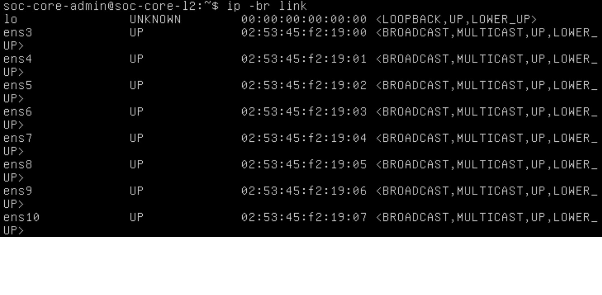

**Hình 2.1. Tám NIC Ubuntu trước cài OVS**

Mục đích: Kiểm tra guest nhận đủ ens3–ens10. Nội dung hiển thị giao diện thật; kết quả đủ tám NIC tại mốc chụp. Ý nghĩa là nền tảng đối chiếu MAC, chưa xác nhận peer.

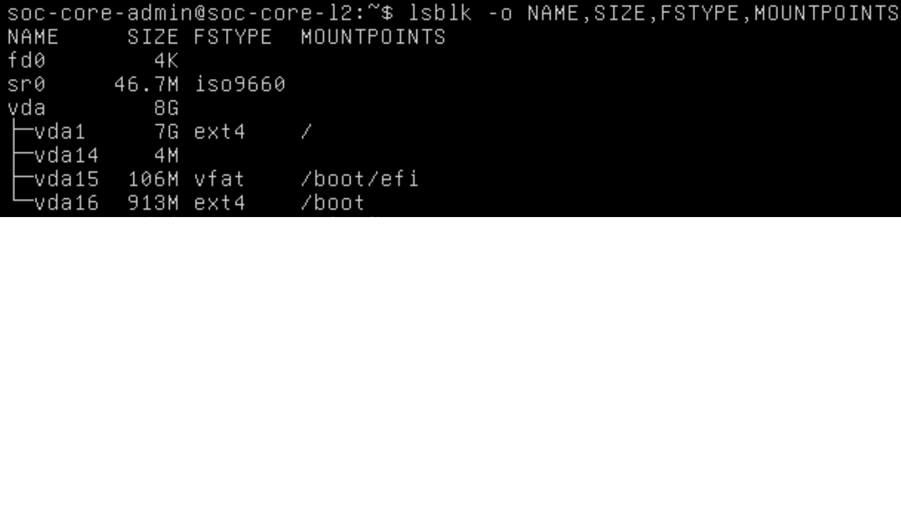

**Hình 2.2. Đĩa và phân vùng của Core**

Mục đích: Kiểm tra dung lượng đĩa. Nội dung lsblk/df thể hiện vda 8 GiB; kết quả phản ánh mốc trước cài đặt. Ý nghĩa là đánh giá chỗ cho bộ gói, không thay số đo hiện tại.

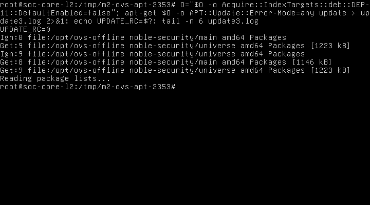

**Hình 2.3. Cập nhật chỉ mục APT offline**

Mục đích: Kiểm tra nguồn cục bộ dùng được. Nội dung là kết quả apt update với kho file; đạt ở lệnh này. Ý nghĩa là cài OVS không cần Internet guest.

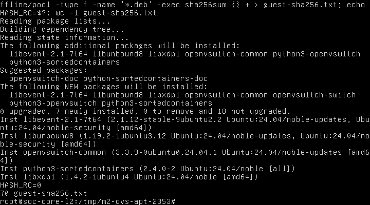

**Hình 2.4. Dependency và checksum bộ gói offline**

Mục đích: Kiểm tra kế hoạch dependency và hash gói. Kết quả ở màn hình thật phục vụ đối chiếu bundle 70 gói; không nói rằng đã cài cả 70. Ý nghĩa là giảm rủi ro cài thiếu phụ thuộc.

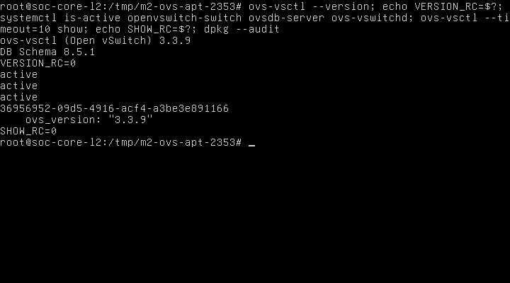

**Hình 2.5. OVS 3.3.9 sau cài đặt, chưa có bridge ở mốc cũ**

Mục đích: Kiểm tra version và dịch vụ sau cài. Kết quả 3.3.9/schema 8.5.1 và active; OVSDB lúc này chưa có bridge. Ý nghĩa là mốc lịch sử trước bước cấu hình, không mâu thuẫn với bridge tạo sau đó.

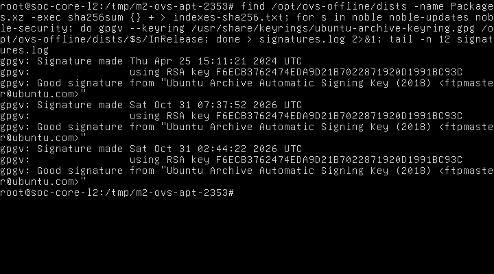

**Hình 2.6. Chữ ký chỉ mục Ubuntu**

Mục đích: Kiểm tra nguồn metadata. Nội dung xác minh ba chữ ký; kết quả dùng cho bước offline. Ý nghĩa là tách kiểm tra nguồn gói với kiểm tra runtime OVS.

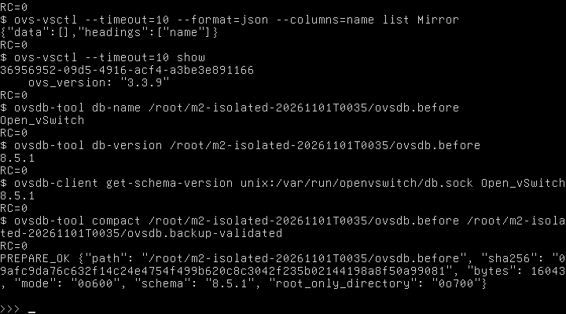

**Hình 2.7. Metadata bản sao OVSDB trước cấu hình**

Mục đích: Kiểm tra snapshot và schema. Kết quả cho thấy metadata root-only và checksum. Ý nghĩa là sẵn đường phục hồi; ảnh này riêng lẻ không chứng minh restore.

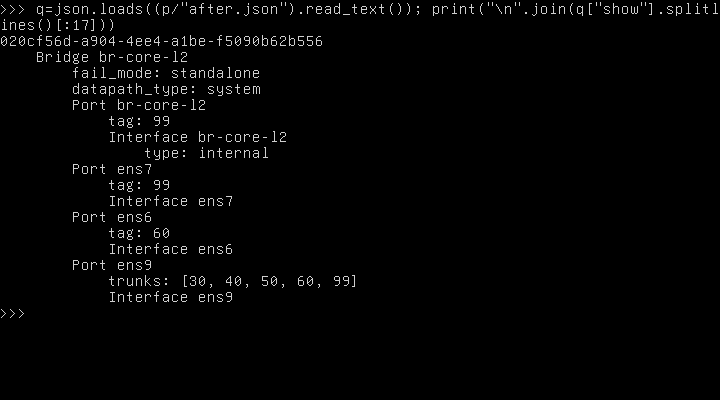

**Hình 2.8. Cấu hình br-core-l2, phần 1**

Mục đích: Đối chiếu output ovs-vsctl show thật. Kết quả hiển thị một phần bridge/port sau cấu hình. Ý nghĩa là bằng chứng DB; xem tiếp hình sau để đủ output.

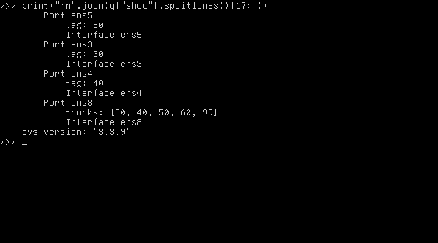

**Hình 2.9. Cấu hình br-core-l2, phần 2**

Mục đích: Hoàn thiện đối chiếu show. Kết quả bổ sung các cổng và phiên bản của bridge. Ý nghĩa là xác minh cấu hình đầy đủ, chưa phải thử frame.

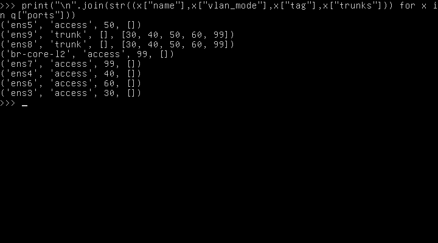

**Hình 2.10. Bảng access và trunk đọc từ OVS**

Mục đích: Kiểm tra tag/vlan_mode/trunks. Kết quả năm access và hai trunk đúng danh sách VLAN; local Port access99. Ý nghĩa là tránh nhầm port trước thử lưu lượng.

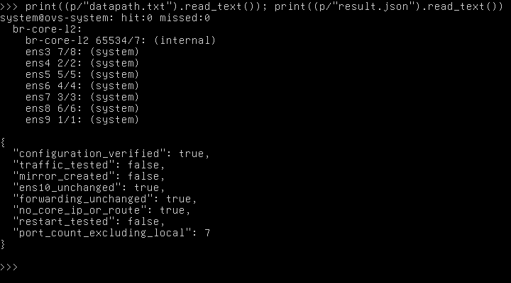

**Hình 2.11. Datapath và Interface sau cấu hình**

Mục đích: Kiểm tra port được datapath nhận và lỗi interface. Kết quả runtime ở mốc cô lập, chưa có frame thử. Ý nghĩa là điều kiện cần trước nghiệm thu forwarding.

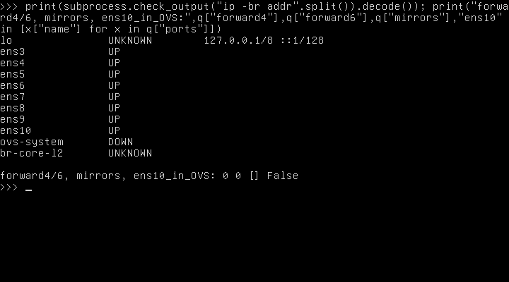

**Hình 2.12. Không IP/gateway, forwarding 0/0, ens10 ngoài OVS**

Mục đích: Kiểm tra vai trò Layer 2. Nội dung ip -br addr và kết quả forwarding/Mirror; chỉ loopback có địa chỉ, forwarding0/0, không mirror/ens10. Ý nghĩa là Core không đóng vai gateway.


## 2.10. Kiểm thử đã chuẩn bị và điều kiện chạy tiếp

Kịch bản chi tiết và bảng điều kiện/thao tác/kết quả/bằng chứng nằm trong M2-test-and-rollback-PREPARED-20261101.md và .csv. Bộ frame có 31 case trước mirror, 32 khi mirror; bao gồm broadcast, learned unicast, hai trunk/năm VLAN, sai VID/untagged, đối chứng dương và kiểm tra mirror không chuyển tiếp ngược. Mọi ca frame đều NOT RUN.

Phương án ưu tiên dùng AF_PACKET trên tám TAP riêng của Core, không nối bridge ngoài EVE, không thêm endpoint VM. Chỉ frame mang marker phiên được ghi; loại bản PACKET_OUTGOING để không nhầm gói phát với kết quả qua guest. Bản PCAP mới chỉ được coi là minh chứng khi phát/thu thành công và có counter/FDB, thời gian và đối chứng tương ứng. Không dùng mô phỏng trace làm thay capture thật.

Đã chuẩn bị script m2_tap_frame_test.py, m2_mirror_guest_prepared.py và mẫu unit/helper soc-core-l2-noip; chưa chạy trên runtime Linux/OVS. Snapshot mới trước mirror phải giữ cấu hình bảy port hiện hữu, không khôi phục nhầm snapshot OVS rỗng. Persistence thử boot trước sửa để biết trạng thái thật; nếu cần triển khai unit thì kiểm tra xung đột tệp, backup và không đổi forwarding. Sau reboot phải thử lại frame, không chỉ đọc DB.

## 2.11. Tài nguyên, việc còn thiếu và kế hoạch trước hạn nộp

Windows 16 GiB đang chạy Labtainer và chỉ còn khoảng 0,5 GiB available ở tiền kiểm tra, sau đó có mẫu thấp hơn 0,1 GiB. EVE 7897 MiB tổng/6531 MiB available khi chưa có QEMU không bảo đảm Windows còn headroom. Không bật Core hoặc VM khác trong chế độ nhẹ. Việc xác nhận tài nguyên sẵn sàng phải do người dùng thông báo, rồi mới đo lại.

Ưu tiên sau khi đủ RAM: bật duy nhất Core theo cách EVE chuẩn, thu baseline sau boot, backup mới, thử frame trước mirror, thêm mirror đúng mapping, thử lại/capture, triển khai persistence có rollback nếu cần và thử sau reboot. Khi đó mới cập nhật bảng PASS/FAIL lưu lượng. Ảnh topology GUI và kiểm tra phân trang Word vẫn còn thiếu; không có ảnh mới khi Core tắt.

M3: kiểm kê chưa có OPNsense. Kế hoạch Primary/Secondary, CARP VIP, pfsync, XMLRPC, VLAN gateway, ma trận firewall và triển khai tuần tự nằm trong ../M3/M3-OPNsense-HA-PROPOSED-20261101.md. Một firewall có thể là bản trình diễn tối thiểu sau khi đủ tài nguyên; chạy tuần tự hai firewall không được nghiệm thu HA. Core2048 + hai firewall3072 mỗi máy đã là8192 MiB, vượt tổng EVE7897 trước overhead. Chưa tải image hoặc sửa NAT/firewall/đường WAN.

Mốc dự kiến để ưu tiên trước 05/11/2026: hoàn thiện bộ chứng cứ M2 ngay khi tài nguyên sẵn sàng; sau đó demo một OPNsense và rule/gateway thực tế; HA chỉ triển khai nếu có ngân sách được xác nhận. Các ngày là kế hoạch, không bảo đảm kết quả chưa thử. Git chỉ lưu script/tài liệu/minh chứng sạch, không raw backup, PCAP, QCOW2, ISO hoặc bí mật.

## 2.12. Nguồn chính thức và đối chiếu hồ sơ


[1] Open vSwitch, What Is Open vSwitch: https://docs.openvswitch.org/en/stable/intro/what-is-ovs/ .

[2] Open vSwitch, Basic Configuration: https://docs.openvswitch.org/en/stable/faq/configuration/ . Tài liệu stable hiện hành phục vụ giải thích nguyên lý; không thay kết quả kiểm tra binary 3.3.9 trong guest.

[3] QEMU, Disk Images: https://www.qemu.org/docs/master/system/images.html .

[4] cloud-init, NoCloud: https://docs.cloud-init.io/en/latest/reference/datasources/nocloud.html .

[5] OPNsense, High Availability: https://docs.opnsense.org/manual/hacarp.html .

[6] Suricata, What is Suricata: https://docs.suricata.io/en/latest/what-is-suricata.html .

[7] Wazuh, Components: https://documentation.wazuh.com/current/getting-started/components/index.html .

[8] Ubuntu Noble, apt-get manual: https://manpages.ubuntu.com/manpages/noble/man8/apt-get.8.html .

[9] RFC Editor, RFC 4251, The Secure Shell Protocol Architecture: https://www.rfc-editor.org/info/rfc4251/ .

[10] OPNsense, Configure CARP, mục Terminology/pfSync: https://docs.opnsense.org/manual/how-tos/carp.html .

[11] RFC Editor, RFC 3022, Traditional NAT: https://www.rfc-editor.org/info/rfc3022/ .


Hồ sơ nguồn: M2-report-ovs-offline-installed-20261101.docx; M2-report-port-mapping-and-ovs-design-20261101.docx; M2-report-isolated-bridge-configured-20261101.docx. Tất cả giữ nguyên. Dữ liệu chính: isolated-bridge-20261101/guest/commands.jsonl, after.json, result.json, attempt1-restored.json và configured-port-mapping.csv; kiểm kê mới port-design-20261101T075757+0700/eve-inventory.json; backup mới accelerated-20261101/stopped-backup.json. Danh mục và checksum của bản hợp nhất được lưu riêng.
