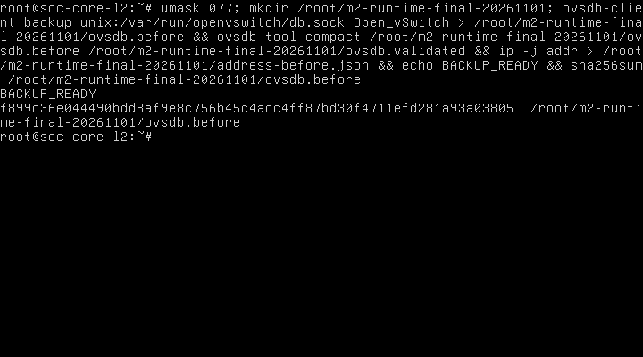
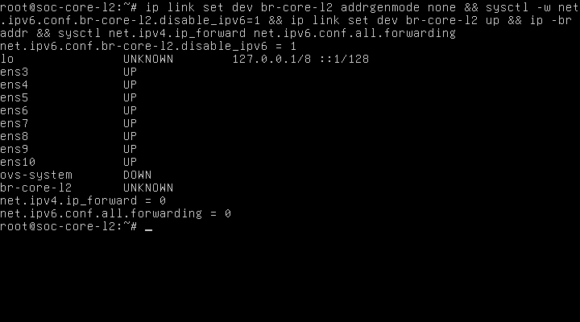
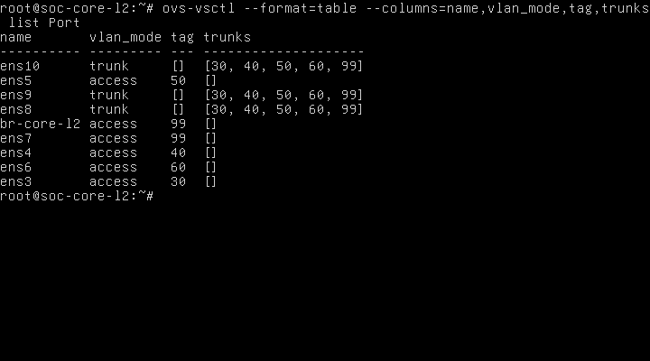
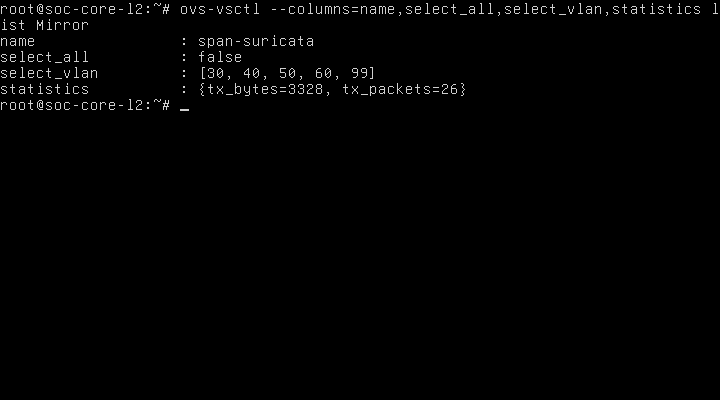
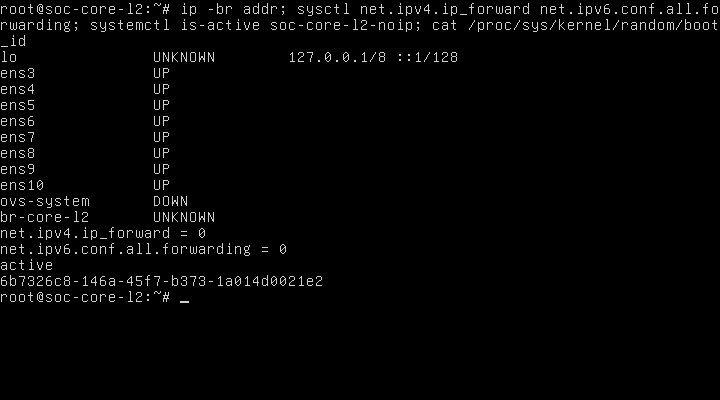
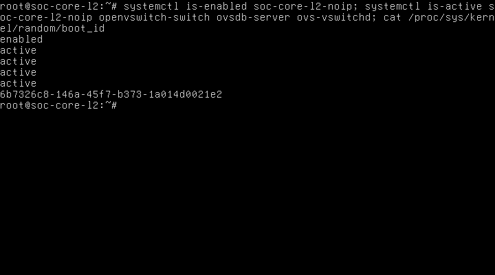
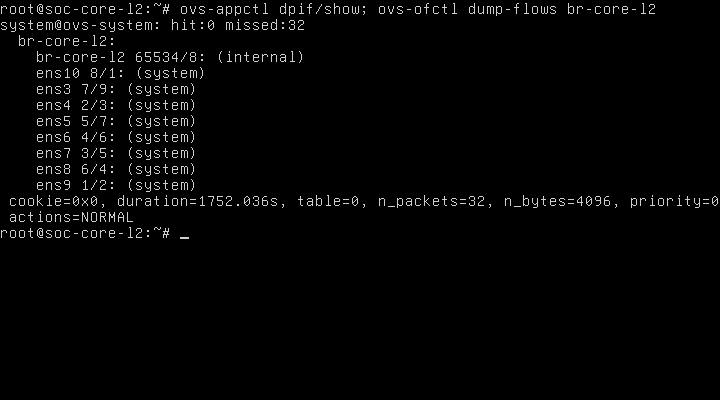

# CHƯƠNG 2. TRIỂN KHAI VÀ KIỂM THỬ CORE LAYER 2 BẰNG OPEN vSWITCH

## 2.1. Kết quả thực tế ngày 01/11/2026

Đã hoàn thành bộ kiểm thử Core Layer 2 trong lab M2 cô lập: **95/95 ca frame thực tế đạt, 0 ca frame thất bại**; gồm31 ca trước mirror,32 ca sau mirror và32 ca sau reboot. OVS 3.3.9 giữ đúng năm access, hai trunk và cổng ens10 mirror chuyên dụng. Persistence đã được kiểm tra bằng boot_id thay đổi, đọc lại cấu hình/dịch vụ và chạy lại frame, không chỉ dựa vào OVSDB còn dữ liệu.

Kết luận chỉ áp dụng mẫu frame Ethernet phát128 byte, các VLAN 30/40/50/60/99, unicast/broadcast và phép đo hữu hạn trong lab. Chưa kiểm tải cao, IPv6 payload, ứng dụng TCP/IP qua firewall, OPNsense HA, Suricata IDS hoặc Wazuh. Không lấy PASS của kiểm tra tĩnh/mock làm kết quả mạng;95 ca trên được thu từ socket nhận frame thật ở TAP phía EVE sau khi frame đi qua guest.

Thời gian trong báo cáo dựa collector Windows UTC+07:00. Đồng hồ EVE/guest được ghi nhưng chưa coi là đồng bộ; timestamp PCAP cần đọc cùng metadata collector. Báo cáo mới không ghi đè các báo cáo cài đặt, mapping hoặc chuẩn bị trước đó.

## 2.2. Phạm vi và môi trường đã xác minh

EVE-NG192.168.220.143, lab SOC-M2-Core-L2, Core ID 3/UUID2b295168-b72e-4de7-b364-37298252dd9f, Ubuntu 24.04,1 vCPU,2048 MiB RAM,8vNIC. Chỉ bật Core; không bật OPNsense/Suricata hoặc endpoint VM. Lab vẫn không có EVE network/link và TAP không có bridge master, nên không có segment ngoài Core để frame đi tắt.

OVS 3.3.9 đã cài offline từ đợt trước, schema 8.5.1. Không cài lại gói hoặc tạo lại bridge. Không sửa image gốc, seed NoCloud, mạng VMware/Windows/Labtainer hoặc firewall/NAT. Các thay đổi cấu hình và ghi log diễn ra trong filesystem guest/OVSDB; không ghi trực tiếp QCOW2 từ host khi VM chạy.

Hồ sơ cài đặt trước đó đã kiểm bộ70 gói .deb, sáu chỉ mục và ba chữ ký InRelease Ubuntu; dependency thực tế cần bảy gói mới. Phiên bản gói3.3.9-0ubuntu0.24.04.1, kho file:/opt/ovs-offline với noble/noble-updates/noble-security. Không đồng nghĩa đã cài cả70 gói. Các lỗi nguồn thiếu noble-updates/metadata phụ CNF-DEP11 đã xử lý ở mốc cũ; không sửa DNS/Internet để cài lại trong đợt thử này. Ubuntu là Ubuntu 24.04 dùng vai trò Core, không gọi nhầm thành sản phẩm Ubuntu Core dạng immutable.

## 2.3. Mapping và cấu hình cuối

| QEMU | TAP EVE | NIC Ubuntu / MAC | Cấu hình đã kiểm chứng | Vai trò |
|---|---|---|---|---|
| net0 | vunl0_3_0 | ens3 / 02:53:45:f2:19:00 | Access VLAN 30 | Data Center |
| net1 | vunl0_3_1 | ens4 / 02:53:45:f2:19:01 | Access VLAN 40 | Employee |
| net2 | vunl0_3_2 | ens5 / 02:53:45:f2:19:02 | Access VLAN 50 | Guest |
| net3 | vunl0_3_3 | ens6 / 02:53:45:f2:19:03 | Access VLAN 60 | DMZ |
| net4 | vunl0_3_4 | ens7 / 02:53:45:f2:19:04 | Access VLAN 99 | Management |
| net5 | vunl0_3_5 | ens8 / 02:53:45:f2:19:05 | Trunk30,40,50,60,99 | OPNsense Primary — peer chưa triển khai |
| net6 | vunl0_3_6 | ens9 / 02:53:45:f2:19:06 | Trunk30,40,50,60,99 | OPNsense Secondary — peer chưa triển khai |
| net7 | vunl0_3_7 | ens10 / 02:53:45:f2:19:07 | Mirror output, trunk30,40,50,60,99 | Output mirror — chưa có sensor VM |

br-core-l2 dùng system datapath, standalone, local internal Port access99 không IP. Không controller, bond hoặc LACP. Hai trunk không native VLAN. Mirror span-suricata chọn ingress ens3–ens9, select_vlan30/40/50/60/99, select_dst_port rỗng và output_port ens10; không select_all. ens10 không phải NIC quản trị và phép thử gửi ngược đã bị bỏ. Số OpenFlow ofport cấp động, không suy từ tên ens.

Output ovs-vsctl show được đọc từ guest sau reboot:

```text
020cf56d-a904-4ee4-a1be-f5090b62b556
    Bridge br-core-l2
        fail_mode: standalone
        datapath_type: system
        Port ens10
            trunks: [30, 40, 50, 60, 99]
            Interface ens10
        Port br-core-l2
            tag: 99
            Interface br-core-l2
                type: internal
        Port ens7
            tag: 99
            Interface ens7
        Port ens6
            tag: 60
            Interface ens6
        Port ens9
            trunks: [30, 40, 50, 60, 99]
            Interface ens9
        Port ens5
            tag: 50
            Interface ens5
        Port ens3
            tag: 30
            Interface ens3
        Port ens4
            tag: 40
            Interface ens4
        Port ens8
            trunks: [30, 40, 50, 60, 99]
            Interface ens8
    ovs_version: "3.3.9"
```

## 2.4. Phương pháp phát/thu lưu lượng thật

AF_PACKET là giao diện socket Ethernet của Linux. Bộ thử bind riêng tám TAP có sẵn trên EVE: phát ra TAP vào QEMU/vNIC tương ứng, chỉ thu frame guest trả ra từ các TAP khác. Script kiểm đúng QEMU netdev→TAP→MAC, không có master bridge, không thêm link/VM hoặc IP. Loại PACKET_OUTGOING để không dùng bản phát làm chứng cứ chuyển tiếp. Chỉ marker ngẫu nhiên của đúng phiên được lưu.

Frame dùng EtherType0x88b5, dài128 byte tại điểm phát và chứa payload đánh dấu; đây là Ethernet kiểm thử thật, không phải ping hoặc mô phỏng ofproto/trace. Điểm thu thực tế có124/128/132 byte do bỏ/giữ/thêm thẻ802.1Q. PACKET_AUXDATA được dùng khi kernel đưa VLAN tag vào metadata, phục hồi TPID/TCI cho PCAP. Capture được phân tích lại khi tải về, kiểm cấu trúc, marker và SHA-256; không tạo PCAP từ kết quả mong đợi.

Mỗi ca chờ0,5giây; ca âm có đối chứng dương và ca dương cuối suite. Không nhận frame trong cửa sổ này chỉ được kết luận trong phạm vi phép thử, không khẳng định an toàn với mọi tải/kiểu frame. Các suite phải đủ31/32 ca và final guard hợp lệ; phiên bị ngắt không được coi là đạt.

## 2.5. Bảng kết quả lưu lượng

| Nhóm thực tế | Số ca | PASS | FAIL | Frame guest trả ra | Chứng cứ |
|---|---|---|---|---|---|
| Access/trunk/isolation trước mirror | 31 | 31 | 0 | 42 | final-collection/vlan-trunk/result.json và8 PCAP TAP |
| Sau cấu hình mirror | 32 | 32 | 0 | 68 | final-collection/mirror-traffic/result.json và8 PCAP TAP |
| Sau reboot/persistence | 32 | 32 | 0 | 68 | final-collection/postboot-traffic/result.json và8 PCAP TAP |

Chi tiết95 dòng ở final-collection/frame-cases.csv; mỗi ca có ingress, VLAN phát, tập cổng/VLAN mong đợi, tập nhận thực tế và số bản sao mirror. Access5 ca, trunk10 ca, negative trunk4 ca, wrong-tag access1 ca, learned-unicast10 ca và đối chứng cuối1 ca; suite mirror thêm1 ca ingress trên ens10. Không đếm14 mock/static test vào bảng này.

Các access nhận untagged; trunk nhận đúng VID được phép. Không rò sang access VLAN khác trong các ca quan sát; VID 100/untagged trên trunk và tagged40 vào access30 bị bỏ. Các ca unicast sau học MAC chỉ đi tới đúng đích, không flood trunk còn lại. Không thử trực tiếp hai access cùng VLAN vì thiết kế cuối mỗi VLAN chỉ có một access; phép cùng VLAN dùng access↔trunk độc lập.

## 2.6. SPAN/Mirror thực tế

Suite sau mirror có26 bản sao trên TAP ens10, phân bố VID 30:6, VID 40/50/60/99:5 mỗi VLAN. Counter Mirror trước reboot tx_packets26/tx_bytes3328 đọc bằng console thật. PCAP mirror thực tế gồm11 frame132 byte và15 frame128 byte, tổng3372 byte: chênh44 byte tương ứng11 thẻ802.1Q bổ sung. Đây là đối chiếu vị trí đếm dựa trên capture, không đồng nhất byte counter với byte PCAP hoặc coi chênh lệch này là packet drop. Sau reboot suite32 ca lặp lại phải có quan sát tương ứng, không suy từ cấu hình Mirror còn tồn tại.

Bảng VLAN trên bản sao thu thực tế: {"vlan-trunk": {}, "mirror-traffic": {"30": 6, "40": 5, "50": 5, "60": 5, "99": 5}, "postboot-traffic": {"30": 6, "40": 5, "50": 5, "60": 5, "99": 5}}.

Mirror ingress-only tránh nhân bản do chọn cả nguồn và đích trong cùng lần đi qua bridge; phép thử nhỏ không quan sát trùng bản sao ngoài dự kiến. Luồng qua firewall rồi quay lại Core có thể tạo một lần ingress khác; chưa có firewall trong đợt này. Có bản sao không đồng nghĩa đã có alert IDS hoặc chặn gói IPS.

## 2.7. Persistence, lỗi và sao lưu

Lần boot đầu cho thấy OVSDB giữ cấu hình nhưng br-core-l2 admin DOWN. Guard đã chặn trước frame. Helper khôi phục đầu tiên so sánh cả cờ link trong ip -j addr khi chủ đích đổi cờ UP, gây rollback không cần thiết; sau đó bật lại IPv6 đã sinh link-local trên bridge. Lần thử tiếp bị guard không IP chặn. Không che các lần lỗi này hoặc tính chúng thành PASS; chúng không phải ca frame thất bại.

Đã giữ snapshot/log các lần thử, sao lưu OVSDB lần nữa tại /root/m2-runtime-final-20261101/ovsdb.before và đọc/compact bản sao để xác nhận hợp lệ, rồi chỉ đặt addrgenmode none, disable_ipv61 trên interface nội bộ và bật br-core-l2. Không đổi forwarding, NIC cũ, VLAN hoặc tạo bridge. Ảnh runtime-diagnosis/runtime-backup/runtime-restored-up ghi diễn biến. Rollback runtime lần lỗi không khớp hoàn toàn địa chỉ do link-local tự sinh; không gọi lần đó là khôi phục đầy đủ đã đạt.

Snapshot chính trước mirror ở /root/m2-traffic-m2-live-20261101a/ovsdb.before, schema 8.5.1, SHA-256 2d3a1e60ce73b7bb2172ba657b4901caafe8c7c550156835f391febd60cb56a3. Raw DB chỉ trong guest root-only; backup OVSDB đọc được không thay một phép restore mới nếu chưa thực hiện. Khi rollback có lỗi phải dừng và giữ log, không Wipe/Reset. Snapshot OVS rỗng từ đợt tạo bridge đầu không dùng cho giai đoạn này.

Journal sau reboot vẫn có cảnh báo OVS_CTL_OPTS chưa đặt, được systemd coi là chuỗi rỗng. Các dịch vụ OVS và unit không IP vẫn active, 95 ca frame đạt. Chưa chỉnh unit OVS để bỏ cảnh báo; không coi đây là lỗi chuyển mạch.

Persistence dùng soc-core-l2-noip.service và helper tại /usr/local/sbin, sau OVS, chỉ tác động interface nội bộ br-core-l2, không đổi forwarding. Lưu registry/hash tệp để rollback giữ tệp thay vì xóa. Đã reboot mềm guest qua systemd-run/systemctl, không reboot EVE/Windows, không Reset node. Sau boot đọc lại đúng MAC, version, VLAN/Mirror, không IP/gateway và forwarding0/0 rồi chạy32 ca frame.

Sau reboot, /tmp không còn bundle cũ; lần truyền helper lớn tiếp theo bị lỗi giải nén. Guard checksum đã chặn thực thi. Console có dòng nhập dở; đã dừng đúng tiến trình điều phối/client của phiên và gửi Ctrl+C, không dừng VM. Adapter được sửa dùng literal JSON để giảm chuỗi escape, hash từng phần lẫn toàn bộ và thư mục /var/tmp. Lần xuất chỉ đọc nhỏ dùng thư viện đã giữ tại /root/m2-isolated-20261101T0035/guest.py với SHA-256 được xác minh, trả trạng thái thực qua console. Bộ guard hiện hành kiểm dữ liệu đó rồi chính hàm frame_test của bộ điều phối chạy32 ca cuối. Đây là thay đường vận chuyển dữ liệu kiểm chứng, không giả lập kết quả mạng. Log lỗi truyền được giữ cùng kết quả đạt.

boot_id trước: 3060cddc-e143-4e13-b739-76f4f2b96deb; sau: 6b7326c8-146a-45f7-b373-1a014d0021e2. Hai giá trị khác nhau là bằng chứng kernel guest đã khởi động lại.

## 2.8. Nguyên lý và vai trò trong SOC

OVS (Open vSwitch) gồm ovsdb-server lưu cấu hình, ovs-vswitchd điều khiển datapath và datapath kernel xử lý frame. Bridge học MAC (Media Access Control) theo VLAN trong FDB (Forwarding Database); NORMAL switching chọn cổng đích đã học hoặc flood trong VLAN. Core cung cấp hạ tầng Layer 2 cho các vùng SOC, không làm gateway.

VLAN (Virtual Local Area Network) chia miền quảng bá. Access phân loại frame endpoint vào một VLAN và xuất không thẻ; trunk mang nhiều VLAN theo IEEE802.1Q. IEEE là Institute of Electrical and Electronics Engineers; thẻ gồm TPID (Tag Protocol Identifier), TCI (Tag Control Information), trong đó VID (VLAN Identifier) nhận dạng VLAN. Thử frame xác nhận tác dụng phân loại, thêm/bỏ tag và cách ly trong mẫu, thay vì chỉ nhìn tag/trunks của Port.

SPAN (Switched Port Analyzer) là tên chức năng giám sát cổng thường dùng; OVS dùng đối tượng Mirror để sao chép lưu lượng. ens10 nay đã là output chuyên dụng có capture thật, hỗ trợ Suricata quan sát sau này. Gateway liên VLAN dự kiến là CARP VIP trên OPNsense HA; firewall chịu routing/rules/NAT. Các chức năng M3/M4 này chưa triển khai trong đợt M2.

Các thuật ngữ nền tảng và giám sát còn lại được giữ ở mục2.8 của M2-report-consolidated-review-20261101.md và phần M3/M4: QEMU, QCOW2, cloud-init, NoCloud, SSH, LACP, OPNsense, CARP, pfsync, HA, NAT, DHCP, IDS/IPS, Suricata, Wazuh. Chúng là tên chính thức hoặc dạng đầy đủ đã giải thích; ví dụ firewall/sensor vẫn dự kiến. Tài liệu nguyên lý: [OVS](https://docs.openvswitch.org/en/stable/intro/what-is-ovs/), [VLAN](https://docs.openvswitch.org/en/stable/faq/vlan/), [Mirror](https://docs.openvswitch.org/en/stable/faq/configuration/), [OPNsense HA](https://docs.opnsense.org/manual/hacarp.html).

| Thuật ngữ và nghĩa tiếng Việt | Nguyên lý hoạt động, vai trò và ví dụ trong đồ án |
|---|---|
| SOC — Security Operations Center; trung tâm điều hành an ninh mạng | Kết hợp con người, quy trình và công cụ để thu thập, phân tích và xử lý sự kiện. Dự kiến Core đưa lưu lượng tới cảm biến, Suricata phát hiện và Wazuh hỗ trợ phân tích tập trung. |
| OVS — Open vSwitch; tên chính thức của bộ chuyển mạch phần mềm | ovsdb-server giữ cấu hình, ovs-vswitchd điều khiển datapath. br-core-l2 đã thử frame thật; Core chỉ Layer 2. [1] |
| Bridge; cầu nối lớp liên kết | Học MAC và chuyển frame theo VLAN. br-core-l2 đã có năm access, hai trunk và cổng mirror; bộ95 ca thực tế đạt. |
| VLAN — Virtual Local Area Network; mạng cục bộ ảo | Chia miền quảng bá; VLAN 30/40/50/60/99 đã kiểm classification/cách ly trong bộ frame hữu hạn, chưa có gateway firewall. |
| IEEE 802.1Q; tiêu chuẩn mạng cầu nối và VLAN | Thẻ Ethernet phân biệt VLAN trên trunk. Mẫu thu124/128/132 byte đã thể hiện bỏ/giữ/thêm thẻ4 byte; TPID/TCI/VID được giải thích ở trên. |
| Trunk; cổng mang nhiều VLAN | Mang nhiều VLAN có tag. ens8/ens9 đã thử năm VID được phép và VID 100/untagged bị bỏ; chưa có hai firewall peer. [2] |
| Access port; cổng truy nhập một VLAN | Phân loại endpoint vào một VLAN, egress không thẻ. ens3 tag30 và ens4–ens7 tag40/50/60/99 đã thử frame thật. [2] |
| LACP — Link Aggregation Control Protocol; giao thức điều khiển gộp liên kết | Trao đổi thông tin để thống nhất thành viên trong nhóm liên kết với peer tương thích. Có thể dùng khi mở rộng Core, nhưng chưa triển khai; hai firewall HA độc lập không tự trở thành một peer LACP. |
| SPAN — Switched Port Analyzer; tên chức năng giám sát cổng thường dùng trong hệ sinh thái Cisco | OVS dùng Mirror sao chép ingress bảy data port theo năm VLAN tới ens10. Đã có capture bản sao thật; chưa có Suricata sensor. [2] |
| Port mirroring; sao chép lưu lượng cổng | Tạo bản sao ngoài đường chuyển tiếp chính. ens10 chuyên dụng, frame gửi ngược không chuyển ra data port; không coi đây là IPS. [2] |
| QEMU; tên chính thức của phần mềm giả lập và ảo hóa | Cung cấp phần cứng ảo, có thể tăng tốc KVM. Core dùng tám VirtIO NIC, chỉ một QEMU được bật; reboot guest được xác minh bằng boot_id khác nhau. |
| QCOW2 — QEMU Copy On Write, version 2; định dạng đĩa sao chép khi ghi | Có thể lưu các khối thay đổi và tham chiếu backing file, giúp phân biệt image nền với overlay runtime. Core dùng đĩa QCOW2; phiên này không sửa đĩa từ host khi VM đang chạy. [3] |
| cloud-init; tên chính thức của công cụ khởi tạo instance | Đọc datasource và thực thi tác vụ khởi tạo theo module, như tạo tài khoản hoặc cấu hình ban đầu. Người dùng xác nhận Core đã hoàn tất; phiên cài OVS không chạy lại cloud-init. |
| NoCloud; tên datasource chính thức của cloud-init | Cung cấp user-data, meta-data và dữ liệu mạng từ nguồn cục bộ hoặc nguồn được chỉ định. Core đã dùng seed ISO; không sửa seed hoặc instance-id để cài lại. [4] |
| SSH — Secure Shell; giao thức truy cập shell bảo mật | Mã hóa phiên và xác thực danh tính, ở đây dùng khóa công khai và ssh-agent ký xác thực. Đã dùng SSH tới EVE; không suy ra có SSH trực tiếp vào guest khi NIC chưa nối mạng. [9] |
| OPNsense; tên chính thức của nền tảng firewall | Dùng lọc gói theo trạng thái, định tuyến và các dịch vụ mạng. Trong thiết kế SOC, OPNsense chịu gateway, liên VLAN, firewall rules và NAT; các chức năng này không đặt trên Core. |
| CARP — Common Address Redundancy Protocol; giao thức dự phòng địa chỉ chung | Các firewall phối hợp quyền sở hữu địa chỉ IP ảo để tiếp quản gateway khi có sự cố. Dự kiến dùng ở M3; chưa tạo hoặc kiểm thử VIP. [5] |
| pfsync; tên chính thức của cơ chế đồng bộ trạng thái Packet Filter | Đồng bộ thông tin trạng thái kết nối giữa firewall để giảm gián đoạn khi đổi vai; không đồng nghĩa đồng bộ toàn bộ cấu hình. Dự kiến có đường đồng bộ riêng ở M3, chưa triển khai. [10] |
| HA — High Availability; tính sẵn sàng cao | Dùng dự phòng, phát hiện lỗi và tiếp quản dịch vụ. Dự kiến hai OPNsense hỗ trợ HA; một Core duy nhất vẫn là điểm lỗi đơn, cài OVS không chứng minh HA. [5] |
| NAT — Network Address Translation; chuyển đổi địa chỉ mạng | Thay địa chỉ hoặc cổng trong lưu lượng theo quy tắc và trạng thái. Dự kiến OPNsense thực hiện NAT ra WAN; Core không làm NAT. [11] |
| DHCP — Dynamic Host Configuration Protocol; giao thức cấu hình máy trạm động | Máy khách và máy chủ trao đổi để cấp thuê địa chỉ cùng các tùy chọn gateway/DNS. Dự kiến OPNsense cấp cho VLAN được chốt; chưa xác nhận scope hoặc cấp phát thực tế. |
| IDS — Intrusion Detection System; hệ thống phát hiện xâm nhập. IPS — Intrusion Prevention System; hệ thống ngăn chặn xâm nhập | IDS phân tích và cảnh báo; IPS cần nằm trên đường xử lý có quyền chặn. Suricata nhận mirror dự kiến làm IDS thụ động, không thể coi việc nhận bản sao là đã chặn lưu lượng gốc. [6] |
| Suricata; tên chính thức của công cụ phân tích an ninh mạng | Phân tích giao thức và so khớp quy tắc để phát hiện, hỗ trợ ngăn chặn khi triển khai phù hợp. Dự kiến NIC capture nhận bản sao từ OVS; chưa có cảm biến/capture được kiểm chứng trong bước này. [6] |
| Wazuh; tên chính thức của nền tảng giám sát an ninh | Agent và các thành phần trung tâm thu thập, phân tích, lưu trữ và trình bày sự kiện. Dự kiến kết hợp dữ liệu endpoint và cảnh báo Suricata trong SOC; chưa xác nhận luồng tích hợp thực tế. [7] |


## 2.9. Minh chứng hình ảnh thật



**Hình 2.1. Backup OVSDB trước khôi phục runtime**

Mục đích là đối chiếu trạng thái thực tế với tiêu chí M2. Nội dung và kết quả: Snapshot đã tạo và compact bản sao thành công; giữ raw trong guest, chưa phải phép restore mới. Ý nghĩa là kiểm chứng có giới hạn đúng mốc thu, không dựng lại màn hình.



**Hình 2.2. Khôi phục bridge không IP và forwarding0/0**

Mục đích là đối chiếu trạng thái thực tế với tiêu chí M2. Nội dung và kết quả: Ảnh sau sửa riêng bridge, không đổi VLAN hoặc địa chỉ/gateway trên Core. Ý nghĩa là kiểm chứng có giới hạn đúng mốc thu, không dựng lại màn hình.



**Hình 2.3. Bảng access/trunk sau thêm cổng mirror**

Mục đích là đối chiếu trạng thái thực tế với tiêu chí M2. Nội dung và kết quả: Bảy cổng dữ liệu và ens10 đều đọc từ OVS; trunk ens10 chỉ phục vụ output mirror. Ý nghĩa là kiểm chứng có giới hạn đúng mốc thu, không dựng lại màn hình.



**Hình 2.4. Mirror trước reboot và26 bản sao**

Mục đích là đối chiếu trạng thái thực tế với tiêu chí M2. Nội dung và kết quả: Counter26/3328 tương ứng mẫu frame128 byte, không phải thông lượng production. Ý nghĩa là kiểm chứng có giới hạn đúng mốc thu, không dựng lại màn hình.


**Hình 2.5. Port/VLAN sau reboot**

Mục đích là đối chiếu trạng thái thực tế với tiêu chí M2. Nội dung và kết quả: Đối chiếu cấu hình cuối với cùng mapping tám NIC; kết hợp suite32 ca sau boot. Ý nghĩa là kiểm chứng có giới hạn đúng mốc thu, không dựng lại màn hình.



**Hình 2.6. Core sau reboot không IP/gateway**

Mục đích là đối chiếu trạng thái thực tế với tiêu chí M2. Nội dung và kết quả: Bridge admin UP, không IP, forwarding0/0; loopback giữ địa chỉ cục bộ như trước. Ý nghĩa là kiểm chứng có giới hạn đúng mốc thu, không dựng lại màn hình.



**Hình 2.7. Dịch vụ OVS và unit persistence sau boot**

Mục đích là đối chiếu trạng thái thực tế với tiêu chí M2. Nội dung và kết quả: Output active/enabled/boot_id dùng cùng JSON để xác nhận persistence thực tế. Ý nghĩa là kiểm chứng có giới hạn đúng mốc thu, không dựng lại màn hình.



**Hình 2.8. Datapath và MAC đã học sau thử frame**

Mục đích là đối chiếu trạng thái thực tế với tiêu chí M2. Nội dung và kết quả: Minh chứng bổ sung runtime/counter; PCAP và ca nguồn–đích mới là bằng chứng chuyển tiếp. Ý nghĩa là kiểm chứng có giới hạn đúng mốc thu, không dựng lại màn hình.

## 2.10. Bàn giao, giới hạn và điều kiện bắt đầu M3

Đạt bộ thử Core Layer 2/mirror/persistence được giao, với95 ca frame và24 PCAP theo TAP được giữ cục bộ; một số PCAP có0 gói ở cổng không nhận trong cửa sổ đo, không phải24 capture đều có dữ liệu. Tất cả ảnh/log cũ giữ nguyên. PCAP là dữ liệu capture thật có marker; .gitignore vẫn loại raw capture/OVSDB/image/token khỏi Git. CSV/JSON/hash và ảnh sạch phục vụ đối chiếu trên repository PRIVATE. Chưa có ảnh topology GUI mới; log XML/QEMU xác nhận một node/không link. Chưa kiểm phân trang bằng Word GUI.

Chưa thực hiện: tải cao/throughput, IPv6 payload, end-to-end TCP/IP qua các peer thật, gateway/rules/NAT/CARP/pfsync/XMLRPC/DHCP trên OPNsense hoặc phát hiện Suricata/Wazuh. Đây là giới hạn, không ghi thành FAIL của95 ca Ethernet. Không bật firewall/sensor trong đợt này.

Để bắt đầu M3 Primary: phê duyệt phạm vi mới; image amd64 chính thức đã xác thực checksum/chữ ký; đo lại Windows RAM/commit và EVE RAM/swap/đĩa; chốt MAC/interface LAN-WAN-SYNC, địa chỉ/subnet/DNS/WAN upstream. Dùng kế hoạch tuần tự, chỉ một firewall trước; cần ngân sách3–4 GiB cho firewall và dự phòng host. Cặp HA cùng Core vượt phân bổ EVE hiện có, không nghiệm thu HA bằng hai máy chạy lần lượt. Xem M3-deployment-matrix-and-tests-PREPARED-20261101.md và SOC-execution-resource-plan-20261101.md.

## 2.11. Nguồn chính thức và hồ sơ trước


[1] Open vSwitch, What Is Open vSwitch: https://docs.openvswitch.org/en/stable/intro/what-is-ovs/ .

[2] Open vSwitch, Basic Configuration: https://docs.openvswitch.org/en/stable/faq/configuration/ . Tài liệu stable hiện hành phục vụ giải thích nguyên lý; không thay kết quả kiểm tra binary 3.3.9 trong guest.

[3] QEMU, Disk Images: https://www.qemu.org/docs/master/system/images.html .

[4] cloud-init, NoCloud: https://docs.cloud-init.io/en/latest/reference/datasources/nocloud.html .

[5] OPNsense, High Availability: https://docs.opnsense.org/manual/hacarp.html .

[6] Suricata, What is Suricata: https://docs.suricata.io/en/latest/what-is-suricata.html .

[7] Wazuh, Components: https://documentation.wazuh.com/current/getting-started/components/index.html .

[8] Ubuntu Noble, apt-get manual: https://manpages.ubuntu.com/manpages/noble/man8/apt-get.8.html .

[9] RFC Editor, RFC 4251, The Secure Shell Protocol Architecture: https://www.rfc-editor.org/info/rfc4251/ .

[10] OPNsense, Configure CARP, mục Terminology/pfSync: https://docs.opnsense.org/manual/how-tos/carp.html .

[11] RFC Editor, RFC 3022, Traditional NAT: https://www.rfc-editor.org/info/rfc3022/ .


Hồ sơ nguồn: M2-report-ovs-offline-installed-20261101.docx; M2-report-port-mapping-and-ovs-design-20261101.docx; M2-report-isolated-bridge-configured-20261101.docx. Tất cả giữ nguyên. Dữ liệu chính: isolated-bridge-20261101/guest/commands.jsonl, after.json, result.json, attempt1-restored.json và configured-port-mapping.csv; kiểm kê mới port-design-20261101T075757+0700/eve-inventory.json; backup mới accelerated-20261101/stopped-backup.json. Danh mục và checksum của bản hợp nhất được lưu riêng.
