> Hiện hành: br-core-l2 có 5 access và 2 trunk đã cấu hình cô lập; ens10 ngoài OVS, chưa mirror. Xem mục 2.28–2.33. Chưa kiểm thử lưu lượng và chưa nghiệm thu chức năng M2.

> Cập nhật thiết kế cổng M2 ngày 01/11/2026: mục 2.21–2.27 chứa mapping xác minh mới và cấu hình dự kiến CHƯA THỰC THI. Các phần trước giữ nguyên lịch sử.

> Bản cập nhật hiện hành: OVS 3.3.9 đã cài và kiểm tra dịch vụ; các mốc chưa cài ở phần lịch sử được giữ nguyên. Xem mục 2.17–2.20.

> Bản cập nhật M2 ngày 31/10/2026: mục 2.1–2.8 lưu bước Ubuntu trước đây; mục 2.9–2.14 ghi nhận chuẩn bị Core mới. Bản Word/ảnh/log cũ được giữ nguyên.

# CHƯƠNG 2. CHUẨN BỊ MÔI TRƯỜNG CORE LAYER 2

## 2.1. Mục tiêu và phạm vi kiểm chứng

Giai đoạn này kiểm tra khả năng khởi tạo và quản trị Ubuntu Server 24.04 trên EVE-NG trước khi triển khai Core Layer 2 bằng Open vSwitch (OVS). Đối tượng kiểm tra là node `Ubuntu-Console-Test`, ID 2, trong lab `SOC-Ubuntu-Image-Test`. EVE-NG được truy cập tại `192.168.220.143`; đây là địa chỉ quản trị EVE đã sử dụng thực tế, không phải địa chỉ gateway của các VLAN trong đồ án.

Người quản trị đã xác nhận đăng nhập console bằng tài khoản `soc-test`. Trong phiên thu thập minh chứng, các lệnh chỉ đọc được thực hiện tại shell đã đăng nhập của chính node này. Hoạt động chỉ gồm đọc trạng thái, chụp framebuffer console thật và ghi tài liệu trên Windows; không cài OVS, sửa mạng, thay seed/image, dừng hoặc khởi động node. Tài liệu này là phần báo cáo M2 về chuẩn bị hệ điều hành, chưa phải biên bản nghiệm thu Core chuyển mạch.

Ảnh được thu trực tiếp từ framebuffer VNC của QEMU qua phiên SSH có kiểm tra host key. Mỗi ảnh giữ toàn bộ màn hình 720 × 400 pixel, không ghép, không cắt, không sửa nội dung. Thao tác Ctrl+L trước ảnh chính chỉ làm mới màn hình terminal thật rồi chạy lại lệnh kiểm tra; không sửa ảnh sau khi chụp. Log JSON cùng tên ảnh ghi node UUID, tiến trình QEMU, lệnh đã gửi, thời điểm và SHA-256 của ảnh.

## 2.2. Kết quả kiểm tra cloud-init

Lệnh `cloud-init status --long` được sử dụng để kiểm tra trạng thái khởi tạo trong guest. Ảnh được chọn cho báo cáo được thu từ 18:43:35 đến 18:43:42 ngày 31/10/2026, UTC+07:00, theo đồng hồ máy thu thập Windows.

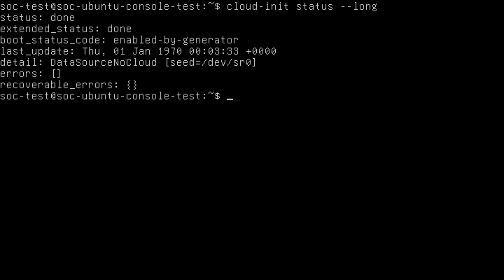

**Hình 2.1. Kết quả kiểm tra trạng thái cloud-init trên Ubuntu Server 24.04**

Mục đích của Hình 2.1 là xác định cloud-init đã hoàn tất trong máy Ubuntu, thay vì chỉ suy luận từ việc CD-ROM đã được gắn trên EVE-NG. Nội dung hình thể hiện lệnh thực tế, các trường trạng thái và dấu nhắc shell của `soc-test` trên hostname `soc-ubuntu-console-test`.

| Nội dung kiểm tra | Kết quả thực tế | Đánh giá |
|---|---|---|
| `status` | `done` | Đã hoàn tất |
| `extended_status` | `done` | Đã hoàn tất |
| `boot_status_code` | `enabled-by-generator` | Trường trạng thái quan sát được |
| `detail` | `DataSourceNoCloud [seed=/dev/sr0]` | Đã nhận nguồn NoCloud từ CD-ROM |
| `errors` | `[]` | Không liệt kê lỗi |
| `recoverable_errors` | `{}` | Không liệt kê lỗi có thể phục hồi |
| Tài khoản sử dụng | Shell `soc-test`; lệnh `whoami` ở Hình 2.2 trả về `soc-test` | Đăng nhập được xác nhận |

Kết quả cho phép xác nhận cloud-init đã hoàn tất thành công theo báo cáo trạng thái của guest, nguồn dữ liệu NoCloud được nhận từ `/dev/sr0` và tài khoản quản trị thử nghiệm có thể sử dụng console. Ý nghĩa đối với Core Layer 2 là nền hệ điều hành có thể được quản trị và tiếp tục chuẩn bị cho OVS. Kết quả này chưa chứng minh OVS đã được cài, chuyển mạch VLAN/trunk hoạt động, mirror hoạt động hoặc firewall HA đã được kiểm thử. Cách diễn giải trạng thái dựa trên tài liệu chính thức về [CLI cloud-init](https://docs.cloud-init.io/en/latest/reference/cli.html) và [reported status](https://docs.cloud-init.io/en/latest/howto/status.html).

Trường `last_update` trong ảnh ghi `Thu, 01 Jan 1970 00:03:33 +0000`; không sử dụng trường này làm thời điểm thu thập minh chứng. Đồng hồ EVE cũng báo `NTPSynchronized=no` và lệch so với máy thu thập. Thời điểm ảnh được ghi riêng theo Windows, chuyển sang UTC+07:00; chưa hiệu chỉnh đồng hồ của bất kỳ hệ thống nào. Mã thoát của lệnh chưa được thu riêng; kết luận dựa trên các trường trạng thái và ảnh, không suy diễn đã đo mã thoát bằng 0.

## 2.3. Kiểm tra hostname, NIC, CPU và RAM

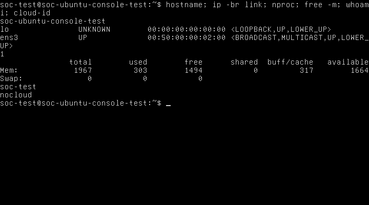

**Hình 2.2. Kết quả kiểm tra hostname, giao diện mạng và tài nguyên của node Ubuntu**

Mục đích của Hình 2.2 là đối chiếu cấu hình máy ảo do EVE/QEMU cấp với tài nguyên và tên giao diện mà Ubuntu nhận diện. Hình ghi lại lần lượt các lệnh `hostname`, `ip -br link`, `nproc`, `free -m`, `whoami` và `cloud-id`. Kết quả xác nhận khả năng quản trị guest, nhận diện cổng thử nghiệm và thiết lập đường cơ sở tài nguyên; chưa xác nhận khả năng chịu tải khi chuyển tiếp lưu lượng SOC.

| Thông số | Kết quả xác minh | Nguồn và giới hạn |
|---|---|---|
| Hostname | `soc-ubuntu-console-test` | `hostname`; ảnh ban đầu còn có `hostnamectl` |
| Hệ điều hành | Ubuntu 24.04.5 LTS, x86-64 | `hostnamectl` trên ảnh `M2-console-initial-20261031T184136+0700.png` |
| NIC Ethernet trong guest | `ens3`, MAC `00:50:00:00:02:00`, trạng thái `UP` | `ip -br link`; ngoài ra có `lo` là loopback, không phải NIC nối topology |
| Liên kết ra topology | Chưa kết nối | XML lab không có network object/interface nối mạng; TAP `vunl0_2_0` không có bridge master |
| CPU cấu hình | 1 vCPU | XML `cpu=1` và QEMU `-smp 1` |
| CPU khả dụng cho tiến trình kiểm tra | `nproc` trả về `1` | Phù hợp CPU cấu hình; không phải phép đo hiệu năng |
| RAM cấu hình | 2048 MiB | XML `ram=2048` và QEMU `-m 2048` |
| RAM guest nhìn thấy | Tổng 1967 MiB; available 1664 MiB tại lúc chụp | `free -m`; nhỏ hơn RAM cấu hình do phần bộ nhớ dành riêng cho hệ thống; số available biến đổi theo thời điểm |
| Swap | Tổng 0 MiB trong guest | `free -m`; không nhầm với swap của EVE host |
| Datasource | `cloud-id` trả về `nocloud` | Kiểm tra bổ sung trong guest |

NIC là Network Interface Card, tức giao diện mạng; vNIC là giao diện mạng ảo do QEMU cung cấp. CPU là Central Processing Unit, tức bộ xử lý trung tâm; vCPU là bộ xử lý ảo cấp cho guest. RAM là Random Access Memory, tức bộ nhớ truy cập ngẫu nhiên. Các thành phần này lần lượt cung cấp cổng chuyển tiếp, năng lực xử lý và bộ nhớ làm việc cho Core dự kiến; phép kiểm tra hiện tại xác nhận tài nguyên được nhận diện, chưa đánh giá thông lượng hoặc độ trễ.

Trạng thái `UP` của `ens3` không chứng minh có đường tới Internet, gateway hoặc một VLAN đã triển khai. Trong EVE, NIC hiện vẫn chưa nối vào topology. Tên `ens3` chỉ được xác nhận cho một NIC hiện tại; không tự gán `ens4`, `eth0` hoặc tên tiếp theo cho các NIC chưa được thêm.

Có thể tái kiểm tra bằng các lệnh chỉ đọc dưới đây. `hostnamectl` cho biết nhận dạng hệ thống; `ip -br link` liệt kê giao diện; `nproc` và `lscpu` kiểm tra CPU; `free -m` kiểm tra RAM; hai lệnh cuối kiểm tra người dùng và datasource. `lscpu` là hướng dẫn bổ sung, chưa được thực hiện trong lần chụp này.

```sh
hostnamectl
ip -br link
nproc
lscpu
free -m
whoami
cloud-id
```

## 2.4. Đề xuất số lượng NIC cho Core Open vSwitch

### 2.4.1. Cơ sở tính toán

OVS, tên đầy đủ Open vSwitch, là bộ chuyển mạch ảo mã nguồn mở. Trong thiết kế này, OVS dự kiến chuyển tiếp frame theo địa chỉ MAC và phân tách các miền Layer 2 bằng VLAN; toàn bộ gateway, định tuyến liên VLAN, firewall rules và NAT do OPNsense đảm nhiệm. SOC là Security Operations Center, tức trung tâm điều hành an ninh mạng; Core cung cấp đường truyền giữa các vùng và bản sao lưu lượng cho bộ phận giám sát của SOC, không thay firewall.

VLAN là Virtual Local Area Network, tức mạng cục bộ ảo, tạo các miền quảng bá riêng trên hạ tầng chuyển mạch. Cổng access nối thiết bị đầu cuối vào một VLAN; trunk mang lưu lượng của nhiều VLAN bằng thẻ IEEE 802.1Q. Trong topology đồ án, một trunk đến OPNsense có thể mang VLAN 30/40/50/60/99, không cần năm NIC trunk riêng cho năm VLAN. Việc bố trí năm NIC access dưới đây xuất phát từ năm kết nối endpoint dự kiến, không phải quy tắc bắt buộc một NIC cho mỗi VLAN. [Tài liệu cấu hình OVS](https://docs.openvswitch.org/en/stable/faq/configuration/).

Đối chiếu [port map M1](../../network/core-l2/port-mapping.md), [kế hoạch địa chỉ](../../network/ip-plan/vlan-ip-plan.md), [phương án M2](deployment-options.md) và AGENTS hiện hành: M1 có hai trunk tới firewall, bốn access và một mirror; AGENTS xác định thêm vùng DMZ VLAN 60, nên đề xuất dưới đây bổ sung một access DMZ. Những mô tả cũ gọi DMZ là tùy chọn không thay thế quy định VLAN hiện hành.

### 2.4.2. Phương án khuyến nghị: 8 vNIC

| Nhãn logic đề xuất | Số vNIC | Vai trò | Trạng thái |
|---|---|---|---|
| Access Data Center | 1 | Endpoint VLAN 30 | Chưa triển khai |
| Access Employee | 1 | Endpoint VLAN 40 | Chưa triển khai |
| Access Guest | 1 | Endpoint VLAN 50 | Chưa triển khai |
| Access DMZ | 1 | Endpoint VLAN 60 | Chưa triển khai |
| Access Management | 1 | Endpoint/mạng quản trị VLAN 99 | Chưa triển khai |
| Trunk OPNsense Primary LAN | 1 | Dự kiến mang VLAN 30/40/50/60/99 | Dự trữ cho M3; chưa xác minh cổng peer |
| Trunk OPNsense Secondary LAN | 1 | Dự kiến mang VLAN 30/40/50/60/99 | Dự trữ cho M3; chưa xác minh cổng peer |
| Mirror output | 1 | Xuất bản sao lưu lượng tới NIC capture của Suricata | Chưa chốt nguồn/hướng mirror hoặc peer |
| **Tổng** | **8** | **5 access + 2 trunk + 1 mirror** | **Đề xuất, chưa đổi NIC** |

Port mirroring là cơ chế sao chép frame được chọn sang cổng giám sát; SPAN là Switched Port Analyzer, tên thường dùng trong hệ sinh thái Cisco cho chức năng giám sát tương tự. Trong đồ án, cổng mirror dự kiến đưa bản sao tới Suricata, công cụ phân tích lưu lượng để phát hiện xâm nhập. Cổng mirror không thay cổng quản trị của cảm biến và không được tính như đường chuyển tiếp endpoint bình thường. Phạm vi nguồn, hướng ingress/egress và khả năng quan sát khi firewall chuyển vai trò cần chốt ở bước thiết kế tiếp theo. [OVS mirroring](https://docs.openvswitch.org/en/stable/faq/configuration/).

Phương án 8 vNIC giữ sẵn hai đường firewall cho HA (High Availability, tính sẵn sàng cao), tức khả năng tiếp tục cung cấp dịch vụ khi một thành phần gặp sự cố. Hai trunk tới Primary và Secondary là hai kết nối riêng, **không gộp thành LACP xuyên qua hai firewall**. LACP (Link Aggregation Control Protocol, giao thức điều khiển gộp liên kết) cần peer hỗ trợ và các link cùng nhóm được thiết kế phù hợp; LACP chưa thuộc kết quả kiểm chứng này.

### 2.4.3. Phương án tối giản và khả năng mở rộng

- M2 tạm chỉ giữ một trunk, năm access và một mirror thì cần 7 vNIC; phương án này chưa có kết nối riêng tới firewall thứ hai như M1. Khuyến nghị chọn 8 để chuẩn bị cho M3.
- Quản trị Core có thể thiết kế qua OVS internal interface thuộc VLAN 99, không nhất thiết thêm một vNIC. Đây là đề xuất, chưa gán IP. Nếu chọn NIC quản trị riêng thì tổng tăng lên 9 và cần xác định segment quản trị trước khi nối.
- Kiểm thử dương hai endpoint cùng VLAN phải đi qua hai cổng OVS khác nhau. Có thể xin thêm một cổng test (tổng 9 nếu giữ tám vai trò trên), hoặc xin tạm bố trí lại một cổng access chưa dùng. Không nối cả hai endpoint vào cùng bridge EVE rồi coi ping thành công là bằng chứng đã đi qua Core.
- Nếu giữ nguyên tám vai trò và bổ sung riêng một bài thử LACP hai link thì cần thêm hai vNIC, tổng 10. Số lượng có thể khác nếu tái sử dụng cổng; chưa chốt peer hoặc triển khai.
- Trước khi tăng NIC, cần kiểm tra khả năng template, số cổng GUI/API cho phép, PCI/QEMU và tên NIC thực tế sau khi thay đổi được phê duyệt. Chưa khẳng định template đã chạy thành công với 8, 9 hoặc 10 NIC.

Không có số cổng Ethernet mới, địa chỉ IP, subnet, VIP hoặc native VLAN nào được xác nhận chính thức bởi đề xuất này. Chưa thay đổi NIC của `Ubuntu-Console-Test` hoặc quyết định chuyển node kiểm thử thành Core. WAN và đường đồng bộ HA của OPNsense không tự động nối qua Core VLAN người dùng trong đề xuất tính NIC này.

## 2.5. Giải thích các thuật ngữ nền tảng

### 2.5.1. cloud-init

**Tên và nghĩa:** `cloud-init` là tên chính thức của công cụ khởi tạo tự động instance; không phải từ viết tắt cần tự tạo một tên khai triển. Có thể diễn giải tiếng Việt là công cụ thiết lập ban đầu máy chủ/máy ảo.

**Nguyên lý:** trong quá trình boot, công cụ nhận diện datasource, đọc dữ liệu khởi tạo và chạy các module tương ứng, chẳng hạn tạo user hoặc đặt hostname. Cấu hình phụ thuộc dữ liệu cung cấp và tần suất module; không giả định mọi module chạy lại ở mọi lần reboot. [Giới thiệu cloud-init](https://docs.cloud-init.io/en/latest/explanation/introduction.html).

**Vai trò và ví dụ:** trong SOC, công cụ giúp chuẩn hóa nền Ubuntu để người quản trị có thể tiếp tục chuẩn bị Core. Tại node đang kiểm tra, trạng thái `done` cùng tài khoản `soc-test` sử dụng được là kết quả đã xác minh. Việc cài OVS thông qua cloud-init là khả năng kỹ thuật, chưa được cấu hình hoặc cho phép thực hiện ở đây.

### 2.5.2. NoCloud

**Tên và nghĩa:** `NoCloud` là tên một datasource của cloud-init, không phải tên viết tắt. Trong trường hợp này có thể diễn giải là phương thức cung cấp dữ liệu khởi tạo cục bộ không cần dịch vụ cloud metadata qua mạng.

**Nguyên lý:** với đĩa seed cục bộ, cloud-init nhận diện filesystem có nhãn `CIDATA`/`cidata` và đọc đúng các tệp `user-data`, `meta-data` ở thư mục gốc. Metadata có `instance-id` để nhận dạng instance. NoCloud còn có các cách cấp dữ liệu khác; kết quả hiện tại chỉ xác nhận cách dùng CD-ROM. [NoCloud](https://docs.cloud-init.io/en/latest/reference/datasources/nocloud.html).

**Vai trò và ví dụ:** phương thức này phù hợp bootstrap node SOC đang cô lập, chưa có mạng. `DataSourceNoCloud [seed=/dev/sr0]` và `cloud-id` trả về `nocloud` xác nhận guest hiện tại đã nhận nguồn đó; không suy rộng kết quả sang seed/node cũ.

### 2.5.3. Datasource

**Tên và nghĩa:** Data Source, thường viết liền là `datasource`, nghĩa là nguồn dữ liệu cấu hình; không có chữ viết tắt bắt buộc trong ngữ cảnh này.

**Nguyên lý:** datasource là lớp cung cấp dữ liệu mà cloud-init sử dụng để nhận metadata và user-data, có thể từ nền tảng cloud hoặc nguồn cục bộ. Nó xác định nơi và cách lấy dữ liệu, không đồng nghĩa với file cấu hình cụ thể. [Datasources](https://docs.cloud-init.io/en/latest/reference/datasources.html).

**Vai trò và ví dụ:** trong quá trình chuẩn bị SOC, nhận đúng datasource giúp tránh trường hợp Ubuntu boot được nhưng thiếu user hoặc hostname mong muốn. Ở node hiện tại, datasource là NoCloud, thiết bị seed là `/dev/sr0`, còn hostname và tài khoản là các giá trị được kiểm tra riêng trong guest.

### 2.5.4. Seed ISO

**Tên và nghĩa:** Seed ISO, tức ảnh đĩa mồi khởi tạo dạng ISO 9660. Đây là cụm mô tả phương tiện chứa cấu hình, không phải tên một giao thức mạng.

**Nguyên lý:** QEMU gắn tệp ISO như CD-ROM; guest nhìn thấy thiết bị quang ảo. Dữ liệu bên trong cung cấp chỉ dẫn khởi tạo cho datasource. Với NoCloud, cần bảo đảm nhãn đĩa và tên file mà guest đọc được; tên file nguồn có đuôi `.yaml` trên host không thay thế yêu cầu tên trong ISO. [Ubuntu: dùng datasource cục bộ](https://ubuntu.com/docs/public-images/public-images-how-to/use-local-cloud-init-ds/).

**Vai trò và ví dụ:** seed riêng giúp bootstrap tài khoản quản trị cho node thử nghiệm mà không sửa image Ubuntu gốc hoặc seed của node khác. QEMU đang gắn `linux-ubuntu-24.04-soc-console-test/cdrom.iso`; kết quả `/dev/sr0` xác nhận guest dùng đĩa seed. Không công bố nội dung hash mật khẩu hoặc các dữ liệu nhạy cảm trong báo cáo.

### 2.5.5. QEMU

**Tên và nghĩa:** QEMU thường được diễn giải là Quick Emulator, bộ giả lập/ảo hóa máy tính. Tên chính thức của dự án là QEMU. [Thuật ngữ NIST](https://csrc.nist.gov/glossary/term/QEMU).

**Nguyên lý:** QEMU tạo mô hình máy gồm CPU, RAM, thiết bị mạng và ổ đĩa để chạy hệ điều hành khách. Khi kết hợp KVM (Kernel-based Virtual Machine, cơ chế ảo hóa trong nhân Linux), nó có thể sử dụng hỗ trợ ảo hóa phần cứng. [QEMU system emulation](https://www.qemu.org/docs/master/system/introduction.html).

**Vai trò và ví dụ:** QEMU là lớp chạy máy Ubuntu làm nền cho Core SOC dự kiến. Tiến trình được quan sát là `/opt/qemu-2.12.0/bin/qemu-system-x86_64`, cấp `-smp 1`, `-m 2048`, NIC VirtIO và `accel=kvm`. Đây là tham số chạy đã đọc, không phải lệnh khởi tạo mới hoặc bằng chứng OVS đã tồn tại.

### 2.5.6. QCOW2

**Tên và nghĩa:** QEMU Copy-On-Write version 2, tức định dạng ảnh đĩa QEMU dùng cơ chế sao chép khi ghi thuộc họ QCOW2. Tên định dạng không được dùng để suy luận rằng header luôn mang version 2. [QEMU glossary](https://www.qemu.org/docs/master/glossary.html), [đặc tả QCOW2](https://www.qemu.org/docs/master/interop/qcow2.html).

**Nguyên lý:** khi dùng backing file, dữ liệu chưa thay đổi được đọc từ lớp nền; dữ liệu mới được ghi vào overlay. Overlay vẫn phụ thuộc backing file, nên không phải bản sao đầy đủ độc lập. Các lớp phải được giữ nguyên hoặc xử lý bằng quy trình được phê duyệt. [QEMU disk images](https://www.qemu.org/docs/master/system/images.html).

**Vai trò và ví dụ:** QCOW2 cho phép thử nghiệm nền Ubuntu mà giữ base của đồ án. Chuỗi đã được kiểm tra ở phiên khôi phục là runtime overlay của node 2 → variant `linux-ubuntu-24.04-soc-console-test/virtioa.qcow2` → base `linux-ubuntu-24.04-ovs/virtioa.qcow2`. Phiên này chỉ đọc đường runtime từ tiến trình, không chạy kiểm tra sửa chữa ổ đĩa hoặc thay backing chain.

### 2.5.7. Console

**Tên và nghĩa:** System Console, tức giao diện điều khiển trực tiếp hệ thống; không có từ viết tắt bắt buộc. Trong node này, Ubuntu sử dụng virtual console/TTY, được hiển thị qua VGA ảo của QEMU và truy cập bằng VNC (Virtual Network Computing).

**Nguyên lý:** bàn phím và màn hình ảo cho phép tương tác với guest mà không cần NIC guest có địa chỉ IP. Đường console khác với SSH (Secure Shell, giao thức quản trị từ xa có mã hóa), vốn cần một đường mạng tới hệ thống đích. Linux phân biệt virtual console với serial console; không gọi VGA/VNC hiện tại là serial console. [Linux console](https://docs.kernel.org/admin-guide/serial-console.html), [QEMU invocation](https://www.qemu.org/docs/master/system/invocation.html).

**Vai trò và ví dụ:** console cung cấp đường bootstrap và kiểm tra Core khi mạng chưa được cấu hình. Tại đây, `soc-test` đăng nhập và chạy `cloud-init status --long` trên console thật. SSH chỉ dùng để vào EVE và vận chuyển dữ liệu chụp, không chứng minh đã SSH vào Ubuntu.

## 2.6. Phân loại kết quả và vấn đề còn tồn tại

| Hạng mục | Phân loại | Kết luận |
|---|---|---|
| Guest boot, console và user `soc-test` | Đạt, đã xác minh | Có shell thực tế và kết quả `whoami` |
| Cloud-init/NoCloud | Đạt, đã xác minh | `done`, không liệt kê lỗi, seed `/dev/sr0` |
| Hostname/NIC/CPU/RAM hiện tại | Đạt về nhận diện | Có ảnh và đối chiếu XML/QEMU |
| Tăng lên 8 vNIC | Đề xuất | Chưa thay node, chưa xác minh giới hạn hoặc tên NIC bổ sung |
| Cài đặt và dịch vụ OVS | Chưa nghiệm thu | Không cài trong phiên này; chưa chạy kiểm kê package/dịch vụ guest |
| VLAN access/trunk, mirror | Chưa kiểm thử | Chưa có cấu hình hoặc lưu lượng thử nghiệm |
| IP, subnet, số cổng hai đầu | Chưa xác nhận | Các giá trị M1 tiếp tục là đề xuất |
| SSH vào guest | Chưa kiểm thử | Console thành công không thay cho SSH thành công |
| Đồng hồ hệ thống | Còn tồn tại | `last_update` năm 1970 và EVE NTP chưa đồng bộ; chưa sửa |
| Hoàn tất toàn bộ M2 | Chưa đạt | Mới hoàn thành bước chuẩn bị hệ điều hành |

Trong lần thu thập đầu, chuỗi phím cho biến `_NPROCESSORS_ONLN` bị console nhận sai thành dấu gạch ngang nên `getconf` báo lỗi; không dùng lần đó để kết luận CPU. Lần kiểm tra sau dùng `nproc`, trả về `1` và được đối chiếu với QEMU. Một ảnh ban đầu chụp trước khi output cloud-init được vẽ xong nên chưa đủ minh chứng dù tên file chứa `success`. Các ảnh và JSON này được giữ nguyên, phân loại rõ trong danh mục; Hình 2.1 và 2.2 chỉ dùng hai ảnh chính đã đọc kiểm tra.

## 2.7. Bước tiếp theo cần phê duyệt

1. Chốt phương án 8 vNIC, mục đích từng cổng, peer kiểm thử trunk/mirror, cách kiểm thử hai endpoint cùng VLAN và lựa chọn node sẽ làm Core. Giữ nguyên các node cũ và không mặc định biến node kiểm thử thành Core.
2. Nếu cần tăng NIC hoặc chuẩn bị node Core, phê duyệt rõ thao tác trên node đích và việc dừng/khởi động lại nếu EVE yêu cầu. Chỉ sau thay đổi được duyệt mới đối chiếu NIC theo MAC, tên guest và cổng EVE.
3. Phê duyệt riêng kế hoạch cài `openvswitch-switch` trong guest, gồm đường cung cấp package. Guest đang cô lập, chưa có đường tải gói được xác nhận; không tự nối pnet/NAT/Internet hoặc sửa seed để cài gói.
4. Phê duyệt cấu hình chuyển mạch Layer 2 và mạng kiểm thử trước khi triển khai VLAN/trunk/mirror. Core không tạo gateway liên VLAN, firewall/NAT; các chức năng đó ở OPNsense.

## 2.8. Tài liệu và khả năng đưa vào Word

Tài liệu Markdown này là bản nội dung báo cáo có thể tái sử dụng. Bản `.docx` cùng tên chứa ảnh thật, chú thích phía dưới và bảng kết quả, dùng A4, Times New Roman 13, lề trái 3 cm, các lề khác 2 cm. Số chương/mục và Hình 2.1–2.2 được ghi rõ; khi ghép vào luận văn đầy đủ cần đối chiếu mục lục và số hình chung. Danh mục minh chứng, log chép kết quả và JSON gốc của bộ thu thập nằm trong `docs/evidence/M2/`; minh chứng cũ tại `docs/evidence/eve-ng/` được giữ nguyên.

Các nguồn chính thức được dẫn ngay tại nội dung liên quan; ngày truy cập 31/10/2026. Tài liệu online giải thích nguyên lý, không xác nhận phiên bản cloud-init hoặc tính năng OVS của guest hiện tại. Ảnh và JSON mới là căn cứ cho các kết quả thực nghiệm.


## 2.9. Chuẩn bị tài nguyên Core mới trong giai đoạn đầu M2

Phần 2.1–2.8 ở trên lưu kết quả kiểm chứng nền Ubuntu và thiết kế tại bước trước. Từ mục 2.9, báo cáo ghi nhận **tài nguyên mới đã được tạo theo phê duyệt**, phân biệt với các kiểm thử guest chưa được phép thực hiện. Hai node `Ubuntu-Test` và `Ubuntu-Console-Test` được giữ nguyên. Bản Word/Markdown cũ được bảo toàn; đây là phiên bản báo cáo M2 cập nhật.

### 2.9.1. Phạm vi phê duyệt và phương pháp

Được phép chuẩn bị bundle OVS offline từ Ubuntu 24.04 chính thức, image/đĩa riêng ít nhất 8 GiB, seed quản trị riêng và node mới 1 vCPU/2048 MiB/8 vNIC, để tắt và chưa nối mạng. Việc tạo lab/node sử dụng native PHP classes `Lab` và `Node` của EVE qua SSH quản trị, cùng cơ chế backend của EVE; không đăng nhập API Web, không tạo cookie hay thay phiên Web người dùng. Không gọi start/stop/wipe/fixpermissions toàn hệ thống.

Khởi động Core, cài OVS vào guest, tạo bridge/VLAN/trunk/mirror và nối mạng tiếp tục nằm ngoài phạm vi. Không sửa template chung, image gốc, lab cũ hoặc cấu hình Windows/VMware.

### 2.9.2. Kết quả image và đĩa Core

| Hạng mục | Kết quả đã xác minh |
|---|---|
| Image directory | `/opt/unetlab/addons/qemu/linux-ubuntu-24.04-soc-core-l2` |
| Disk | `virtioa.qcow2`, bản sao đầy đủ độc lập, không có backing-file |
| Virtual capacity | 8,589,934,592 byte, tương đương 8 GiB |
| File size | 621,346,944 byte; dung lượng file khác virtual capacity |
| Kiểm tra QCOW2 | `qemu-img check`: rc=0, `check-errors=0` |
| So nội dung với base | `qemu-img compare`: rc=0, `Images are identical` |
| Disk SHA-256 mới | `0de140dda997a09b6d72230ae74b68612fdc2cfbc59949d7e2021561246ac718` |
| Base SHA-256 bảo toàn | `04e8f2461a16a44e78a370284471f29616cdd9baf1893df25807b71f985b6c94` |

Quy trình sao chép kiểm tra checksum trước khi mở rộng, chỉ resize file mới, sau đó kiểm tra cấu trúc và so dữ liệu. Cảnh báo `Image size mismatch` trong compare là hệ quả đĩa mới 8 GiB lớn hơn base 3.5 GiB; công cụ vẫn trả về dữ liệu giống nhau, vùng đuôi tăng thêm bằng zero. Kết quả xác nhận tính toàn vẹn mức ảnh đĩa, **chưa xác nhận partition/root filesystem đã mở rộng**, vì Core chưa khởi động. [QEMU image utility](https://www.qemu.org/docs/master/tools/qemu-img.html).

### 2.9.3. Lab, node và tám interface đã khai báo

Lab mới là `/opt/unetlab/labs/SOC-M2-Core-L2.unl`, UUID `f39cfc8c-5eaf-461e-bb0c-60b5fde848b7`. Node `SOC-Core-L2` có ID **3**, UUID `2b295168-b72e-4de7-b364-37298252dd9f`, CPU=1, RAM=2048 MiB, Ethernet=8, template Linux, VirtIO NIC, QEMU 2.12.0. Native EVE status đọc lại là **0 — stopped**; không có tiến trình QEMU mang UUID Core và chưa có runtime directory/overlay cho lab mới.

Trong lần tạo đầu, ID 1 của lab mới làm hàm EVE `getStatus()` nhìn thấy cổng console của node ID 1 đang chạy ở lab cũ và trả về 2. Không có Core process hoặc runtime, nên đây là kết quả trạng thái nhầm theo cổng, không phải Core đã boot. Chỉ ID của node mới được chuyển sang 3 chưa dùng; sau đó status=0 được đối chiếu lại với UUID/process/runtime. Không dừng VM cũ hoặc xóa/wipe dữ liệu để xử lý.

| EVE interface ID | Nhãn EVE đã đọc | MAC đã đọc | Network ID | NIC guest |
|---|---|---|---|---|
| 0 | e0 | `02:53:45:f2:19:00` | 0, chưa nối | Chưa xác minh |
| 1 | e1 | `02:53:45:f2:19:01` | 0, chưa nối | Chưa xác minh |
| 2 | e2 | `02:53:45:f2:19:02` | 0, chưa nối | Chưa xác minh |
| 3 | e3 | `02:53:45:f2:19:03` | 0, chưa nối | Chưa xác minh |
| 4 | e4 | `02:53:45:f2:19:04` | 0, chưa nối | Chưa xác minh |
| 5 | e5 | `02:53:45:f2:19:05` | 0, chưa nối | Chưa xác minh |
| 6 | e6 | `02:53:45:f2:19:06` | 0, chưa nối | Chưa xác minh |
| 7 | e7 | `02:53:45:f2:19:07` | 0, chưa nối | Chưa xác minh |

Node có 0 network object và 0 liên kết. Nhãn EVE `e0`–`e7` đã được xác minh ở cấp cấu hình; không coi đó là tên Linux và không giả định `ens3`, `ens4` cho Core chưa boot. Vai trò access/trunk/mirror vẫn theo thiết kế, chưa có cấu hình OVS áp dụng.

## 2.10. Seed NoCloud và tài khoản quản trị riêng

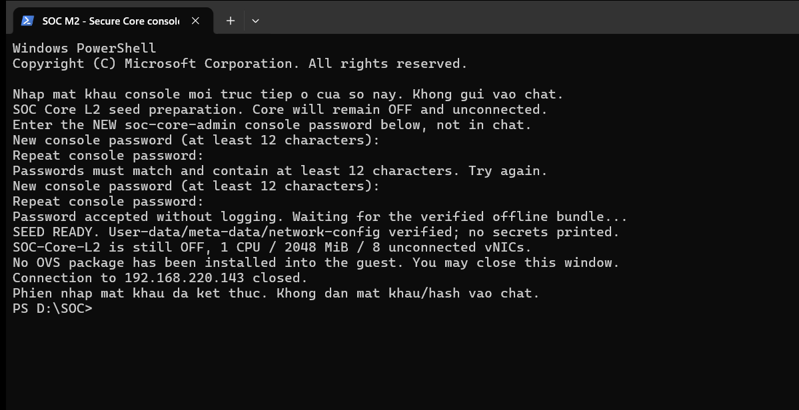

**Hình 2.3. Kết quả tạo seed NoCloud riêng cho node SOC-Core-L2 ở trạng thái tắt**

Mục đích của hình là chứng minh quy trình nhập mật khẩu qua terminal riêng đã kết thúc và seed đã được đóng gói, không phải chứng minh đăng nhập guest Core. Ảnh là cửa sổ PowerShell/SSH thực tế, chụp nguyên cửa sổ bằng Win32 PrintWindow lúc 19:55:46 ngày 31/10/2026, UTC+07:00. Input getpass không hiển thị mật khẩu; ảnh không chứa password/hash. Kết quả cho thấy seed sẵn sàng, Core vẫn tắt và chưa cài OVS.

| Trường seed | Kết quả kiểm tra tĩnh |
|---|---|
| Path | `/opt/unetlab/addons/qemu/linux-ubuntu-24.04-soc-core-l2/cdrom.iso` |
| Owner/mode | root, 0600; thư mục chứa input riêng 0700 |
| Volume label | `cidata`, có Rock Ridge và Joliet |
| File gốc ISO | `user-data`, `meta-data`, `network-config`, archive bundle OVS |
| Tài khoản / hostname đề nghị trong seed | `soc-core-admin` / `soc-core-l2` |
| Instance-id | `iid-soc-core-l2-da130c3e-4cfe-4e11-91cb-254581c02547` |
| Console | Có hash SHA-512 crypt, `lock_passwd: false`; chưa thử login Core |
| SSH password/root login | `ssh_pwauth: false`, `disable_root: true`; hiệu lực runtime chưa kiểm tra |
| Quyền quản trị | Seed khai báo nhóm adm/sudo; chưa xác minh sudo trong guest |
| Network-config | Match 8 MAC, DHCP4/DHCP6/RA tắt, không địa chỉ IP, optional=true |
| Seed size / SHA-256 | 48,996,352 byte / `961ae4131e0f758a4a3b3565a29ebe87f7cadb90e368a5745ca7fcd33b011578` |

Mật khẩu do người dùng nhập trực tiếp hai lần qua getpass trên TTY SSH. Plaintext chỉ dùng trong bộ nhớ để đưa vào OpenSSL qua stdin; không đặt trên command line, chat, log hoặc repository. Hash chỉ nằm trong seed/input riêng bảo vệ trên EVE, không được sao chép vào bộ báo cáo. Public key quản trị chỉ được nhận khi fingerprint khớp khóa đã xác minh trước đây. File mô tả trong repository đã che hash/key material, không dùng thay seed thật.

Đã parse cấu trúc YAML và đối chiếu tên file trong cả hai namespace ISO, nhưng **chưa chạy cloud-init schema/runtime trên Core**. Việc guest nhận datasource, user/hostname, tám NIC và root filesystem là tiêu chí bước boot tiếp theo. Cấu hình NoCloud tĩnh không thay cho kết quả `cloud-init status --long` trong Core. [NoCloud chính thức](https://docs.cloud-init.io/en/latest/reference/datasources/nocloud.html).

## 2.11. Bundle Open vSwitch offline cho Ubuntu 24.04 amd64

### 2.11.1. Nguồn, phiên bản và toàn vẹn

Đã chuẩn bị **70 package** gồm root package `openvswitch-switch` và dependency/Pre-Depends do APT giải từ nguồn Ubuntu Noble chính thức; không bao gồm mọi Recommends/Suggests. `openvswitch-switch`, `openvswitch-common` và `python3-openvswitch` được chọn ở phiên bản **3.3.9-0ubuntu0.24.04.1**. Kiến trúc các gói chỉ có `amd64` hoặc `all`.

Metadata được tải bằng Windows qua HTTPS từ `archive.ubuntu.com` và `security.ubuntu.com`, gồm InRelease của noble/noble-updates/noble-security và sáu index main/universe amd64. Đã xác minh chữ ký với Ubuntu Archive Automatic Signing Key (2018), fingerprint `F6ECB3762474EDA9D21B7022871920D1991BC93C`. Hash index khớp InRelease; hash từng `.deb` khớp index; các trường Package/Version/Architecture trong control archive khớp manifest. Đây là chuỗi kiểm tra metadata → package, không chỉ so hai bản sao của cùng một file. [APT archive authentication](https://manpages.ubuntu.com/manpages/noble/man8/apt-secure.8.html).

| Artifact | Kết quả |
|---|---|
| Windows bundle | `staging/soc-core-l2-20261031-stage1/ovs-noble-amd64-offline-20261031-v2.tar` |
| EVE bundle | `/opt/unetlab/soc-core-preparation-20261031/ovs-noble-amd64-offline-20261031-v2.tar` |
| Archive size | 48,619,520 byte |
| Tổng dung lượng 70 `.deb` | 25,963,666 byte |
| Bundle SHA-256 | `c513ad7720c719f5f7bd24b2e73af3b2ec55a7f60ca67a0492621d25f5c2940b` |
| OVS switch package SHA-256 | `7a9a359d6a3bc207b210ef2cf6b9f11244f89eb2a910b4ba863ebef08e85dd0a` |

### 2.11.2. Bộ giải APT tách riêng và giới hạn tương thích

APT executable sẵn có trên EVE chỉ được dùng làm bộ giải và kiểm tra cache: toàn bộ sources, Etc, status, state, cache và log được tách vào `/opt/unetlab/soc-core-preparation-20261031/apt-root`. Sources chỉ trỏ tới file repository Noble đã xác thực; status bắt đầu và kết thúc vẫn rỗng. Không dùng package status, sources hoặc cache Jammy của host để lựa chọn gói. Không cài phần mềm lên EVE để chuẩn bị bundle.

Kiểm tra cuối dùng `--download-only --no-download --no-install-recommends`; đã đủ byte trong cache, rc=0 và có dòng `Download complete and in download only mode`. Thông báo kế hoạch `70 newly installed` trong output APT **không phải 70 gói đã được cài**. Hash `/var/lib/dpkg/status` và các file `/etc/apt` của host không đổi. [APT configuration isolation](https://manpages.ubuntu.com/manpages/noble/man5/apt.conf.5.html).

Bundle phù hợp release/architecture và đã khép dependency theo trạng thái rỗng của bộ giải, nhưng chưa chứng minh tương thích kernel/datapath hoặc installed-state thực của Core. Sau boot phải kiểm tra `uname -r`, module openvswitch, kiến trúc và mô phỏng cài theo package state guest. Không cài mù toàn bộ 70 `.deb`: nhiều gói nền đã có trong guest và cần tránh nâng/gỡ thành phần ngoài phạm vi. Mọi cài OVS thực tế tiếp tục cần phê duyệt riêng.

## 2.12. Minh chứng kiểm tra cuối và tình trạng tài nguyên

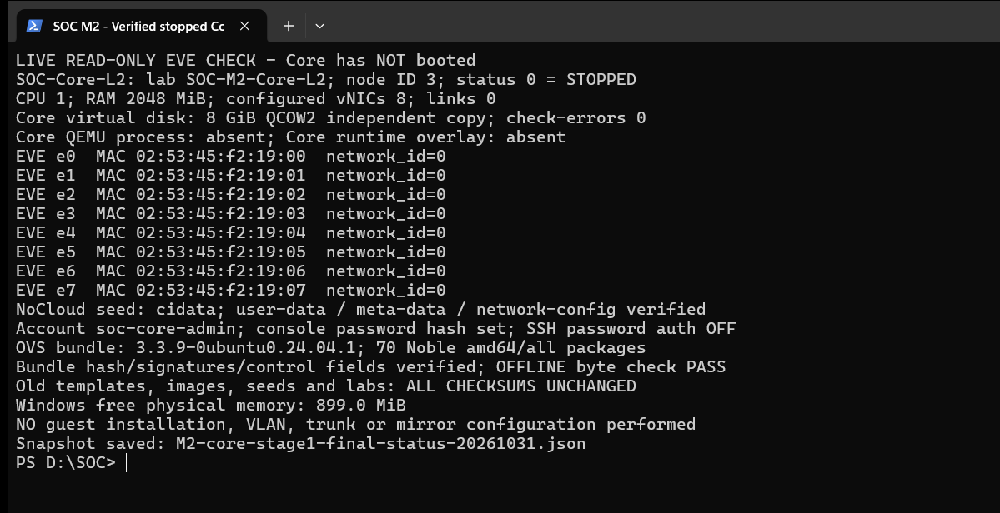

**Hình 2.4. Kiểm tra trạng thái tắt và tám giao diện mạng ảo đã khai báo của SOC-Core-L2**

Hình 2.4 ghi lại terminal thật chạy bộ kiểm tra chỉ đọc trên EVE, chụp lúc 19:57:58 UTC+07:00. Nội dung cho biết node status=0, cấu hình CPU/RAM/8 NIC, MAC của từng interface, network_id=0, không Core process/runtime, seed và bundle đã kiểm tra, checksum tài nguyên cũ bảo toàn. Đây là output kiểm tra từ EVE và Windows, **không phải console của guest Core đang boot hoặc ảnh GUI topology**. Ảnh nguyên cửa sổ, không cắt/ghép/sửa nội dung kỹ thuật.

Lần kiểm tra Windows lúc **2026-10-31T20:00:08.3518594+07:00** ghi FreePhysicalMemory **841,768 KiB, khoảng 822.0 MiB**; tổng RAM nhìn thấy khoảng 15.7 GiB. RAM Windows dao động trong phiên, không dùng số 899 MiB của ảnh chụp trước để thay mẫu mới hơn. EVE `free -m` ở lần đọc 20:00 cho available **5352 MiB**, swap dùng 0 MiB; việc EVE còn available không đồng nghĩa host Windows đã đủ RAM vật lý.

Theo ngưỡng vận hành đề xuất trong kế hoạch (Windows available ít nhất 2 GiB, EVE MemAvailable ít nhất 3 GiB trước boot), **Windows hiện chưa đạt điều kiện đề xuất để khởi động Core**. Không tự đóng ứng dụng/VM hoặc đổi RAM VMware. Người dùng có thể lưu công việc rồi tự đóng tab/ứng dụng không dùng và các cửa sổ terminal SOC đã hoàn tất; nếu muốn dừng VM khác thì phải xác định riêng, không dừng hai node kiểm chứng. Sau đó đo lại cả hai lớp tài nguyên. Ngưỡng này là lựa chọn cho lab, không phải bảo đảm của nhà cung cấp.

## 2.13. Giải thích thuật ngữ của bước chuẩn bị Core

| Tên tiếng Anh đầy đủ / viết tắt | Nghĩa tiếng Việt | Nguyên lý | Vai trò trong SOC và ví dụ của đồ án |
|---|---|---|---|
| Open vSwitch — OVS | Bộ chuyển mạch ảo | OVSDB lưu cấu hình, daemon/datapath chuyển frame theo chính sách L2 | Core SOC dự kiến thực hiện VLAN/trunk/mirror; hiện mới có bộ cài, chưa cài guest |
| Virtual Network Interface Card — vNIC | Giao diện mạng ảo | QEMU mô phỏng card với MAC và kết nối backend riêng | Đã khai báo 8 vNIC e0–e7 trên EVE; tên guest còn chưa xác minh |
| QCOW2 overlay — QEMU Copy-On-Write version 2 overlay | Lớp ảnh đĩa ghi thay đổi | Đọc dữ liệu chưa sửa từ backing, ghi thay đổi ở overlay; phụ thuộc chuỗi backing | Image Core mới là full copy độc lập; runtime overlay EVE chưa tạo vì Core chưa boot; overlay cũ giữ nguyên |
| cloud-init (tên sản phẩm, không tự tạo dạng khai triển) | Công cụ khởi tạo instance | Nhận datasource, đọc user-data/meta-data/network-config và chạy module theo boot/frequency | Seed Core khai báo tài khoản/hostname riêng; trạng thái done của node console không suy rộng cho Core |
| Offline package — Debian binary package `.deb` | Gói cài đặt dùng khi target không có Internet | Gói và dependency được tải trước, xác thực, chuyển qua phương tiện cục bộ rồi giải quyết theo trạng thái target | 70 gói Noble trong ISO riêng cho Core; chưa chạy cài đặt guest |
| Network bridge / Layer 2 bridge | Cầu nối chuyển mạch Layer 2 | Học MAC và chuyển frame trong miền được phép | Bridge OVS dự kiến tên br-soc, chưa tạo; khác bridge EVE dùng nối TAP |
| Access port | Cổng truy nhập một VLAN | Frame endpoint được gán vào VLAN của cổng | Vai trò access 30/40/50/60/99 thuộc thiết kế, chưa gán lên e0–e4 |
| VLAN trunk port | Cổng mang nhiều VLAN | Frame 802.1Q mang VLAN ID để dùng chung link | Hai cổng độc lập dự kiến tới hai OPNsense; chưa nối và không là bond LACP |
| Port mirroring | Sao chép lưu lượng sang cổng giám sát | Nhân bản frame được chọn tới capture port | Cổng thứ tám dự kiến gửi traffic cho Suricata; chưa cấu hình mirror, không phải IPS inline |

Các thuật ngữ đã có phần giải thích chi tiết hơn ở mục 2.5 và [kế hoạch triển khai Core](core-l2-implementation-plan.md). Ví dụ chưa được triển khai được đánh dấu rõ; không coi VLAN/IP hoặc port-to-port dự kiến là chính thức chỉ vì EVE đã có tám interface.

## 2.14. Đánh giá hoàn thành và bước tiếp theo

| Hạng mục | Kết quả ở cuối giai đoạn đầu |
|---|---|
| Bundle OVS chính thức | Đạt kiểm tra nguồn/chữ ký/hash/control và dependency/cache; chưa nghiệm thu runtime guest |
| Image/đĩa Core 8 GiB | Đạt kiểm tra QCOW2 và so dữ liệu; root filesystem guest chưa kiểm tra |
| Seed/tài khoản riêng | Đạt chuẩn bị tĩnh và bảo vệ bí mật; console login/cloud-init Core chưa thử |
| Node 1 CPU/2048 MiB/8 NIC | Đã tạo, status=0, 0 network/link, chưa có process/runtime overlay |
| Tài nguyên cũ | 9 file template/base/variant/seed/lab đều giữ SHA; hai QEMU cũ vẫn PID287703 và297601 |
| VLAN/trunk/mirror/bridge OVS | Chưa cấu hình, đúng giới hạn phê duyệt |
| Windows RAM | Chưa đạt ngưỡng vận hành đề xuất; cần người dùng xử lý rồi đo lại |

Sau khi người dùng giải phóng tài nguyên và phê duyệt **start duy nhất SOC-Core-L2**, mới boot, đăng nhập console bằng soc-core-admin và kiểm tra cloud-init, hostname, 8 NIC theo MAC, CPU/RAM, root partition/filesystem. Chưa cài OVS trong bước boot này. Khi các kiểm tra guest đạt, mới đề nghị phê duyệt mô phỏng/cài OVS offline và các bước cấu hình Layer 2 riêng.

Bộ báo cáo cập nhật gồm Word/Markdown mới, hai ảnh thật mới, snapshot trước/sau, cấu hình node/XML, metadata/network-config không chứa bí mật, log xác minh package, manifest và danh mục ảnh. Không sao chép seed ISO hoặc user-data chứa hash vào repository. Ảnh topology/settings EVE GUI chưa chụp trực tiếp: người dùng mở lab SOC-M2-Core-L2, hiển thị SOC-Core-L2 đang tắt và settings Ethernet=8, chụp PNG nguyên bản bằng Snipping Tool và lưu vào docs/evidence/M2 với thời điểm UTC+07:00. Ảnh terminal không được gán nhãn thành ảnh topology.


## 2.15. Bản chốt payload v2 và kiểm tra trước bước boot

Kiểm tra archive cuối phát hiện một mục `.deb.part-1` **0 byte**, do lần tải mạng bị timeout; không có package `.deb` sai checksum. Đã tạo bundle v2 loại mục tạm này và cập nhật SHA256SUMS bên trong archive. Bản v1 được giữ lại để đối chiếu; không xóa dữ liệu cũ. Tất cả 70 package thật của hai bản có cùng hash đã xác minh.

Chỉ seed của Core mới đang tắt được đóng gói lại bằng payload v2, giữ nguyên tài khoản, password hash, instance-id, public key và network-config. Seed v1 được lưu root-only ở staging riêng trước khi thay file `cdrom.iso` của Core; hai seed/image/lab cũ không thay đổi. Không boot guest để làm việc này. Các bảng hash/path bundle trong bản báo cáo chốt đã dùng **v2 hiện hành**; ảnh Hình 2.3–2.4 được chụp trước khi bỏ mục tạm và chỉ chứng minh trạng thái/cấu hình tại thời điểm chụp, không thay snapshot/hash v2.

Bundle hiện hành: `/opt/unetlab/soc-core-preparation-20261031/ovs-noble-amd64-offline-20261031-v2.tar`; SHA-256 `c513ad7720c719f5f7bd24b2e73af3b2ec55a7f60ca67a0492621d25f5c2940b`. Seed hiện hành: `/opt/unetlab/addons/qemu/linux-ubuntu-24.04-soc-core-l2/cdrom.iso`; SHA-256 `961ae4131e0f758a4a3b3565a29ebe87f7cadb90e368a5745ca7fcd33b011578`. Không có mục `.part-*` trong archive v2. Kiểm tra hash và control của 70 `.deb`, cùng APT download-only/no-download, đều đạt lại ở v2.

Snapshot chốt: `2026-10-31T20:09:27.482754+07:00`. EVE status=0, 8 interface network_id=0, không Core QEMU process hoặc runtime directory. Chín file cũ tiếp tục khớp checksum ban đầu. RAM Windows tại `2026-10-31T20:09:28.5402568+07:00` chỉ còn **442.3 MiB**; EVE memory tại cùng lần đọc được ghi nguyên văn trong JSON. Đây là mẫu mới hơn số liệu mục 2.12, **Windows vẫn chưa đạt ngưỡng vận hành 2 GiB đề xuất**.

Để tiếp tục, dùng `seed-ready-v2.json`, `bundle-ready-v2.json`, `bundle-validated-v2.json` trong `/opt/unetlab/soc-core-preparation-20261031/` và snapshot v2 trong thư mục minh chứng. Không coi các marker v1 là trạng thái payload mới nhất, không chạy lại thao tác tạo image/lab khi đã tồn tại. Chờ người dùng xử lý RAM và phê duyệt boot riêng Core; cài OVS hoặc nối mạng vẫn cần duyệt riêng.

[Danh mục minh chứng bản chốt](../evidence/M2/M2-core-stage1-final-evidence-index-20261031.md). Bản Word được kiểm tra ở mức ZIP/XML, định dạng trang/font và ảnh nhúng; chưa mở để kiểm tra bố cục trực quan bằng Word.


## 2.16. Giai đoạn 2: tiền kiểm tra khởi động Core ngày 31/10/2026

Mục này cập nhật trạng thái sau các mốc lịch sử ở mục 2.1–2.15. Người dùng đã phê duyệt khởi động duy nhất SOC-Core-L2 trong SOC-M2-Core-L2, với điều kiện Windows có ít nhất 2 GiB RAM khả dụng. Quyền khởi động đã được cấp; trở ngại hiện tại là tài nguyên, không phải thiếu phê duyệt. Không cài OVS hoặc nối mạng trong giai đoạn này.

### 2.16.1. Kết quả kiểm tra tài nguyên và quyết định

Thời điểm snapshot: 2026-10-31T20:15:52.446447+07:00; mẫu RAM Windows: 2026-10-31T20:15:53.2551919+07:00. Dùng giờ bộ thu Windows UTC+07:00; đồng hồ EVE chưa được coi là nguồn thời gian đáng tin cậy.

| Hạng mục | Kết quả đo | Đánh giá |
|---|---|---|
| Windows RAM khả dụng | 586,348 KiB = 572.6 MiB, khoảng 0.559 GiB | Không đạt điều kiện bắt buộc 2 GiB |
| EVE RAM available | 5335 MiB, khoảng 5.21 GiB; tổng 7897 MiB | Đạt mức dự phòng 3 GiB đề xuất trong kế hoạch |
| EVE swap | 0 MiB đang dùng | Số liệu tại thời điểm đọc |
| Core ID 3 | status=0; không có tiến trình QEMU hoặc thư mục runtime | Vẫn tắt, chưa gửi lệnh start |
| Cấu hình node | 1 vCPU, 2048 MiB, 8 vNIC; 0 network/link | Đã đọc trực tiếp cấu hình EVE; chưa phải thông số guest runtime |
| Image Core và seed | SHA-256 hiện tại khớp marker giai đoạn 1 | Không thay image/seed |
| Tài nguyên cũ | 9 checksum được bảo vệ giữ nguyên; hai tiến trình Ubuntu kiểm chứng vẫn chạy | Không thay đổi vòng đời hoặc cấu hình cũ |

Kết luận: **chưa khởi động Core vì Windows không đạt ngưỡng RAM**. RAM khả dụng bên trong EVE không thay thế điều kiện RAM của Windows. Chưa thể nghiệm thu Giai đoạn 2; đây là điểm dừng trước khởi động theo điều kiện của người dùng, không phải lỗi boot Ubuntu.

Nguồn trực tiếp: [snapshot JSON](../evidence/M2/M2-core-stage2-preflight-20261031T2015+0700.json) và [log tiền kiểm tra](../evidence/M2/M2-core-stage2-preflight-20261031T2015+0700.log). Dung lượng đĩa 8 GiB và kiểm tra QCOW2 trước đây là kết quả giai đoạn 1; lần này đối chiếu checksum, chưa kiểm tra phân vùng hoặc filesystem trong guest.

### 2.16.2. Bảng đối chiếu cổng: cấu hình đã đọc và mapping chưa xác minh

| Cổng EVE | MAC khai báo | NIC Ubuntu | QEMU runtime | Vai trò dự kiến, chưa cấu hình |
|---|---|---|---|---|
| e0 | 02:53:45:f2:19:00 | Chưa xác minh | Chưa khởi động | Access VLAN 30 |
| e1 | 02:53:45:f2:19:01 | Chưa xác minh | Chưa khởi động | Access VLAN 40 |
| e2 | 02:53:45:f2:19:02 | Chưa xác minh | Chưa khởi động | Access VLAN 50 |
| e3 | 02:53:45:f2:19:03 | Chưa xác minh | Chưa khởi động | Access VLAN 60 |
| e4 | 02:53:45:f2:19:04 | Chưa xác minh | Chưa khởi động | Access VLAN 99 |
| e5 | 02:53:45:f2:19:05 | Chưa xác minh | Chưa khởi động | Trunk OPNsense Primary |
| e6 | 02:53:45:f2:19:06 | Chưa xác minh | Chưa khởi động | Trunk OPNsense Secondary |
| e7 | 02:53:45:f2:19:07 | Chưa xác minh | Chưa khởi động | Mirror Suricata |

Bảng này là danh mục cổng EVE/MAC đã khai báo, **chưa phải mapping NIC thực tế trong Ubuntu**. Không điền ens3, ens4 hoặc tên PCI/QEMU khi chưa có runtime. Mọi cổng vẫn network_id=0; vai trò VLAN/trunk/mirror chỉ là thiết kế. Sau boot, đối chiếu MAC từ `ip -br link` hoặc `ip -j link` với MAC trong đối số QEMU và cổng EVE, kiểm tra đủ tám MAC duy nhất; loại giao diện loopback khỏi số lượng vNIC. [CSV mapping chờ kiểm chứng](../evidence/M2/M2-core-stage2-preflight-20261031T2015+0700-nic-mapping.csv).

### 2.16.3. Kiểm tra và ảnh thực tế còn chờ

Chưa có runtime Core để xác minh firmware, CPU/RAM QEMU, tám thiết bị mạng, ổ đĩa runtime hoặc CD-ROM NoCloud đang gắn. Chưa quan sát màn hình login và chưa chạy bất kỳ lệnh nào trong guest Core. Kết quả cloud-init thành công của Ubuntu-Console-Test ở mục trước không được suy rộng sang SOC-Core-L2.

Sau khi đạt điều kiện tài nguyên, kiểm tra đúng UUID node, đường dẫn lab và ID 3 trước khi bật riêng Core. Đọc tiến trình QEMU và chuỗi backing của ổ đĩa runtime; ghi nhận CPU, RAM, NIC/MAC/backend, firmware thực tế và seed CD-ROM. Không suy diễn BIOS/UEFI chỉ từ tên template. Nếu đến login, người dùng tự nhập tài khoản soc-core-admin và mật khẩu trên console; không thu thập phím nhập, mật khẩu hoặc hash.

Các lệnh chẩn đoán được phê duyệt, chỉ thực hiện sau khi xác nhận đã đăng nhập đúng guest:

```text
cloud-init status --long
cloud-id
hostnamectl
ip -br link
lsblk
free -h
nproc
```

| Mốc ảnh dự kiến | Chú thích dự kiến | Trạng thái hiện tại |
|---|---|---|
| Node chạy trong lab riêng | Hình 2.5. Trạng thái hoạt động của SOC-Core-L2 trên EVE-NG | Chưa chụp vì chưa bật Core |
| Console tới login | Hình 2.6. Màn hình đăng nhập Ubuntu của SOC-Core-L2 | Chưa chụp |
| cloud-init và cloud-id | Hình 2.7. Kết quả khởi tạo NoCloud trên SOC-Core-L2 | Chưa chụp |
| NIC và MAC | Hình 2.8. Tám giao diện mạng ảo thực tế trên Ubuntu Core | Chưa chụp |
| Hostname, CPU/RAM và đĩa | Hình 2.9. Thông tin hệ thống và tài nguyên của Ubuntu Core | Chưa chụp |

Các chú thích trên là kế hoạch, không phải minh chứng đã có. Không tạo ảnh thay thế, không dùng ảnh node cũ để minh chứng Core. Công cụ RFB hiện có hỗ trợ chụp framebuffer QEMU thật khi node chạy; giai đoạn này không có framebuffer Core. Nếu không truy cập được GUI EVE, người dùng mở đúng lab, chụp nguyên màn hình trạng thái node bằng Snipping Tool, lưu PNG vào docs/evidence/M2 kèm thời điểm UTC+07:00. Với console, ảnh phải chứa đủ lệnh, kết quả và dấu nhắc nhận diện guest; chia thành nhiều ảnh nếu cần, tránh cắt kết quả quan trọng. Mỗi ảnh sau thu thập phải bổ sung mục đích, nội dung, kết quả và ý nghĩa; tuyệt đối không chụp nội dung bí mật.

### 2.16.4. Thuật ngữ phục vụ diễn giải kết quả

Các giải thích chi tiết cloud-init, NoCloud, datasource, seed ISO, QEMU, QCOW2, console và vNIC đã có tại mục 2.5 và 2.13, cùng nguồn chính thức trong bản báo cáo trước. Khi sử dụng cho Core, phải giữ các trạng thái sau:

| Thuật ngữ | Ý nghĩa trong phép kiểm tra Core |
|---|---|
| QEMU runtime | Phiên máy ảo đang thực thi; phải đọc tiến trình thực tế để xác nhận CPU, bộ nhớ và thiết bị, hiện chưa tồn tại |
| vNIC — Virtual Network Interface Card | Card mạng ảo; tám cổng đã khai báo trong EVE, số lượng Ubuntu nhận diện còn chờ boot |
| MAC — Media Access Control address | Địa chỉ lớp liên kết của NIC; dùng đối chiếu EVE, QEMU và Ubuntu, không thay thế xác minh đường nối vật lý/ảo |
| Firmware | Phần mềm khởi động máy ảo trước hệ điều hành; loại BIOS/UEFI và cấu hình thực tế của Core chưa xác minh |
| cloud-init / NoCloud | Cơ chế khởi tạo từ dữ liệu cục bộ; chuẩn bị seed chưa đồng nghĩa guest đã xử lý seed thành công |
| QCOW2 overlay | Lớp lưu thay đổi runtime của QEMU; Core hiện chưa có runtime để kiểm tra chuỗi đĩa |
| Available RAM | Chỉ số tài nguyên dùng làm điều kiện trước boot ở từng lớp host; số đo Windows và EVE phải đánh giá riêng, không cộng lại |

Trong SOC dự kiến, Core dùng vNIC cho access/trunk/mirror Layer 2; OPNsense xử lý gateway, định tuyến, firewall và NAT. Hiện chưa có OVS bridge hoặc cấu hình chuyển mạch để kiểm thử.

### 2.16.5. Hướng xử lý và bước tiếp tục

Người dùng lưu công việc rồi tự đóng ứng dụng/tab trình duyệt hoặc cửa sổ terminal đã dùng xong để giải phóng RAM. Không tự dừng Ubuntu-Test, Ubuntu-Console-Test, EVE hoặc thay RAM VMware. Sau khi giải phóng, đo lại Windows và EVE ngay trước boot; chỉ tiếp tục khi Windows đạt ít nhất 2048 MiB và tài nguyên EVE phù hợp. Không cần xin lại quyền boot đã được phê duyệt nếu điều kiện và phạm vi không thay đổi.

Sau khi kiểm tra runtime, đăng nhập, cloud-init, tám NIC, tài nguyên và ổ đĩa đều đạt, mới trình phương án cài OVS offline v2 để phê duyệt riêng. Phương án phải kiểm tra phiên bản/kiến trúc/kernel và trạng thái gói thực tế, xác thực bundle/checksum, mô phỏng giải phụ thuộc với nguồn Noble offline trước khi cài; không cài mù toàn bộ 70 gói hoặc nối mạng để lấy phụ thuộc. Hiện chưa đề nghị thực hiện cài đặt vì Giai đoạn 2 chưa được nghiệm thu.

[Danh mục minh chứng tiền kiểm tra Giai đoạn 2](../evidence/M2/M2-core-stage2-preflight-20261031T2015+0700-evidence-index.md). Báo cáo Word được kiểm tra cấu trúc ZIP/XML, A4, font và ảnh nhúng; chưa kiểm tra bố cục bằng giao diện Word. Các ảnh ở mục trước giữ nguyên và chỉ chứng minh các thời điểm lịch sử tương ứng.


## 2.17. Tiếp quản và hoàn tất cài Open vSwitch offline

### 2.17.1. Phạm vi và trạng thái cập nhật

Mục 2.1–2.16 giữ nguyên nội dung lịch sử của báo cáo trước; các nhận định Core chưa boot/chưa cài ở đó chỉ áp dụng tại thời điểm cũ. Kết quả hiện hành được cập nhật tại mục 2.17–2.20. Phiên triển khai diễn ra tối 31/10/2026 và hoàn thiện hồ sơ sang 01/11/2026, múi giờ UTC+07:00. Giờ thu thập lấy từ Windows, không dùng giờ guest hoặc EVE làm thời điểm đáng tin cậy.

Người dùng đã cho phép cài OVS offline trên SOC-Core-L2, ID 3, lab SOC-M2-Core-L2. Đã xác minh đúng tiến trình QEMU với UUID 2b295168-b72e-4de7-b364-37298252dd9f, 1 vCPU, 2048 MiB và 8 VirtIO NIC. Không wipe/reset node; không dừng hoặc bật thêm VM; không sửa VMware, NAT, Windows firewall, mạng, seed hoặc image. Hash lab, virtioa.qcow2 gốc và cdrom.iso gốc trước/sau giống nhau. Guest tự ghi filesystem trong quá trình cài; không có công cụ host ghi trực tiếp vào QCOW2 đang chạy.

Ảnh NIC, đĩa và trạng thái chưa cài do người dùng cung cấp đã được đọc trực tiếp, giữ nguyên byte. Thời điểm chụp gốc của ba ảnh chưa có log thu thập đi kèm; thời gian sửa tệp chỉ dùng tham khảo, không được thay thế thời điểm chụp.

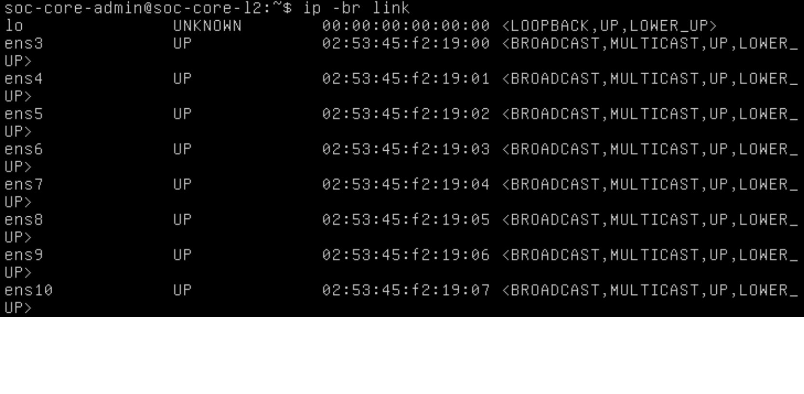

**Hình 2.10. Tám giao diện ens3–ens10 đã được Ubuntu nhận diện trước cài OVS**

Mục đích là xác định tập giao diện và MAC thực tế. Nội dung thể hiện tám NIC Ethernet, ngoài loopback; MAC lần lượt 02:53:45:f2:19:00 đến 02:53:45:f2:19:07. Kết quả xác nhận guest nhận đủ NIC; ý nghĩa là có cơ sở đối chiếu với EVE/QEMU. Chưa xác minh kết nối peer hoặc vai trò VLAN theo thứ tự NIC.

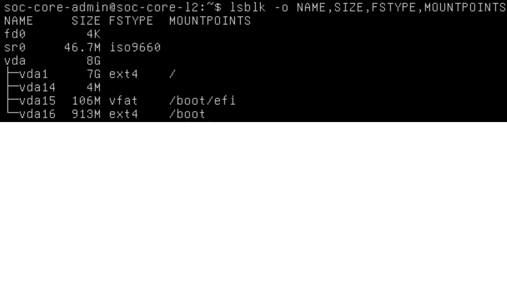

**Hình 2.11. Thiết bị đĩa vda 8 GiB và phân vùng Ubuntu Core trước cài đặt**

Mục đích là đối chiếu đĩa guest đang sử dụng. Nội dung lsblk thể hiện vda 8G, root vda1 và các phân vùng boot/EFI. Kết quả xác nhận dung lượng thiết bị, không phải dung lượng còn trống; ảnh không chứa df nên không dùng để chứng minh số trống 5,1 GiB mà người dùng đã mô tả. Ý nghĩa là xác định đúng phạm vi đĩa mà trình quản lý gói guest sử dụng.

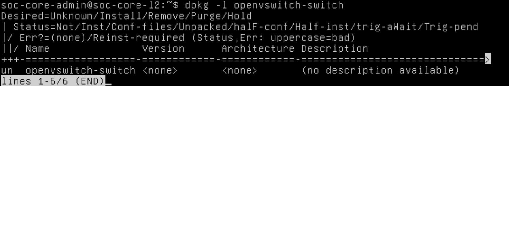

**Hình 2.12. Trạng thái openvswitch-switch chưa cài ở mốc trước triển khai**

Mục đích là ghi nhận đường cơ sở. Nội dung dpkg thể hiện un và version none; kết quả cho thấy package chưa cài tại mốc ảnh. Ý nghĩa là phân biệt trạng thái trước và sau; ảnh này không thay cho kiểm tra phiên bản sau cài.

### 2.17.2. Bundle, chữ ký và giải phụ thuộc

Bộ audit mới trên Windows đối chiếu lại 70 tệp deb: SHA-256, kích thước, tên, phiên bản, kiến trúc và các trường Depends/Pre-Depends trong sáu chỉ mục Packages.xz đều khớp manifest. Trong guest đã tính lại 70 hash gói và sáu hash chỉ mục; dữ liệu xuất về Windows khớp hoàn toàn. gpgv xác nhận ba InRelease có chữ ký tốt từ Ubuntu Archive Automatic Signing Key (2018), fingerprint F6ECB3762474EDA9D21B7022871920D1991BC93C. Kiến trúc bundle là amd64/all. Phép kiểm tra status rỗng trước đây được giữ làm lịch sử; kế hoạch dependency trong lần này dựa trên trạng thái dpkg thực tế của guest.

Nguồn cũ chỉ ghi noble nên thiếu OVS 3.3.9 nằm trong noble-updates/main. Phiên này tạo offline.list riêng trong /tmp/m2-ovs-apt-2353, bao gồm noble, noble-updates và noble-security, chỉ URI file:/opt/ovs-offline, dùng signed-by với keyring Ubuntu. Không sửa nguồn APT online hiện hữu hoặc nguồn noble-only cũ; lần cài tiếp theo cần dùng nguồn riêng đã lưu, không chạy apt update chung rồi coi DNS đã được khắc phục.

### 2.17.3. Lệnh thực thi và xử lý lỗi

SSH tới EVE ban đầu bị chặn vì không có agent ký khóa; sau khi người dùng khởi động ssh-agent và nạp khóa, kết nối BatchMode đã thành công. Guest không có SSH trực tiếp; các lệnh được gửi qua VNC/RFB của đúng QEMU bên trong phiên SSH có kiểm tra host key. Lượt truyền payload dài bị sai ký tự, đã hủy dòng nhập dở; không coi các script payload chưa chạy là kết quả triển khai. Đã chuyển sang từng lệnh ngắn, giảm tốc độ và kiểm tra ảnh console; không chạy lại cloud-init hoặc chuyển lại kho gói.

Dùng sudo -n script -q -f /tmp/m2-ovs-install-20261031.log để ghi phiên root; không thu mật khẩu. Sao lưu trạng thái dpkg và source offline cũ vào thư mục làm việc trước cài. offline.list có ba dòng theo mẫu sau, thay suite tương ứng:

```text
deb [signed-by=/usr/share/keyrings/ubuntu-archive-keyring.gpg] file:/opt/ovs-offline noble main universe
deb [signed-by=/usr/share/keyrings/ubuntu-archive-keyring.gpg] file:/opt/ovs-offline noble-updates main universe
deb [signed-by=/usr/share/keyrings/ubuntu-archive-keyring.gpg] file:/opt/ovs-offline noble-security main universe
```

Các tùy chọn APT đã sử dụng, lưu nguyên bản trong apt-options.txt:

```text
-o Dir::Etc::sourcelist=/tmp/m2-ovs-apt-2353/offline.list
-o Dir::Etc::sourceparts=-
-o Dir::State::lists=/tmp/m2-ovs-apt-2353/lists
-o Acquire::Languages=none
-o Acquire::IndexTargets::deb::CNF::DefaultEnabled=false
-o Acquire::IndexTargets::deb::DEP-11::DefaultEnabled=false
```

Ba tùy chọn Dir giới hạn nguồn và chỉ mục vào phiên offline. Hai loại metadata CNF (gợi ý lệnh) và DEP-11 (mô tả ứng dụng) không có trong bundle; hai lần cập nhật đầu trả 100 vì thiếu chúng. Tắt việc lấy các loại phụ trợ trong phiên này cho phép lần update3 thành công với UPDATE_RC=0; vẫn giữ kiểm tra chữ ký và hash gói. Không cần Internet, không tắt xác thực kho và không đổi đồng hồ. Tùy chọn Languages tránh lấy bản dịch không cần thiết.

Trong shell thực tế, O là chuỗi tùy chọn trên và V=3.3.9-0ubuntu0.24.04.1. Các lệnh chính:

```sh
apt-get $O -o APT::Update::Error-Mode=any update
apt-get $O -s --no-install-recommends --no-remove install openvswitch-switch=$V
apt-get $O --yes --no-install-recommends --no-remove install openvswitch-switch=$V
```

Lệnh update cập nhật chỉ mục từ kho cục bộ; mô phỏng cho phép xem dependency; lệnh cuối cài đúng phiên bản, không cài gợi ý và không cho gỡ gói. APT tự chọn bảy gói cần thiết thay vì cài mù 70 tệp. Kế hoạch: libevent-2.1-7t64, libunbound8, libxdp1, python3-sortedcontainers, openvswitch-common, python3-openvswitch, openvswitch-switch; không nâng cấp hoặc gỡ gói, 18 gói hiện hữu không được nâng. Toàn bộ phiên bản trong bảy hành động Inst khớp manifest đã kiểm tra. INSTALL_RC=0. Cách dùng mô phỏng và pin phiên bản dựa trên [Ubuntu apt-get manual](https://manpages.ubuntu.com/manpages/noble/man8/apt-get.8.html).

## 2.18. Kết quả kiểm chứng phần mềm và giới hạn nghiệm thu

### 2.18.1. Kết quả đạt và vấn đề còn tồn tại

| Hạng mục | Kết quả thực tế | Đánh giá và nguồn |
|---|---|---|
| Toàn vẹn gói/metadata guest | 70/70 gói và 6/6 chỉ mục khớp; 3 chữ ký tốt | Đạt; guest-sha256.txt, indexes-sha256.txt, signatures.log |
| Cập nhật offline | UPDATE_RC=0 sau khi tắt CNF/DEP-11 | Đạt; update3.log và ảnh Hình 2.13 |
| Dependency thực tế | 7 mới, 0 nâng cấp, 0 gỡ; đúng phiên bản bundle | Đạt; simulate2.log và Hình 2.14 |
| Cài phần mềm | INSTALL_RC=0 | Đạt; install.log, transcript và ảnh cài |
| Binary và schema | ovs-vsctl 3.3.9; DB Schema 8.5.1 | Đạt; verification.log và Hình 2.15 |
| Ba gói OVS | 3.3.9-0ubuntu0.24.04.1 | Đạt; verification.log |
| Dịch vụ | openvswitch-switch, ovsdb-server, ovs-vswitchd đều active | Đạt tại thời điểm kiểm tra; services.log |
| Cơ sở dữ liệu | UUID 36956952-09d5-4916-acf4-a3be3e891166; ovs_version 3.3.9; show RC=0; không bridge | Đạt khả năng truy cập DB; chưa kiểm thử chuyển tiếp |
| Module kernel | openvswitch có trong lsmod | Đạt nạp module; không chứng minh hiệu năng datapath |
| Tính nhất quán dpkg | dpkg --audit không xuất lỗi tại lần kiểm tra | Đạt trong phạm vi lệnh |
| Journal | OVS_CTL_OPTS unset, được đánh giá thành chuỗi rỗng; khởi động tiếp tục thành công | Cảnh báo còn tồn tại; warnings.log, journal.log; chưa sửa unit |
| VLAN, trunk, mirror | Chưa tạo/cấu hình/thử lưu lượng | Chưa nghiệm thu; chờ mapping peer |
| DNS/Internet guest | Không thay đổi mạng hoặc DNS | Chưa khắc phục kết nối online; không cản lần cài offline |

Đối tượng openvswitch-switch là unit điều phối nên cần đọc thêm ovsdb-server và ovs-vswitchd, không chỉ nhìn active của unit tổng. ovsdb-server quản lý cơ sở dữ liệu cấu hình; ovs-vswitchd hiện thực chuyển tiếp cùng datapath kernel; ovs-vsctl truy vấn và cập nhật cấu hình. Trong SOC, các thành phần này tạo nền cho phân tách VLAN và cung cấp bản sao lưu lượng giám sát. Kết quả hiện tại chỉ nghiệm thu cài đặt và khởi động phần mềm, chưa nghiệm thu chức năng chuyển mạch của M2. [Tài liệu OVS](https://docs.openvswitch.org/en/stable/intro/what-is-ovs/).

Việc lsmod hiển thị nf_nat hoặc nf_conntrack là thông tin module phụ thuộc của kernel; không phải minh chứng Core đã cấu hình NAT hoặc gateway. Không có lệnh cấu hình các chức năng Layer 3 trong phiên này.

### 2.18.2. Bảo toàn và lưu minh chứng

Log nguyên bản được lưu trong docs/evidence/M2/ovs-offline-guest-20261101/. Do không có đường mạng guest, dữ liệu được nén, mã hóa base64 và hiển thị từng trang trên console thật; bộ thu khôi phục ký tự bằng mẫu glyph chính xác, không đoán ký tự. SHA-256 của toàn bộ dữ liệu xuất khớp giá trị guest hiển thị trước khi giải nén. Ảnh truyền dữ liệu chỉ là phương tiện kiểm tra toàn vẹn, không được trình bày như ảnh kiểm thử chức năng mạng. Ảnh minh chứng kỹ thuật giữ nguyên nội dung; JSON đi kèm ghi thời điểm Windows, UUID, lệnh và hash ảnh.

Sao lưu báo cáo cũ nằm trong docs/M2/backups/M2-before-ovs-install-20261101/. Không xóa/di chuyển minh chứng cũ, kể cả docs/evidence/eve-ng/. Các bản gốc báo cáo vẫn giữ nguyên. Chưa kiểm tra bố cục bằng giao diện Word; đã kiểm tra cấu trúc DOCX, khổ A4, Times New Roman 12–13, lề trái 3 cm và các lề còn lại 2 cm.

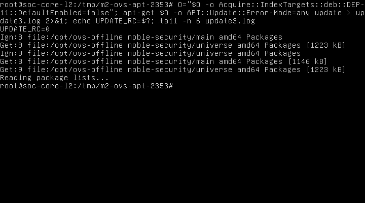

**Hình 2.13. Cập nhật chỉ mục hoàn toàn offline thành công**

Mục đích là kiểm tra APT chỉ dùng nguồn cục bộ. Hình thể hiện UPDATE_RC=0 và các URI file:/opt/ovs-offline; kết quả xác nhận cập nhật thành công sau xử lý metadata phụ trợ. Ý nghĩa là dependency được giải từ bundle, không dựa Internet.

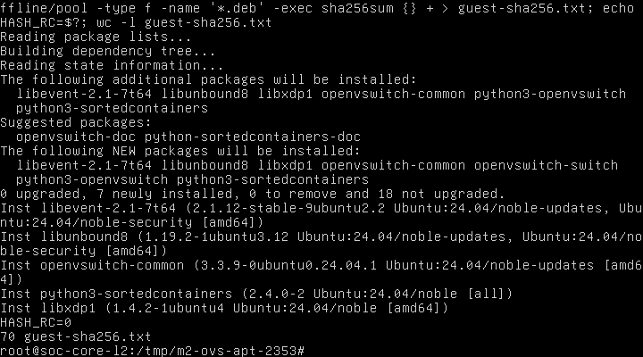

**Hình 2.14. Kế hoạch dependency thực tế và đủ 70 hash gói trong guest**

Mục đích là xác nhận phạm vi thay đổi trước cài. Hình thể hiện bảy gói mới, không nâng cấp/gỡ, HASH_RC=0 và 70 dòng hash. Kết quả đối chiếu hash về Windows được ghi trong JSON validation; riêng số dòng không thay kiểm tra hash. Ý nghĩa là tránh cài toàn bộ 70 dependency bất kể trạng thái guest.

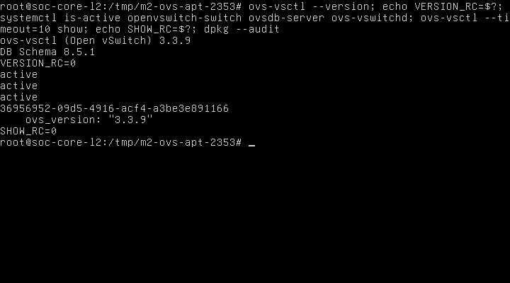

**Hình 2.15. Open vSwitch 3.3.9 hoạt động và cơ sở dữ liệu chưa có bridge**

Mục đích là kiểm tra binary, dịch vụ và DB sau cài. Hình thể hiện phiên bản 3.3.9, schema 8.5.1, ba active, UUID DB và SHOW_RC=0. Kết quả xác nhận nền OVS sẵn sàng; không có bridge nên chưa kết luận chuyển mạch/VLAN/mirror đạt.

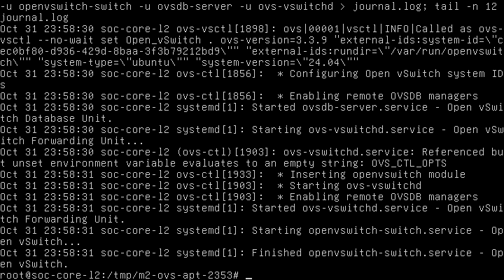

**Hình 2.16. Journal khởi động Open vSwitch và cảnh báo biến tùy chọn chưa đặt**

Mục đích là đối chiếu trạng thái active với nhật ký khởi động. Nội dung thể hiện nạp module và khởi động daemon thành công, đồng thời có OVS_CTL_OPTS unset. Kết quả cho thấy cảnh báo không ngăn lần khởi động này; ý nghĩa là báo cáo minh bạch vấn đề còn tồn tại, không kết luận không có cảnh báo.

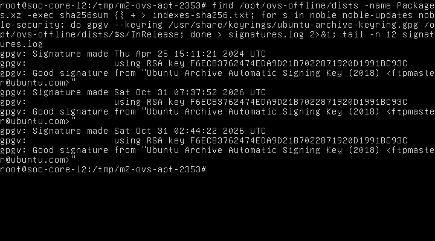

**Hình 2.17. Xác minh ba chữ ký InRelease của kho Ubuntu ngay trong guest**

Mục đích là xác thực nguồn metadata. Hình thể hiện ba Good signature cùng khóa Ubuntu Archive; kết quả phù hợp log signatures.log. Ý nghĩa là phân biệt kiểm tra chữ ký với chỉ kiểm tra số lượng tệp trong thư mục kho.

### 2.18.3. Đối chiếu runtime và ảnh topology còn thiếu

| QEMU backend | TAP trên EVE | MAC guest/QEMU | NIC Ubuntu | Peer/vai trò |
|---|---|---|---|---|
| net0 | vunl0_3_0 | 02:53:45:f2:19:00 | ens3 | Chưa nối peer; vai trò VLAN chưa gán |
| net1 | vunl0_3_1 | 02:53:45:f2:19:01 | ens4 | Chưa nối peer; vai trò VLAN chưa gán |
| net2 | vunl0_3_2 | 02:53:45:f2:19:02 | ens5 | Chưa nối peer; vai trò VLAN chưa gán |
| net3 | vunl0_3_3 | 02:53:45:f2:19:03 | ens6 | Chưa nối peer; vai trò VLAN chưa gán |
| net4 | vunl0_3_4 | 02:53:45:f2:19:04 | ens7 | Chưa nối peer; vai trò VLAN chưa gán |
| net5 | vunl0_3_5 | 02:53:45:f2:19:05 | ens8 | Chưa nối peer; vai trò VLAN chưa gán |
| net6 | vunl0_3_6 | 02:53:45:f2:19:06 | ens9 | Chưa nối peer; vai trò VLAN chưa gán |
| net7 | vunl0_3_7 | 02:53:45:f2:19:07 | ens10 | Chưa nối peer; vai trò VLAN chưa gán |

Bảng xác nhận backend QEMU, TAP và NIC Ubuntu theo MAC; tám TAP đều không có bridge master trên EVE tại snapshot. XML lab không có interface nối network; nhãn cổng giao diện Web và peer hai đầu vẫn cần đọc khi thiết kế kết nối. Không suy từ net0 thành nhãn EVE đã nhìn thấy trên GUI. Vai trò access/trunk/mirror vẫn là dự kiến.

Chưa chụp được topology GUI EVE bằng công cụ hiện có; các ảnh mới là console QEMU thật. Để bổ sung thủ công: mở lab SOC-M2-Core-L2 trên giao diện Web EVE, giữ nguyên trạng thái node, hiển thị toàn bộ canvas và tên node SOC-Core-L2; dùng Win+Shift+S chụp rõ trạng thái node và các liên kết hiện có, không cắt mất nhãn. Lưu docs/evidence/M2/M2-core-topology-after-ovs-<thoi-diem-UTC+0700>.png, ghi giờ chụp kèm múi giờ và bổ sung vào danh mục. Ảnh này hiện chưa tồn tại trong bộ minh chứng.

## 2.19. Phương án bridge, access/trunk và mirror sau cài đặt

### 2.19.1. Điều kiện trước triển khai mạng

Toàn bộ mục này là **cấu hình dự kiến, chưa thực thi**. Đối chiếu đủ tám dòng EVE port → MAC QEMU → MAC/tên NIC Ubuntu → thiết bị/cổng peer. Có tám NIC trong guest không có nghĩa đã xác minh peer hoặc topology. Không lấy thứ tự ens3–ens10 làm căn cứ tự động gán vai trò. Vai trò dự kiến: năm access cho VLAN 30/40/50/60/99, hai trunk riêng tới OPNsense Primary/Secondary và một output mirror tới NIC capture Suricata.

Trước khi áp dụng cần ghi rõ allowed VLAN, chế độ tagged-only/native VLAN, hướng và nguồn mirror, peer hai đầu, khả năng quan sát khi failover, ngân sách RAM và tiêu chí thử. Hai trunk firewall không gộp LACP. Core chỉ chuyển mạch Layer 2; gateway, định tuyến liên VLAN, firewall rules và NAT đặt trên OPNsense.

### 2.19.2. Mẫu bridge và cổng VLAN

Các biến NIC_ACCESS30, NIC_TRUNK_PRIMARY và NIC_CAPTURE là ký hiệu cần thay sau khi xác minh, chưa được định nghĩa trong guest. Không chạy nguyên khối minh họa này trên hệ thống hiện tại. Mỗi lệnh tác động cấu hình đều cần được đối chiếu với mapping và phạm vi được duyệt trước khi chạy.

```sh
ovs-vsctl add-br br-core-l2
ovs-vsctl add-port br-core-l2 "$NIC_ACCESS30" -- set Port "$NIC_ACCESS30" vlan_mode=access tag=30
ovs-vsctl add-port br-core-l2 "$NIC_TRUNK_PRIMARY" -- set Port "$NIC_TRUNK_PRIMARY" vlan_mode=trunk trunks=30,40,50,60,99
```

Lệnh thứ nhất dự kiến tạo cầu nối OVS. Lệnh thứ hai gán một cổng vào VLAN 30 theo chế độ access. Lệnh thứ ba dự kiến cho trunk mang năm VLAN đã quy định. Các cổng access 40/50/60/99 và trunk Secondary phải được xác nhận độc lập; không suy ra peer từ mẫu này. Chưa gán địa chỉ IP hoặc gateway cho bridge. Cần kiểm thử loại bỏ lưu lượng untagged/VLAN ngoài danh sách theo chính sách chốt, thay vì mặc định coi danh sách trunk đã bao phủ mọi tình huống. [OVS Basic Configuration](https://docs.openvswitch.org/en/stable/faq/configuration/).

### 2.19.3. Mẫu mirror và giới hạn quan sát

Ví dụ dưới đây dự kiến sao chép toàn bộ lưu lượng đủ điều kiện trên bridge tới một cổng capture dành riêng. Phạm vi select-all chỉ là ví dụ để thảo luận; chưa chốt thay cho yêu cầu chọn nguồn/hướng. Khi triển khai có mirror sẵn, phải bổ sung giao dịch phù hợp để giữ các mirror hiện hữu.

```sh
ovs-vsctl add-port br-core-l2 "$NIC_CAPTURE"
ovs-vsctl -- --id=@cap get Port "$NIC_CAPTURE" -- --id=@mon create Mirror name=suricata-monitor select-all=true output-port=@cap -- set Bridge br-core-l2 mirrors=@mon
```

Giao dịch dự kiến tham chiếu port capture và gắn đối tượng Mirror vào bridge mới. Cổng output mirror không dùng làm cổng endpoint chuyển tiếp thông thường hoặc cổng quản trị Suricata. Suricata nhận bản sao hoạt động theo hướng IDS thụ động; nó không chặn được gói gốc bằng việc chỉ nhận mirror. Cần đo tỷ lệ mất gói khi mirror tổng hợp vượt tốc độ đầu ra, kiểm tra frame có thẻ VLAN, lưu lượng cùng VLAN không qua firewall và hiện tượng trùng gói. [OVS mirroring](https://docs.openvswitch.org/en/stable/faq/configuration/).

### 2.19.4. Tiêu chí nghiệm thu tiếp theo

| Bài kiểm thử dự kiến | Điều kiện đạt và minh chứng cần có | Trạng thái hiện tại |
|---|---|---|
| Mapping tám cổng | EVE/QEMU/Ubuntu khớp MAC, peer và network ID được ghi đầy đủ | Peer chưa xác minh |
| Access cùng VLAN | Hai endpoint cùng VLAN trao đổi được frame; lưu bảng MAC và capture | Chưa thử |
| Cách ly VLAN | Lưu lượng khác VLAN không đi trực tiếp qua Core; liên VLAN theo firewall | Chưa thử |
| Trunk | Capture xác nhận thẻ 30/40/50/60/99 và chính sách với untagged/VLAN lạ | Chưa thử |
| Mirror Suricata | NIC capture thấy đúng phạm vi/hướng; ghi số gói, tag và mất gói | Chưa thử |
| Khởi động lại | Cấu hình OVS được giữ sau restart trong đợt được duyệt riêng | Chưa thực hiện restart |
| HA firewall | Chuyển vai CARP, pfsync và duy trì quan sát; thuộc M3 | Chưa triển khai |

## 2.20. Giải thích thuật ngữ và nguồn tham khảo

### 2.20.1. Các khái niệm phục vụ triển khai và giám sát

Các ví dụ cấu hình mạng trong mục này là thiết kế dự kiến; chưa nghiệm thu VLAN, trunk, mirror, firewall HA hoặc hệ thống phân tích SOC.

| Thuật ngữ và nghĩa tiếng Việt | Nguyên lý hoạt động, vai trò và ví dụ trong đồ án |
|---|---|
| SOC — Security Operations Center; trung tâm điều hành an ninh mạng | Kết hợp con người, quy trình và công cụ để thu thập, phân tích và xử lý sự kiện. Dự kiến Core đưa lưu lượng tới cảm biến, Suricata phát hiện và Wazuh hỗ trợ phân tích tập trung. |
| OVS — Open vSwitch; tên chính thức của bộ chuyển mạch phần mềm | ovsdb-server giữ cấu hình, ovs-vswitchd điều khiển chuyển tiếp, datapath xử lý gói. Trong đồ án chỉ sử dụng chức năng Layer 2; dự kiến tạo bridge br-core-l2 để nối các vùng SOC. [1] |
| Bridge; cầu nối lớp liên kết | Học địa chỉ MAC và chuyển frame trong miền Layer 2, áp dụng phân tách VLAN. Dự kiến br-core-l2 chứa các port access/trunk; bridge chưa tạo trong bước cài phần mềm. |
| VLAN — Virtual Local Area Network; mạng cục bộ ảo | Phân chia miền quảng bá trên cùng hạ tầng chuyển mạch. Đồ án quy định VLAN 30 Data Center, 40 Employee, 50 Guest, 60 DMZ, 99 Management; cấu hình thực tế còn chờ. |
| IEEE 802.1Q; tiêu chuẩn mạng cầu nối và VLAN | Cơ chế gắn thẻ VLAN trong Ethernet cho phép phân biệt lưu lượng trên liên kết chung. Dự kiến trunk tới OPNsense mang các VLAN 30/40/50/60/99; chưa kiểm thử frame có thẻ. |
| Trunk; cổng mang nhiều VLAN | Chuyển lưu lượng nhiều VLAN, thường giữ thẻ 802.1Q; danh sách allowed VLAN giới hạn VLAN được phép. Dự kiến có hai trunk riêng tới hai OPNsense. [2] |
| Access port; cổng truy nhập một VLAN | Gán frame không gắn thẻ của endpoint vào VLAN cấu hình và bỏ thẻ khi đưa ra endpoint. Ví dụ dự kiến tag=30 cho cổng Data Center; chưa gán ens3 hoặc cổng cụ thể. [2] |
| LACP — Link Aggregation Control Protocol; giao thức điều khiển gộp liên kết | Trao đổi thông tin để thống nhất thành viên trong nhóm liên kết với peer tương thích. Có thể dùng khi mở rộng Core, nhưng chưa triển khai; hai firewall HA độc lập không tự trở thành một peer LACP. |
| SPAN — Switched Port Analyzer; tên chức năng giám sát cổng thường dùng trong hệ sinh thái Cisco | Sao chép lưu lượng nguồn sang cổng quan sát. Với OVS, dự kiến dùng đối tượng Mirror để đạt chức năng tương tự, đưa bản sao tới Suricata; chưa cấu hình. [2] |
| Port mirroring; sao chép lưu lượng cổng | Chọn frame theo cổng/VLAN và hướng để tạo bản sao ngoài đường chuyển tiếp chính. Cổng output-port dành riêng cho capture; cần kiểm thử trùng gói, VLAN tag và mất gói. Dự kiến triển khai sau khi xác minh peer. [2] |
| QEMU; tên chính thức của phần mềm giả lập và ảo hóa | Cung cấp thiết bị ảo và thực thi guest, có thể dùng tăng tốc KVM. Tiến trình QEMU thực tế đang phục vụ SOC-Core-L2 với 8 thiết bị VirtIO; không khởi động QEMU phụ. |
| QCOW2 — QEMU Copy On Write, version 2; định dạng đĩa sao chép khi ghi | Có thể lưu các khối thay đổi và tham chiếu backing file, giúp phân biệt image nền với overlay runtime. Core dùng đĩa QCOW2; phiên này không sửa đĩa từ host khi VM đang chạy. [3] |
| cloud-init; tên chính thức của công cụ khởi tạo instance | Đọc datasource và thực thi tác vụ khởi tạo theo module, như tạo tài khoản hoặc cấu hình ban đầu. Người dùng xác nhận Core đã hoàn tất; phiên cài OVS không chạy lại cloud-init. |
| NoCloud; tên datasource chính thức của cloud-init | Cung cấp user-data, meta-data và dữ liệu mạng từ nguồn cục bộ hoặc nguồn được chỉ định. Core đã dùng seed ISO; không sửa seed hoặc instance-id để cài lại. [4] |
| SSH — Secure Shell; giao thức truy cập shell bảo mật | Mã hóa phiên và xác thực danh tính, ở đây dùng khóa công khai và ssh-agent ký xác thực. Đã dùng SSH tới EVE; không suy ra có SSH trực tiếp vào guest khi NIC chưa nối mạng. [9] |
| OPNsense; tên chính thức của nền tảng firewall | Dùng lọc gói theo trạng thái, định tuyến và các dịch vụ mạng. Trong thiết kế SOC, OPNsense chịu gateway, liên VLAN, firewall rules và NAT; các chức năng này không đặt trên Core. |
| CARP — Common Address Redundancy Protocol; giao thức dự phòng địa chỉ chung | Các firewall phối hợp quyền sở hữu địa chỉ IP ảo để tiếp quản gateway khi có sự cố. Dự kiến dùng ở M3; chưa tạo hoặc kiểm thử VIP. [5] |
| pfsync; tên chính thức của cơ chế đồng bộ trạng thái Packet Filter | Đồng bộ thông tin trạng thái kết nối giữa firewall để giảm gián đoạn khi đổi vai; không đồng nghĩa đồng bộ toàn bộ cấu hình. Dự kiến có đường đồng bộ riêng ở M3, chưa triển khai. [10] |
| HA — High Availability; tính sẵn sàng cao | Dùng dự phòng, phát hiện lỗi và tiếp quản dịch vụ. Dự kiến hai OPNsense hỗ trợ HA; một Core duy nhất vẫn là điểm lỗi đơn, cài OVS không chứng minh HA. [5] |
| NAT — Network Address Translation; chuyển đổi địa chỉ mạng | Thay địa chỉ hoặc cổng trong lưu lượng theo quy tắc và trạng thái. Dự kiến OPNsense thực hiện NAT ra WAN; Core không làm NAT. [11] |
| DHCP — Dynamic Host Configuration Protocol; giao thức cấu hình máy trạm động | Máy khách và máy chủ trao đổi để cấp thuê địa chỉ cùng các tùy chọn gateway/DNS. Dự kiến OPNsense cấp cho VLAN được chốt; chưa xác nhận scope hoặc cấp phát thực tế. |
| IDS — Intrusion Detection System; hệ thống phát hiện xâm nhập. IPS — Intrusion Prevention System; hệ thống ngăn chặn xâm nhập | IDS phân tích và cảnh báo; IPS cần nằm trên đường xử lý có quyền chặn. Suricata nhận mirror dự kiến làm IDS thụ động, không thể coi việc nhận bản sao là đã chặn lưu lượng gốc. [6] |
| Suricata; tên chính thức của công cụ phân tích an ninh mạng | Phân tích giao thức và so khớp quy tắc để phát hiện, hỗ trợ ngăn chặn khi triển khai phù hợp. Dự kiến NIC capture nhận bản sao từ OVS; chưa có cảm biến/capture được kiểm chứng trong bước này. [6] |
| Wazuh; tên chính thức của nền tảng giám sát an ninh | Agent và các thành phần trung tâm thu thập, phân tích, lưu trữ và trình bày sự kiện. Dự kiến kết hợp dữ liệu endpoint và cảnh báo Suricata trong SOC; chưa xác nhận luồng tích hợp thực tế. [7] |

### 2.20.2. Tài liệu chính thức

[1] Open vSwitch, What Is Open vSwitch: https://docs.openvswitch.org/en/stable/intro/what-is-ovs/ .

[2] Open vSwitch, Basic Configuration: https://docs.openvswitch.org/en/stable/faq/configuration/ . Tài liệu stable hiện hành phục vụ giải thích nguyên lý; không thay kết quả kiểm tra binary 3.3.9 trong guest.

[3] QEMU, Disk Images: https://www.qemu.org/docs/master/system/images.html .

[4] cloud-init, NoCloud: https://docs.cloud-init.io/en/latest/reference/datasources/nocloud.html .

[5] OPNsense, High Availability: https://docs.opnsense.org/manual/hacarp.html .

[6] Suricata, What is Suricata: https://docs.suricata.io/en/latest/what-is-suricata.html .

[7] Wazuh, Components: https://documentation.wazuh.com/current/getting-started/components/index.html .

[8] Ubuntu Noble, apt-get manual: https://manpages.ubuntu.com/manpages/noble/man8/apt-get.8.html .

[9] RFC Editor, RFC 4251, The Secure Shell Protocol Architecture: https://www.rfc-editor.org/info/rfc4251/ .

[10] OPNsense, Configure CARP, mục Terminology/pfSync: https://docs.opnsense.org/manual/how-tos/carp.html .

[11] RFC Editor, RFC 3022, Traditional NAT: https://www.rfc-editor.org/info/rfc3022/ .


## 2.21. Xác minh ánh xạ cổng sau cài Open vSwitch

### 2.21.1. Phạm vi và nguồn dữ liệu

Ngày kiểm tra: 01/11/2026, múi giờ UTC+07:00. Chỉ thực hiện kiểm kê EVE qua SSH, đọc tiến trình QEMU, XML các lab, TAP, tài nguyên và chạy lệnh chẩn đoán trên console guest đã đăng nhập. Không tạo bridge, sửa VLAN, nối link, thay firewall/NAT, thay vòng đời node, sửa image hoặc seed. Báo cáo M2-report-ovs-offline-installed-20261101.docx đã được đọc trực tiếp từ XML bên trong DOCX; nội dung OVS 3.3.9 và giới hạn nghiệm thu được giữ nguyên. CSV mapping cũ là đầu vào đối chiếu, không được ghi đè.

Snapshot host thu từ 00:14:02 đến 00:14:09 UTC+07:00; ảnh guest NIC từ 00:14:43 đến 00:14:49; ảnh trạng thái Layer 2 từ 00:15:23 đến 00:15:35. Dùng thời gian bộ thu Windows; đồng hồ guest/EVE không thay thời điểm thu thập. Log và ảnh nằm tại docs/evidence/M2/port-design-20261101T001402+0700/.

### 2.21.2. Kết quả kiểm chứng

Tiến trình QEMU thực tế PID 13455, UUID 2b295168-b72e-4de7-b364-37298252dd9f, tên SOC-Core-L2, cấu hình 1 vCPU/2048 MiB/8 VirtIO NIC. Với mỗi đối số device, đã ghép netdev với backend TAP và so MAC với ảnh ip -br link mới. Tám dòng khớp bảng CSV trước, không có MAC trùng. Tên ens3–ens10 được xác nhận bằng console, không suy đoán từ số thứ tự.

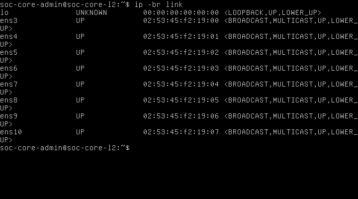

**Hình 2.18. Đối chiếu tám giao diện Ubuntu và MAC thực tế sau cài OVS**

Mục đích là xác nhận mapping vẫn đúng ở thời điểm thiết kế mạng. Nội dung hình thể hiện ip -br link với ens3–ens10 và tám MAC. Kết quả khớp MAC trong tiến trình QEMU và mapping đã lưu. Ý nghĩa là có thể đề xuất vai trò trên các NIC đã nhận dạng, nhưng chưa chứng minh peer hoặc các VLAN đã hoạt động.

| QEMU backend | TAP thực tế trên EVE | NIC Ubuntu | MAC thực tế | Vai trò dự kiến | Peer hiện tại |
|---|---|---|---|---|---|
| net0 | vunl0_3_0 | ens3 | 02:53:45:f2:19:00 | Access VLAN 30 — Data Center | Chưa nối |
| net1 | vunl0_3_1 | ens4 | 02:53:45:f2:19:01 | Access VLAN 40 — Employee | Chưa nối |
| net2 | vunl0_3_2 | ens5 | 02:53:45:f2:19:02 | Access VLAN 50 — Guest | Chưa nối |
| net3 | vunl0_3_3 | ens6 | 02:53:45:f2:19:03 | Access VLAN 60 — DMZ | Chưa nối |
| net4 | vunl0_3_4 | ens7 | 02:53:45:f2:19:04 | Access VLAN 99 — Management | Chưa nối |
| net5 | vunl0_3_5 | ens8 | 02:53:45:f2:19:05 | Trunk riêng tới OPNsense Primary LAN | Chưa có peer trong EVE |
| net6 | vunl0_3_6 | ens9 | 02:53:45:f2:19:06 | Trunk riêng tới OPNsense Secondary LAN | Chưa có peer trong EVE |
| net7 | vunl0_3_7 | ens10 | 02:53:45:f2:19:07 | Mirror output tới Suricata capture | Chưa có peer trong EVE |

Các cột backend/TAP/NIC/MAC là dữ liệu đã xác minh; cột vai trò là đề xuất chưa áp dụng. XML node chưa có interface nối network nên chưa gắn nhãn e0–e7 như tên cổng GUI đã kiểm chứng. Khi được phép nối link, cần mở GUI và đối chiếu lại tên cổng EVE với đúng MAC/index QEMU; không chọn theo vị trí biểu tượng hoặc thứ tự hiển thị đơn thuần.

### 2.21.3. Kết nối và trạng thái Layer 2 hiện tại

Lab SOC-M2-Core-L2 chỉ có node ID 3; không có network object, không có interface/network_id nối topology. Tám TAP vunl0_3_0–vunl0_3_7 đều tồn tại và không có bridge master trong ip -j link trên EVE. Cờ UP/LOWER_UP của vNIC chỉ phản ánh thiết bị ảo; không chứng minh đã có peer hoặc kết nối VLAN/Internet.

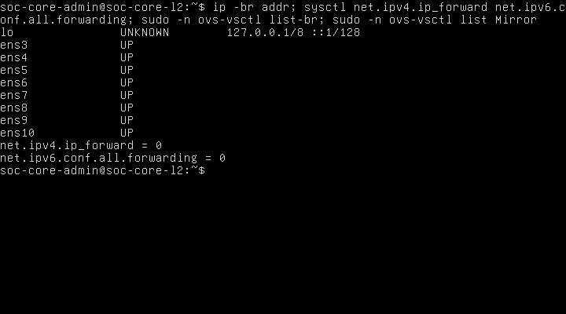

**Hình 2.19. Trạng thái địa chỉ, forwarding và OVS trước thiết kế kết nối**

Mục đích là xác định đường cơ sở trước thay đổi mạng. Nội dung gồm ip -br addr, hai sysctl forwarding, ovs-vsctl list-br và ovs-vsctl list Mirror. Tám NIC không hiển thị địa chỉ IP; net.ipv4.ip_forward=0 và net.ipv6.conf.all.forwarding=0; hai truy vấn OVS không trả bản ghi. Kết quả phù hợp mô hình Core chưa có bridge/mirror và không chuyển tiếp IP. Ý nghĩa là các cấu hình sau đây phải được xem là dự kiến; không dùng kết quả OVS đã cài thay cho kết quả VLAN/trunk.

## 2.22. Thiết kế bridge trung tâm và chính sách VLAN dự kiến

### 2.22.1. Bridge và các cổng

Đề xuất một bridge br-core-l2, datapath system, chuyển mạch NORMAL ở chế độ standalone và không dùng OpenFlow controller trong phạm vi M2. Năm access port có vlan_mode=access với tag lần lượt 30,40,50,60,99. Endpoint trên access gửi/nhận Ethernet không gắn thẻ VLAN; tag là thuộc tính phân loại trong OVS, không phải yêu cầu endpoint tự gắn thẻ. Hai port ens8 và ens9 là vlan_mode=trunk, trunks=30,40,50,60,99, không gán native VLAN và không gộp LACP. Cấu hình và phép thử tag phải được đánh giá theo normal switching; flow tùy biến có thể làm thay đổi đường xử lý. [OVS VLAN FAQ](https://docs.openvswitch.org/en/stable/faq/vlan/).

Trong thiết kế tagged-only, không đưa VLAN 0 vào danh sách trunk; frame untagged trên trunk không được dùng như một mạng native. Cần kiểm thử riêng frame untagged, priority-tag VLAN 0, VLAN ngoài danh sách và frame gắn tag không phù hợp trên access. OVS có thể xử lý priority-tag khác frame có VID khác 0; không mô tả chính sách thành câu tuyệt đối “mọi frame có thẻ trên access đều bị chặn” khi chưa thử. [Mô tả Port của OVS 3.3](https://raw.githubusercontent.com/openvswitch/ovs/branch-3.3/vswitchd/vswitch.xml).

Bridge tạo thêm một interface nội bộ cùng tên br-core-l2; đây không phải vNIC thứ chín. Đề xuất local Port br-core-l2 thuộc access VLAN 99 để tránh mặc định VLAN 0, nhưng chưa gán IP, route, DHCP client hoặc gateway cho interface này. Địa chỉ quản trị Core nếu cần sẽ được chốt ở một thay đổi riêng, thuộc VLAN 99, không làm gateway cho các VLAN người dùng. Chưa thay netplan/systemd-networkd/NetworkManager; phải kiểm tra trình quản lý NIC và phương án duy trì sau reboot trước khi triển khai.

### 2.22.2. Mirror/SPAN dành cho Suricata

Đề xuất ens10 chỉ làm output_port của một Mirror tên span-suricata. Chọn ingress của cả ens3–ens9, select_vlan=30,40,50,60,99, select_all=false và không chọn select_dst_port. Chính sách này quan sát frame vào Core từ các vùng và cả hai firewall; lưu lượng do chính host Core sinh ra không thuộc phạm vi ingress bảy cổng đó. Đây là đề xuất hướng mirror cụ thể, thay cho ví dụ select-all ở mục 2.19 trước; chưa tạo Mirror trong hệ thống.

output_port là cổng giám sát dành riêng: không dùng làm endpoint thông thường hoặc NIC quản trị; frame gửi ngược từ sensor vào cổng này bị bỏ theo cơ chế mirror OVS. Việc OVS tránh sao chép cùng một lần vào bridge nhiều lần tới cùng đích không đồng nghĩa một phiên liên VLAN chỉ có một bản tin quan sát: gói đi qua firewall rồi quay lại Core là một lần vào khác. Không kết luận giữ nguyên/tự bổ sung mọi thẻ VLAN trên bản sao trước khi capture kiểm chứng. [Mô tả Mirror của OVS 3.3](https://raw.githubusercontent.com/openvswitch/ovs/branch-3.3/vswitchd/vswitch.xml).

Suricata dự kiến có ít nhất hai NIC: capture nhận ens10 không đặt IP/gateway và NIC quản trị đi riêng về segment Management VLAN 99; cần xác minh MAC/tên NIC của sensor trước khi nối. Với bản sao lưu lượng, Suricata hoạt động như IDS thụ động; không coi đây là IPS inline. [Tài liệu Suricata](https://docs.suricata.io/en/latest/what-is-suricata.html).

### 2.22.3. Mẫu cấu hình để xem xét, chưa thực thi

Tệp M2-ovs-config-PROPOSED-20261101.txt chứa một giao dịch mẫu cho bridge, tám port và Mirror. Đây là tài liệu thiết kế, không phải script đã chạy. Chỉ áp dụng sau phê duyệt, kiểm tra MAC/peer và xác nhận OVS vẫn chưa có bridge cùng tên; mẫu cố ý không dùng may-exist để không âm thầm sửa cấu hình đã có. Thêm ens10 và gắn vai trò output mirror trong cùng giao dịch nhằm tránh giai đoạn port capture trở thành port chuyển tiếp thông thường. Giao dịch OVSDB không làm cho thao tác nối link EVE, bật interface hoặc cấu hình firewall trở thành nguyên tử; cần kiểm tra từng lớp riêng.

Mẫu không bật IP forwarding, không gán IP/subnet và không chứa rule firewall/NAT. Sau phê duyệt cần sao lưu DB OVS vào vị trí root-only bên trong guest, ghi cấu hình đọc lại và dùng console làm đường phục hồi. Trước kết nối mạng phải kiểm tra bridge/port/datapath không lỗi, trạng thái link, cấu hình quản lý mạng và IPv4/IPv6 forwarding vẫn 0. Thiết kế một Core với các peer định tuyến không tạo vòng Layer 2; không nối thêm đường bridge trên firewall hoặc vòng ngoài. STP/RSTP và chính sách phòng vòng phải được duyệt lại nếu topology thay đổi.

## 2.23. Sơ đồ kết nối dự kiến và vai trò gateway

### 2.23.1. Các segment trên EVE

```text
Data Center (VLAN 30, untagged) -------- ens3 --+
Employee    (VLAN 40, untagged) -------- ens4 --+
Guest       (VLAN 50, untagged) -------- ens5 --+
DMZ         (VLAN 60, untagged) -------- ens6 --+-- br-core-l2
Management  (VLAN 99, untagged) -------- ens7 --+       |
OPNsense Primary LAN (802.1Q 30/40/50/60/99) -- ens8 --+
OPNsense Secondary LAN (802.1Q 30/40/50/60/99) - ens9 --+
Suricata capture <----- mirror only -------- ens10 --+

OPNsense Primary SYNC <---- segment rieng ----> Secondary SYNC
WAN firewall: thiet ke rieng, khong noi vao access/capture Core
Suricata management ----> Management VLAN 99 (NIC rieng)
```

Sơ đồ là thiết kế, không phải ảnh topology EVE thực tế. Dự kiến cần tám segment cách ly cho tám cổng Core: năm segment endpoint untagged, hai segment trunk riêng và một segment capture chỉ nối Core với sensor. Mỗi đường trunk phải là segment riêng cho đúng hai đầu; không đặt ens8 và ens9 vào cùng một bridge ngoài EVE rồi lại nối cả hai vào cùng OVS. Mạng SYNC/WAN không tiêu tốn thêm cổng Core trong phương án này và cần tài nguyên/cổng trên firewall riêng. Nhãn và network_id thực tế chưa tạo, cổng LAN/SYNC/WAN của firewall và capture/management của sensor chưa có mapping.

Nhiều endpoint đặt cùng một segment EVE có thể trao đổi ngay trên segment ngoài Core; mirror OVS không quan sát được đường đó. Với yêu cầu quan sát mọi lưu lượng cùng VLAN, phải thiết kế topology buộc frame đi qua OVS bằng các cổng/peer VLAN-aware riêng hoặc bổ sung access switch có cơ chế giám sát thích hợp. Không dùng hai endpoint cùng một EVE bridge ngoài Core để tuyên bố đã nghiệm thu OVS switching hoặc mirror east-west.

### 2.23.2. Gateway và HA

Mỗi VLAN dự kiến có một CARP VIP làm default gateway trên cặp OPNsense. Primary/Secondary có địa chỉ riêng, cùng VLAN/subnet; CARP quyết định máy đang giữ VIP, pfsync đồng bộ trạng thái kết nối và cơ chế đồng bộ cấu hình là phần riêng. Hai trunk nối hai firewall độc lập; không bond/LACP xuyên cặp firewall. [OPNsense CARP](https://docs.opnsense.org/manual/how-tos/carp.html).

Core chỉ chuyển frame theo MAC/VLAN. Luồng cùng VLAN đi qua Layer 2; luồng khác VLAN phải đi tới gateway OPNsense, chịu firewall rules rồi quay lại trunk tương ứng. NAT chỉ xử lý tại firewall theo thiết kế WAN sau này. Địa chỉ 192.168.<VLAN>.1 cho VIP, .2/.3 cho hai firewall và 192.168.99.10 cho Core trong M1 chỉ là ví dụ, chưa được kiểm chứng và chưa được đưa vào cấu hình. Không tạo SVI/gateway hoặc route liên VLAN trên Ubuntu.

## 2.24. Khả năng triển khai với tài nguyên hiện có

### 2.24.1. Số đo và kiểm kê

| Hạng mục | Số liệu thực tế | Đánh giá |
|---|---|---|
| Windows | 2.220 GiB khả dụng trên khoảng 15.71 GiB RAM nhìn thấy; 12 logical processor | Headroom nhỏ; chưa đủ căn cứ bật thêm nhiều VM |
| EVE | 7897 MiB tổng, 5602 MiB available; swap dùng 0/4095 MiB | Khoảng 5.47 GiB available; không thay số RAM khả dụng của Windows |
| EVE CPU | 4 CPU; load 0.49/0.47/0.59; mẫu vmstat ngắn idle 97%, không swap-in/out | Phù hợp kiểm tra hiện tại, chưa chứng minh tải mirror/IDS |
| Đĩa EVE | / và /opt/unetlab cùng filesystem, còn khoảng 40 GiB | Không cộng hai dòng df thành 80 GiB |
| Core | Một QEMU đang chạy; RAM khai báo 2048 MiB, RSS khoảng 1053 MiB | RSS tức thời không phải mức RAM tối đa |
| Ubuntu-Test và Ubuntu-Console-Test | Hai node ở lab khác, mỗi node 1 vCPU/2048 MiB/1 NIC; không có QEMU tương ứng trong lần kiểm kê | Chưa có hai guest đang chạy để thử ngay; không tự khởi động, chuyển lab hoặc tái cấu hình |
| R1 ở M2_Core_L3 | Node IOL/router nối network kiểu pnet1 tên Link_OPNsense | Tên network không chứng minh có OPNsense; chưa xác minh vận hành IOL, không tái dùng router này làm Core L2 |
| Image QEMU | Chỉ thấy ba thư mục Ubuntu trong /opt/unetlab/addons/qemu | Không thấy image OPNsense/Suricata trong phạm vi kho đã quét |
| VPCS | Binary /opt/vpcsu/bin/vpcs hiện mode 777 root:root | Chưa có node VPCS dùng cho đợt thử; chưa đánh giá quyền hoặc thay quyền |

Giá trị RAM Windows từ mẫu 00:14:09 UTC+07:00. Không suy ra không có firewall/VM ở mọi nơi khác trên Windows từ kiểm kê EVE; các VM VMware ngoài EVE không được khảo sát trong nhiệm vụ này. Không coi pnet1 trong một lab khác là đường kết nối đã xác nhận của SOC-Core-L2.

### 2.24.2. Các mức khả thi và điều kiện thiếu

| Mức triển khai dự kiến | Điều kiện tối thiểu cần bổ sung | Kết luận hiện tại |
|---|---|---|
| Tạo cấu hình Core cô lập, chưa link | Phê duyệt mapping, giao dịch mẫu, backup DB, kiểm tra quản lý NIC và đường console | Có thể chuẩn bị kỹ thuật; chưa được phép thực thi |
| Thử switching/VLAN cơ bản | Ít nhất hai endpoint có khả năng gửi/capture 802.1Q trên hai cổng độc lập; đo lại RAM trước boot | Chưa sẵn sàng; hiện chỉ Core chạy |
| Thử mirror bằng capture | Một capture peer riêng và công cụ capture đã có, hoặc cảm biến có NIC capture + management; nguồn phát và đích độc lập | Chưa có sensor/capture peer đã xác minh |
| Thử đủ hai firewall HA | Hai image/node OPNsense, mapping LAN/WAN/SYNC, VIP/subnet, mạng SYNC/WAN và tài nguyên phù hợp | Chưa có node/image trong EVE; chưa khả thi với ngân sách hiện tại |
| Thử Suricata thật | Image/node, bộ quy tắc, hai NIC và ngân sách tài nguyên theo lưu lượng kiểm thử | Chưa có; không thay bằng ảnh hoặc kết quả giả |

OPNsense công bố tối thiểu 3 GB RAM mỗi VM. Để lập ngân sách bảo thủ dùng 3072 MiB mỗi firewall: cặp firewall cần 6144 MiB, lớn hơn 5602 MiB available hiện tại; Core 2048 MiB cộng cặp này thành 8192 MiB, vượt tổng EVE 7897 MiB trước cả overhead host, sensor và endpoints. Vì vậy không đề xuất bật cặp HA trong EVE hiện tại. [Yêu cầu VM OPNsense](https://docs.opnsense.org/manual/virtuals.html).

Đề xuất lập ngân sách mới theo công thức Core + hai firewall + sensor + các endpoint hoạt động đồng thời + overhead host; không lấy “12 GB” hoặc “16 GB” làm bảo đảm hiệu năng khi chưa chốt image/tải. Windows chỉ còn khoảng 2.22 GiB nên mọi phương án tăng RAM EVE cũng cần đánh giá host và phê duyệt riêng. Với M2 nhỏ nên chạy từng nhóm thử, ưu tiên endpoint hỗ trợ VLAN/capture có RAM thấp đã được chọn và kiểm chứng. Không tự tạo helper VM, không coi bản Ubuntu hiện có đã cài tcpdump/Scapy hay có nhiều NIC. Nếu cần dùng hai Ubuntu cũ phải xin phép tái sử dụng và có kế hoạch giữ dữ liệu, lab và nối mạng riêng.

## 2.25. Kế hoạch kiểm thử chi tiết sau phê duyệt

### 2.25.1. Nguyên tắc đo

Tất cả bài thử dưới đây **chưa thực hiện**. Dùng địa chỉ/MAC thử được chốt riêng; không tự dùng IP M1 làm dữ liệu thật. Trước mỗi nhóm đo lại tài nguyên, ghi MAC/interface/peer/network_id, cấu hình đọc lại, pcap đầu nguồn/đích và thời gian UTC+07:00. Ping thành công chỉ là một chỉ báo; cần MAC table, counter và capture để chứng minh frame đã đi qua OVS. Có bài đối chứng dương trên cùng VLAN trước khi diễn giải timeout là cách ly đúng; loại trừ lỗi endpoint firewall/routing hoặc phát gói không thành công.

| ID / nội dung | Điều kiện và thao tác dự kiến | Kết quả kỳ vọng / minh chứng | Trạng thái |
|---|---|---|---|
| T00 — Đường cơ sở | Đọc ip -br link/addr, QEMU/TAP, list-br/Mirror, forwarding, tài nguyên; so MAC trước tác động | Đúng tám MAC; không bridge/mirror ban đầu; forwarding=0; ảnh và JSON | Đã có đường cơ sở; phải đọc lại ngay trước triển khai |
| T01 — Tạo bridge cô lập | Sau phê duyệt, backup DB root-only; áp dụng giao dịch chỉ trong guest, chưa nối link | Đúng một bridge, tám port vật lý và local port; Interface.error rỗng, ofport hợp lệ; list Port/Mirror và show | Chưa thực hiện |
| T02 — Mapping peer | Sau phê duyệt nối từng link; đối chiếu MAC cả hai đầu, EVE network_id và capture khung đánh dấu | Đúng cổng nguồn/đích; không nhầm trunk hoặc mirror; ảnh GUI và bảng đủ peer | Chưa thực hiện |
| T03 — Access 5 VLAN | Với từng access, endpoint A gửi untagged; endpoint B trên trunk độc lập tạo VLAN tương ứng; gửi gói thử giới hạn | Chuyển đúng VLAN, access egress untagged, trunk egress đúng VID; FDB/counter/pcap | Chưa thực hiện |
| T04 — Hai access cùng VLAN | Cần port thử thứ hai đã duyệt hoặc VLAN-aware peer độc lập; không nối cả hai endpoint chung EVE bridge để bypass Core | Giao tiếp cùng VLAN qua hai cổng OVS và FDB học đúng; không suy ra từ bypass | Chưa thực hiện; 5 access cuối cùng mỗi VLAN chỉ có 1 cổng |
| T05 — Cách ly VLAN | Sau đối chứng T03, gửi frame unicast/broadcast nhận dạng giữa hai VLAN khác nhau khi chưa có router peer | Không rò frame sang VLAN kia; pcap bên nhận và counter bên gửi; timeout đơn lẻ không đủ | Chưa thực hiện |
| T06 — Allowed trunk | Lần lượt phát VID 30/40/50/60/99 trên từng trunk và đối chiếu access | Đúng phân loại cả 5 VID trên cả 2 trunk; không mất tag ngoài chính sách | Chưa thực hiện |
| T07 — Trunk âm tính | Endpoint có khả năng tạo frame phát untagged, VID 0 và VID ngoài danh sách, ví dụ 10 đã duyệt | Không chuyển vào 5 VLAN cho trunk tagged-only; capture chứng minh frame đã phát trước khi kết luận drop | Chưa thực hiện |
| T08 — Access âm tính | Phát frame có VID khác 0 trên access, gồm VID đúng/sai và ca priority-tag VID 0 riêng | Không VLAN hopping; ghi hành vi thực tế VID 0, không nhập nhằng với VID thông thường | Chưa thực hiện |
| T09 — Hai trunk độc lập | Kiểm tra Port ens8/ens9 chỉ có một Interface, không Bond; thử từng đường với peer VLAN-aware | Từng trunk chuyển đúng VLAN; hai firewall là peer riêng; không LACP xuyên HA | Chưa thực hiện |
| T10 — Mirror ingress | Phát số gói nhỏ có dấu nhận dạng từ mỗi ens3–ens9; capture ens10, so counter Mirror | Đúng phạm vi ingress/VLAN và đủ hai hướng phiên từ các port khác nhau; ghi tag thật trên bản sao | Chưa thực hiện |
| T11 — Capture chuyên dụng | Từ sensor phát gói đánh dấu ngược qua ens10; đồng thời duy trì đối chứng lưu lượng hợp lệ | Gói từ output mirror không đi vào VLAN/forwarding; NIC quản trị sensor độc lập; pcap hai phía | Chưa thực hiện |
| T12 — Gateway liên VLAN | Khi có OPNsense và rules đã duyệt, ping/flow giữa hai VLAN với gateway VIP; thử allow và deny rõ ràng | Khác VLAN chỉ qua firewall; capture hai trunk, firewall log và route endpoint; Core forwarding vẫn 0 | Chưa thực hiện; thuộc tích hợp M3 |
| T13 — CARP/pfsync/failover | Cần cặp HA, tài nguyên và phê duyệt thao tác gây failover; ghi MASTER/BACKUP, trạng thái kết nối và VIP | VIP đổi chủ đúng, trạng thái được đồng bộ, đo gián đoạn và mirror trên đường Secondary; không khẳng định mất gói bằng 0 trước đo | Chưa thực hiện; không dừng node trong phiên này |
| T14 — Mất gói/hiệu năng mirror | Sau thử chức năng, tăng tải từng nấc có giới hạn; theo dõi CPU/RAM, interface/capture/Suricata drop | Báo tỷ lệ loss và mức tải đo được; chưa đặt SLA khi không có dữ liệu; không gây cạn RAM | Chưa thực hiện |
| T15 — Duy trì/khôi phục | Sau phê duyệt riêng, kiểm tra DB/port sau restart và kế hoạch hoàn nguyên khi mạng lỗi | Cấu hình, mapping và forwarding đúng sau restart; console phục hồi và bản backup có thể sử dụng | Chưa thực hiện; chưa restart |

### 2.25.2. Lệnh đọc lại và tệp kết quả dự kiến

```sh
sudo ovs-vsctl show
sudo ovs-vsctl --columns=name,vlan_mode,tag,trunks list Port
sudo ovs-vsctl --columns=name,ofport,error list Interface
sudo ovs-vsctl --columns=name,select_all,select_src_port,select_dst_port,select_vlan,output_port,statistics list Mirror
sudo ovs-appctl fdb/show br-core-l2
sudo ovs-ofctl dump-ports br-core-l2
ip -br addr
sysctl net.ipv4.ip_forward net.ipv6.conf.all.forwarding
```

Đây là danh mục kiểm tra dự kiến, không phải output đã có của bridge chưa tạo. Trên endpoint/sensor đã xác minh có tcpdump có thể dùng tcpdump -eni <NIC> -c <SO_GOI> -w <PCAP> để ghi frame có giới hạn; dùng capture hiển thị VID và MAC tương ứng. Không cài công cụ capture hoặc sửa offload trong phiên này. Nếu capture bị ảnh hưởng offload cần ghi giới hạn và trình thay đổi riêng, không sửa thầm để làm đẹp kết quả.

Tệp dự kiến cho mỗi test: Txx-<ten>-<UTC+0700>.log, Txx-<nguon>.pcap, Txx-<dich>.pcap và ảnh console/topology thật. Bảng kết quả phải có thời điểm, cấu hình/đường truyền, số gói gửi/nhận, tiêu chí đạt, kết luận đạt/chưa đạt và lỗi tồn tại. Tệp chưa tạo không được liệt kê là minh chứng đã thu.

## 2.26. Rủi ro và bước triển khai đầu tiên đề xuất

### 2.26.1. Rủi ro cần kiểm soát

| Rủi ro cụ thể | Hệ quả | Điều kiện kiểm soát trước/sau phê duyệt |
|---|---|---|
| Nhầm tên cổng EVE/peer hoặc đổi MAC sau clone/restart | VLAN hoặc capture nối sai vùng | Giữ bảng MAC; ghi tên cổng GUI, network_id và MAC peer thật ngay trước nối |
| Core đơn | Điểm lỗi đơn của mọi VLAN đi qua nó | Ghi giới hạn sẵn sàng; HA firewall không khắc phục lỗi Core |
| Vòng Layer 2 ngoài Core | Broadcast storm và MAC flapping | Hai segment trunk riêng, SYNC riêng; không bridge hai LAN firewall hoặc tạo vòng ngoài; duyệt lại STP/RSTP nếu đổi topology |
| Native VLAN/tag sai hoặc flow tùy biến | Rò VLAN hoặc mất kết nối | Chốt tagged-only; kiểm thử T03/T05/T07/T08, không suy từ ping một ca |
| Chọn sensor capture làm NIC quản trị | Mất quản trị hoặc hiểu sai dữ liệu mirror | Hai NIC sensor, ens10 chỉ output mirror; quản trị qua VLAN 99 riêng |
| Lưu lượng ngoài đường OVS | Thiếu quan sát east-west trên segment EVE dùng chung | Buộc đường cần quan sát qua cổng OVS; đánh dấu phạm vi không quan sát |
| Mirror tổng hợp nhiều cổng/cả hai phía firewall | Quá tải capture, nhiều lần quan sát cùng phiên hoặc sai giả định tag | Dùng phạm vi ingress đã chốt; đo counter/pcap/loss; phân biệt gói tái vào sau định tuyến |
| RAM Windows/EVE ít và sensor/HA chưa có | Swap, treo host, sai kết quả tải | Chia đợt thử; đo cả host lẫn EVE; lập ngân sách trước boot, không tự dừng VM |
| Quản lý NIC/khởi động chưa kiểm tra | Sau reboot mất cổng hoặc tự có địa chỉ/route | Đọc cấu hình quản lý mạng và thử persistence trong đợt được duyệt riêng |
| Cảnh báo OVS_CTL_OPTS của lần cài trước | Gây nhầm cảnh báo với lỗi daemon | Giữ log gốc; đọc trạng thái daemon trước triển khai, không sửa unit khi chỉ thiết kế |

### 2.26.2. Bước đầu tiên sau khi được phê duyệt

Đề xuất bước đầu chỉ cấu hình Core cô lập: đọc lại MAC/tài nguyên/trạng thái, xác nhận không có bridge cùng tên, sao lưu OVSDB root-only, áp dụng một giao dịch tạo br-core-l2 + 5 access + 2 trunk + mirror ens10 theo mẫu; chưa nối link, chưa bật VM khác, chưa gán IP hoặc đổi firewall/NAT. Kiểm tra T01 qua console, chụp ảnh cấu hình đọc lại, ghi lỗi/rollback nếu có. Việc bật interface, xử lý quản lý mạng, nối link và bổ sung peer phải nằm trong phạm vi được duyệt cụ thể tiếp theo; không suy ra quyền từ việc duyệt tài liệu.

Hiện chưa đề nghị triển khai toàn bộ topology HA vì thiếu hai firewall, cảm biến, mapping peer và ngân sách tài nguyên. Trước đợt thử chức năng cần chốt lựa chọn endpoint VLAN-aware/capture, nơi đặt node, image hợp lệ, số NIC và cổng peer, địa chỉ thử, chính sách firewall và tài nguyên. Toàn bộ công việc của phiên này dừng ở kiểm chứng chỉ đọc và tài liệu thiết kế.

## 2.27. Danh mục minh chứng và giới hạn công cụ

Danh mục CSV/Markdown, mapping có cột trạng thái riêng và SHA-256 được lưu trong thư mục evidence của phiên. Ảnh Hình 2.18–2.19 là framebuffer console QEMU thật; sơ đồ ở mục 2.23 là bản thiết kế, không phải ảnh chụp EVE. Chưa có công cụ điều khiển trình duyệt EVE để chụp GUI topology trong phiên này.

Hướng dẫn bổ sung ảnh thủ công: mở giao diện EVE-NG, vào lab SOC-M2-Core-L2; không sửa node/link hoặc bấm start/stop. Hiển thị tên lab, node SOC-Core-L2 và toàn bộ canvas để thấy chưa có peer/link. Dùng Win+Shift+S chụp rõ, không cắt mất nhãn, lưu docs/evidence/M2/port-design-20261101T001402+0700/M2-topology-current-<thoi-diem-UTC+0700>.png; ghi giờ thực tế và múi giờ. Khi nối link sau phê duyệt, chụp lại canvas và màn hình cổng hai đầu, không dùng hình thiết kế thay minh chứng. Các ảnh GUI này hiện chưa có.

Các thuật ngữ SOC, VLAN, 802.1Q, access/trunk, LACP, SPAN/port mirroring, OVS/bridge, QEMU/QCOW2, cloud-init/NoCloud, SSH, OPNsense/CARP/pfsync/HA, NAT/DHCP, IDS/IPS, Suricata và Wazuh đã được giải thích ở mục 2.20 và giữ nguyên trong bản báo cáo tích hợp. Những ví dụ ở chương thiết kế này vẫn chưa được triển khai.


## 2.28. Triển khai Open vSwitch cô lập theo phạm vi đã phê duyệt

### 2.28.1. Phạm vi và các mốc lịch sử

Người dùng đã phê duyệt tạo bridge br-core-l2 cùng năm access ens3–ens7 và hai trunk ens8/ens9 trong guest SOC-Core-L2. Mẫu cũ ở mục 2.22 có ens10/Mirror được giữ làm lịch sử thiết kế; **phạm vi hiện hành không triển khai ens10 hoặc SPAN**. Mục 2.28–2.33 ghi kết quả cấu hình thực tế; các nhận định chưa tạo bridge ở phần trước chỉ áp dụng tại mốc cũ. Tất cả peer, đường mạng và kiểm thử lưu lượng vẫn chưa triển khai.

Trước thao tác đã đọc AGENTS.md, báo cáo mapping Word và mẫu đề xuất. Đã xác minh hostname soc-core-l2, UUID QEMU 2b295168-b72e-4de7-b364-37298252dd9f, OVS 3.3.9, ba unit active và tám MAC giữ nguyên. Phiên sudo cũ hết hạn; chỉ thực hiện đặc quyền sau khi xác thực, không ghi thông tin đăng nhập vào log dự án hoặc báo cáo. Script đã được chuyển qua console và đối chiếu SHA-256 trước khi chạy. Không giả định có SSH trực tiếp vào guest.

### 2.28.2. Kiểm tra xung đột và sao lưu

Bước prepare xác nhận OVS chưa có Bridge/Port/Interface/Mirror, Linux chưa có interface br-core-l2, tám NIC chưa có địa chỉ, route và forwarding được lưu làm đường cơ sở. Đã đọc các mục Match và chính sách mạng liên quan trong cấu hình systemd-networkd, không sửa netplan hoặc cấu hình NIC cũ. Bước preapply đọc lại và so trạng thái ngay trước giao dịch; nếu xuất hiện cấu hình khác thì dừng.

Sao lưu dùng ovsdb-client backup qua socket DB đang chạy, không đọc/ghi QCOW2 từ host. Bản backup raw giữ trong guest root-only; đã xác nhận tên Open_vSwitch, schema 8.5.1 khớp server và đọc/compact bản backup sang một tệp kiểm tra riêng. Không compact hoặc ghi đè DB đang chạy. Rollback dùng ovsdb-client restore snapshot với schema trùng, không --force và không dừng dịch vụ/VM. Restore có thể sinh UUID hàng mới, nên kiểm tra cấu hình tương đương. [Tài liệu ovsdb-client](https://www.openvswitch.org/support/dist-docs/ovsdb-client.1.html).

Lần áp dụng đầu tiên bị chặn tại kiểm tra route: kernel sinh thêm route multicast IPv6 ff00::/8 thuộc interface mới br-core-l2, không phải default gateway hoặc route liên VLAN. Script đã restore snapshot, mã thoát 0, rồi xác nhận OVS về cấu hình rỗng và link/address/route trở lại đường cơ sở. Đây là rollback thực tế đã kiểm chứng. Các tệp attempt1-* và commands.jsonl giữ nguyên diễn biến lỗi/khôi phục; failure.json và rollback-result.json còn lại là lịch sử lần đầu, không phải trạng thái kết quả cuối. Không phát hiện cấu hình bridge/port có sẵn xung đột. Sau khi xác minh khôi phục hoàn toàn, phiên bản script thứ hai ngăn route tự sinh bằng cách tắt IPv6 host stack chỉ trên bridge mới rồi áp dụng lại trong phạm vi Core cô lập đã duyệt.

Bản sao: /root/m2-isolated-20261101T0035/ovsdb.before; kích thước 16043 byte; mode 0o600; thư mục 0o700; SHA-256 09afc9da76c632f14c24e4754f499b620c8c3042f235b02144198a8f50a99081. rollback.sh và snapshot nằm cùng thư mục, không xuất nội dung raw DB vào báo cáo.


## 2.29. Cấu hình thực tế đã áp dụng

### 2.29.1. Bridge và bảy cổng vật lý

Một giao dịch ovs-vsctl tạo br-core-l2, datapath_type=system, fail_mode=standalone, local Port access VLAN 99 không IP; tạo năm access và hai trunk như bảng. Không có controller hoặc bond/LACP. Đã kiểm tra tham số giao dịch không chứa ens10 hoặc thao tác Mirror. Giao dịch thực tế lưu tại guest/applied-transaction.json và trong commands.jsonl; không chạy nguyên mẫu có SPAN cũ.

| Backend | TAP EVE | NIC Ubuntu | MAC | Chế độ thực tế | Tag | Trunks | Bridge | Kiểm thử |
|---|---|---|---|---|---|---|---|---|
| net0 | vunl0_3_0 | ens3 | 02:53:45:f2:19:00 | access | 30 | — | br-core-l2 | Chưa nối peer; chưa thử lưu lượng |
| net1 | vunl0_3_1 | ens4 | 02:53:45:f2:19:01 | access | 40 | — | br-core-l2 | Chưa nối peer; chưa thử lưu lượng |
| net2 | vunl0_3_2 | ens5 | 02:53:45:f2:19:02 | access | 50 | — | br-core-l2 | Chưa nối peer; chưa thử lưu lượng |
| net3 | vunl0_3_3 | ens6 | 02:53:45:f2:19:03 | access | 60 | — | br-core-l2 | Chưa nối peer; chưa thử lưu lượng |
| net4 | vunl0_3_4 | ens7 | 02:53:45:f2:19:04 | access | 99 | — | br-core-l2 | Chưa nối peer; chưa thử lưu lượng |
| net5 | vunl0_3_5 | ens8 | 02:53:45:f2:19:05 | trunk | — | 30,40,50,60,99 | br-core-l2 | Chưa nối peer; chưa thử lưu lượng |
| net6 | vunl0_3_6 | ens9 | 02:53:45:f2:19:06 | trunk | — | 30,40,50,60,99 | br-core-l2 | Chưa nối peer; chưa thử lưu lượng |
| net7 | vunl0_3_7 | ens10 | 02:53:45:f2:19:07 | Ngoài OVS | — | — | Không có | Chưa nối peer; chưa thử lưu lượng |


Local Port br-core-l2 là interface nội bộ do OVS tạo, thuộc VLAN 99 và không có IP; không tính là một vNIC mới thay cho tám thiết bị VirtIO đã xác minh. Hai trunk mang đúng 30,40,50,60,99, không native VLAN; ens10 không có Port/Interface trong OVS, không mirror và trạng thái Linux được so bằng dữ liệu trước/sau.

### 2.29.2. Giữ Core không có IP và không định tuyến

Đã đặt addrgenmode none và net.ipv6.conf.br-core-l2.disable_ipv6=1 chỉ trên interface nội bộ br-core-l2 mới tạo rồi bật interface này để bridge admin UP. Thiết lập disable_ipv6 ngăn kernel tạo địa chỉ/route multicast cục bộ trên interface mới; không thay sysctl forwarding hoặc IPv6 trên NIC cũ. Việc tắt host IPv6 trên interface nội bộ không cấu hình rule chặn Ethernet IPv6 trong OVS; chuyển tiếp frame IPv6 vẫn cần kiểm thử riêng. Script cũng có nhánh chỉ loại bỏ link-local tự sinh trên interface mới khi cần; log commands.jsonl xác định chính xác nhánh thực sự chạy. Không gán IP/gateway.

Sau cấu hình, các interface Core không có địa chỉ IP, bảng route giữ nguyên đường cơ sở và net.ipv4.ip_forward/net.ipv6.conf.all.forwarding vẫn 0. Loopback vẫn có các địa chỉ cục bộ hệ thống như trước, không phải IP/gateway VLAN. Chính sách addrgenmode mới là trạng thái runtime của interface; chưa chứng minh duy trì qua reboot và chưa thay cấu hình quản lý mạng để bảo đảm persistence.

### 2.29.3. Kết quả ovs-vsctl show thực tế

```text
020cf56d-a904-4ee4-a1be-f5090b62b556
    Bridge br-core-l2
        fail_mode: standalone
        datapath_type: system
        Port br-core-l2
            tag: 99
            Interface br-core-l2
                type: internal
        Port ens7
            tag: 99
            Interface ens7
        Port ens6
            tag: 60
            Interface ens6
        Port ens9
            trunks: [30, 40, 50, 60, 99]
            Interface ens9
        Port ens5
            tag: 50
            Interface ens5
        Port ens3
            tag: 30
            Interface ens3
        Port ens4
            tag: 40
            Interface ens4
        Port ens8
            trunks: [30, 40, 50, 60, 99]
            Interface ens8
    ovs_version: "3.3.9"
```

Nội dung trên lấy nguyên từ output guest sau kiểm tra, không dựng từ thiết kế. Đây là minh chứng cấu hình DB và trạng thái daemon, chưa phải kết quả chuyển tiếp frame giữa peer.

## 2.30. Kiểm chứng cấu hình tĩnh và datapath

| Hạng mục | Kết quả thực tế | Phạm vi kết luận |
|---|---|---|
| Bridge | Đúng một br-core-l2, system/standalone, admin UP | Đạt cấu hình/runtime trong phiên |
| Access | ens3/30, ens4/40, ens5/50, ens6/60, ens7/99; không trunks | Đạt thuộc tính Port; chưa thử tag hoặc cách ly |
| Trunk | ens8 và ens9: 30,40,50,60,99; không tag/native | Đạt thuộc tính Port; chưa thử 802.1Q bằng frame |
| Port count | 7 port vật lý + local Port br-core-l2 | Đúng phạm vi duyệt, không thêm vNIC |
| Interface | ofport hợp lệ, error rỗng | Datapath đã nhận interface; chưa đo thông lượng |
| ens10 | Ngoài bridge/OVS; link trước/sau giống nhau | Giữ nguyên, chưa SPAN |
| Mirror/controller/bond | Không tạo | Chưa triển khai SPAN/SDN/LACP |
| IP/route/forwarding | Không địa chỉ trên Core; route không đổi; forwarding 0/0 | Core không làm gateway/định tuyến liên VLAN |
| Dịch vụ | openvswitch-switch, ovsdb-server, ovs-vswitchd active | Daemon hoạt động tại thời điểm đọc |
| Datapath và flow | dpif/show và dump-flows được thu thực tế | Đối chiếu cổng và pipeline; counter không chứng minh đã thử peer |
| EVE/VM/image | Hash lab, image gốc, seed không đổi; PID QEMU giữ nguyên; 8 TAP chưa bridge master | Không nối link, không bật VM, không sửa image/seed |
| Reboot/persistence | Chưa restart và chưa kiểm tra sau reboot | Chưa đạt nghiệm thu persistence |
| Lưu lượng thực tế | Không phát gói kiểm thử giữa endpoints | Chưa nghiệm thu switching/VLAN/trunk hoặc M2 đầy đủ |

### 2.30.1. Datapath ghi nhận

```text
system@ovs-system: hit:0 missed:0
  br-core-l2:
    br-core-l2 65534/7: (internal)
    ens3 7/8: (system)
    ens4 2/2: (system)
    ens5 5/5: (system)
    ens6 4/4: (system)
    ens7 3/3: (system)
    ens8 6/6: (system)
    ens9 1/1: (system)
```

### 2.30.2. Flow ghi nhận

```text
NXST_FLOW reply (xid=0x4):
 cookie=0x0, duration=2.438s, table=0, n_packets=0, n_bytes=0, idle_age=2, priority=0 actions=NORMAL
```

Không gọi dump-flows là kiểm thử chuyển mạch bằng lưu lượng. Thuộc tính Bridge/Port là trạng thái cấu hình; datapath, ofport và Interface.error là kiểm tra runtime; chỉ capture/counter gắn với frame thử qua hai peer độc lập mới chứng minh chức năng chuyển tiếp. ofport do OVS cấp động, không được suy từ QEMU net0 hoặc tên ens3 thành một số OpenFlow cố định; CSV cấu hình có cột ofport đọc thực tế.

Ảnh ip -br addr có thể hiển thị operstate UNKNOWN cho interface nội bộ br-core-l2 dù cờ quản trị UP đã được kiểm tra bằng ip -j link. Thiết bị ovs-system trong Linux là phần datapath, không phải một port gateway được cấp IP; dòng DOWN của thiết bị này không thay cho kiểm tra dpif/show, ofport hoặc Interface.error. Báo cáo chỉ kết luận trạng thái quản trị và datapath nhận cổng, không kết luận carrier hoặc kết nối end-to-end với peer chưa có.

## 2.31. Nguyên lý và vai trò trong SOC

OVS là Open vSwitch, tên chính thức của bộ chuyển mạch phần mềm. Bridge là cầu nối lớp liên kết, chuyển frame theo MAC trong VLAN; br-core-l2 hiện đã được tạo làm điểm tập trung bảy cổng. ovsdb-server lưu cấu hình, ovs-vswitchd điều khiển datapath; lưu lượng SOC dự kiến đi qua đó khi có link/peer. [OVS overview](https://docs.openvswitch.org/en/stable/intro/what-is-ovs/).

VLAN là Virtual Local Area Network, mạng cục bộ ảo, chia miền quảng bá. Access port phân loại frame endpoint vào một VLAN theo tag cấu hình, như ens3 tag=30 cho Data Center; trạng thái này đã xác minh tĩnh. Trunk dùng cơ chế gắn thẻ IEEE 802.1Q để mang nhiều VLAN trên một liên kết, như ens8/ens9 mang năm VLAN đã quy định. Chưa thử frame ingress/egress nên không coi cấu hình đúng là tag/cách ly đã được kiểm chứng. [OVS VLAN FAQ](https://docs.openvswitch.org/en/stable/faq/vlan/), [OVS configuration](https://docs.openvswitch.org/en/stable/faq/configuration/).

SOC là Security Operations Center, trung tâm điều hành an ninh mạng. Core cung cấp hạ tầng chuyển mạch giữa các vùng; OPNsense xử lý gateway, định tuyến liên VLAN, firewall rules và NAT. Thiết kế HA (High Availability, tính sẵn sàng cao) dùng CARP (Common Address Redundancy Protocol, dự phòng địa chỉ chung) VIP làm gateway và pfsync đồng bộ trạng thái trên firewall; chưa triển khai firewall trong giai đoạn này. SPAN (Switched Port Analyzer) và port mirroring là sao chép lưu lượng để quan sát; ens10/Suricata được hoãn theo phê duyệt mới. Không coi Suricata IDS thụ động là IPS đã chặn gói. Các thuật ngữ còn lại và ví dụ được giữ ở mục 2.20 của báo cáo trước.

## 2.32. Minh chứng console thực tế

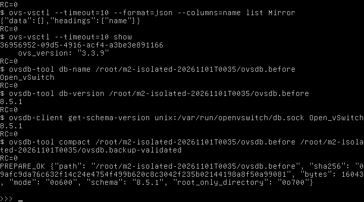

**Hình 2.20. Sao lưu OVSDB và xác nhận schema/checksum trước thay đổi**

Mục đích là xác nhận có snapshot có thể dùng cho rollback. Nội dung thể hiện đường dẫn root-only, schema và metadata/checksum. Kết quả cho biết backup đã tạo và được đọc kiểm tra; không phải kiểm thử restore thực tế. Ý nghĩa là giữ đường phục hồi trước giao dịch.

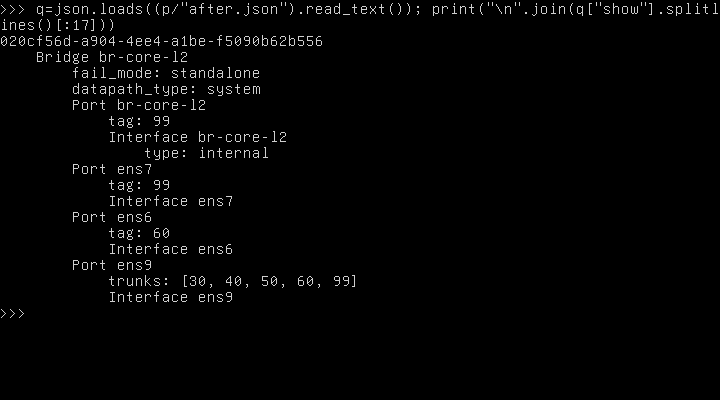

**Hình 2.21 (1/2). Cấu hình OVS bridge và bảy port sau giao dịch**

Mục đích là đối chiếu cấu hình thực tế với phạm vi duyệt. Nội dung hiển thị các phần của output ovs-vsctl show; kết quả có đúng access/trunk và không có ens10/Mirror. Ý nghĩa là xác nhận DB, không thay capture lưu lượng.

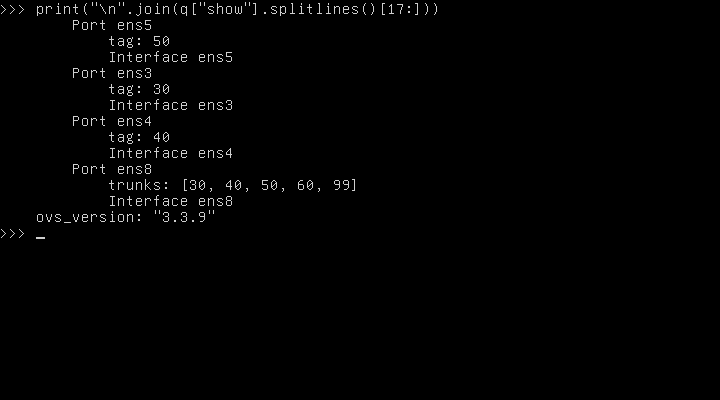

**Hình 2.21 (2/2). Cấu hình OVS bridge và bảy port sau giao dịch**

Mục đích là đối chiếu cấu hình thực tế với phạm vi duyệt. Nội dung hiển thị các phần của output ovs-vsctl show; kết quả có đúng access/trunk và không có ens10/Mirror. Ý nghĩa là xác nhận DB, không thay capture lưu lượng.

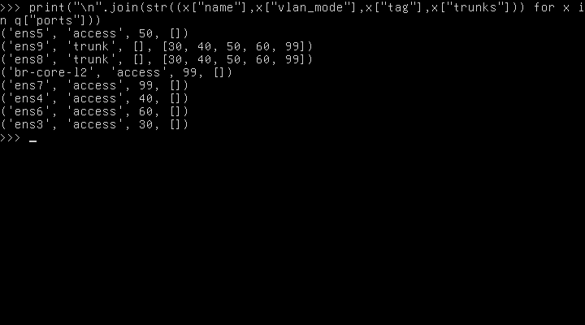

**Hình 2.22. Bảng VLAN access/trunk đọc lại từ OVS**

Mục đích là kiểm tra mode, tag và trunks của từng Port. Kết quả dùng để so với bảng mapping; ý nghĩa là loại trừ nhầm cấu hình VLAN trước khi nối peer.

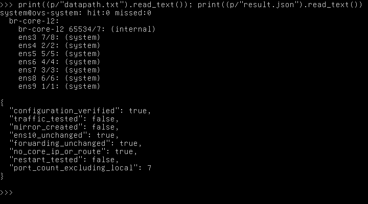

**Hình 2.23. Datapath và interface OVS sau cấu hình cô lập**

Mục đích là kiểm tra daemon đã đưa cổng vào datapath và không có lỗi Interface. Kết quả là kiểm chứng runtime ở trạng thái cô lập; chưa kết luận thông lượng hoặc chuyển tiếp qua peer.

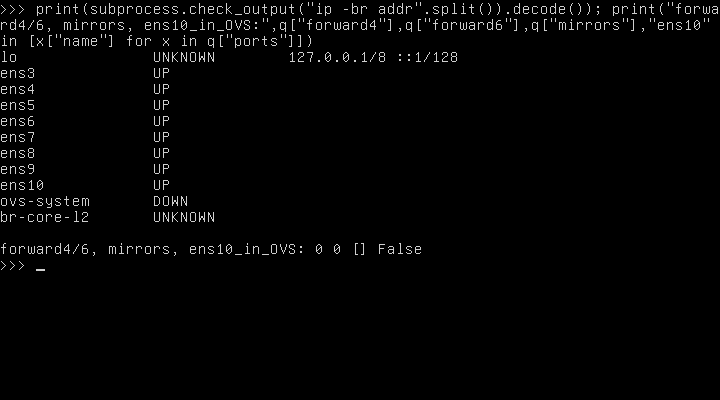

**Hình 2.24. Core không có IP/gateway và forwarding giữ nguyên sau cấu hình**

Mục đích là kiểm tra giới hạn Layer 2 và ens10. Nội dung thể hiện địa chỉ/forwarding/mirror hoặc dữ liệu đọc lại tương ứng. Kết quả không có IP mới, forwarding 0/0, ens10 ngoài OVS; ý nghĩa là không chuyển vai trò gateway lên Core.


## 2.33. Giới hạn nghiệm thu và kế hoạch tiếp theo

Đã đạt bước cấu hình cô lập và kiểm tra tĩnh/runtime trong guest. Chưa có peer/link EVE nên chưa thử switching cùng VLAN, cách ly khác VLAN, tag 802.1Q, trunk allowed/denied, mirror, gateway hoặc HA. Chưa restart để kiểm tra duy trì cấu hình. Không tuyên bố hoàn tất hoặc nghiệm thu chức năng chuyển mạch M2.

Đợt tiếp theo cần phê duyệt riêng về endpoint, cổng hai đầu, link/network_id, tài nguyên và địa chỉ thử; chọn hai peer độc lập để tránh đi tắt trên cùng EVE segment. Thực hiện các ca T02–T09 trong mục 2.25 với đối chứng dương, capture nguồn/đích, FDB và counter. Bước SPAN ens10 hoãn hoàn toàn; phải duyệt phạm vi nguồn/hướng và sensor riêng trước khi cấu hình. Bước restart/persistence cũng cần đợt riêng.

Giữ nguyên mọi ảnh/log trước đây, gồm docs/evidence/eve-ng/. Các bản báo cáo cũ không bị ghi đè. Thời điểm minh chứng lấy từ Windows UTC+07:00 trong JSON, giờ bên trong guest chỉ tham khảo. Log guest được thu qua console bằng truyền base64 có SHA-256 toàn bộ khớp; không xuất raw OVSDB backup hoặc dữ liệu đăng nhập. Ảnh là framebuffer thật, không sửa nội dung. Chưa có ảnh topology GUI mới do công cụ hiện tại chỉ truy cập console: có thể mở lab SOC-M2-Core-L2 trên EVE Web, giữ nguyên canvas không link, chụp toàn màn hình có tên lab/node bằng Win+Shift+S và lưu cùng thư mục minh chứng với giờ UTC+07:00. Không coi ảnh chưa chụp là minh chứng đã có.
