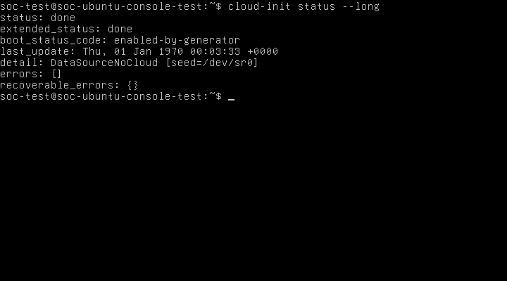
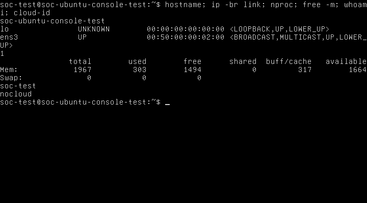
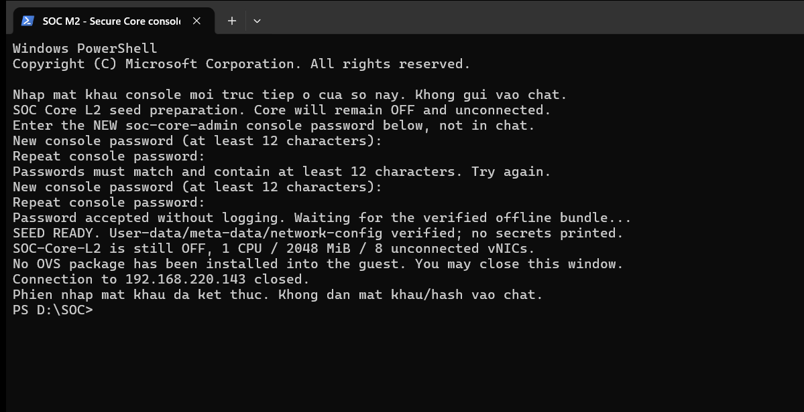
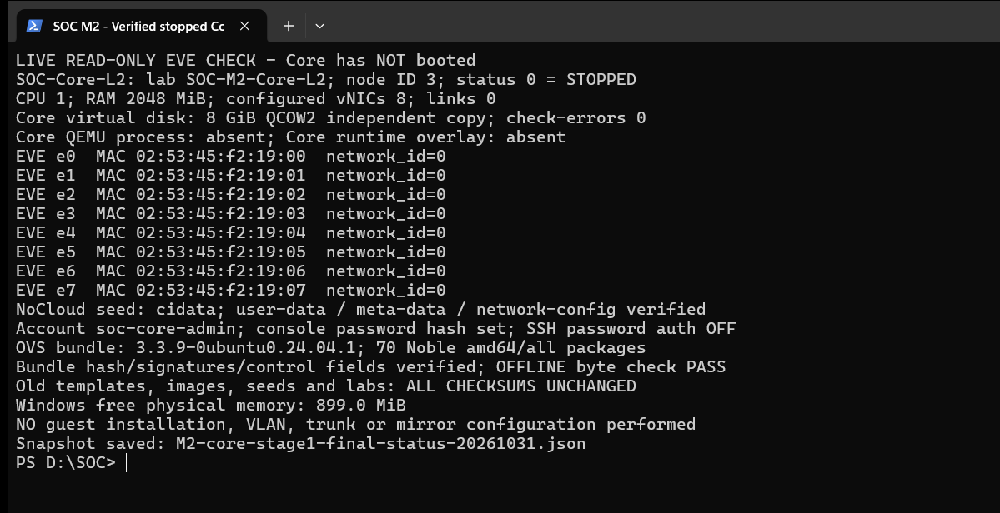

> Bản cập nhật M2 ngày 31/10/2026: mục 2.1–2.8 lưu bước Ubuntu trước đây; mục 2.9–2.14 ghi nhận chuẩn bị Core mới. Bản Word/ảnh/log cũ được giữ nguyên.

# CHƯƠNG 2. CHUẨN BỊ MÔI TRƯỜNG CORE LAYER 2

## 2.1. Mục tiêu và phạm vi kiểm chứng

Giai đoạn này kiểm tra khả năng khởi tạo và quản trị Ubuntu Server 24.04 trên EVE-NG trước khi triển khai Core Layer 2 bằng Open vSwitch (OVS). Đối tượng kiểm tra là node `Ubuntu-Console-Test`, ID 2, trong lab `SOC-Ubuntu-Image-Test`. EVE-NG được truy cập tại `192.168.220.143`; đây là địa chỉ quản trị EVE đã sử dụng thực tế, không phải địa chỉ gateway của các VLAN trong đồ án.

Người quản trị đã xác nhận đăng nhập console bằng tài khoản `soc-test`. Trong phiên thu thập minh chứng, các lệnh chỉ đọc được thực hiện tại shell đã đăng nhập của chính node này. Hoạt động chỉ gồm đọc trạng thái, chụp framebuffer console thật và ghi tài liệu trên Windows; không cài OVS, sửa mạng, thay seed/image, dừng hoặc khởi động node. Tài liệu này là phần báo cáo M2 về chuẩn bị hệ điều hành, chưa phải biên bản nghiệm thu Core chuyển mạch.

Ảnh được thu trực tiếp từ framebuffer VNC của QEMU qua phiên SSH có kiểm tra host key. Mỗi ảnh giữ toàn bộ màn hình 720 × 400 pixel, không ghép, không cắt, không sửa nội dung. Thao tác Ctrl+L trước ảnh chính chỉ làm mới màn hình terminal thật rồi chạy lại lệnh kiểm tra; không sửa ảnh sau khi chụp. Log JSON cùng tên ảnh ghi node UUID, tiến trình QEMU, lệnh đã gửi, thời điểm và SHA-256 của ảnh.

## 2.2. Kết quả kiểm tra cloud-init

Lệnh `cloud-init status --long` được sử dụng để kiểm tra trạng thái khởi tạo trong guest. Ảnh được chọn cho báo cáo được thu từ 18:43:35 đến 18:43:42 ngày 31/10/2026, UTC+07:00, theo đồng hồ máy thu thập Windows.



**Hình 2.1. Kết quả kiểm tra trạng thái cloud-init trên Ubuntu Server 24.04**

Mục đích của Hình 2.1 là xác định cloud-init đã hoàn tất trong máy Ubuntu, thay vì chỉ suy luận từ việc CD-ROM đã được gắn trên EVE-NG. Nội dung hình thể hiện lệnh thực tế, các trường trạng thái và dấu nhắc shell của `soc-test` trên hostname `soc-ubuntu-console-test`.

| Nội dung kiểm tra | Kết quả thực tế | Đánh giá |
|---|---|---|
| `status` | `done` | Đã hoàn tất |
| `extended_status` | `done` | Đã hoàn tất |
| `boot_status_code` | `enabled-by-generator` | Trường trạng thái quan sát được |
| `detail` | `DataSourceNoCloud [seed=/dev/sr0]` | Đã nhận nguồn NoCloud từ CD-ROM |
| `errors` | `[]` | Không liệt kê lỗi |
| `recoverable_errors` | `{}` | Không liệt kê lỗi có thể phục hồi |
| Tài khoản sử dụng | Shell `soc-test`; lệnh `whoami` ở Hình 2.2 trả về `soc-test` | Đăng nhập được xác nhận |

Kết quả cho phép xác nhận cloud-init đã hoàn tất thành công theo báo cáo trạng thái của guest, nguồn dữ liệu NoCloud được nhận từ `/dev/sr0` và tài khoản quản trị thử nghiệm có thể sử dụng console. Ý nghĩa đối với Core Layer 2 là nền hệ điều hành có thể được quản trị và tiếp tục chuẩn bị cho OVS. Kết quả này chưa chứng minh OVS đã được cài, chuyển mạch VLAN/trunk hoạt động, mirror hoạt động hoặc firewall HA đã được kiểm thử. Cách diễn giải trạng thái dựa trên tài liệu chính thức về [CLI cloud-init](https://docs.cloud-init.io/en/latest/reference/cli.html) và [reported status](https://docs.cloud-init.io/en/latest/howto/status.html).

Trường `last_update` trong ảnh ghi `Thu, 01 Jan 1970 00:03:33 +0000`; không sử dụng trường này làm thời điểm thu thập minh chứng. Đồng hồ EVE cũng báo `NTPSynchronized=no` và lệch so với máy thu thập. Thời điểm ảnh được ghi riêng theo Windows, chuyển sang UTC+07:00; chưa hiệu chỉnh đồng hồ của bất kỳ hệ thống nào. Mã thoát của lệnh chưa được thu riêng; kết luận dựa trên các trường trạng thái và ảnh, không suy diễn đã đo mã thoát bằng 0.

## 2.3. Kiểm tra hostname, NIC, CPU và RAM



**Hình 2.2. Kết quả kiểm tra hostname, giao diện mạng và tài nguyên của node Ubuntu**

Mục đích của Hình 2.2 là đối chiếu cấu hình máy ảo do EVE/QEMU cấp với tài nguyên và tên giao diện mà Ubuntu nhận diện. Hình ghi lại lần lượt các lệnh `hostname`, `ip -br link`, `nproc`, `free -m`, `whoami` và `cloud-id`. Kết quả xác nhận khả năng quản trị guest, nhận diện cổng thử nghiệm và thiết lập đường cơ sở tài nguyên; chưa xác nhận khả năng chịu tải khi chuyển tiếp lưu lượng SOC.

| Thông số | Kết quả xác minh | Nguồn và giới hạn |
|---|---|---|
| Hostname | `soc-ubuntu-console-test` | `hostname`; ảnh ban đầu còn có `hostnamectl` |
| Hệ điều hành | Ubuntu 24.04.5 LTS, x86-64 | `hostnamectl` trên ảnh `M2-console-initial-20261031T184136+0700.png` |
| NIC Ethernet trong guest | `ens3`, MAC `00:50:00:00:02:00`, trạng thái `UP` | `ip -br link`; ngoài ra có `lo` là loopback, không phải NIC nối topology |
| Liên kết ra topology | Chưa kết nối | XML lab không có network object/interface nối mạng; TAP `vunl0_2_0` không có bridge master |
| CPU cấu hình | 1 vCPU | XML `cpu=1` và QEMU `-smp 1` |
| CPU khả dụng cho tiến trình kiểm tra | `nproc` trả về `1` | Phù hợp CPU cấu hình; không phải phép đo hiệu năng |
| RAM cấu hình | 2048 MiB | XML `ram=2048` và QEMU `-m 2048` |
| RAM guest nhìn thấy | Tổng 1967 MiB; available 1664 MiB tại lúc chụp | `free -m`; nhỏ hơn RAM cấu hình do phần bộ nhớ dành riêng cho hệ thống; số available biến đổi theo thời điểm |
| Swap | Tổng 0 MiB trong guest | `free -m`; không nhầm với swap của EVE host |
| Datasource | `cloud-id` trả về `nocloud` | Kiểm tra bổ sung trong guest |

NIC là Network Interface Card, tức giao diện mạng; vNIC là giao diện mạng ảo do QEMU cung cấp. CPU là Central Processing Unit, tức bộ xử lý trung tâm; vCPU là bộ xử lý ảo cấp cho guest. RAM là Random Access Memory, tức bộ nhớ truy cập ngẫu nhiên. Các thành phần này lần lượt cung cấp cổng chuyển tiếp, năng lực xử lý và bộ nhớ làm việc cho Core dự kiến; phép kiểm tra hiện tại xác nhận tài nguyên được nhận diện, chưa đánh giá thông lượng hoặc độ trễ.

Trạng thái `UP` của `ens3` không chứng minh có đường tới Internet, gateway hoặc một VLAN đã triển khai. Trong EVE, NIC hiện vẫn chưa nối vào topology. Tên `ens3` chỉ được xác nhận cho một NIC hiện tại; không tự gán `ens4`, `eth0` hoặc tên tiếp theo cho các NIC chưa được thêm.

Có thể tái kiểm tra bằng các lệnh chỉ đọc dưới đây. `hostnamectl` cho biết nhận dạng hệ thống; `ip -br link` liệt kê giao diện; `nproc` và `lscpu` kiểm tra CPU; `free -m` kiểm tra RAM; hai lệnh cuối kiểm tra người dùng và datasource. `lscpu` là hướng dẫn bổ sung, chưa được thực hiện trong lần chụp này.

```sh
hostnamectl
ip -br link
nproc
lscpu
free -m
whoami
cloud-id
```

## 2.4. Đề xuất số lượng NIC cho Core Open vSwitch

### 2.4.1. Cơ sở tính toán

OVS, tên đầy đủ Open vSwitch, là bộ chuyển mạch ảo mã nguồn mở. Trong thiết kế này, OVS dự kiến chuyển tiếp frame theo địa chỉ MAC và phân tách các miền Layer 2 bằng VLAN; toàn bộ gateway, định tuyến liên VLAN, firewall rules và NAT do OPNsense đảm nhiệm. SOC là Security Operations Center, tức trung tâm điều hành an ninh mạng; Core cung cấp đường truyền giữa các vùng và bản sao lưu lượng cho bộ phận giám sát của SOC, không thay firewall.

VLAN là Virtual Local Area Network, tức mạng cục bộ ảo, tạo các miền quảng bá riêng trên hạ tầng chuyển mạch. Cổng access nối thiết bị đầu cuối vào một VLAN; trunk mang lưu lượng của nhiều VLAN bằng thẻ IEEE 802.1Q. Trong topology đồ án, một trunk đến OPNsense có thể mang VLAN 30/40/50/60/99, không cần năm NIC trunk riêng cho năm VLAN. Việc bố trí năm NIC access dưới đây xuất phát từ năm kết nối endpoint dự kiến, không phải quy tắc bắt buộc một NIC cho mỗi VLAN. [Tài liệu cấu hình OVS](https://docs.openvswitch.org/en/stable/faq/configuration/).

Đối chiếu [port map M1](../../network/core-l2/port-mapping.md), [kế hoạch địa chỉ](../../network/ip-plan/vlan-ip-plan.md), [phương án M2](deployment-options.md) và AGENTS hiện hành: M1 có hai trunk tới firewall, bốn access và một mirror; AGENTS xác định thêm vùng DMZ VLAN 60, nên đề xuất dưới đây bổ sung một access DMZ. Những mô tả cũ gọi DMZ là tùy chọn không thay thế quy định VLAN hiện hành.

### 2.4.2. Phương án khuyến nghị: 8 vNIC

| Nhãn logic đề xuất | Số vNIC | Vai trò | Trạng thái |
|---|---|---|---|
| Access Data Center | 1 | Endpoint VLAN 30 | Chưa triển khai |
| Access Employee | 1 | Endpoint VLAN 40 | Chưa triển khai |
| Access Guest | 1 | Endpoint VLAN 50 | Chưa triển khai |
| Access DMZ | 1 | Endpoint VLAN 60 | Chưa triển khai |
| Access Management | 1 | Endpoint/mạng quản trị VLAN 99 | Chưa triển khai |
| Trunk OPNsense Primary LAN | 1 | Dự kiến mang VLAN 30/40/50/60/99 | Dự trữ cho M3; chưa xác minh cổng peer |
| Trunk OPNsense Secondary LAN | 1 | Dự kiến mang VLAN 30/40/50/60/99 | Dự trữ cho M3; chưa xác minh cổng peer |
| Mirror output | 1 | Xuất bản sao lưu lượng tới NIC capture của Suricata | Chưa chốt nguồn/hướng mirror hoặc peer |
| **Tổng** | **8** | **5 access + 2 trunk + 1 mirror** | **Đề xuất, chưa đổi NIC** |

Port mirroring là cơ chế sao chép frame được chọn sang cổng giám sát; SPAN là Switched Port Analyzer, tên thường dùng trong hệ sinh thái Cisco cho chức năng giám sát tương tự. Trong đồ án, cổng mirror dự kiến đưa bản sao tới Suricata, công cụ phân tích lưu lượng để phát hiện xâm nhập. Cổng mirror không thay cổng quản trị của cảm biến và không được tính như đường chuyển tiếp endpoint bình thường. Phạm vi nguồn, hướng ingress/egress và khả năng quan sát khi firewall chuyển vai trò cần chốt ở bước thiết kế tiếp theo. [OVS mirroring](https://docs.openvswitch.org/en/stable/faq/configuration/).

Phương án 8 vNIC giữ sẵn hai đường firewall cho HA (High Availability, tính sẵn sàng cao), tức khả năng tiếp tục cung cấp dịch vụ khi một thành phần gặp sự cố. Hai trunk tới Primary và Secondary là hai kết nối riêng, **không gộp thành LACP xuyên qua hai firewall**. LACP (Link Aggregation Control Protocol, giao thức điều khiển gộp liên kết) cần peer hỗ trợ và các link cùng nhóm được thiết kế phù hợp; LACP chưa thuộc kết quả kiểm chứng này.

### 2.4.3. Phương án tối giản và khả năng mở rộng

- M2 tạm chỉ giữ một trunk, năm access và một mirror thì cần 7 vNIC; phương án này chưa có kết nối riêng tới firewall thứ hai như M1. Khuyến nghị chọn 8 để chuẩn bị cho M3.
- Quản trị Core có thể thiết kế qua OVS internal interface thuộc VLAN 99, không nhất thiết thêm một vNIC. Đây là đề xuất, chưa gán IP. Nếu chọn NIC quản trị riêng thì tổng tăng lên 9 và cần xác định segment quản trị trước khi nối.
- Kiểm thử dương hai endpoint cùng VLAN phải đi qua hai cổng OVS khác nhau. Có thể xin thêm một cổng test (tổng 9 nếu giữ tám vai trò trên), hoặc xin tạm bố trí lại một cổng access chưa dùng. Không nối cả hai endpoint vào cùng bridge EVE rồi coi ping thành công là bằng chứng đã đi qua Core.
- Nếu giữ nguyên tám vai trò và bổ sung riêng một bài thử LACP hai link thì cần thêm hai vNIC, tổng 10. Số lượng có thể khác nếu tái sử dụng cổng; chưa chốt peer hoặc triển khai.
- Trước khi tăng NIC, cần kiểm tra khả năng template, số cổng GUI/API cho phép, PCI/QEMU và tên NIC thực tế sau khi thay đổi được phê duyệt. Chưa khẳng định template đã chạy thành công với 8, 9 hoặc 10 NIC.

Không có số cổng Ethernet mới, địa chỉ IP, subnet, VIP hoặc native VLAN nào được xác nhận chính thức bởi đề xuất này. Chưa thay đổi NIC của `Ubuntu-Console-Test` hoặc quyết định chuyển node kiểm thử thành Core. WAN và đường đồng bộ HA của OPNsense không tự động nối qua Core VLAN người dùng trong đề xuất tính NIC này.

## 2.5. Giải thích các thuật ngữ nền tảng

### 2.5.1. cloud-init

**Tên và nghĩa:** `cloud-init` là tên chính thức của công cụ khởi tạo tự động instance; không phải từ viết tắt cần tự tạo một tên khai triển. Có thể diễn giải tiếng Việt là công cụ thiết lập ban đầu máy chủ/máy ảo.

**Nguyên lý:** trong quá trình boot, công cụ nhận diện datasource, đọc dữ liệu khởi tạo và chạy các module tương ứng, chẳng hạn tạo user hoặc đặt hostname. Cấu hình phụ thuộc dữ liệu cung cấp và tần suất module; không giả định mọi module chạy lại ở mọi lần reboot. [Giới thiệu cloud-init](https://docs.cloud-init.io/en/latest/explanation/introduction.html).

**Vai trò và ví dụ:** trong SOC, công cụ giúp chuẩn hóa nền Ubuntu để người quản trị có thể tiếp tục chuẩn bị Core. Tại node đang kiểm tra, trạng thái `done` cùng tài khoản `soc-test` sử dụng được là kết quả đã xác minh. Việc cài OVS thông qua cloud-init là khả năng kỹ thuật, chưa được cấu hình hoặc cho phép thực hiện ở đây.

### 2.5.2. NoCloud

**Tên và nghĩa:** `NoCloud` là tên một datasource của cloud-init, không phải tên viết tắt. Trong trường hợp này có thể diễn giải là phương thức cung cấp dữ liệu khởi tạo cục bộ không cần dịch vụ cloud metadata qua mạng.

**Nguyên lý:** với đĩa seed cục bộ, cloud-init nhận diện filesystem có nhãn `CIDATA`/`cidata` và đọc đúng các tệp `user-data`, `meta-data` ở thư mục gốc. Metadata có `instance-id` để nhận dạng instance. NoCloud còn có các cách cấp dữ liệu khác; kết quả hiện tại chỉ xác nhận cách dùng CD-ROM. [NoCloud](https://docs.cloud-init.io/en/latest/reference/datasources/nocloud.html).

**Vai trò và ví dụ:** phương thức này phù hợp bootstrap node SOC đang cô lập, chưa có mạng. `DataSourceNoCloud [seed=/dev/sr0]` và `cloud-id` trả về `nocloud` xác nhận guest hiện tại đã nhận nguồn đó; không suy rộng kết quả sang seed/node cũ.

### 2.5.3. Datasource

**Tên và nghĩa:** Data Source, thường viết liền là `datasource`, nghĩa là nguồn dữ liệu cấu hình; không có chữ viết tắt bắt buộc trong ngữ cảnh này.

**Nguyên lý:** datasource là lớp cung cấp dữ liệu mà cloud-init sử dụng để nhận metadata và user-data, có thể từ nền tảng cloud hoặc nguồn cục bộ. Nó xác định nơi và cách lấy dữ liệu, không đồng nghĩa với file cấu hình cụ thể. [Datasources](https://docs.cloud-init.io/en/latest/reference/datasources.html).

**Vai trò và ví dụ:** trong quá trình chuẩn bị SOC, nhận đúng datasource giúp tránh trường hợp Ubuntu boot được nhưng thiếu user hoặc hostname mong muốn. Ở node hiện tại, datasource là NoCloud, thiết bị seed là `/dev/sr0`, còn hostname và tài khoản là các giá trị được kiểm tra riêng trong guest.

### 2.5.4. Seed ISO

**Tên và nghĩa:** Seed ISO, tức ảnh đĩa mồi khởi tạo dạng ISO 9660. Đây là cụm mô tả phương tiện chứa cấu hình, không phải tên một giao thức mạng.

**Nguyên lý:** QEMU gắn tệp ISO như CD-ROM; guest nhìn thấy thiết bị quang ảo. Dữ liệu bên trong cung cấp chỉ dẫn khởi tạo cho datasource. Với NoCloud, cần bảo đảm nhãn đĩa và tên file mà guest đọc được; tên file nguồn có đuôi `.yaml` trên host không thay thế yêu cầu tên trong ISO. [Ubuntu: dùng datasource cục bộ](https://ubuntu.com/docs/public-images/public-images-how-to/use-local-cloud-init-ds/).

**Vai trò và ví dụ:** seed riêng giúp bootstrap tài khoản quản trị cho node thử nghiệm mà không sửa image Ubuntu gốc hoặc seed của node khác. QEMU đang gắn `linux-ubuntu-24.04-soc-console-test/cdrom.iso`; kết quả `/dev/sr0` xác nhận guest dùng đĩa seed. Không công bố nội dung hash mật khẩu hoặc các dữ liệu nhạy cảm trong báo cáo.

### 2.5.5. QEMU

**Tên và nghĩa:** QEMU thường được diễn giải là Quick Emulator, bộ giả lập/ảo hóa máy tính. Tên chính thức của dự án là QEMU. [Thuật ngữ NIST](https://csrc.nist.gov/glossary/term/QEMU).

**Nguyên lý:** QEMU tạo mô hình máy gồm CPU, RAM, thiết bị mạng và ổ đĩa để chạy hệ điều hành khách. Khi kết hợp KVM (Kernel-based Virtual Machine, cơ chế ảo hóa trong nhân Linux), nó có thể sử dụng hỗ trợ ảo hóa phần cứng. [QEMU system emulation](https://www.qemu.org/docs/master/system/introduction.html).

**Vai trò và ví dụ:** QEMU là lớp chạy máy Ubuntu làm nền cho Core SOC dự kiến. Tiến trình được quan sát là `/opt/qemu-2.12.0/bin/qemu-system-x86_64`, cấp `-smp 1`, `-m 2048`, NIC VirtIO và `accel=kvm`. Đây là tham số chạy đã đọc, không phải lệnh khởi tạo mới hoặc bằng chứng OVS đã tồn tại.

### 2.5.6. QCOW2

**Tên và nghĩa:** QEMU Copy-On-Write version 2, tức định dạng ảnh đĩa QEMU dùng cơ chế sao chép khi ghi thuộc họ QCOW2. Tên định dạng không được dùng để suy luận rằng header luôn mang version 2. [QEMU glossary](https://www.qemu.org/docs/master/glossary.html), [đặc tả QCOW2](https://www.qemu.org/docs/master/interop/qcow2.html).

**Nguyên lý:** khi dùng backing file, dữ liệu chưa thay đổi được đọc từ lớp nền; dữ liệu mới được ghi vào overlay. Overlay vẫn phụ thuộc backing file, nên không phải bản sao đầy đủ độc lập. Các lớp phải được giữ nguyên hoặc xử lý bằng quy trình được phê duyệt. [QEMU disk images](https://www.qemu.org/docs/master/system/images.html).

**Vai trò và ví dụ:** QCOW2 cho phép thử nghiệm nền Ubuntu mà giữ base của đồ án. Chuỗi đã được kiểm tra ở phiên khôi phục là runtime overlay của node 2 → variant `linux-ubuntu-24.04-soc-console-test/virtioa.qcow2` → base `linux-ubuntu-24.04-ovs/virtioa.qcow2`. Phiên này chỉ đọc đường runtime từ tiến trình, không chạy kiểm tra sửa chữa ổ đĩa hoặc thay backing chain.

### 2.5.7. Console

**Tên và nghĩa:** System Console, tức giao diện điều khiển trực tiếp hệ thống; không có từ viết tắt bắt buộc. Trong node này, Ubuntu sử dụng virtual console/TTY, được hiển thị qua VGA ảo của QEMU và truy cập bằng VNC (Virtual Network Computing).

**Nguyên lý:** bàn phím và màn hình ảo cho phép tương tác với guest mà không cần NIC guest có địa chỉ IP. Đường console khác với SSH (Secure Shell, giao thức quản trị từ xa có mã hóa), vốn cần một đường mạng tới hệ thống đích. Linux phân biệt virtual console với serial console; không gọi VGA/VNC hiện tại là serial console. [Linux console](https://docs.kernel.org/admin-guide/serial-console.html), [QEMU invocation](https://www.qemu.org/docs/master/system/invocation.html).

**Vai trò và ví dụ:** console cung cấp đường bootstrap và kiểm tra Core khi mạng chưa được cấu hình. Tại đây, `soc-test` đăng nhập và chạy `cloud-init status --long` trên console thật. SSH chỉ dùng để vào EVE và vận chuyển dữ liệu chụp, không chứng minh đã SSH vào Ubuntu.

## 2.6. Phân loại kết quả và vấn đề còn tồn tại

| Hạng mục | Phân loại | Kết luận |
|---|---|---|
| Guest boot, console và user `soc-test` | Đạt, đã xác minh | Có shell thực tế và kết quả `whoami` |
| Cloud-init/NoCloud | Đạt, đã xác minh | `done`, không liệt kê lỗi, seed `/dev/sr0` |
| Hostname/NIC/CPU/RAM hiện tại | Đạt về nhận diện | Có ảnh và đối chiếu XML/QEMU |
| Tăng lên 8 vNIC | Đề xuất | Chưa thay node, chưa xác minh giới hạn hoặc tên NIC bổ sung |
| Cài đặt và dịch vụ OVS | Chưa nghiệm thu | Không cài trong phiên này; chưa chạy kiểm kê package/dịch vụ guest |
| VLAN access/trunk, mirror | Chưa kiểm thử | Chưa có cấu hình hoặc lưu lượng thử nghiệm |
| IP, subnet, số cổng hai đầu | Chưa xác nhận | Các giá trị M1 tiếp tục là đề xuất |
| SSH vào guest | Chưa kiểm thử | Console thành công không thay cho SSH thành công |
| Đồng hồ hệ thống | Còn tồn tại | `last_update` năm 1970 và EVE NTP chưa đồng bộ; chưa sửa |
| Hoàn tất toàn bộ M2 | Chưa đạt | Mới hoàn thành bước chuẩn bị hệ điều hành |

Trong lần thu thập đầu, chuỗi phím cho biến `_NPROCESSORS_ONLN` bị console nhận sai thành dấu gạch ngang nên `getconf` báo lỗi; không dùng lần đó để kết luận CPU. Lần kiểm tra sau dùng `nproc`, trả về `1` và được đối chiếu với QEMU. Một ảnh ban đầu chụp trước khi output cloud-init được vẽ xong nên chưa đủ minh chứng dù tên file chứa `success`. Các ảnh và JSON này được giữ nguyên, phân loại rõ trong danh mục; Hình 2.1 và 2.2 chỉ dùng hai ảnh chính đã đọc kiểm tra.

## 2.7. Bước tiếp theo cần phê duyệt

1. Chốt phương án 8 vNIC, mục đích từng cổng, peer kiểm thử trunk/mirror, cách kiểm thử hai endpoint cùng VLAN và lựa chọn node sẽ làm Core. Giữ nguyên các node cũ và không mặc định biến node kiểm thử thành Core.
2. Nếu cần tăng NIC hoặc chuẩn bị node Core, phê duyệt rõ thao tác trên node đích và việc dừng/khởi động lại nếu EVE yêu cầu. Chỉ sau thay đổi được duyệt mới đối chiếu NIC theo MAC, tên guest và cổng EVE.
3. Phê duyệt riêng kế hoạch cài `openvswitch-switch` trong guest, gồm đường cung cấp package. Guest đang cô lập, chưa có đường tải gói được xác nhận; không tự nối pnet/NAT/Internet hoặc sửa seed để cài gói.
4. Phê duyệt cấu hình chuyển mạch Layer 2 và mạng kiểm thử trước khi triển khai VLAN/trunk/mirror. Core không tạo gateway liên VLAN, firewall/NAT; các chức năng đó ở OPNsense.

## 2.8. Tài liệu và khả năng đưa vào Word

Tài liệu Markdown này là bản nội dung báo cáo có thể tái sử dụng. Bản `.docx` cùng tên chứa ảnh thật, chú thích phía dưới và bảng kết quả, dùng A4, Times New Roman 13, lề trái 3 cm, các lề khác 2 cm. Số chương/mục và Hình 2.1–2.2 được ghi rõ; khi ghép vào luận văn đầy đủ cần đối chiếu mục lục và số hình chung. Danh mục minh chứng, log chép kết quả và JSON gốc của bộ thu thập nằm trong `docs/evidence/M2/`; minh chứng cũ tại `docs/evidence/eve-ng/` được giữ nguyên.

Các nguồn chính thức được dẫn ngay tại nội dung liên quan; ngày truy cập 31/10/2026. Tài liệu online giải thích nguyên lý, không xác nhận phiên bản cloud-init hoặc tính năng OVS của guest hiện tại. Ảnh và JSON mới là căn cứ cho các kết quả thực nghiệm.


## 2.9. Chuẩn bị tài nguyên Core mới trong giai đoạn đầu M2

Phần 2.1–2.8 ở trên lưu kết quả kiểm chứng nền Ubuntu và thiết kế tại bước trước. Từ mục 2.9, báo cáo ghi nhận **tài nguyên mới đã được tạo theo phê duyệt**, phân biệt với các kiểm thử guest chưa được phép thực hiện. Hai node `Ubuntu-Test` và `Ubuntu-Console-Test` được giữ nguyên. Bản Word/Markdown cũ được bảo toàn; đây là phiên bản báo cáo M2 cập nhật.

### 2.9.1. Phạm vi phê duyệt và phương pháp

Được phép chuẩn bị bundle OVS offline từ Ubuntu 24.04 chính thức, image/đĩa riêng ít nhất 8 GiB, seed quản trị riêng và node mới 1 vCPU/2048 MiB/8 vNIC, để tắt và chưa nối mạng. Việc tạo lab/node sử dụng native PHP classes `Lab` và `Node` của EVE qua SSH quản trị, cùng cơ chế backend của EVE; không đăng nhập API Web, không tạo cookie hay thay phiên Web người dùng. Không gọi start/stop/wipe/fixpermissions toàn hệ thống.

Khởi động Core, cài OVS vào guest, tạo bridge/VLAN/trunk/mirror và nối mạng tiếp tục nằm ngoài phạm vi. Không sửa template chung, image gốc, lab cũ hoặc cấu hình Windows/VMware.

### 2.9.2. Kết quả image và đĩa Core

| Hạng mục | Kết quả đã xác minh |
|---|---|
| Image directory | `/opt/unetlab/addons/qemu/linux-ubuntu-24.04-soc-core-l2` |
| Disk | `virtioa.qcow2`, bản sao đầy đủ độc lập, không có backing-file |
| Virtual capacity | 8,589,934,592 byte, tương đương 8 GiB |
| File size | 621,346,944 byte; dung lượng file khác virtual capacity |
| Kiểm tra QCOW2 | `qemu-img check`: rc=0, `check-errors=0` |
| So nội dung với base | `qemu-img compare`: rc=0, `Images are identical` |
| Disk SHA-256 mới | `0de140dda997a09b6d72230ae74b68612fdc2cfbc59949d7e2021561246ac718` |
| Base SHA-256 bảo toàn | `04e8f2461a16a44e78a370284471f29616cdd9baf1893df25807b71f985b6c94` |

Quy trình sao chép kiểm tra checksum trước khi mở rộng, chỉ resize file mới, sau đó kiểm tra cấu trúc và so dữ liệu. Cảnh báo `Image size mismatch` trong compare là hệ quả đĩa mới 8 GiB lớn hơn base 3.5 GiB; công cụ vẫn trả về dữ liệu giống nhau, vùng đuôi tăng thêm bằng zero. Kết quả xác nhận tính toàn vẹn mức ảnh đĩa, **chưa xác nhận partition/root filesystem đã mở rộng**, vì Core chưa khởi động. [QEMU image utility](https://www.qemu.org/docs/master/tools/qemu-img.html).

### 2.9.3. Lab, node và tám interface đã khai báo

Lab mới là `/opt/unetlab/labs/SOC-M2-Core-L2.unl`, UUID `f39cfc8c-5eaf-461e-bb0c-60b5fde848b7`. Node `SOC-Core-L2` có ID **3**, UUID `2b295168-b72e-4de7-b364-37298252dd9f`, CPU=1, RAM=2048 MiB, Ethernet=8, template Linux, VirtIO NIC, QEMU 2.12.0. Native EVE status đọc lại là **0 — stopped**; không có tiến trình QEMU mang UUID Core và chưa có runtime directory/overlay cho lab mới.

Trong lần tạo đầu, ID 1 của lab mới làm hàm EVE `getStatus()` nhìn thấy cổng console của node ID 1 đang chạy ở lab cũ và trả về 2. Không có Core process hoặc runtime, nên đây là kết quả trạng thái nhầm theo cổng, không phải Core đã boot. Chỉ ID của node mới được chuyển sang 3 chưa dùng; sau đó status=0 được đối chiếu lại với UUID/process/runtime. Không dừng VM cũ hoặc xóa/wipe dữ liệu để xử lý.

| EVE interface ID | Nhãn EVE đã đọc | MAC đã đọc | Network ID | NIC guest |
|---|---|---|---|---|
| 0 | e0 | `02:53:45:f2:19:00` | 0, chưa nối | Chưa xác minh |
| 1 | e1 | `02:53:45:f2:19:01` | 0, chưa nối | Chưa xác minh |
| 2 | e2 | `02:53:45:f2:19:02` | 0, chưa nối | Chưa xác minh |
| 3 | e3 | `02:53:45:f2:19:03` | 0, chưa nối | Chưa xác minh |
| 4 | e4 | `02:53:45:f2:19:04` | 0, chưa nối | Chưa xác minh |
| 5 | e5 | `02:53:45:f2:19:05` | 0, chưa nối | Chưa xác minh |
| 6 | e6 | `02:53:45:f2:19:06` | 0, chưa nối | Chưa xác minh |
| 7 | e7 | `02:53:45:f2:19:07` | 0, chưa nối | Chưa xác minh |

Node có 0 network object và 0 liên kết. Nhãn EVE `e0`–`e7` đã được xác minh ở cấp cấu hình; không coi đó là tên Linux và không giả định `ens3`, `ens4` cho Core chưa boot. Vai trò access/trunk/mirror vẫn theo thiết kế, chưa có cấu hình OVS áp dụng.

## 2.10. Seed NoCloud và tài khoản quản trị riêng



**Hình 2.3. Kết quả tạo seed NoCloud riêng cho node SOC-Core-L2 ở trạng thái tắt**

Mục đích của hình là chứng minh quy trình nhập mật khẩu qua terminal riêng đã kết thúc và seed đã được đóng gói, không phải chứng minh đăng nhập guest Core. Ảnh là cửa sổ PowerShell/SSH thực tế, chụp nguyên cửa sổ bằng Win32 PrintWindow lúc 19:55:46 ngày 31/10/2026, UTC+07:00. Input getpass không hiển thị mật khẩu; ảnh không chứa password/hash. Kết quả cho thấy seed sẵn sàng, Core vẫn tắt và chưa cài OVS.

| Trường seed | Kết quả kiểm tra tĩnh |
|---|---|
| Path | `/opt/unetlab/addons/qemu/linux-ubuntu-24.04-soc-core-l2/cdrom.iso` |
| Owner/mode | root, 0600; thư mục chứa input riêng 0700 |
| Volume label | `cidata`, có Rock Ridge và Joliet |
| File gốc ISO | `user-data`, `meta-data`, `network-config`, archive bundle OVS |
| Tài khoản / hostname đề nghị trong seed | `soc-core-admin` / `soc-core-l2` |
| Instance-id | `iid-soc-core-l2-da130c3e-4cfe-4e11-91cb-254581c02547` |
| Console | Có hash SHA-512 crypt, `lock_passwd: false`; chưa thử login Core |
| SSH password/root login | `ssh_pwauth: false`, `disable_root: true`; hiệu lực runtime chưa kiểm tra |
| Quyền quản trị | Seed khai báo nhóm adm/sudo; chưa xác minh sudo trong guest |
| Network-config | Match 8 MAC, DHCP4/DHCP6/RA tắt, không địa chỉ IP, optional=true |
| Seed size / SHA-256 | 48,996,352 byte / `961ae4131e0f758a4a3b3565a29ebe87f7cadb90e368a5745ca7fcd33b011578` |

Mật khẩu do người dùng nhập trực tiếp hai lần qua getpass trên TTY SSH. Plaintext chỉ dùng trong bộ nhớ để đưa vào OpenSSL qua stdin; không đặt trên command line, chat, log hoặc repository. Hash chỉ nằm trong seed/input riêng bảo vệ trên EVE, không được sao chép vào bộ báo cáo. Public key quản trị chỉ được nhận khi fingerprint khớp khóa đã xác minh trước đây. File mô tả trong repository đã che hash/key material, không dùng thay seed thật.

Đã parse cấu trúc YAML và đối chiếu tên file trong cả hai namespace ISO, nhưng **chưa chạy cloud-init schema/runtime trên Core**. Việc guest nhận datasource, user/hostname, tám NIC và root filesystem là tiêu chí bước boot tiếp theo. Cấu hình NoCloud tĩnh không thay cho kết quả `cloud-init status --long` trong Core. [NoCloud chính thức](https://docs.cloud-init.io/en/latest/reference/datasources/nocloud.html).

## 2.11. Bundle Open vSwitch offline cho Ubuntu 24.04 amd64

### 2.11.1. Nguồn, phiên bản và toàn vẹn

Đã chuẩn bị **70 package** gồm root package `openvswitch-switch` và dependency/Pre-Depends do APT giải từ nguồn Ubuntu Noble chính thức; không bao gồm mọi Recommends/Suggests. `openvswitch-switch`, `openvswitch-common` và `python3-openvswitch` được chọn ở phiên bản **3.3.9-0ubuntu0.24.04.1**. Kiến trúc các gói chỉ có `amd64` hoặc `all`.

Metadata được tải bằng Windows qua HTTPS từ `archive.ubuntu.com` và `security.ubuntu.com`, gồm InRelease của noble/noble-updates/noble-security và sáu index main/universe amd64. Đã xác minh chữ ký với Ubuntu Archive Automatic Signing Key (2018), fingerprint `F6ECB3762474EDA9D21B7022871920D1991BC93C`. Hash index khớp InRelease; hash từng `.deb` khớp index; các trường Package/Version/Architecture trong control archive khớp manifest. Đây là chuỗi kiểm tra metadata → package, không chỉ so hai bản sao của cùng một file. [APT archive authentication](https://manpages.ubuntu.com/manpages/noble/man8/apt-secure.8.html).

| Artifact | Kết quả |
|---|---|
| Windows bundle | `staging/soc-core-l2-20261031-stage1/ovs-noble-amd64-offline-20261031-v2.tar` |
| EVE bundle | `/opt/unetlab/soc-core-preparation-20261031/ovs-noble-amd64-offline-20261031-v2.tar` |
| Archive size | 48,619,520 byte |
| Tổng dung lượng 70 `.deb` | 25,963,666 byte |
| Bundle SHA-256 | `c513ad7720c719f5f7bd24b2e73af3b2ec55a7f60ca67a0492621d25f5c2940b` |
| OVS switch package SHA-256 | `7a9a359d6a3bc207b210ef2cf6b9f11244f89eb2a910b4ba863ebef08e85dd0a` |

### 2.11.2. Bộ giải APT tách riêng và giới hạn tương thích

APT executable sẵn có trên EVE chỉ được dùng làm bộ giải và kiểm tra cache: toàn bộ sources, Etc, status, state, cache và log được tách vào `/opt/unetlab/soc-core-preparation-20261031/apt-root`. Sources chỉ trỏ tới file repository Noble đã xác thực; status bắt đầu và kết thúc vẫn rỗng. Không dùng package status, sources hoặc cache Jammy của host để lựa chọn gói. Không cài phần mềm lên EVE để chuẩn bị bundle.

Kiểm tra cuối dùng `--download-only --no-download --no-install-recommends`; đã đủ byte trong cache, rc=0 và có dòng `Download complete and in download only mode`. Thông báo kế hoạch `70 newly installed` trong output APT **không phải 70 gói đã được cài**. Hash `/var/lib/dpkg/status` và các file `/etc/apt` của host không đổi. [APT configuration isolation](https://manpages.ubuntu.com/manpages/noble/man5/apt.conf.5.html).

Bundle phù hợp release/architecture và đã khép dependency theo trạng thái rỗng của bộ giải, nhưng chưa chứng minh tương thích kernel/datapath hoặc installed-state thực của Core. Sau boot phải kiểm tra `uname -r`, module openvswitch, kiến trúc và mô phỏng cài theo package state guest. Không cài mù toàn bộ 70 `.deb`: nhiều gói nền đã có trong guest và cần tránh nâng/gỡ thành phần ngoài phạm vi. Mọi cài OVS thực tế tiếp tục cần phê duyệt riêng.

## 2.12. Minh chứng kiểm tra cuối và tình trạng tài nguyên



**Hình 2.4. Kiểm tra trạng thái tắt và tám giao diện mạng ảo đã khai báo của SOC-Core-L2**

Hình 2.4 ghi lại terminal thật chạy bộ kiểm tra chỉ đọc trên EVE, chụp lúc 19:57:58 UTC+07:00. Nội dung cho biết node status=0, cấu hình CPU/RAM/8 NIC, MAC của từng interface, network_id=0, không Core process/runtime, seed và bundle đã kiểm tra, checksum tài nguyên cũ bảo toàn. Đây là output kiểm tra từ EVE và Windows, **không phải console của guest Core đang boot hoặc ảnh GUI topology**. Ảnh nguyên cửa sổ, không cắt/ghép/sửa nội dung kỹ thuật.

Lần kiểm tra Windows lúc **2026-10-31T20:00:08.3518594+07:00** ghi FreePhysicalMemory **841,768 KiB, khoảng 822.0 MiB**; tổng RAM nhìn thấy khoảng 15.7 GiB. RAM Windows dao động trong phiên, không dùng số 899 MiB của ảnh chụp trước để thay mẫu mới hơn. EVE `free -m` ở lần đọc 20:00 cho available **5352 MiB**, swap dùng 0 MiB; việc EVE còn available không đồng nghĩa host Windows đã đủ RAM vật lý.

Theo ngưỡng vận hành đề xuất trong kế hoạch (Windows available ít nhất 2 GiB, EVE MemAvailable ít nhất 3 GiB trước boot), **Windows hiện chưa đạt điều kiện đề xuất để khởi động Core**. Không tự đóng ứng dụng/VM hoặc đổi RAM VMware. Người dùng có thể lưu công việc rồi tự đóng tab/ứng dụng không dùng và các cửa sổ terminal SOC đã hoàn tất; nếu muốn dừng VM khác thì phải xác định riêng, không dừng hai node kiểm chứng. Sau đó đo lại cả hai lớp tài nguyên. Ngưỡng này là lựa chọn cho lab, không phải bảo đảm của nhà cung cấp.

## 2.13. Giải thích thuật ngữ của bước chuẩn bị Core

| Tên tiếng Anh đầy đủ / viết tắt | Nghĩa tiếng Việt | Nguyên lý | Vai trò trong SOC và ví dụ của đồ án |
|---|---|---|---|
| Open vSwitch — OVS | Bộ chuyển mạch ảo | OVSDB lưu cấu hình, daemon/datapath chuyển frame theo chính sách L2 | Core SOC dự kiến thực hiện VLAN/trunk/mirror; hiện mới có bộ cài, chưa cài guest |
| Virtual Network Interface Card — vNIC | Giao diện mạng ảo | QEMU mô phỏng card với MAC và kết nối backend riêng | Đã khai báo 8 vNIC e0–e7 trên EVE; tên guest còn chưa xác minh |
| QCOW2 overlay — QEMU Copy-On-Write version 2 overlay | Lớp ảnh đĩa ghi thay đổi | Đọc dữ liệu chưa sửa từ backing, ghi thay đổi ở overlay; phụ thuộc chuỗi backing | Image Core mới là full copy độc lập; runtime overlay EVE chưa tạo vì Core chưa boot; overlay cũ giữ nguyên |
| cloud-init (tên sản phẩm, không tự tạo dạng khai triển) | Công cụ khởi tạo instance | Nhận datasource, đọc user-data/meta-data/network-config và chạy module theo boot/frequency | Seed Core khai báo tài khoản/hostname riêng; trạng thái done của node console không suy rộng cho Core |
| Offline package — Debian binary package `.deb` | Gói cài đặt dùng khi target không có Internet | Gói và dependency được tải trước, xác thực, chuyển qua phương tiện cục bộ rồi giải quyết theo trạng thái target | 70 gói Noble trong ISO riêng cho Core; chưa chạy cài đặt guest |
| Network bridge / Layer 2 bridge | Cầu nối chuyển mạch Layer 2 | Học MAC và chuyển frame trong miền được phép | Bridge OVS dự kiến tên br-soc, chưa tạo; khác bridge EVE dùng nối TAP |
| Access port | Cổng truy nhập một VLAN | Frame endpoint được gán vào VLAN của cổng | Vai trò access 30/40/50/60/99 thuộc thiết kế, chưa gán lên e0–e4 |
| VLAN trunk port | Cổng mang nhiều VLAN | Frame 802.1Q mang VLAN ID để dùng chung link | Hai cổng độc lập dự kiến tới hai OPNsense; chưa nối và không là bond LACP |
| Port mirroring | Sao chép lưu lượng sang cổng giám sát | Nhân bản frame được chọn tới capture port | Cổng thứ tám dự kiến gửi traffic cho Suricata; chưa cấu hình mirror, không phải IPS inline |

Các thuật ngữ đã có phần giải thích chi tiết hơn ở mục 2.5 và [kế hoạch triển khai Core](core-l2-implementation-plan.md). Ví dụ chưa được triển khai được đánh dấu rõ; không coi VLAN/IP hoặc port-to-port dự kiến là chính thức chỉ vì EVE đã có tám interface.

## 2.14. Đánh giá hoàn thành và bước tiếp theo

| Hạng mục | Kết quả ở cuối giai đoạn đầu |
|---|---|
| Bundle OVS chính thức | Đạt kiểm tra nguồn/chữ ký/hash/control và dependency/cache; chưa nghiệm thu runtime guest |
| Image/đĩa Core 8 GiB | Đạt kiểm tra QCOW2 và so dữ liệu; root filesystem guest chưa kiểm tra |
| Seed/tài khoản riêng | Đạt chuẩn bị tĩnh và bảo vệ bí mật; console login/cloud-init Core chưa thử |
| Node 1 CPU/2048 MiB/8 NIC | Đã tạo, status=0, 0 network/link, chưa có process/runtime overlay |
| Tài nguyên cũ | 9 file template/base/variant/seed/lab đều giữ SHA; hai QEMU cũ vẫn PID287703 và297601 |
| VLAN/trunk/mirror/bridge OVS | Chưa cấu hình, đúng giới hạn phê duyệt |
| Windows RAM | Chưa đạt ngưỡng vận hành đề xuất; cần người dùng xử lý rồi đo lại |

Sau khi người dùng giải phóng tài nguyên và phê duyệt **start duy nhất SOC-Core-L2**, mới boot, đăng nhập console bằng soc-core-admin và kiểm tra cloud-init, hostname, 8 NIC theo MAC, CPU/RAM, root partition/filesystem. Chưa cài OVS trong bước boot này. Khi các kiểm tra guest đạt, mới đề nghị phê duyệt mô phỏng/cài OVS offline và các bước cấu hình Layer 2 riêng.

Bộ báo cáo cập nhật gồm Word/Markdown mới, hai ảnh thật mới, snapshot trước/sau, cấu hình node/XML, metadata/network-config không chứa bí mật, log xác minh package, manifest và danh mục ảnh. Không sao chép seed ISO hoặc user-data chứa hash vào repository. Ảnh topology/settings EVE GUI chưa chụp trực tiếp: người dùng mở lab SOC-M2-Core-L2, hiển thị SOC-Core-L2 đang tắt và settings Ethernet=8, chụp PNG nguyên bản bằng Snipping Tool và lưu vào docs/evidence/M2 với thời điểm UTC+07:00. Ảnh terminal không được gán nhãn thành ảnh topology.


## 2.15. Bản chốt payload v2 và kiểm tra trước bước boot

Kiểm tra archive cuối phát hiện một mục `.deb.part-1` **0 byte**, do lần tải mạng bị timeout; không có package `.deb` sai checksum. Đã tạo bundle v2 loại mục tạm này và cập nhật SHA256SUMS bên trong archive. Bản v1 được giữ lại để đối chiếu; không xóa dữ liệu cũ. Tất cả 70 package thật của hai bản có cùng hash đã xác minh.

Chỉ seed của Core mới đang tắt được đóng gói lại bằng payload v2, giữ nguyên tài khoản, password hash, instance-id, public key và network-config. Seed v1 được lưu root-only ở staging riêng trước khi thay file `cdrom.iso` của Core; hai seed/image/lab cũ không thay đổi. Không boot guest để làm việc này. Các bảng hash/path bundle trong bản báo cáo chốt đã dùng **v2 hiện hành**; ảnh Hình 2.3–2.4 được chụp trước khi bỏ mục tạm và chỉ chứng minh trạng thái/cấu hình tại thời điểm chụp, không thay snapshot/hash v2.

Bundle hiện hành: `/opt/unetlab/soc-core-preparation-20261031/ovs-noble-amd64-offline-20261031-v2.tar`; SHA-256 `c513ad7720c719f5f7bd24b2e73af3b2ec55a7f60ca67a0492621d25f5c2940b`. Seed hiện hành: `/opt/unetlab/addons/qemu/linux-ubuntu-24.04-soc-core-l2/cdrom.iso`; SHA-256 `961ae4131e0f758a4a3b3565a29ebe87f7cadb90e368a5745ca7fcd33b011578`. Không có mục `.part-*` trong archive v2. Kiểm tra hash và control của 70 `.deb`, cùng APT download-only/no-download, đều đạt lại ở v2.

Snapshot chốt: `2026-10-31T20:09:27.482754+07:00`. EVE status=0, 8 interface network_id=0, không Core QEMU process hoặc runtime directory. Chín file cũ tiếp tục khớp checksum ban đầu. RAM Windows tại `2026-10-31T20:09:28.5402568+07:00` chỉ còn **442.3 MiB**; EVE memory tại cùng lần đọc được ghi nguyên văn trong JSON. Đây là mẫu mới hơn số liệu mục 2.12, **Windows vẫn chưa đạt ngưỡng vận hành 2 GiB đề xuất**.

Để tiếp tục, dùng `seed-ready-v2.json`, `bundle-ready-v2.json`, `bundle-validated-v2.json` trong `/opt/unetlab/soc-core-preparation-20261031/` và snapshot v2 trong thư mục minh chứng. Không coi các marker v1 là trạng thái payload mới nhất, không chạy lại thao tác tạo image/lab khi đã tồn tại. Chờ người dùng xử lý RAM và phê duyệt boot riêng Core; cài OVS hoặc nối mạng vẫn cần duyệt riêng.

[Danh mục minh chứng bản chốt](../evidence/M2/M2-core-stage1-final-evidence-index-20261031.md). Bản Word được kiểm tra ở mức ZIP/XML, định dạng trang/font và ảnh nhúng; chưa mở để kiểm tra bố cục trực quan bằng Word.
