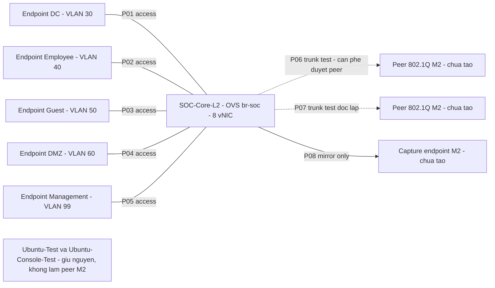
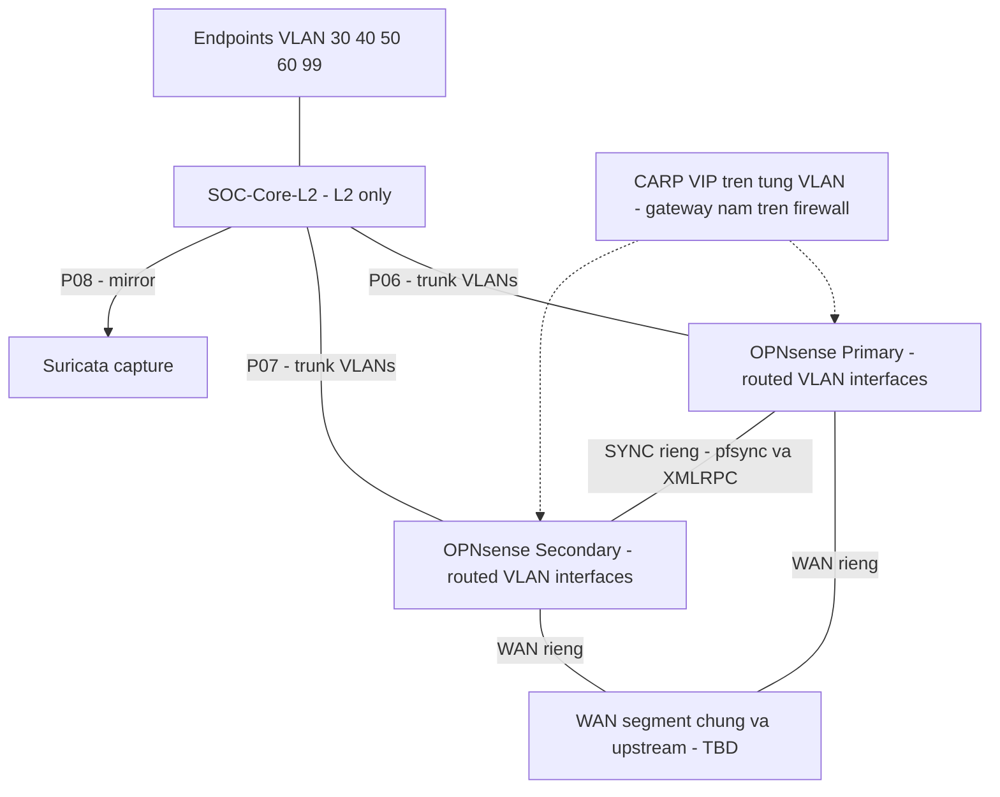

# KẾ HOẠCH TRIỂN KHAI CORE LAYER 2 TRÊN UBUNTU OPEN VSWITCH

- Ngày lập: 31/10/2026; múi giờ báo cáo UTC+07:00 (Asia/Saigon).
- Trạng thái: **được đồng ý thiết kế sơ bộ Ubuntu OVS + 8 vNIC; chưa được phép thay đổi hệ thống**.
- Đầu vào: `AGENTS.md`, thiết kế M1, kế hoạch M2, kết quả cloud-init và các lần đọc trực tiếp EVE-NG 6.2.0-4.
- Mục tiêu: tạo **node mới `SOC-Core-L2`**, giữ nguyên `Ubuntu-Test` và `Ubuntu-Console-Test`, triển khai và nghiệm thu chức năng chuyển mạch L2 theo từng bước được duyệt.

## 1. Phạm vi và nguyên tắc bảo toàn

Core chỉ thực hiện chuyển mạch Layer 2, access/trunk VLAN và port mirroring. Gateway, định tuyến liên VLAN, firewall rules, NAT và DHCP thuộc OPNsense. VLAN áp dụng theo AGENTS: 30 Data Center, 40 Employee, 50 Guest, 60 DMZ, 99 Management. IP/subnet, VIP, cổng hai đầu, tên NIC mới và đường kết nối VMware vẫn chưa chính thức.

Phiên lập kế hoạch chỉ đọc file, mã nguồn/template, thông tin tiến trình và tài nguyên qua SSH, đọc Windows CIM và tài liệu chính thức; chỉ ghi tài liệu/log vào `D:\SOC`. Không đăng nhập API EVE, tạo lab/node/image/seed, tăng NIC, cài phần mềm, sửa mạng, dừng hoặc khởi động VM. Không thực hiện lệnh trên console hai guest trong phiên này. Giữ nguyên toàn bộ ảnh/log cũ.

Node mới dự kiến ở lab riêng **`SOC-M2-Core-L2`**, để tách việc triển khai khỏi lab kiểm chứng. Đây là đề xuất cần duyệt, không phải lab đã tạo. Không ghi đè lab `M2` hoặc `M2_Core_L3`. Lần đọc hiện tại thấy `M2.unl` không còn node/network, khác bản kiểm kê cũ có 5 node; không có đủ thông tin để giải thích thay đổi đó, không phục hồi hoặc sửa lab này.

## 2. Kết quả tiền kiểm tra chỉ đọc

### 2.1. Nguồn và mức độ xác minh

Log dữ liệu: [M2-core-l2-plan-readonly-20261031T1856+0700.json](../evidence/M2/M2-core-l2-plan-readonly-20261031T1856+0700.json). Log chứa snapshot các lệnh đọc, template, đoạn mã theo số dòng, checksum và cấu hình node quan sát được. Thời điểm tham chiếu Windows: 18:56:12 ngày 31/10/2026, UTC+07:00; các lần SSH trước đó nằm trong cùng phiên tiền kiểm tra. Đồng hồ EVE chưa đồng bộ NTP nên không dùng giờ EVE làm thời điểm thu thập đáng tin cậy.

[Kiểm tra cuối phiên](../evidence/M2/M2-core-l2-plan-final-check-20261031.json) xác nhận hash của hai template, file lab kiểm chứng và hai seed ISO không đổi; hai guest vẫn cùng PID/UUID; chưa có SOC-Core-L2 hoặc thư mục image mới. [Danh mục tiền kiểm tra](../evidence/M2/M2-core-l2-plan-evidence-index-20261031.md) phân biệt log đã thu với ảnh tương lai chưa có.

| Hạng mục | Kết quả | Mức độ |
|---|---|---|
| EVE-NG | `192.168.220.143`, package `eve-ng 6.2.0-4` | Đọc trực tiếp |
| Hệ điều hành host EVE | Ubuntu 22.04.4 LTS, Jammy | Đọc `/etc/os-release`; khác Ubuntu 24.04 trong guest |
| Hai node kiểm chứng | `Ubuntu-Test` và `Ubuntu-Console-Test` cùng đang chạy; mỗi node 1 vCPU, 2048 MiB, 1 NIC | Đọc QEMU và XML; không thay vòng đời |
| Guest console đã kiểm chứng trước đây | Ubuntu 24.04.5 LTS, cloud-init done, NoCloud, user `soc-test`, hostname `soc-ubuntu-console-test` | Có [báo cáo và ảnh thật](M2-cloud-init-validation-20261031.md); không suy rộng sang Core mới |
| Base Ubuntu | `/opt/unetlab/addons/qemu/linux-ubuntu-24.04-ovs/virtioa.qcow2` | SHA-256 đọc lại khớp `04e8f2461a16a44e78a370284471f29616cdd9baf1893df25807b71f985b6c94` |
| Dung lượng đĩa base | Virtual 3.5 GiB; file 621,284,352 byte | `qemu-img info` và inventory |
| Core mới | Chưa thấy node `SOC-Core-L2` trong các lab đã quét; thư mục `linux-ubuntu-24.04-soc-core-l2` chưa có | Chỉ phản ánh lần kiểm tra hiện tại |
| OVS của Core | Chưa có Core để kiểm tra package/dịch vụ | Chưa triển khai |
| Cache gói trên host | Không tìm thấy `.deb` trong `/var/cache/apt/archives/` | Không chứng minh mọi thư mục khác đều không có; chưa có bundle OVS được xác minh |

### 2.2. Template Linux và 8 vNIC

Đã đọc hai file `/opt/unetlab/html/templates/intel/linux.yml` và `/opt/unetlab/html/templates/amd/linux.yml`. Trên host Intel hiện tại, template mặc định là `cpu: 2`, `ram: 4096`, `ethernet: 1`, `console: vnc`, `qemu_nic: virtio-net-pci`, kiến trúc x86-64; Intel chọn QEMU 2.12.0. Giá trị `ethernet: 1` là mặc định, không phải bằng chứng giới hạn một cổng.

| Vị trí mã trên EVE thực tế | Nội dung đã đọc | Ý nghĩa |
|---|---|---|
| `html/includes/api_nodes.php:585–590` | QEMU có option `ethernet`, kiểu `input`, lấy giá trị node/template | Có trường số NIC cho từng node |
| `html/includes/__node.php:344–350` | Constructor QEMU nhận `ethernet` kiểu số nguyên cùng CPU/RAM | Có cơ chế override riêng node |
| `html/includes/__node.php:725–735` | Đường cập nhật QEMU tiếp nhận số Ethernet dương | Không thấy chặn riêng giá trị 8 tại nhánh đã đọc |
| `html/includes/__node.php:1933–1952` | Nhánh `linux` lặp từ 0 đến nhỏ hơn `ethernet`, sinh nhãn EVE `e<i>`, MAC và TAP riêng | Với giá trị 8, mã được thiết kế để sinh 8 interface |
| `themes/default/js/functions.js:3695–3701` | Trường Ethernet có thể sửa đối với node ngoài trường hợp VPCS bị readonly | Cơ sở cho nhập giá trị tại GUI; chưa thao tác GUI |

**Kết luận:** đủ cơ sở tĩnh để đề xuất tạo riêng node Linux với `ethernet=8`, `cpu=1`, `ram=2048`, giữ nguyên template chung. Không sửa YAML, PHP hoặc JavaScript. Không chạy constructor PHP, không POST thử API và không chạy QEMU phụ để giả lập kiểm thử. Chưa xác minh runtime 8 vNIC, tài nguyên PCI, kết quả API thực tế hoặc tên NIC trong Ubuntu.

Nhãn EVE `e0`–`e7` là dự đoán từ mã sinh interface, **không phải tên guest** và cũng cần đọc lại sau khi tạo node. Không gán trước `ens3`, `ens4`, `eth0` cho Core. Sau khi được duyệt: đối chiếu EVE interface ID → MAC QEMU → MAC trong `ip -br link` → tên guest → vai trò OVS; chỉ cấu hình khi bảng này đủ 8 dòng, không trùng MAC.

Checksum template trước triển khai:

- Intel: `ce0c2a0979695727c1b84235c6ac5075f35129b0f51a8b0ef68112e285ae5803`.
- AMD: `b28853200c3b23101ea2609222f66ff0f8c74d60b5ea0c6a7730333024fa9902`.

Tài liệu [EVE API chính thức](https://www.eve-ng.net/index.php/how-to-eve-ng-api/) chỉ là tham chiếu; mã của phiên bản đang cài mới là căn cứ cho nhận định trên. Không đăng nhập API trong tiền kiểm tra vì cơ chế một phiên của EVE có thể làm mất phiên Web đang dùng. Khi triển khai, cần phối hợp thời điểm dùng API với người quản trị.

### 2.3. CPU, RAM và dung lượng khả dụng

| Lớp tài nguyên | Kết quả quan sát | Đánh giá sử dụng |
|---|---|---|
| CPU vật lý Windows | Intel i5-13420H, 8 core/12 logical processor | Không tương đương 12 CPU riêng dành cho EVE |
| RAM Windows | Tổng 16,473,976 KiB; free physical 498,116 KiB, khoảng 486 MiB ở mẫu 18:56; mẫu trước khoảng 550 MiB | Bộ nhớ máy vật lý đang ít; chưa đủ cơ sở kết luận có thể mở thêm workload an toàn |
| CPU EVE | 4 CPU online; load 1.20/1.08/1.12 | Mẫu ngắn, không phải đánh giá tải dài hạn |
| `vmstat` EVE | Hai mẫu tức thời idle 98% và 96%, không thấy swap-in/out trong các mẫu đó | CPU chưa phải nút thắt ở thời điểm đo; không bảo đảm khi có traffic |
| RAM EVE | Tổng 7897 MiB, available 5370 MiB; swap tổng 4095 MiB | Available có thể thu hồi cache, không đồng nghĩa RAM vật lý Windows còn trống |
| Hai QEMU cũ | RAM khai báo 4096 MiB tổng; RSS khoảng 589,460 và 666,424 KiB | RSS hiện tại không phải mức tiêu thụ tối đa |
| Đĩa EVE | Available 43,426,328 KiB, khoảng 41.4 GiB | Đủ chỗ đề xuất thêm một copy base và volume thưa, vẫn cần đo trước khi ghi |

Core đề xuất **1 vCPU / 2048 MiB RAM / 8 VirtIO NIC**. Ba guest cộng lại có RAM khai báo 6144 MiB, để lại khoảng 1753 MiB từ tổng EVE cho host EVE, overhead và các endpoint. Không coi chênh lệch này là toàn bộ RAM dư cho VM phụ. CPU ba node khai báo tổng 3 vCPU không có nghĩa từng vCPU được dành riêng.

**Điều kiện trước boot:** đo lại cả Windows và EVE. Ngưỡng vận hành đề xuất cho phiên lab nhỏ: Windows còn ít nhất 2 GiB bộ nhớ khả dụng, EVE MemAvailable ít nhất 3 GiB trước khi boot Core, không có áp lực swap kéo dài; đây là ngưỡng thận trọng của kế hoạch, không phải yêu cầu tối thiểu do nhà cung cấp công bố hoặc bảo đảm tải. Nếu không đạt, hoãn boot để người dùng xử lý tài nguyên, không tự dừng hai node kiểm chứng, giảm RAM của chúng hoặc thay cấu hình VMware.

Không tạo máy helper mới trên Windows đang thiếu RAM chỉ để tải gói offline. Endpoint Linux dùng kiểm thử trunk/mirror cần ngân sách tài nguyên riêng; chỉ chạy từng nhóm bài thử sau khi đủ headroom. Không hứa chạy đồng thời toàn bộ peer/capture khi chưa lập budget thực tế.

M3 thêm hai OPNsense có yêu cầu tối thiểu 3 GB RAM mỗi instance theo [OPNsense virtual installation](https://docs.opnsense.org/manual/virtuals.html). Khi giữ cả hai guest kiểm chứng và Core, EVE hiện 8 GB không đủ ngân sách RAM khai báo cho cả cặp firewall cộng overhead. Tài nguyên M3 cần kế hoạch riêng; không coi việc Core M2 hoạt động là đã đủ tài nguyên HA.

## 3. Đề xuất chuẩn bị node mới SOC-Core-L2

### 3.1. Thông số và cách ly image

| Tham số | Đề xuất cần phê duyệt |
|---|---|
| Lab | Tạo riêng `SOC-M2-Core-L2`, không đụng lab cũ |
| Node | `SOC-Core-L2`, template Linux, VNC, 1 vCPU, 2048 MiB, 8 NIC VirtIO |
| Image mới | `/opt/unetlab/addons/qemu/linux-ubuntu-24.04-soc-core-l2/virtioa.qcow2` |
| Nguồn | Full copy của base Ubuntu sạch đã kiểm tra SHA, không copy runtime overlay của hai node kiểm chứng |
| Dung lượng | Đề xuất tăng virtual disk **chỉ bản copy mới** từ 3.5 lên 8 GiB trước first boot; không preallocate toàn bộ, không tăng base |
| Seed | `cdrom.iso` riêng cùng thư mục image mới; nhãn `cidata`, tệp gốc `user-data`, `meta-data`, có thể có `network-config` và thư mục gói offline |
| Hostname/user | `soc-core-l2` / `soc-core-admin`, đều là đề xuất, chưa tạo |
| Instance ID | `iid-soc-core-l2-<UUID mới>`, tạo thật sau phê duyệt, không tái dùng ID seed cũ |
| Mạng ở boot đầu | 8 NIC chưa nối bất kỳ segment nào; không tự dùng pnet/Cloud/NAT/Internet |

Full copy được ưu tiên thay cho thêm một backing overlay để Core không phụ thuộc vào variant console; dung lượng truyền khoảng 621 MB phù hợp đĩa hiện còn trống. EVE vẫn tạo runtime overlay riêng khi node mới start. Thư mục image mới là mục toàn cục trong thư viện EVE, dù chỉ lab mới tham chiếu, nên việc tạo nó cần nằm rõ trong phạm vi duyệt.

Tăng đĩa 8 GiB chỉ là đề xuất để có chỗ cài gói, log và kiểm thử. Sau boot phải đọc `lsblk` và `df -h`, xác nhận partition/filesystem thực sự lớn lên; việc tăng virtual capacity không tự chứng minh root filesystem đã tăng. Nếu resize/growpart không đạt thì dừng kế hoạch tại bước đó, không sửa base hoặc wipe overlay.

### 3.2. Quản trị và cloud-init riêng

Seed mới dự kiến tạo `soc-core-admin` với shell Bash, quyền sudo yêu cầu mật khẩu, console login bằng hash; tắt SSH password auth và root login. Public key quản trị có thể được dùng sau khi xác nhận chủ sở hữu, nhưng không sao chép private key lên EVE/guest. Mật khẩu do người dùng nhập trực tiếp ở terminal an toàn khi tạo hash; không gửi qua chat, không ghi password/hash vào repository, ảnh hoặc log. Quyền đọc seed có hash cần giới hạn theo tài khoản thực chạy QEMU; không công bố nội dung seed chứa bí mật trong báo cáo.

Không đưa `packages`, `runcmd` cài OVS hoặc mở Internet vào seed ở bước chỉ bootstrap. Có thể chở bộ gói offline trong ISO, nhưng việc cài vẫn là bước riêng cần duyệt. Phải kiểm tra đúng tên `user-data`/`meta-data` trong Rock Ridge/Joliet và `instance-id` mới, tránh lỗi tên có đuôi `.yaml` của seed cũ. [NoCloud](https://docs.cloud-init.io/en/latest/reference/datasources/nocloud.html).

Với 8 NIC, đề xuất `network-config` riêng cho Core: match theo MAC đã đối chiếu từ cấu hình node mới, tắt DHCP4/DHCP6/RA trên cổng dữ liệu, không đặt địa chỉ, đánh dấu optional để không chờ các link chưa nối. Cú pháp phải được kiểm tra theo cloud-init/Netplan của guest; chưa có file cấu hình áp dụng. Không phụ thuộc tên `ensX` và không đổi cấu hình cloud-init của hai guest cũ. [Network config v2](https://docs.cloud-init.io/en/latest/reference/network-config-format-v2.html).

Sau boot, chỉ đọc trước: cloud-init, tài khoản, hostname, NIC/MAC, CPU/RAM, filesystem, cấu hình Netplan hiện có, `net.ipv4.ip_forward` và IPv6 forwarding. Sau khi được duyệt cấu hình, Core phải không bật routing/NAT; không gán IP lên NIC dữ liệu hoặc cổng mirror. Quản trị lâu dài dự kiến qua một OVS internal interface thuộc VLAN 99 khi IP được chốt, không cần thêm vNIC thứ chín. M2 đầu tiên có thể quản trị hoàn toàn bằng console, chưa cần IP.

## 4. Bảng port-to-port dự kiến

Tất cả P01–P08 là **nhãn logic trong kế hoạch**, không phải tên guest hoặc số cổng đã được xác minh. ID EVE 0–7 và nhãn `e0`–`e7` là giá trị dự kiến theo mã Linux; sẽ đọc lại sau khi tạo. Cổng peer thực tế đều TBD, kể cả khi tên node đích đã thể hiện chức năng mong muốn.

| Nhãn Core | EVE ID/nhãn dự kiến | NIC guest/MAC | Đối tác và cổng phía đối tác dự kiến | Mode / VLAN | M2 và M3 |
|---|---|---|---|---|---|
| P01-DC | 0 / e0 | TBD / TBD | Endpoint-DC, NIC thử nghiệm TBD | Access 30 | M2 endpoint mới sau duyệt |
| P02-EMP | 1 / e1 | TBD / TBD | Endpoint-Employee, NIC TBD | Access 40 | M2 endpoint mới sau duyệt |
| P03-GUEST | 2 / e2 | TBD / TBD | Endpoint-Guest, NIC TBD | Access 50 | M2 endpoint mới sau duyệt |
| P04-DMZ | 3 / e3 | TBD / TBD | Endpoint-DMZ, NIC TBD | Access 60 | M2 endpoint mới sau duyệt |
| P05-MGMT | 4 / e4 | TBD / TBD | Segment/endpoint Management, NIC TBD | Access 99 | M2; không mặc định nối pnet quản trị EVE |
| P06-FW-A | 5 / e5 | TBD / TBD | **OPNsense Primary**, LAN parent NIC TBD | Trunk tagged 30,40,50,60,99 | M2 chưa nối firewall; thử bằng peer 802.1Q riêng nếu được duyệt; M3 nối Primary |
| P07-FW-B | 6 / e6 | TBD / TBD | **OPNsense Secondary**, LAN parent NIC TBD | Trunk tagged 30,40,50,60,99 | Trunk độc lập; M2 chưa nối firewall; M3 nối Secondary |
| P08-MIRROR | 7 / e7 | TBD / TBD | **Suricata**, capture NIC TBD | Mirror output riêng, không phải access quản trị | M2 có thể dùng capture endpoint tạm; M3/SOC thay bằng Suricata sau duyệt |

Hai trunk là hai Port OVS riêng, không là bond tới hai firewall. Parent NIC của mỗi OPNsense dự kiến không gán mạng LAN untagged; các VLAN subinterface mang dịch vụ tương ứng. Không ngầm chọn native VLAN. Trunk chỉ cho phép danh sách VLAN đã thống nhất; việc xử lý frame untagged phải được kiểm thử riêng, không coi `trunks=` tự chứng minh mọi frame untagged đều bị loại bỏ.

Suricata capture NIC không có IP và không bridge ngược về mạng người dùng. Cổng quản trị của Suricata, nếu cần, đi đường VLAN 99 riêng được thiết kế sau, không dùng P08 vừa làm quản trị vừa mirror.

## 5. Sơ đồ kỹ thuật dự kiến

### 5.1. M2: Core thử nghiệm độc lập

**Sơ đồ 2.1. Topology thiết kế M2, chưa triển khai; không phải ảnh minh chứng EVE-NG.**

Mục đích là phân tách switching, trunk và capture. Các peer có thể được kiểm thử luân phiên để giảm tài nguyên; nếu một máy thử có nhiều NIC thì không bridge hoặc bật forwarding giữa hai trunk/capture. Tên endpoint trong hình là nhãn đề xuất, không phải danh sách node đã tồn tại. Hai guest cũ đứng ngoài bài thử và không bị tái sử dụng làm Core, peer hoặc cảm biến.

### 5.2. M3: Core chung cho hai firewall HA

**Sơ đồ 2.2. Kiến trúc HA M3 dự kiến trên một Core; chưa cấu hình CARP, WAN hoặc SYNC.**

Mục đích là thể hiện hai đường LAN độc lập, đồng thời tách WAN/SYNC khỏi các cổng người dùng của Core. VIP là địa chỉ logic trên firewall, các nét nối VIP không phải dây Ethernet bổ sung. Hình giải thích thiết kế, không chứng minh HA hoạt động.

## 6. Open vSwitch: yêu cầu chức năng và cài đặt offline

### 6.1. Nền tảng và thành phần cần kiểm tra

Ưu tiên package Ubuntu cho `openvswitch-switch`, gồm dịch vụ OVSDB và `ovs-vswitchd` cùng các phụ thuộc do APT giải quyết; không build source, DPDK hoặc thêm kernel DKMS nếu chưa có nhu cầu được kiểm chứng. Sử dụng datapath kernel Linux thông thường. [OVS packages](https://docs.openvswitch.org/en/stable/intro/install/distributions/), [OVS installation](https://docs.openvswitch.org/en/stable/intro/install/general/).

Trên Core mới sau khi được tạo, cần đọc `uname -r`, kiến trúc `dpkg --print-architecture`, `modinfo openvswitch`, dung lượng root, package state và Netplan. Nếu thiếu module phải tìm đúng package kernel chứa module cho **kernel guest hiện tại**, không tự nâng kernel, cài header/DKMS hoặc lấy module từ EVE host. Thử tải module, bật dịch vụ và cài package là thao tác thay đổi, phải thuộc bước triển khai được duyệt. Không đòi CPU/RAM tối thiểu cố định cho OVS từ số liệu ước tính lab này.

### 6.2. VLAN access/trunk, bridge và mirror

| Chức năng | Yêu cầu thiết kế | Cách kiểm chứng sau triển khai |
|---|---|---|
| Bridge L2 | Một bridge OVS dự kiến `br-soc`, không có OpenFlow controller ngoài trong M2 | `ovs-vsctl show`, trạng thái dịch vụ, FDB; không dùng Linux bridge khác bắc song song cùng cổng |
| Access | Port khai báo access và VLAN tag tương ứng 30/40/50/60/99 | Đọc OVSDB và truyền frame thực; chỉ nhìn `tag=` chưa đủ nghiệm thu |
| Trunk | Port riêng, mode trunk, allowlist 30/40/50/60/99; thống nhất tagged với peer | Capture 802.1Q, bài thử allow/deny VLAN, kiểm thử untagged riêng |
| Mirror | Một Mirror output vào P08; M2 low-rate dự kiến chọn mọi port dữ liệu với `select_all` | Capture lưu lượng có dấu nhận dạng; kiểm tra chiều hai hướng và traffic ngang trong VLAN |
| Quản trị | Chỉ OVS internal VLAN 99 khi có IP được duyệt; NIC thành viên không có DHCP/IP | `ip -br addr`, route, Netplan và OVSDB; console là đường cứu hộ |
| Persistence | Một cơ chế quản lý thống nhất cho link/IP và OVSDB; không để Netplan/cloud-init/ovs-vsctl tranh quyền | Reboot chỉ node Core nếu được duyệt, đối chiếu cấu hình trước/sau |

OVS hỗ trợ access/trunk và port mirroring; quy tắc VLAN của OVSDB cần được giữ trong đường chuyển tiếp thông thường, không thêm OpenFlow bypass tùy ý. Mirror destination chỉ dùng capture; không tự giả định các tag nhìn thấy ở sensor giống mọi tag ở ingress. Phải đo thực tế. [OVS VLAN FAQ](https://docs.openvswitch.org/en/stable/faq/vlan/), [OVS configuration FAQ](https://docs.openvswitch.org/en/stable/faq/configuration/).

### 6.3. LACP có thể bổ sung, không gộp hai firewall

OVS có bonding và LACP. Một bài thử cần ít nhất hai link tới **cùng peer LACP hợp lệ**, ít nhất một phía active, cấu hình bond/allowed VLAN nhất quán và quan sát trạng thái negotiation, mất link và phục hồi. Không dùng hai OPNsense Primary/Secondary như hai member của một peer LACP; HA CARP không tạo ra một hệ thống LACP chung. [OVS bonding](https://docs.openvswitch.org/en/stable/topics/bonding/).

Với đủ tám vai trò hiện có, thêm bài thử LACP độc lập hai link cần thêm hai NIC (tổng 10), hoặc phải duyệt lại cách dùng cổng và topology. Không tự tăng NIC hay tháo hai trunk firewall để thử. LACP không thuộc điều kiện bắt buộc nghiệm thu M2 cơ bản; nếu được bổ sung thì yêu cầu peer, RAM và kế hoạch ảnh riêng.

### 6.4. Phương án offline được ưu tiên

**Khuyến nghị:** chuẩn bị bộ `.deb` đủ phụ thuộc trên một môi trường Ubuntu 24.04/Noble amd64 có Internet **ngoài máy Windows đang ít RAM**, rồi chuyển qua ISO riêng của Core. Đây là đường cấp tệp, không tạo đường Internet cho guest. Hiện chưa có máy helper hoặc bundle hoàn chỉnh được xác minh.

1. Chốt release/architecture, trạng thái package, kernel và nguồn APT tương ứng Ubuntu guest. Dùng bản base giống SHA đã kiểm chứng làm đường cơ sở khi chuẩn bị trước boot; đối chiếu lại trạng thái Core mới trước cài.
2. Trên máy chuẩn bị được duyệt, dùng repository Ubuntu chính thức, xác minh InRelease/Release bằng keyring Ubuntu và checksum package. Tải `openvswitch-switch` cùng toàn bộ dependency/Pre-Depends cần thiết; kèm công cụ test được duyệt như `tcpdump`, `iputils-ping` nếu guest chưa có. Ghi tên/version/architecture/URL/hash/thời điểm vào manifest; chỉ chọn version sau khi đọc repository thực tế.
3. Không chỉ `apt download openvswitch-switch` rồi coi là đủ. APT download-only trên máy helper có thể bỏ qua dependency đã cài ở helper nhưng còn thiếu ở target. Phải dùng môi trường sạch tương ứng hoặc APT state riêng dựa trên trạng thái target, bao phủ cả dependency đã có ở helper. Không lấy phụ thuộc theo APT Jammy của EVE host và không copy mù thư mục cache của host.
4. Tạo payload `packages/` kèm manifest trong **seed ISO mới của Core** trước boot, cùng `user-data`/`meta-data` đúng tên. Cần kiểm tra EVE gắn đúng ISO và guest đọc được payload; không thêm CD-ROM thứ hai bằng sửa template chung. Không tự cài package bằng cloud-init.
5. Sau boot, người quản trị mount ISO read-only, đối chiếu checksum rồi mô phỏng cài bằng APT ở chế độ không tải mạng. Chỉ duyệt cài nếu không thiếu gói, không gỡ package quan trọng và không kéo thay đổi ngoài phạm vi. Lệnh cài thực phải có chế độ `--no-download`, không chạy update/upgrade qua mạng. Mô phỏng APT không thay cho xác minh nguồn gốc gói.
6. Ghi log cài thật, version, trạng thái OVSDB/vswitchd, module/datapath và dung lượng còn lại. Chưa tạo bridge hoặc nối cổng khi mới duyệt việc cài package.

Nếu bundle thiếu phụ thuộc: dừng ở trạng thái chưa đạt, không dùng `apt -f install` để tự mở mạng hoặc chép package khác release. Cần chuẩn bị lại payload; nếu phải thay CD-ROM hoặc dừng/boot lại thì chỉ làm trên Core mới sau duyệt riêng, giữ nguyên seed của hai node kiểm chứng. Không thay ISO đang gắn khi guest đang dùng nó.

Phương án `apt-offline` có thể dùng quy trình signature → tải trên máy online → nhập trên máy offline, nhưng phải bootstrap chính `apt-offline` và các phụ thuộc trước nếu target chưa có. Không xem đây là công cụ sẵn có: host EVE hiện không có `/usr/bin/apt-offline`, trạng thái trong Core chưa tồn tại. [apt-offline Noble](https://manpages.ubuntu.com/manpages/noble/man8/apt-offline.8.html), [APT Noble](https://manpages.ubuntu.com/manpages/noble/man8/apt-get.8.html).

Một đường mạng cài đặt tạm qua NAT/Internet là phương án khác có thể bàn sau, không nằm trong khuyến nghị offline và không được suy diễn đã duyệt từ việc cho phép OVS. Không cài OVS trực tiếp lên host EVE để thay cho cài trong guest.

## 7. Kết nối Core tới hai OPNsense HA: thiết kế M3

### 7.1. VLAN trunk, địa chỉ và CARP VIP

Mỗi trunk Core nối tới LAN parent NIC riêng trên từng firewall. Hai firewall tạo cùng các VLAN 30/40/50/60/99; mỗi VLAN trên Primary và Secondary có địa chỉ riêng trong cùng subnet, cộng một CARP VIP chung dự kiến làm gateway client. VIP không đặt trên Core. Chưa chọn subnet, địa chỉ, VHID hoặc tham số bầu chọn; các `.1/.2/.3` trong M1 chỉ là ví dụ, không được đưa thẳng vào cấu hình.

CARP trao đổi trạng thái bằng IP protocol 112; không coi đây là TCP port 112. Core phải cho frame tương ứng đi qua đúng VLAN giữa hai trunk, không chặn multicast/ARP hoặc học MAC ảo một cách cố định sai cổng. M3 cần kiểm tra một MASTER và một BACKUP cho từng VIP, chuyển vai trò và cập nhật đường MAC; không mặc định mọi VLAN failover đúng chỉ từ một VIP hoạt động. [OPNsense CARP](https://docs.opnsense.org/manual/how-tos/carp.html).

### 7.2. WAN và SYNC độc lập

pfsync đồng bộ trạng thái kết nối, còn đồng bộ cấu hình là kênh riêng (XMLRPC theo thiết kế M1); CARP không thay cả hai. Đề xuất segment SYNC riêng giữa firewall, không bridge với VLAN người dùng và không tính vào tám cổng Core. Việc cấu hình HA, quyền sync và phạm vi sync thuộc M3. [OPNsense HA](https://docs.opnsense.org/manual/hacarp.html).

Cả hai firewall phải có đường tới WAN/upstream thích hợp. Khi kiểm thử NAT failover cần xác nhận địa chỉ dịch WAN gắn với thiết kế VIP, không chỉ xem gateway LAN đổi được. WAN/SYNC, loại NIC thực và mạng VMware/EVE chưa được xác nhận, nên không nối `pnet1` chỉ vì lab cũ có nhãn `Link_OPNsense`. [OPNsense CARP/NAT](https://docs.opnsense.org/manual/how-tos/carp.html).

### 7.3. Tránh vòng lặp và giới hạn HA

Hai firewall hoạt động routed, không bridge LAN với WAN/SYNC hoặc bridge hai trunk vào nhau, nên hai kết nối Core–firewall không tự tạo vòng L2. CARP xử lý quyền dùng VIP, không phải giao thức chống loop; BACKUP không có nghĩa NIC bị tắt hoặc Core chặn toàn bộ frame tới nó.

Quy tắc đấu nối dự kiến:

- Mỗi link Core–peer dùng segment EVE riêng, không đặt P06 và P07 vào cùng một bridge EVE bên ngoài Core để nối tắt hai cổng.
- Không bridge các NIC của máy test, NIC capture với quản trị, hoặc các segment WAN/LAN/SYNC. Không dùng lại Cloud/pnet làm lối đi thứ hai khi chưa có sơ đồ được duyệt.
- Nếu bổ sung switch/đường song song thật sự, thiết kế STP/RSTP và kiểm tra BPDU/blocking. OVS hỗ trợ RSTP, nhưng không mặc định đang bật hoặc mọi peer tham gia; không dựa vào nó để sửa đấu nhầm. [OVS bridge schema/RSTP](https://www.openvswitch.org/support/dist-docs/ovs-vswitchd.conf.db.5.html).
- Một Core vẫn là điểm lỗi đơn. Firewall HA không làm Core, host EVE hay WAN upstream trở nên dự phòng. Ngắt Core vẫn có thể làm mất toàn bộ đường LAN.

Đối với MAC ảo CARP, tránh port-security/sticky MAC hoặc giới hạn multicast chưa đánh giá; kiểm tra học lại MAC sau chuyển vai. Đây là yêu cầu thiết kế và bài thử M3, chưa thay chính sách switch hoặc VMware. Không bật promiscuous/forged-transmit trên VMware một cách mặc định; chỉ xem xét khi đường thực tế và capture chứng minh cần thiết. [OPNsense switch considerations](https://docs.opnsense.org/manual/how-tos/carp.html).

## 8. Trình tự triển khai sau phê duyệt

Mỗi bước dừng ở mốc có thể kiểm tra. Duyệt bước này không tự bao gồm bước tiếp theo.

| Bước | Thao tác dự kiến | Đầu ra cần đạt | Phạm vi thay đổi |
|---|---|---|---|
| A | Chuẩn bị bundle, đối chiếu tài nguyên, xác nhận node/lab/image mới chưa trùng | Package manifest, budget, bảng quyền được duyệt | Tải/chứa tệp staging sau duyệt; chưa tạo Core |
| B | Full copy base vào image mới, tăng virtual disk bản mới nếu được duyệt, tạo lab và node **giữ tắt** với 8 NIC, đọc MAC | Checksum copy trước resize, chain độc lập, XML/API node8NIC | Chỉ tài nguyên mới, không sửa template/guest cũ |
| C | Tạo seed/instance-id/user/network-config riêng theo MAC, gắn payload, kiểm tra quyền/tên file | Seed đúng dạng, không lộ bí mật, 8 NIC chưa nối | Chỉ seed/image directory mới |
| D | Đo lại tài nguyên, boot **chỉ SOC-Core-L2** nếu đủ và đã duyệt start | Console login, cloud-init done, đủ 8 NIC, CPU/RAM/root được nhận | Vòng đời riêng Core mới |
| E | Mô phỏng rồi cài OVS offline, kiểm tra daemon/datapath | Không tải Internet, không thiếu dependency, OVS hoạt động | Chỉ package/dịch vụ guest Core |
| F | Đối chiếu MAC-to-role, chuẩn bị link/IP ownership, tạo bridge/VLAN | Bảng mapping thực tế, OVSDB, no routing/NAT | Cấu hình L2 trên Core mới |
| G | Tạo/nối endpoint, trunk peer, capture endpoint theo bài thử được duyệt | Topology thật và kiểm thử có đối chứng | Lab mới và các node test mới được nêu rõ |
| H | Kiểm tra persistence bằng reboot Core nếu được duyệt; lưu cấu hình/log/report | Nghiệm thu M2 theo bảng dưới | Không reboot hai guest cũ; không cấu hình HA |

Không áp dụng một script cấu hình cuối cùng khi mapping còn TBD. Sau D mới viết cấu hình dùng đúng NIC/MAC và giải thích tiếng Việt cho từng lệnh; phê duyệt F/G dựa trên bảng thực tế đó. Nếu cần rollback, không wipe ngay; giữ log/overlay, chỉ dừng/sao lưu/khôi phục tài nguyên mới theo quyền riêng. Không sửa base hoặc xóa bằng chứng để làm lại một bài thử.

## 9. Điều kiện nghiệm thu và kiểm thử

| Mã | Điều kiện đạt | Minh chứng cần thu | Phân kỳ |
|---|---|---|---|
| M2-01 | Hai guest cũ giữ nguyên node/image/seed, tiếp tục đúng trạng thái đã thống nhất | UUID/PID, lab XML, hash template/seed/base trước–sau; overlay đang chạy không so hash để kết luận bất biến | Bắt buộc |
| M2-02 | Node mới 8 vNIC ở XML/API, QEMU sinh 8 thiết bị và guest nhận 8 Ethernet khác MAC, không tính `lo`/OVS internal | GUI node settings, process flags, `ip -br link`, bảng MAC-to-port | Bắt buộc |
| M2-03 | Console quản trị riêng, cloud-init done/NoCloud, filesystem đủ chỗ | Console, status, hostname, CPU/RAM, `df`, `lsblk`; không chụp lúc nhập mật khẩu | Bắt buộc |
| M2-04 | Package đúng release/arch; cài offline thành công; OVSDB/vswitchd và datapath dùng được | Manifest, simulation, log cài, version, service, lỗi journal nếu có | Bắt buộc |
| M2-05 | Bridge và 5 access đúng VLAN; không forwarding/NAT trên Core, không IP trên cổng dữ liệu | OVSDB, link/address/route, sysctl IPv4/IPv6 forwarding, cấu hình persistent | Bắt buộc |
| M2-06 | Hai endpoint cùng VLAN trên **hai cổng OVS khác nhau** truyền được, có FDB/counter chứng minh đi qua Core | Ping/ARP/capture, FDB theo VLAN, counters | Bắt buộc, bố trí cổng test riêng |
| M2-07 | Hai endpoint khác VLAN không nhận frame nhau, có đối chứng kiểm tra dương | Dùng IP test cùng subnet nhưng VLAN khác để buộc ARP thử qua L2, không chỉ ping khác subnet thiếu gateway; capture/counters | Bắt buộc |
| M2-08 | Trunk P06 và P07 từng cổng mang đúng VLAN allowlist, VLAN ngoài danh sách không qua; frame untagged xử lý đúng chính sách chốt | Peer subinterface, capture có tag, cả thử dương/âm; hai trunk thử độc lập, peer không bridge | Bắt buộc nếu nghiệm thu trunk; chưa có peer thì ghi chưa đạt |
| M2-09 | Mirror thu đúng traffic thử hai chiều, cả east-west cùng VLAN; capture NIC không forwarding | `tcpdump`/pcap và Mirror record/counters; giới hạn tốc độ để kiểm tra packet drop | Bắt buộc; sensor tạm cần được duyệt |
| M2-10 | Cấu hình còn đúng sau reboot Core riêng được duyệt; đối chiếu counters/load/đường quản trị | Export trước/sau, ảnh console, `ovs-vsctl show`, kiểm thử lại đại diện | Bắt buộc hoặc ghi rõ chưa kiểm thử persistence |
| M2-LACP | LACP đàm phán với peer hợp lệ, mất một member vẫn truyền và phục hồi đúng | LACP/bond status, capture/control traffic, bài thử mất link | Tùy chọn, không gộp hai firewall |
| M3-HA | VIP/gateway, MASTER/BACKUP, pfsync, XMLRPC, WAN/NAT và giám sát khi failover đạt | OPNsense GUI/console, state/capture, session liên tục theo tiêu chí định lượng sẽ chốt | Chưa triển khai, ngoài nghiệm thu M2 |

Năm access ban đầu mỗi VLAN một endpoint chưa đủ cho M2-06. Đề xuất bố trí lại tạm một cổng access sang VLAN đang thử, kiểm tra hai endpoint rồi trả đúng mapping; mỗi thay đổi và hoàn nguyên cần có trong phạm vi duyệt. Nếu giữ nguyên tám vai trò trong mọi thời điểm thì phải xin thêm cổng/node test, không tự tăng NIC thứ chín. Không nối hai endpoint vào cùng bridge EVE rồi coi ping bypass Core là kiểm thử switching đạt.

Các bài thử IP chỉ dùng địa chỉ lab sẽ được chốt riêng; không coi subnet M1 đã xác nhận. Trong M2 không có gateway liên VLAN; không nghiệm thu firewall rules hoặc HA bằng các phép thử này. Kết quả phải ghi đạt/chưa đạt/chưa kiểm thử, đính kèm nguyên nhân và đường dẫn ảnh/log/pcap, không thay “chưa có peer” bằng đạt.

## 10. Kế hoạch minh chứng thực tế

Ảnh Hình 2.1–2.2 đã có từ bước Ubuntu, giữ nguyên. Các ảnh dưới đây **chưa tồn tại** vì Core chưa được tạo; số hình là vị trí dự kiến, cần đối chiếu khi ghép báo cáo cuối. Không vẽ lại kết quả console hoặc dùng sơ đồ thiết kế thay screenshot runtime.

| Ảnh dự kiến trong `docs/evidence/M2/` | Màn hình thật cần chụp | Mục đích/nội dung/kết quả cần giải thích | Vị trí báo cáo dự kiến |
|---|---|---|---|
| `M2-core-node-created-<time>.png` | Topology EVE và settings node mới | Nhận dạng node/lab/image, trạng thái tắt trước boot | Hình 2.3 |
| `M2-core-eight-nics-<time>.png` | Settings `ethernet=8` và console liệt kê NIC; dùng nhiều ảnh nếu cần | Đối chiếu đủ 8 NIC/MAC, tách ID EVE khỏi tên guest | Hình 2.4a–b |
| `M2-core-bootstrap-<time>.png` | Console hostname, cloud-init, root filesystem, CPU/RAM | Nền Core mới hoạt động, không dùng ảnh node test cũ để chứng minh Core | Hình 2.5 |
| `M2-core-ovs-offline-install-<time>.png` | Mô phỏng, kết quả cài offline, package/service/version | Gói đủ dependency, dịch vụ hoạt động, không có đường Internet guest | Hình 2.6a–b |
| `M2-core-bridge-<time>.png` | `ovs-vsctl show` và thông tin datapath | Bridge thật và port sau mapping | Hình 2.7 |
| `M2-core-access-vlans-<time>.png` | OVSDB Port/tag/mode và bảng mapping | Năm access VLAN đúng, không suy luận từ nhãn topology | Hình 2.8 |
| `M2-core-trunks-<time>.png` | Hai Port trunk riêng, allowlist và peer tagged frame | Hai đường độc lập, chưa có CARP M3 | Hình 2.9a–b |
| `M2-core-mirror-<time>.png` | Mirror record và capture thực trên P08 | Có traffic đúng nguồn/chiều, sensor passive | Hình 2.10a–b |
| `M2-core-same-vlan-pass-<time>.png` | Hai endpoint, FDB/counters và kết quả thử dương | Chứng minh đường đi qua Core | Hình 2.11 |
| `M2-core-vlan-isolation-<time>.png` | Đối chứng dương/âm, ARP/capture theo VLAN | Phân tách L2, không nhầm lỗi routing | Hình 2.12 |
| `M2-core-trunk-filter-test-<time>.png` | VLAN được phép/không được phép, kết quả untagged | Nghiệm thu chính sách trunk thực tế | Hình 2.13 |
| `M2-core-persistence-<time>.png` | Cấu hình/kiểm thử sau reboot riêng Core | Khả năng tái lập, ghi rõ nếu chưa reboot | Hình 2.14 |

Mỗi ảnh cần caption bên dưới theo chương; phần thuyết minh nêu mục đích, lệnh/thao tác, kết quả và ý nghĩa. Ghi tên, nội dung, thời điểm UTC+07:00, đường dẫn, mã test và vị trí báo cáo vào danh mục CSV/Markdown; log/cấu hình/pcap dùng cùng mốc thời gian và checksum. Chụp nhiều khung hình khi output dài thay vì cắt mất kết quả. Không chụp mật khẩu, hash, private key, token, cookie API hoặc dữ liệu đăng nhập; không chỉnh nội dung kỹ thuật sau chụp.

Công cụ đã chứng minh chụp framebuffer QEMU VNC thật của hai node kiểm chứng ở bước trước; chưa kiểm chứng đường chụp cho Core chưa tồn tại. Có thể tiếp tục cách đó sau khi Core được tạo và được phép tương tác console. Hiện không có công cụ browser screenshot chuyên dụng được xác nhận cho EVE GUI; nếu không chụp trực tiếp được, người dùng mở topology/settings EVE, hiển thị đầy đủ node và trường Ethernet, chụp bằng Windows Snipping Tool, lưu PNG nguyên bản theo bảng rồi cung cấp đường dẫn để kiểm tra/lập danh mục. Không giả lập GUI để thay ảnh thật.

Ảnh HA/CARP/pfsync và failover sau này lưu `docs/evidence/M3/`, đánh số chương 3. M4/M5 tiếp tục thư mục tương ứng; không trộn bằng chứng kế hoạch M3 vào kết quả đạt M2. Khi xuất Word áp dụng A4, Times New Roman 12–13, lề trái 3 cm, các lề khác 2 cm.

## 11. Thuật ngữ tiếng Việt và ví dụ trong đồ án

Bảy thuật ngữ cloud-init, NoCloud, datasource, seed ISO, QEMU, QCOW2 và console đã được giải thích theo tên, nghĩa, nguyên lý, vai trò và ví dụ tại [báo cáo chuẩn bị Ubuntu, mục 2.5](M2-cloud-init-validation-20261031.md). Trong kế hoạch này, chúng được dùng để bootstrap **Core mới**; kết quả đã đạt trên node console không tự chứng minh Core đạt.

| Tên đầy đủ / viết tắt hoặc tên chính thức | Nghĩa tiếng Việt | Nguyên lý | Vai trò SOC và ví dụ dự kiến |
|---|---|---|---|
| Security Operations Center — SOC | Trung tâm điều hành an ninh mạng | Kết hợp thu thập, phân tích và ứng phó sự kiện | Core cung cấp đường truyền/quan sát cho hệ SOC, chưa tích hợp giám sát đầu cuối |
| Virtual Local Area Network — VLAN | Mạng cục bộ ảo | Tách miền quảng bá trong chuyển mạch L2 | Access P01 thuộc VLAN 30, P03 thuộc VLAN 50 |
| IEEE 802.1Q (mã chuẩn, không phải từ viết tắt) | Chuẩn gắn thẻ VLAN trong Ethernet | Frame mang VLAN ID để phân biệt miền trên link chung | P06/P07 dự kiến mang năm VLAN trên từng trunk |
| Trunk port | Cổng mang nhiều VLAN | Hai đầu xử lý thẻ VLAN nhất quán | LAN parent mỗi OPNsense là peer trunk, chưa xác nhận tên NIC |
| Access port | Cổng truy nhập một VLAN | Gán frame endpoint vào VLAN của port | P02 gán VLAN 40, endpoint không cần tự thêm tag |
| Open vSwitch — OVS | Bộ chuyển mạch ảo | OVSDB giữ cấu hình, daemon/datapath xử lý chuyển tiếp | `br-soc` chuyển mạch trên node SOC-Core-L2, chưa tạo |
| Bridge / Layer 2 bridge | Cầu nối chuyển mạch L2 | Học MAC và chuyển frame trong miền được phép | Bridge OVS trong guest khác bridge EVE nối các TAP; không dùng hai loại bắc song song cùng cổng |
| Link Aggregation Control Protocol — LACP | Giao thức điều khiển gộp liên kết | Đàm phán nhóm link với peer hợp lệ | Bài thử hai link riêng nếu duyệt, không bond Primary với Secondary |
| Switched Port Analyzer — SPAN; port mirroring | Sao chép lưu lượng sang cổng giám sát | Chọn frame theo nguồn/đích/VLAN rồi nhân bản | P08 là output cho sensor, không thay đường quản trị |
| OPNsense (tên sản phẩm) | Nền tảng firewall/router | Xử lý L3, stateful firewall, NAT và các dịch vụ mạng | Cặp Primary/Secondary ở M3, không chuyển nhiệm vụ gateway về Core |
| Common Address Redundancy Protocol — CARP | Giao thức dự phòng địa chỉ chung | Bầu vai trò cho địa chỉ/MAC ảo dùng chung | VIP từng VLAN là gateway client ở M3, chưa có IP được chốt |
| pfsync (tên giao thức đồng bộ state của Packet Filter) | Đồng bộ bảng trạng thái firewall | Chuyển state kết nối giữa hai firewall | Kênh SYNC riêng dự kiến, không phải giao thức chống vòng L2 |
| High Availability — HA | Tính sẵn sàng cao | Thành phần dự phòng tiếp quản khi lỗi, cần kiểm thử dịch vụ | HA firewall không loại bỏ điểm lỗi đơn Core/EVE |
| Network Address Translation — NAT | Chuyển đổi địa chỉ mạng | Firewall thay địa chỉ/port theo chính sách | Xử lý trên OPNsense, M3 cần kiểm thử WAN failover |
| Dynamic Host Configuration Protocol — DHCP | Giao thức cấp cấu hình IP động | Server cấp lease và tham số mạng | Nếu triển khai thì OPNsense cấp; Core mới chưa bật DHCP trên cổng dữ liệu |
| Intrusion Detection System / Intrusion Prevention System — IDS/IPS | Hệ thống phát hiện/ngăn chặn xâm nhập | IDS quan sát/cảnh báo; IPS có đường xử lý chặn thích hợp | Mirror là đường quan sát passive, không tự chứng minh chặn inline |
| Suricata (tên sản phẩm) | Bộ máy phát hiện/phân tích an ninh mạng | Phân tích traffic và luật để tạo sự kiện | Capture P08 dự kiến dùng cho IDS; chưa cài sensor trong M2 hiện tại |
| Wazuh (tên sản phẩm) | Nền tảng giám sát/an ninh | Thu thập và phân tích sự kiện/telemetry từ các thành phần | Tích hợp log SOC ở bước sau; không cần cài Wazuh để chứng minh VLAN |
| Secure Shell — SSH | Giao thức quản trị từ xa an toàn | Mã hóa phiên và xác thực peer/user | SSH key vào EVE đã dùng để đọc tiền kiểm tra; SSH vào Core chưa tồn tại |
| Network Interface Card / virtual NIC — NIC/vNIC | Giao diện mạng / giao diện mạng ảo | Cung cấp MAC và đường vào/ra Ethernet | Tám vNIC đề xuất sẽ đối chiếu MAC trước khi gán P01–P08 |
| Rapid Spanning Tree Protocol — RSTP | Giao thức cây bao trùm nhanh | Chọn topology không vòng lặp qua trao đổi BPDU | Chỉ xét khi topology có bridge/đường dự phòng L2; không coi CARP là RSTP |

Nguồn bổ sung cho sensor: [Suricata chính thức](https://docs.suricata.io/en/latest/what-is-suricata.html), [Wazuh chính thức](https://documentation.wazuh.com/current/getting-started/index.html). Các tên sản phẩm không được tự tạo cách khai triển. Ví dụ ở bảng là thiết kế dự kiến, không phải kết quả triển khai.

## 12. Phương án tối ưu và các phạm vi cần duyệt

Phương án khuyến nghị là **Core mới độc lập, 8 NIC đặt riêng node, 1 vCPU/2 GiB, full copy base và seed riêng, bootstrap qua console, cài OVS từ bundle offline, kiểm thử L2 trước HA**. Không tái sử dụng hai node kiểm chứng, không sửa template dùng chung và không đưa Internet vào lab chỉ để cài package. Điều kiện tiên quyết là xử lý đủ headroom Windows và chuẩn bị đường cấp gói có dependency đầy đủ; chưa đạt thì hoãn start/cài đặt.

| Phạm vi xin duyệt khi bắt đầu | Nội dung cụ thể | Không tự bao gồm |
|---|---|---|
| P-A: Chuẩn bị | Tải bộ gói có kiểm chứng vào staging, xác định môi trường chuẩn bị ngoài host thiếu RAM; chốt budget | Cài gói lên EVE hoặc guest; tạo VM helper trên Windows |
| P-B: Tạo tài nguyên mới, giữ tắt | Lab `SOC-M2-Core-L2`, image directory toàn cục mới, full copy base, tăng virtual disk riêng lên 8 GiB, node SOC-Core-L2 1 CPU/2048 MiB/8 NIC chưa nối | Start node; sửa/tắt hai node kiểm chứng; sửa template |
| P-C: Seed quản trị mới | User soc-core-admin, instance-id mới, console password hash do người dùng nhập trực tiếp, SSH key công khai, network-config theo MAC, payload offline | Gửi password/hash vào chat/repo; mở SSH password; gán IP hoặc nối mạng |
| P-D: Boot và kiểm tra | Start duy nhất Core mới sau đo tài nguyên; đăng nhập và chạy lệnh đọc để lập bảng MAC/NIC, cloud-init, CPU/RAM/đĩa | Cài OVS; tự stop/restart các node khác |
| P-E: Cài OVS offline | Mô phỏng, cài package đã chốt và dependency, nạp module/khởi động dịch vụ trên Core mới | Internet/NAT/pnet, nâng kernel ngoài kế hoạch, bridge/VLAN/trunk |
| P-F: Cấu hình và kiểm thử L2 | Cấu hình cụ thể sau mapping thật; endpoint/peer/capture mới, VLAN/access/trunk/mirror, IP test đã chốt, test và persistence | OPNsense HA, WAN/SYNC, LACP tùy chọn chưa có peer |

Có thể duyệt P-A/P-B/P-C trước để chuẩn bị node tắt và seed; P-D phải xem lại tài nguyên ngay trước boot. P-E và P-F cần đầu vào đã xác minh từ Core mới. Dừng/reboot/wipe/xóa hoặc thay ISO ngoài phạm vi đã ghi phải xin riêng, kể cả khi chỉ liên quan Core mới. Đây là danh sách thao tác chờ phê duyệt, không phải xác nhận đã được phép triển khai.

## 13. Tài liệu tham chiếu

Tài liệu bên ngoài được dẫn tại đoạn liên quan, truy cập 31/10/2026. Chúng xác minh khả năng/nguyên lý của sản phẩm, không thay minh chứng chạy trên phiên bản guest chưa được cài. Trang package Ubuntu chưa truy xuất được đầy đủ trong phiên duyệt tài liệu; chưa chốt version/dependency cụ thể từ trang web hoặc suy diễn từ phiên bản OVS upstream. Danh sách package thực sẽ lấy từ metadata APT có chữ ký cho Noble amd64 sau khi được duyệt chuẩn bị bundle.

Nguồn nội bộ: [thiết kế HA M1](../../opnsense/ha/ha-design.md), [port map M1](../../network/core-l2/port-mapping.md), [IP plan M1](../../network/ip-plan/vlan-ip-plan.md), [phương án M2 ban đầu](deployment-options.md), [báo cáo Ubuntu đã kiểm chứng](M2-cloud-init-validation-20261031.md), [minh chứng tiền kiểm tra mới](../evidence/M2/M2-core-l2-plan-readonly-20261031T1856+0700.json).
