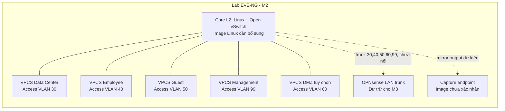

# Phương án triển khai M2: Core Layer 2

- **Ngày lập:** 2026-10-31
- **Cơ sở:** thiết kế M1, [đánh giá image](../evidence/eve-ng/image-readiness.md), log kiểm kê EVE-NG và metadata VMX VMware.
- **Trạng thái:** phương án đề xuất; chưa tạo node/lab, tải image hay thay đổi VMware/EVE-NG.

## 1. Tóm tắt lựa chọn

**Đề xuất dùng Linux Open vSwitch (OVS) trong EVE-NG cho M2**, nếu nhóm chấp nhận khác biệt với Cisco IOS CLI. OVS là lựa chọn khả thi nhất cho bộ yêu cầu M1 vì hỗ trợ VLAN access/trunk, LACP và mirroring/SPAN; tuy nhiên Linux QEMU image chưa có trong EVE-NG và cần được bổ sung hợp pháp trước khi triển khai.

Cisco IOSvL2 phù hợp hơn nếu mục tiêu chính là luyện đúng Cisco CLI và cần VLAN/trunk/LACP. Image IOSvL2 hiện không có trong EVE-NG, và tài liệu Cisco nêu IOSvL2 **không hỗ trợ SPAN**. Các image Cisco CML được cấp phép chỉ để sử dụng trong CML, trừ khi có quyền riêng cho môi trường khác. Vì M1 yêu cầu Suricata nhận mirror traffic, IOSvL2 đơn lẻ không đáp ứng toàn bộ yêu cầu đó.

Chưa có Core L2 image nào được xác nhận sẵn sàng trong EVE-NG. Vì vậy M2 **chưa thể triển khai ngay** với image hiện có; hiện có thể chốt thiết kế và port map dự kiến. VPCS đã có binary và template, nhưng quyền binary `777` cần được quản trị viên xem xét trước khi chạy.

## 2. So sánh Cisco IOSvL2 và Linux Open vSwitch

| Tiêu chí | Cisco IOSvL2 | Linux Open vSwitch (OVS) |
|---|---|---|
| VLAN access | Được Cisco liệt kê trong switchport features | Hỗ trợ access port qua VLAN tag |
| VLAN trunk / 802.1Q | Được Cisco liệt kê hỗ trợ | Hỗ trợ trunk 802.1Q và danh sách VLAN |
| LACP | Cisco liệt kê Port-Channel với LACP/PAgP | Hỗ trợ bonding với LACP; cần peer và ít nhất hai link để kiểm thử |
| SPAN / mirroring | Cisco ghi rõ port mirroring (SPAN) không được hỗ trợ | Có port mirroring, có thể xuất bản sao traffic ra capture port |
| Tương thích EVE-NG hiện tại | `viosl2.yml` có ở Intel/AMD, nhưng không có image IOSvL2; cần image có quyền sử dụng | `linux.yml` có ở Intel/AMD, nhưng không có Linux QEMU disk và chưa có OVS guest |
| Nguồn/quyền | Không lấy từ mirror/diễn đàn. IOSvL2 trong CML chỉ được cấp phép dùng trong CML, trừ khi nhóm có entitlement riêng cho EVE-NG | Ubuntu/OVS là phương án mã nguồn mở; lấy Ubuntu từ Ubuntu/Canonical chính thức |
| Ước tính tài nguyên M2 | Kế hoạch sơ bộ: 1 vCPU, khoảng 1 GB RAM cho một switch | Kế hoạch sơ bộ: 1–2 vCPU, khoảng 1–2 GB RAM cho Ubuntu Server + OVS |
| CLI và vận hành | Cisco IOS; gần với nội dung đồ án Cisco | Linux shell và `ovs-vsctl`; không có IOS CLI, cú pháp và quy trình kiểm thử khác |
| Tính trung thực Cisco | Cao hơn cho tính năng IOSvL2 được image hỗ trợ; không tương đương switch ASIC vật lý | Thấp hơn với Cisco CLI/đặc tính nền tảng; phù hợp xác minh hành vi chuẩn L2, VLAN, LACP và mirror |
| Kết luận | Hợp nếu ưu tiên Cisco CLI và có quyền dùng image; cần switch khác cho SPAN | Hợp hơn với yêu cầu VLAN + LACP + SPAN trong một node; cần bổ sung Linux image và chấp nhận khác biệt CLI |

Tài liệu Cisco liệt kê L2 forwarding, 802.1Q trunk/VLAN và LACP cho IOSvL2, đồng thời liệt kê SPAN là unsupported. [Cisco IOSvL2 feature matrix](https://developer.cisco.com/docs/modeling-labs/iosvl2/). Cisco quy định các VM image cung cấp cùng CML/refplat ISO chỉ được cấp phép dùng trong CML nếu không có license khác. [Cisco CML image licensing](https://developer.cisco.com/docs/modeling-labs/vm-images-for-cml-labs/). OVS công bố hỗ trợ access/trunk VLAN, LACP và traffic mirroring. [OVS features](https://docs.openvswitch.org/en/latest/intro/what-is-ovs/), [VLAN/SPAN configuration](https://docs.openvswitch.org/en/stable/faq/configuration/).

**Không đánh giá các IOL L3 đang có là switch L2.** Metadata cho thấy hiện chỉ có các file IOL L3; chưa chạy image nên VLAN/trunk/SPAN/LACP của chúng chưa được xác nhận. Không dùng chúng làm Core M2 nếu chưa có kiểm chứng phù hợp.

## 3. Kiểm tra VMware OPNsense hiện có

`vmrun list` cho thấy chỉ EVE-NG đang chạy; các VM OPNsense dưới đây đều tắt. Đọc VMX chỉ xác nhận cấu hình khai báo, không xác nhận trạng thái cài đặt/nội dung guest disk.

| VM | VMX metadata | Disk / ISO | Mạng khai báo | Đánh giá tận dụng |
|---|---|---|---|---|
| `FW1-OPNsense` | 2 vCPU, 2048 MB RAM, guestOS `freebsd14-64` | VMDK descriptor/extent tồn tại; VMX gắn OPNsense `26.7` DVD ISO và đường dẫn ISO hiện có | 3 adapter: `nat`, `pvn`, `hostonly` (ghi nguyên văn từ VMX; ý nghĩa cụ thể của `pvn` chưa xác nhận) | Ứng viên firewall VMware riêng. RAM 2 GB thấp hơn mức tối thiểu 3 GB của OPNsense ảo. Không phải node EVE-NG trực tiếp. |
| `FW2-OPNsense` | 2 vCPU, 2048 MB RAM, guestOS `freebsd14-64` | VMDK descriptor/extent tồn tại, tên disk có hậu tố clone; cùng DVD ISO được tham chiếu | 3 adapter: `nat`, `pvn`, `hostonly` | Ứng viên thứ hai cho VMware riêng; cũng thiếu RAM so với mức tối thiểu. Chưa xác nhận cấu hình HA hay disk chứa OPNsense đã cài. |
| `OPNsense-FW1` | 2 vCPU, 2048 MB RAM, guestOS `other` | VMDK descriptor/extent tồn tại; optical `auto detect` | 1 adapter: `nat` | Tên VM chưa đủ để xác nhận đang cài OPNsense; không tính là firewall dùng được nếu chưa kiểm tra thủ công. |

Hai VM `FW1/FW2` có số NIC có thể ánh xạ ý niệm WAN/LAN/SYNC, nhưng network mode hiện tại không xác nhận chúng kết nối vào cùng các segment của EVE. Muốn ghép vào topology EVE cần thiết kế và có thể sửa network mapping VMware/EVE; việc đó nằm ngoài phạm vi hiện tại. Cũng chưa kiểm tra RAM vật lý toàn máy Windows, nên không thể khẳng định máy chủ đủ tài nguyên để chạy đồng thời EVE 8 GB và các VM firewall.

**Kết luận:** có thể xem `FW1/FW2` là ứng viên cho thử nghiệm M3 riêng trên VMware sau khi xác minh guest và tài nguyên; không đưa chúng vào sơ đồ M2 EVE-NG như node đã sẵn sàng. Muốn chạy hai OPNsense cần ít nhất 3 GB RAM mỗi instance theo tài liệu OPNsense; hiện mỗi VM khai báo 2 GB. [OPNsense virtual install requirements](https://docs.opnsense.org/manual/virtuals.html).

## 4. Điều kiện còn thiếu để dùng OVS trong EVE-NG

1. **Linux QEMU image:** hiện không có QEMU disk. Có `linux.yml` generic, chưa có `ubuntu.yml` riêng. Cần Ubuntu/Linux image hợp pháp tương thích EVE và định dạng folder/disk theo EVE. EVE ghi nhận QEMU image dưới `/opt/unetlab/addons/qemu/`; Linux dùng prefix `linux-` và disk `virtioa.qcow2` theo bảng naming. [EVE QEMU naming](https://www.eve-ng.net/index.php/documentation/qemu-image-namings/).
2. **OVS trong guest:** cần xác nhận OVS package/runtime có trong image hoặc chuẩn bị cài trong guest ở giai đoạn triển khai. Hiện chưa có Linux guest nên chưa xác minh phiên bản, dịch vụ hay lệnh `ovs-vsctl`.
3. **Số interface:** topology tối giản cần các vNIC cho 4 VLAN endpoint, 1 trunk dự phòng cho OPNsense M3, 1 mirror/capture và một đường quản trị nếu tách riêng. Đây là số cổng logic dự kiến, không phải giới hạn đã xác nhận của `linux.yml` hay image. Trước triển khai cần kiểm tra số NIC cho phép trong template EVE và tên thực tế `ethX` khi node được tạo.
4. **L2-only:** OVS bridge chỉ làm switching. Linux guest không bật IP forwarding/NAT; không tạo gateway trên Core. Default gateway, inter-VLAN routing, firewall, NAT và DHCP vẫn đặt ở OPNsense theo M1.
5. **SPAN:** OVS hỗ trợ mirror; phải chọn nguồn (trunk, VLAN hay port), hướng ingress/egress và đầu ra capture. Chưa có Suricata image được xác nhận; có thể để cổng mirror là vị trí dự kiến và xác minh capture khi có Linux/Suricata endpoint.
6. **LACP:** cần peer hỗ trợ LACP và tối thiểu hai link. M2 tối giản chỉ có một Core và chưa có firewall EVE, vì vậy LACP không được đưa vào đường hoạt động bắt buộc; có thể thêm thành test tùy chọn khi có peer thích hợp.
7. **Tài nguyên:** M2 OVS + VPCS dự kiến 1–2 vCPU và khoảng 1–2 GB RAM node, phù hợp hơn với EVE 4 vCPU/8 GB. Đây là ước tính, chưa đo runtime.

## 5. Topology M2 tối giản đề xuất

M2 chỉ kiểm thử chuyển mạch L2 trong từng VLAN, access/trunk, VLAN isolation và (nếu có capture endpoint) mirror. Không có gateway liên-VLAN; không cấu hình DHCP/NAT/firewall trên Core. Địa chỉ IP kiểm thử lấy từ kế hoạch đã được nhóm xác nhận sau này; các IP M1 hiện vẫn là đề xuất.

### Port map logic (chưa chính thức)

| Phía Core OVS | Phía đối tác | Mode | VLAN | Trạng thái |
|---|---|---|---|---|
| `port-DC` (vNIC thực tế TBD) | VPCS-DC `eth0` (cần xác nhận) | Access | 30 | Logical mapping đề xuất |
| `port-Employee` | VPCS-Employee `eth0` | Access | 40 | Logical mapping đề xuất |
| `port-Guest` | VPCS-Guest `eth0` | Access | 50 | Logical mapping đề xuất |
| `port-Management` | VPCS-Management `eth0` | Access | 99 | Logical mapping đề xuất; quản trị Core chỉ là host IP, không routing |
| `port-DMZ` | VPCS-DMZ `eth0` (optional) | Access | 60 | VLAN 60 còn cần nhóm chốt; mapping dự kiến |
| `port-FW-trunk` | OPNsense Primary LAN (M3) | Trunk 802.1Q | 30, 40, 50, 60, 99 | Dự trữ, chưa có endpoint EVE |
| `port-mirror` | Capture/Suricata interface | Mirror destination | Nguồn/hướng chưa chốt | Cổng dự kiến; image capture chưa xác nhận |
| Hai port song song tùy chọn | Peer LACP (cần xác định) | LACP bond | Chưa chốt | Không thuộc tối giản; cần ít nhất hai link và peer hỗ trợ |

Các tên `port-*`, `eth0`, VLAN/subnet và cổng đối tác trên đây là nhãn logic để thảo luận. Tên NIC EVE, port thực tế, allowed VLAN và đường kết nối VMware chưa được xác nhận; không dùng bảng này như cấu hình chính thức.

## 6. Phân loại khả năng triển khai

| Hạng mục | Trạng thái | Điều kiện |
|---|---|---|
| Thiết kế VLAN, port map logic, tài liệu M2 | Có thể làm ngay | Nhóm xác nhận phương án Core và VLAN/DMZ |
| VPCS endpoint | Có binary/template | Quản trị viên đánh giá quyền `777`; chưa runtime test |
| Cisco IOSvL2 Core trong EVE | Cần bổ sung image | Image có entitlement hợp lệ cho EVE; đồng thời cần giải pháp mirror vì IOSvL2 không hỗ trợ SPAN |
| OVS Core trong EVE | Cần bổ sung Linux QEMU image và OVS guest | Xác minh image/naming, package OVS, số vNIC, mirror/capture path |
| VMware `FW1/FW2` | Có thể là ứng viên riêng, chưa sẵn sàng theo thông tin hiện có | Guest/disk và network mapping phải được xác minh; RAM hiện 2 GB/VM, thấp hơn mức OPNsense tối thiểu |
| OPNsense QEMU node trong EVE | Cần bổ sung image | Tải hợp pháp OPNsense CE và cài disk theo template; chưa thực hiện |
| OPNsense HA trên EVE | Cần image và nâng tài nguyên | Hai firewall tối thiểu 3 GB RAM mỗi máy; EVE 8 GB/4 vCPU không đủ thoải mái khi chạy đồng thời với switch/endpoints |

EVE hiện còn khoảng 41 GB đĩa ở lần kiểm tra trước; VMX OPNsense riêng có VMDK, nhưng không phải QEMU image EVE. Việc có VMDK không tự chứng minh có thể chuyển đổi/nhúng vào EVE hợp lệ hoặc tương thích.

## 7. Quyết định cần nhóm xác nhận trước M2

1. Chọn Core M2: **OVS/Linux trong EVE** (đề xuất) hay **Cisco IOSvL2** khi đã có entitlement cho EVE.
2. Nếu chọn OVS, chấp nhận rằng CLI và hành vi không phải Cisco IOS; chọn Ubuntu Server image nguồn chính thức nào và ai phụ trách bảo đảm license/tính toàn vẹn.
3. Xác nhận VLAN 30/40/50/60/99, đặc biệt VLAN 60 DMZ, allowed VLAN trunk và VLAN access của từng endpoint.
4. Chốt phạm vi SPAN: port/VLAN nguồn, hướng mirror, capture endpoint và có cần bao phủ WAN/LAN trunk khi failover ở giai đoạn sau không.
5. LACP có phải tiêu chí M2 hay chỉ để sau; nếu bắt buộc, chọn peer và topology hai link.
6. M2 có cần OPNsense endpoint ngay để kiểm tra trunk không, hay để trunk disconnected đến M3 theo phân kỳ M1.
7. Chọn sử dụng các VM `FW1/FW2` riêng trong VMware cho M3 hay dựng OPNsense QEMU trong EVE; xác nhận mạng tích hợp, host RAM và có chấp nhận nâng RAM mỗi firewall lên tối thiểu 3 GB không.
8. Phê duyệt đánh giá thủ công quyền `777` của VPCS binary trước khi bật VPCS. Báo cáo này không đổi quyền.
9. Xác nhận tài nguyên VMware có thể cấp cho EVE ở M3; đề xuất tối thiểu 12 GB/6 vCPU cho HA nhỏ và 16 GB/8 vCPU thoải mái hơn.

## Nguồn tham khảo

- [Cisco IOSvL2 features và giới hạn](https://developer.cisco.com/docs/modeling-labs/iosvl2/)
- [Cisco CML image licensing](https://developer.cisco.com/docs/modeling-labs/vm-images-for-cml-labs/)
- [Open vSwitch features](https://docs.openvswitch.org/en/latest/intro/what-is-ovs/)
- [Open vSwitch VLAN/SPAN configuration](https://docs.openvswitch.org/en/stable/faq/configuration/)
- [EVE-NG QEMU image naming](https://www.eve-ng.net/index.php/documentation/qemu-image-namings/)
- [OPNsense hardware sizing](https://docs.opnsense.org/manual/hardware.html)

Không tải image, không cài phần mềm, không bật/tắt VM, không sửa cấu hình VMware/EVE-NG, không tạo node/lab trong quá trình lập phương án.
