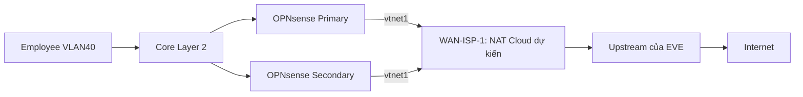

# 3.10. Phương án hoàn tất M3 — chờ phê duyệt

## 3.10.1. Phạm vi và căn cứ
Ngày 06/11/2026, UTC+07:00. Chỉ lập phương án; không SSH, đổi lab, cài đặt hoặc kiểm thử mới trong đợt này. M3 giữ PARTIAL, NAT Internet BLOCKED; mọi PASS trước giữ nguyên. Căn cứ: báo cáo 3.8/3.9; topology-readonly.json, wan-members-host.json và results-20261106T201450+0700.json tại docs/evidence/M3/M3-cause-nat-plan-20261106/. Các mục bên dưới là thiết kế chưa áp dụng.

Hồ sơ image-readiness.md ghi EVE-NG Community 6.2.0-4. Tài liệu NAT Cloud hiện hành không đủ khẳng định tính năng đang có trên bản cài này; không suy từ bản Pro/Freemium mới sang Community cũ. Cần kiểm tra danh sách network type trong UI và dịch vụ NAT/DHCP hiện có bằng thao tác đọc trước khi chọn phương án. Không nâng cấp hay cài bổ sung để mặc định đáp ứng.

## 3.10.2. Phương án kết nối
Ưu tiên A nếu bản cài hỗ trợ NAT Cloud và host EVE đã có upstream hoạt động:

NAT Cloud là mạng ảo cung cấp dịch địa chỉ và có thể kèm DHCP, giúp node lab đi qua đường mạng của host EVE. Đề xuất tạo network NAT riêng rồi chuyển CHỈ hai liên kết vtnet1 từ bridge WAN-ISP-1 hiện tại sang network mới; giữ bridge cũ để rollback. Nếu UI cho phép đổi type an toàn thì vẫn phải duyệt thao tác cụ thể trước thực hiện. Không nối hai mạng bằng link network-to-network giả định. Không đụng WAN-ISP-2, trunk, VLAN, LAN VIP hoặc SYNC. Việc chuyển link có thể ảnh hưởng WAN/CARP, cần kế hoạch thời điểm và đánh giá không gián đoạn riêng; không hứa hot-change an toàn.

Nếu NAT Cloud không có hoặc không hỗ trợ yêu cầu WAN VIP, phương án B là một router upstream giả lập hai NIC: NIC trong nối bridge WAN-ISP-1 hiện có; NIC ngoài nối Cloud/pnet dành riêng đã được xác nhận có upstream. Router cung cấp DHCP/gateway và NAT phía ngoài, giữ miền WAN bên trong có thể quản lý. Chỉ dùng image sẵn có phù hợp; chưa chọn node/image, không tạo hoặc bật node. Không mặc định Cloud0/pnet0 là Internet, và không đưa lab trực tiếp vào mạng quản trị khi chưa duyệt.

## 3.10.3. IP và gateway: chưa gán số
| Tham số | Đề xuất và điều kiện chốt |
|---|---|
| WAN subnet/mask | `<WAN_SUBNET>/<PREFIX>` đọc từ DHCP/NAT Cloud hoặc dải riêng của router upstream được duyệt; kiểm tra không trùng VLAN30/40/50/60/99, SYNC10.255.255.0/30 hoặc mạng quản trị EVE |
| Primary WAN | `<WAN_PRIMARY>` lease DHCP riêng; nếu HA thì cần lease/reservation ổn định được xác nhận |
| Secondary WAN | `<WAN_SECONDARY>` khác Primary, cùng subnet; không clone IP/lease |
| Gateway | `<WAN_GATEWAY>` từ DHCP router option3 hoặc router upstream; xác nhận định tuyến mặc định phù hợp |
| DNS | DHCP option6 hoặc resolver được duyệt; chỉ cần khi dùng tên miền |
| WAN VIP nếu HA | `<WAN_VIP>` cùng subnet, riêng biệt và được loại khỏi pool DHCP hoặc quản lý reservation an toàn; chỉ chốt sau kiểm tra địa chỉ chưa dùng |

Không lấy subnet/gateway ví dụ trong tài liệu EVE làm giá trị lab đã xác nhận. Không đổi IP WAN hay tạo reservation ở bước lập phương án. Không renew DHCP để thử.

## 3.10.4. NAT egress tối thiểu cho Employee
Nguồn đề xuất: một endpoint Employee, 192.168.40.110/32 là lease đã PASS trước đây, phải đối chiếu lease hiện hành trước triển khai; không coi là địa chỉ cố định. Đích `<APPROVED_EXTERNAL_IP>` do người dùng duyệt, dịch vụ TCP443. Firewall rule mới đặt trên VLAN40 theo chiều vào, đúng nguồn/đích/cổng; không mở any-any hoặc thêm Guest/DC/DMZ/Management. Dùng IP đích để hạn chế phụ thuộc DNS; không tự mở DNS Internet.

NAT hiện ở Automatic. Nếu chỉ nghiệm thu NAT một máy, có thể giữ mode và kiểm tra rule sinh sau khi WAN hợp lệ; traffic vẫn phải qua firewall rule được duyệt. Automatic có thể sinh rule cho nhiều subnet, nên phạm vi NAT và phạm vi egress được phép phải được rà soát riêng.

Nếu cần NAT có HA: đề xuất Hybrid với rule ưu tiên cho nguồn/đích/cổng trên, egress WAN, translation `<WAN_VIP>`, static-port mặc định tắt. Nếu cần chỉ duy nhất một rule SNAT trong cả bảng thì phải duyệt Manual sau kiểm kê toàn bộ NAT. NAT không phải firewall; không thay deny liên VLAN bằng NAT.

## 3.10.5. Điều kiện WAN VIP cho NAT HA
Hai WAN IP riêng và VIP thứ ba phải ổn định, cùng miền L2; upstream/Cloud phải cho phép CARP protocol112 và virtual MAC/ARP chuyển chủ, không có anti-spoof làm mất gói VIP. Cần xác minh NAT Cloud có thể dành VIP ngoài pool và nhận lưu lượng địa chỉ đó; chưa đủ bằng chứng để chốt NAT Cloud phù hợp NAT HA. Nếu thiếu khả năng này, ưu tiên router upstream kiểm soát được subnet/pool.

Dịch nguồn sang WAN IP riêng sẽ đổi địa chỉ khi đổi chủ, không đáp ứng giữ nguyên phiên NAT. Translation sang WAN VIP cùng pfsync là điều kiện cần; vẫn phải có kiểm chứng NAT HA riêng nếu nằm trong tiêu chí nghiệm thu được duyệt. Hiện syncitems chưa bao gồm NAT: cần duyệt bổ sung đồng bộ NAT Primary→Secondary hoặc cấu hình tương đương trên hai máy; không tự đồng bộ gateway/địa chỉ WAN riêng. Không dùng source any cho rule VIP bao gồm traffic tự sinh từ Secondary.

## 3.10.6. Hook 96-soc-pfsync: rủi ro và cách xử lý dự kiến
Log xác nhận hook gọi lại native pfsync sau bulk đầu đã xong, tái khởi phát bulk; Primary từng chờ khoảng673giây, demotion240. Hook có thể làm tái đồng bộ không cần thiết, đổi vai trò trong quá trình khởi động và kéo dài thời gian sẵn sàng. Đây là rủi ro có bằng chứng về tái khởi tạo, chưa phải bằng chứng hook tự nó gây thời gian chậm; counter lỗi không có mốc nên chưa xác định nguyên nhân truyền chậm.

Xóa/vô hiệu hóa hook có nguy cơ mất pfsync persistent từng được hook khắc phục và nghiệm thu. Giữ nguyên. Phương án nghiên cứu sau phê duyệt: rà dependency/thời điểm native startup, cân nhắc guard chỉ chạy khi runtime chưa sẵn sàng hoặc cơ chế native phù hợp phiên bản; không chỉ dùng syncok để che lỗi. Trước sửa cần backup hook/config, tiêu chí rollback và cửa sổ bảo trì; mọi reboot/failover phục vụ nghiệm thu thay đổi phải được duyệt riêng. Không dùng reset demotion cưỡng bức làm giải pháp.

## 3.10.7. Danh mục cần phê duyệt trước triển khai
| Mục | Nội dung phải chốt |
|---|---|
| Kết nối upstream | A NAT Cloud nếu có/đủ tính năng, hoặc B router+Cloud/pnet; tên network/interface và hai link vtnet1 cần chuyển; không tự gắn pnet0 |
| Địa chỉ | Subnet/mask, DHCP pool, gateway, lease/reservation hai máy; VIP nếu chọn NAT HA; mọi giá trị số còn chờ xác minh |
| Phạm vi nghiệm thu | NAT Internet một máy hay NAT có HA giữ phiên; đích IP TCP443 và nguồn Employee thực tế |
| Policy/NAT | Firewall rule, Automatic/Hybrid/Manual, translation WAN address hay WAN VIP; nhóm XMLRPC NAT |
| Thực hiện/rollback | Backup topology/config, thời điểm đổi link/reload, điều kiện dừng và phục hồi bridge/link/config cũ; không tự dừng VM |
| Hook | Không sửa trong kế hoạch WAN; nếu sửa phải là thay đổi được duyệt riêng, có backup và nghiệm thu persistent |

Sau phê duyệt mới lập cấu hình thực thi từ giá trị đã xác nhận. Tái sử dụng PASS cũ; chỉ nghiệm thu phần mới WAN/NAT hoặc phần thực sự bị thay đổi. Không đánh dấu DONE khi NAT còn BLOCKED. Đợt này không có ảnh lab mới vì không thao tác lab; dùng minh chứng thật đã có, không báo cáo thiết kế là triển khai.

## 3.10.8. Nguồn chính thức
Tham khảo ngày06/11/2026: [EVE — Features Compare](https://www.eve-ng.net/index.php/features-compare/) mô tả NAT Cloud của các edition hiện hành; [EVE Community](https://www.eve-ng.net/index.php/community/) cho ngữ cảnh phiên bản, không chứng minh bản lab có NAT Cloud; [OPNsense NAT](https://docs.opnsense.org/manual/nat.html#source-nat-outbound) cho các mode; [OPNsense CARP — Source NAT](https://docs.opnsense.org/manual/how-tos/carp.html#setup-source-nat) cho translation WAN VIP. Các nội dung trên là căn cứ thiết kế, không thay thế kiểm chứng EVE-NG.
