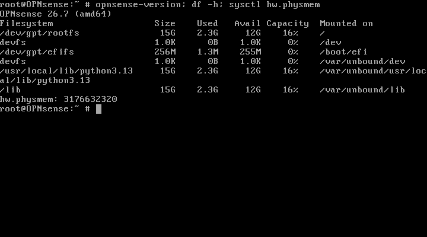

# CHƯƠNG 3. CÀI ĐẶT VÀ XÁC MINH OPNsense PRIMARY

## 3.1. Kết quả và giới hạn nghiệm thu

Ngày 01/11/2026, UTC+07:00: đã cài OPNsense 26.7 (amd64) lên ổ ảo vtbd0 16 GiB bằng UFS, khởi động từ ổ cứng và xác minh trong shell root. Ba NIC khớp MAC/QEMU/TAP đã kiểm kê. Đây là kết quả cài đặt và boot một firewall, không phải nghiệm thu gateway VLAN, định tuyến, firewall policy, NAT hoặc HA.

Node OPNsense-Primary, ID 1, UUID fe606d13-1542-490b-b651-5c1c6289afde thuộc lab SOC-M2-Core-L2 trên EVE-NG 192.168.220.143; 2 vCPU, 3072 MiB RAM, ba VirtIO NIC. Core ID 3 giữ tắt trong giai đoạn này. Chưa nối WAN, LAN trunk hoặc SYNC. Không thay mạng Windows/VMware, image Core hay seed NoCloud.

M2 đã có 95/95 ca frame thật PASS, gồm VLAN/trunk, mirror và persistence; báo cáo M2 riêng được giữ nguyên. Kết quả M2 không được cộng vào số ca M3 hoặc coi là bằng chứng định tuyến qua firewall.

## 3.2. Quá trình cài đặt thực tế

Trước cài, console chạy Live từ /dev/iso9660/OPNSENSE_INSTALL. Kiểm tra diskinfo xác nhận vtbd0 có 17179869184 byte; chưa có bảng phân vùng được gpart nhận diện. Đã shutdown mềm Primary và sao lưu overlay trước cài khi không có QEMU chạy. Sau đó bật lại Primary, người dùng đăng nhập installer trực tiếp; công cụ không thu hoặc ghi thông tin xác thực.

Giữ keymap US, chọn Install (UFS), xác minh vtbd0 16GB, xem màn hình xác nhận chỉ liệt kê vtbd0 rồi bắt đầu phân vùng. Các ảnh đầu quá trình ghi khởi tạo partition và cloning đang chạy, không phải ảnh cài thành công. Người dùng thông báo hoàn tất installer và tự đặt mật khẩu root mới; bằng chứng độc lập sau đó là ổ đã phân vùng, boot từ ổ và shell kiểm chứng.

Hình 3.1. Installer hiển thị vtbd0 16GB và DVD cd0; chọn vtbd0.

Mục đích: xác minh đích trước ghi. Nội dung: danh sách đĩa thật trong installer. Kết quả: ổ cứng đúng dung lượng được chọn, không chọn DVD. Ý nghĩa: tránh ghi nhầm thiết bị; hình này chưa chứng minh cài hoàn tất.

## 3.3. Backup sau cài và khởi động từ ổ cứng

Đã xác minh không có QEMU chạy trước sao lưu ổ vừa cài. Bản sao nằm tại /root/m3-primary-installed-backup-20261101/virtioa.qcow2, kích thước tệp 2491482112 byte, dung lượng ảo 16 GiB. SHA-256 nguồn và bản sao khớp: 81d0dba0063d918581f0cfc8717fe81472c3398cd82e9381fd8b904f68e0a5df. Metadata ở ../evidence/M3/primary-live-20261101/installed-backup-boot-disk.json. Raw QCOW2 chỉ giữ trên EVE, không đưa lên Git.

Lab XML được sao lưu cùng thư mục dưới tên lab-before.unl. Chỉ thay tùy chọn boot của Primary từ order=dc thành order=c; giữ nguyên node Core, MAC, RAM, ISO và image gốc. ISO vẫn gắn CD-ROM nhưng không nằm trong thứ tự boot BIOS. Không đổi tên/xóa ISO để ép boot.

Rollback dự kiến: chỉ khi Primary đã tắt và không còn tiến trình giữ đĩa, có thể phục hồi lab-before.unl để hoàn nguyên lựa chọn boot; nếu cần khôi phục ổ, phải bảo toàn overlay lỗi vào tên mới trước khi phục hồi bản sao vào đúng runtime path trong metadata. Chưa thử restore, không kết luận rollback PASS.

Hình 3.2. Console thực tế ghi Booting from Hard Disk.

Mục đích: kiểm chứng lựa chọn boot. Nội dung: BIOS và bộ nạp BTX từ ổ cứng. Kết quả: không boot lại Live ISO. Ý nghĩa: xác minh bước đầu của boot; cần đối chiếu filesystem sau khi hệ điều hành lên.

Hình 3.3. GPT trên vtbd0 và /dev/gpt/rootfs được mount làm thư mục gốc.

Mục đích: kiểm tra hệ điều hành thật sự chạy trên ổ đã cài. Nội dung: gpart, diskinfo và mount từ shell root. Kết quả: GPT có EFI 260M, freebsd-boot 512K, freebsd-ufs; /dev/gpt/rootfs mount tại / với UFS. Ý nghĩa: xác nhận hệ thống đã rời Live ISO; không suy từ tên image hoặc thông báo người dùng.

Hình 3.4. OPNsense 26.7 và dung lượng filesystem sau cài.

Mục đích: kiểm tra phiên bản và dung lượng thực tế. Nội dung: opnsense-version, df -h, sysctl hw.physmem. Kết quả: 26.7 amd64; root filesystem khoảng 15G, dùng 2,3G, còn 12G tại thời điểm thu. Ý nghĩa: có hệ điều hành và dung lượng trống để cấu hình tiếp; không phải bằng chứng hiệu năng hoặc tải firewall.

## 3.4. Mapping cổng sau boot

| QEMU | TAP EVE | MAC guest | NIC OPNsense | Trạng thái/vai trò |
|---|---|---|---|---|
| net0 | vunl0_1_0 | 50:00:00:01:00:00 | vtnet0 | LAN hiện tại 192.168.1.1/24; dự kiến LAN trunk tới ens8 Core |
| net1 | vunl0_1_1 | 50:00:00:01:00:01 | vtnet1 | WAN; chưa nối upstream, chưa chốt địa chỉ |
| net2 | vunl0_1_2 | 50:00:00:01:00:02 | vtnet2 | Chưa gán; dự kiến HA SYNC riêng |

Hình 3.5. Ba địa chỉ MAC đọc trực tiếp trong guest sau boot từ ổ.

Mục đích: tránh suy mapping từ thứ tự thiết kế. Nội dung: ifconfig của từng vtnet. Kết quả: ba MAC khớp netdev và TAP trong metadata QEMU. Ý nghĩa: đủ cơ sở định danh cổng trước cấu hình VLAN; chưa có link tới Core hoặc peer SYNC.

## 3.5. Gateway và firewall dự kiến, chưa áp dụng

| VLAN | Vùng | Subnet dự kiến | Primary | Secondary dự kiến | CARP VIP dự kiến |
|---|---|---|---|---|---|
| 30 | Data Center | 192.168.30.0/24 | 192.168.30.2 | 192.168.30.3 | 192.168.30.1 |
| 40 | Employee | 192.168.40.0/24 | 192.168.40.2 | 192.168.40.3 | 192.168.40.1 |
| 50 | Guest | 192.168.50.0/24 | 192.168.50.2 | 192.168.50.3 | 192.168.50.1 |
| 60 | DMZ | 192.168.60.0/24 | 192.168.60.2 | 192.168.60.3 | 192.168.60.1 |
| 99 | Management | 192.168.99.0/24 | 192.168.99.2 | 192.168.99.3 | 192.168.99.1 |

Nguồn thiết kế: M3-deployment-matrix-and-tests-PREPARED-20261101.md và configs/M3/address-proposal.json. WAN/subnet/upstream/DNS chưa chốt. SYNC 10.255.255.0/30 là đề xuất; chưa có Secondary. Khi chỉ có Primary, client thử dùng IP .2 của Primary; không gọi .1 là gateway đang hoạt động hoặc tạo tuyên bố HA giả.

Policy dự kiến: Guest chặn toàn bộ mạng nội bộ, chỉ cho DNS/DHCP và WAN được duyệt; Employee chỉ tới dịch vụ DC được chọn; DMZ chỉ tới backend/log đích xác định; Management chỉ từ máy quản trị; DC cho phép các dịch vụ cần thiết được chốt. Không dùng allow-any liên VLAN để đạt ping. Chưa có rule mới hoặc NAT được triển khai trong phiên này.

Core chỉ chuyển mạch Layer 2; OPNsense xử lý gateway, định tuyến liên VLAN và lọc gói theo trạng thái. Trunk IEEE 802.1Q trên vtnet0 dự kiến mang VLAN 30/40/50/60/99, nối riêng ens8 của Core. vtnet2 dự kiến dành cho SYNC, không nối mạng người dùng. WAN không tự nối pnet hoặc mạng thật.

## 3.6. Nguyên lý và vai trò trong SOC

OPNsense là tên sản phẩm firewall, không có dạng khai triển tự tạo. SOC (Security Operations Center, trung tâm điều hành an ninh) dùng firewall làm ranh giới kiểm soát luồng, đồng thời thu log để giám sát. VLAN (Virtual Local Area Network, mạng LAN ảo) tách miền quảng bá; IEEE 802.1Q gắn định danh VLAN vào frame trunk. Gateway là địa chỉ interface Layer 3 nhận lưu lượng đi ra khỏi subnet; trong mô hình dự kiến, OPNsense đảm nhiệm vai trò này, Core không định tuyến.

UFS (Unix File System) là hệ thống tệp được chọn trong installer. GPT (GUID Partition Table) mô tả các phân vùng trên ổ. QEMU là phần mềm giả lập/ảo hóa, QCOW2 (QEMU Copy On Write version 2) là định dạng đĩa ảo; overlay runtime tham chiếu backing image. Ghi ổ từ installer trong guest khác với sửa QCOW2 trực tiếp từ host; chỉ sao lưu/kiểm tra qemu-img khi VM đã tắt trong quy trình này.

HA (High Availability, tính sẵn sàng cao) dự kiến dùng hai firewall. CARP (Common Address Redundancy Protocol) chia sẻ địa chỉ ảo với vai trò MASTER/BACKUP; pfsync đồng bộ trạng thái kết nối; XMLRPC (XML Remote Procedure Call) đồng bộ các phần cấu hình được chọn. Các cơ chế này chưa triển khai/kiểm thử. NAT (Network Address Translation) chuyển đổi địa chỉ, không thay thế firewall policy; DHCP (Dynamic Host Configuration Protocol) cấp tham số mạng cho client, chưa cấu hình scope VLAN trong phiên này. Suricata/Wazuh và pipeline IDS còn ở giai đoạn chuẩn bị.

## 3.7. Bảng kết quả và bước tiếp tục

| Mã | Hạng mục | Kết quả | Bằng chứng/giới hạn |
|---|---|---|---|
| P01 | Backup overlay sau cài khi node tắt | PASS | Metadata và checksum nguồn/bản sao khớp; chưa restore thử |
| P02 | Boot từ ổ cứng | PASS | Hình 3.2, 3.3; root không còn ISO |
| P03 | OPNsense 26.7 hoạt động tại shell | PASS | Hình 3.4; chưa đánh giá hiệu năng |
| P04 | Mapping ba NIC sau boot | PASS | Hình 3.5 và QEMU metadata |
| P05 | VLAN gateway persistent | NOT_RUN | Mới chuẩn bị ma trận, chưa ghi cấu hình |
| P06 | Trunk Core–Primary | NOT_RUN | Core tắt, chưa nối link |
| P07 | Routing và policy bằng traffic thật | NOT_RUN | Chưa có capture/luồng thử M3 |
| P08 | WAN/NAT/DHCP | NOT_RUN | Chưa chốt WAN, chưa thử client |
| P09 | CARP/pfsync/XMLRPC/failover | NOT_RUN | Chưa triển khai Secondary |

Tài nguyên cuối kiểm tra Windows khoảng 0,94 GiB RAM available, commit available 3,19 GiB; không bật Core. Ngưỡng RAM tạm trước đó được đánh giá lại theo RAM EVE/commit và tải thực tế, không trình bày thành yêu cầu chính thức của OPNsense. Có lần guard start chặn vì 268 KiB swap cũ dù free -m làm tròn về 0; vmstat si/so bằng 0, không phải bằng chứng đang thiếu RAM EVE. Giữ các lần chặn trong nhật ký, không tính là FAIL chức năng firewall.

Bước tiếp tục: backup config hiện tại trong guest với quyền root-only, xác nhận địa chỉ và parent vtnet0, cấu hình VLAN/assignment theo schema bản đang chạy, kiểm tra tĩnh; khi đủ tài nguyên mới nối trunk riêng tới ens8 và chạy đối chứng cho phép/chặn bằng traffic thật. Chưa nhập XML cũ. Không công bố hoàn thành SOC hoặc HA từ bốn kiểm tra nền tảng này.

## 3.8. Tài liệu tham chiếu và minh chứng

[OPNsense — Initial Installation & Configuration](https://docs.opnsense.org/manual/install.html); [OPNsense — Firewall](https://docs.opnsense.org/manual/firewall.html); [OPNsense — CARP](https://docs.opnsense.org/manual/how-tos/carp.html). Kiểm tra bổ sung đã đọc source/schema trên chính guest: Vlan.xml mount /vlans và interfaces_vlan_configure trong interfaces.inc; chưa dùng để áp cấu hình.

Ảnh PNG là framebuffer QEMU thực, không chỉnh sửa nội dung; JSON cùng tên ghi lệnh, UUID, QEMU args, SHA-256 và thời điểm collector UTC+07:00. Thời gian EVE/guest được ghi riêng, không mặc định đồng bộ. Mật khẩu mới do người dùng tự nhập; không thu vào log, báo cáo hoặc Git. Báo cáo này là tệp mới, giữ nguyên các tài liệu M2/M3 cũ.
