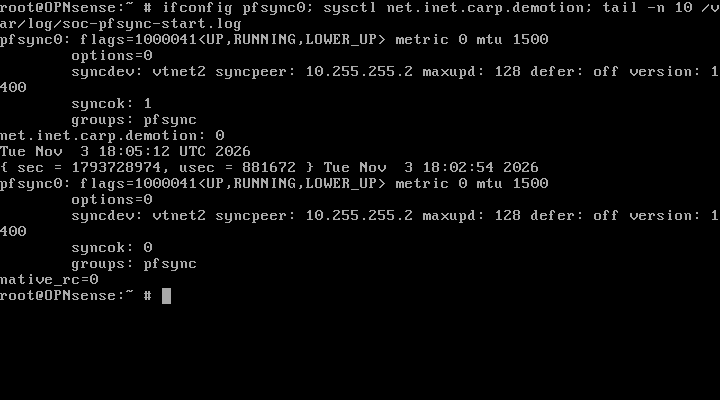
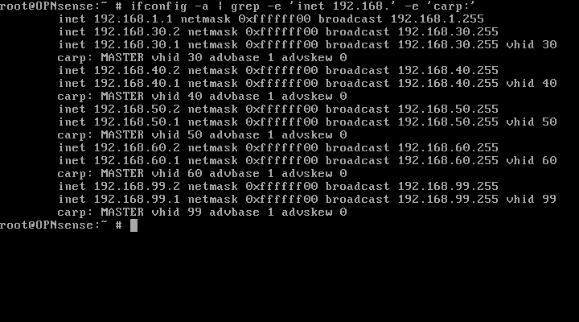
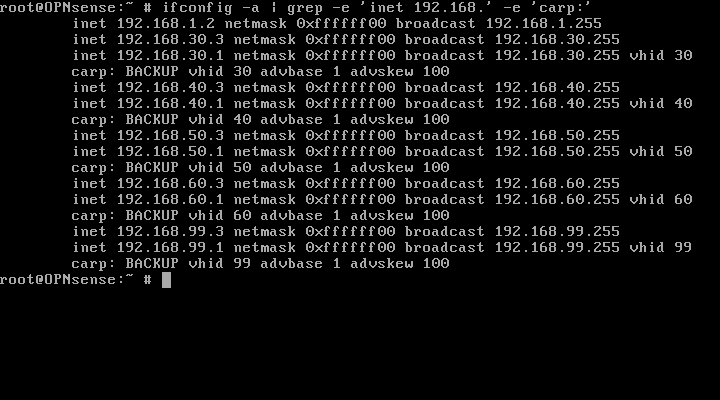

# CHƯƠNG 3. NGHIỆM THU CÁC TODO M3 NGÀY 03/11/2026

## 3.1. Kết quả và phạm vi

**Hai TODO M3 được liệt kê trong SOC_TO_DO.md đã DONE/PASS.** M3.1 đạt tại 2026-11-03T23:22:49.717195+07:00; M3.2 đạt tại 2026-11-03T23:35:30.471679+07:00 (UTC+07:00). Thời điểm thu từng phép đo nằm trong JSON; giờ guest/EVE lệch nên chỉ dùng kern.boottime để đối chiếu các lần boot, không thay timestamp collector.

| TODO | STATUS | EVIDENCE |
|---|---|---|
| M3.1 — pfsync persistent và runtime sau reboot từng firewall | DONE/PASS | M3.1-acceptance.json; primary/secondary-pfsync-postboot.json; ảnh pfsync-proof |
| M3.2 — CARP năm VLAN, Primary MASTER / Secondary BACKUP | DONE/PASS | M3.2-acceptance.json; primary/secondary-carp-apply.json; primary/secondary-carp-verified.json; carp-advertisements-after.json; ảnh carp-proof |

Tất cả tên tệp trong bảng thuộc `docs/evidence/M3/todo-completion-20261103/`. File TODO ban đầu chỉ có bảng nghiệm thu M2; đã ghi lại đúng hai mục M3 trong chỉ thị mới của người dùng. Không tự bổ sung nhiệm vụ khác hoặc suy hai mục này thành nghiệm thu mọi chức năng HA của toàn dự án.

Core vẫn Layer2, OPNsense giữ vai trò Layer3/inter-VLAN/firewall. Không đổi topology, VLAN/IP plan, interface mapping, disk/image, seed hoặc RAM/vCPU. Không thay NAT/DHCP, không cleanup/xóa file, không commit/push và không chuyển M4/M5. Không chạy kiểm thử failover vì không có mục đó trong danh sách hiện hành.

## 3.2. M3.1 — sửa pfsync persistent và kiểm chứng reboot

### 3.2.1. Nguyên nhân và cấu hình đã triển khai

`primary-diagnose.json` chứa mã cài thực tế: `interfaces_pfsync_configure()` chỉ được gọi trong nhánh xử lý CARP VIP; không có lời gọi tương ứng ở cuối `interfaces_configure()` trong image này. Nhóm boot không gọi riêng plugin pfsync. Khi chưa có VIP, cấu hình peer còn trong XML nhưng boot không áp runtime; pfsync0 flags0, thiếu syncdev/peer. Cấu hình khai báo version1400, runtime chưa áp hiển thị1500. Không có căn cứ quy lỗi này cho giảm RAM.

Đã tạo `/usr/local/etc/rc.syshook.d/start/96-soc-pfsync`, mode0700, SHA-256 `7575588f69bfc2eee49b5d9cd336659d32e6831651366aba355d8b750b9a36a8` trên cả hai guest. Hook gọi `/usr/local/sbin/pluginctl -c pfsync` sau khi mạng khởi động, dùng cấu hình native có sẵn, không hardcode peer mới và không vá core. Log root-only `/var/log/soc-pfsync-start.log` ghi kern.boottime, native exit code và runtime. Cơ chế syshook start được OPNsense hỗ trợ chính thức. [OPNsense — Bootup / autorun options](https://docs.opnsense.org/development/backend/autorun.html).

Trước thay đổi, mỗi guest có backup mode0600 tại `/root/soc-m3-todo-pfsync-20261103/config.before.xml`. SHA-256 config trước/sau áp hook và sau reboot đều khớp: Primary `2a8dff44d86ee2971237c05fc94cec5e99ceccb642893f12474de6d8f54028a2`; Secondary `fd0482546117a18254e05114dc1b101012b95c1388e4ba9ea4eaafce115c69bd`. Đây là checksum ở checkpoint trước CARP; cấu hình có thay đổi hợp lệ khi thêm VIP sau đó.

### 3.2.2. Kết quả nghiệm thu

Đã reboot mềm Secondary, chờ boot xong, rồi reboot Primary. Sau khi người dùng đăng nhập trực tiếp hai console, reader chỉ đọc log/runtime; không gọi lại apply pfsync sau reboot để tạo kết quả.

| Kiểm tra sau reboot | Primary | Secondary |
|---|---|---|
| kern.boottime khác mốc trước reboot | PASS | PASS |
| Hook được boot sequence gọi; log khớp boot mới | PASS | PASS |
| Native exit code trong log | 0 | 0 |
| pfsync UP/RUNNING, syncdev | vtnet2 | vtnet2 |
| Sync peer | 10.255.255.2 | 10.255.255.1 |
| Runtime version | 1400 | 1400 |
| syncok tại nghiệm thu | 1 | 1 |
| CARP demotion | 0 | 0 |
| Ping SYNC hai hướng | 2/2, mất0% | 2/2, mất0% |
| Năm IP VLAN vật lý .2/.3 | Đúng | Đúng |
| Config khớp backup trước hook | PASS | PASS |

Log startup Primary ghi syncok0 ở thời điểm bắt đầu, sau đó runtime hội tụ về1 khi peer sẵn sàng; không nhầm trạng thái tức thời trong log thành kết luận cuối. Trường ready trong JSON apply ban đầu chỉ kiểm native attachment; nghiệm thu chính thức sử dụng bộ điều kiện đầy đủ trong M3.1-acceptance.json.

`secondary-reboot-pfsync-packets.json` ghi3 gói protocol240 hai chiều trong35giây; PCAP root-only trên EVE có đường dẫn/SHA-256 trong JSON. Một cửa sổ khác lúc Primary còn boot không có gói; không dùng mẫu đó để kết luận FAIL. Các phép đo này chưa phải nghiệm thu đồng bộ mọi state hoặc giữ phiên khi failover.

## 3.3. M3.2 — triển khai và kiểm chứng CARP

### 3.3.1. Kiểm tra trước apply và bảo vệ cấu hình

Chỉ chuyển sang M3.2 sau M3.1 PASS. `carp-vip-arp-before.json` nhận .2/.3 trên đủ năm VLAN và không thấy .1 phản hồi trong hai probe/địa chỉ; `carp-vhid-observation-before.json` không thấy protocol112 trong20giây. Config không có VIP trước áp; các phép kiểm có giới hạn cửa sổ và không bảo đảm phát hiện thiết bị ngoại vi/offline chưa được khai báo.

`primary-carp-preflight.json` xác nhận schema VIP và backend cài trong guest; tệp shared secret đã tồn tại root-only, không xuất giá trị hoặc fingerprint. Secondary được kiểm tra file quyền0600/19byte bằng console thật. Không tạo secret mới hoặc gửi secret qua lệnh shell/chat.

Đã áp lần lượt Primary rồi Secondary bằng model native `OPNsense\Interfaces\Vip`, validation trước save; reload bằng `configctl interface vip configure` và `configctl filter reload`. Mỗi guest có checkpoint root-only `/root/soc-m3-todo-carp-20261103/config.before.xml`. JSON apply xác nhận các phần XML ngoài virtualip/revision giữ nguyên. Rule người dùng, NAT/DHCP, interface và hasync không bị sửa. Filter reload sinh rule CARP defaults của OPNsense cho protocol112; đây là thay đổi runtime cần thiết từ VIP, không phải thêm policy người dùng mới.

### 3.3.2. Kết quả thực tế

| VLAN | VIP đã triển khai | VHID | advbase | Primary skew/state | Secondary skew/state | Kết quả |
|---|---|---:|---:|---|---|---|
|30|192.168.30.1/24|30|1|0 / MASTER|100 / BACKUP|PASS|
|40|192.168.40.1/24|40|1|0 / MASTER|100 / BACKUP|PASS|
|50|192.168.50.1/24|50|1|0 / MASTER|100 / BACKUP|PASS|
|60|192.168.60.1/24|60|1|0 / MASTER|100 / BACKUP|PASS|
|99|192.168.99.1/24|99|1|0 / MASTER|100 / BACKUP|PASS|

Hai JSON carp-verified kiểm từng VIP persistent, subnet24, assignment opt1–opt5, runtime ifconfig đúng VHID/role. Mỗi firewall có đúng5 VIP, demotion0; pfsync vẫn UP/peer đúng/syncok1 sau CARP apply. Cấu hình CARP đã được lưu; không reboot thêm riêng CARP ở lượt này nên không gọi kết quả này là nghiệm thu CARP sau reboot.

`carp-advertisements-after.json` ghi quảng bá thật từ Primary .2 tới224.0.0.18, protocol112, TTL255, advbase1/skew0 trên đủ VHID30/40/50/60/99. PCAP giữ riêng trên EVE với SHA-256. Trạng thái BACKUP được xác nhận trực tiếp trên Secondary, không suy diễn chỉ từ việc không thấy quảng bá Secondary.

`carp-vip-arp-after.json` xác nhận đủ năm VIP trả ARP bằng MAC CARP tương ứng: VLAN30→00:00:5e:00:01:1e; VLAN40→00:00:5e:00:01:28; VLAN50→00:00:5e:00:01:32; VLAN60→00:00:5e:00:01:3c; VLAN99→00:00:5e:00:01:63. Đây là quan sát Layer2 sau apply, không thay cho kiểm thử mọi dịch vụ đi qua gateway.

Không thực hiện failover, kiểm giữ phiên, WAN HA hoặc NAT/DHCP HA; không đánh dấu các chức năng đó PASS ngoài hai TODO hiện hành.

## 3.4. Hình minh chứng

**Hình 3.1. Pfsync Primary sau reboot.** Mục đích: đối chiếu runtime và boot log. Nội dung: pfsync UP, syncdev/peer, syncok1 hiện tại, demotion0 và log có native_rc0. Kết quả: runtime hội tụ, dù mẫu ngay lúc hook chạy có syncok0. Ý nghĩa: chứng minh tự áp sau reboot và trạng thái cuối, không phải apply thủ công lại.

**Hình 3.2. Pfsync Secondary sau reboot.** Mục đích: kiểm tra phía dự phòng độc lập. Nội dung: peer đối ứng, version1400, syncok1/demotion0 và log boot. Kết quả: đủ điều kiện M3.1 hai phía. Ý nghĩa: không dựa riêng ảnh Primary để nghiệm thu toàn cặp.

**Hình 3.3. Primary MASTER trên năm VLAN.** Mục đích: nghiệm thu vai trò firewall chính. Nội dung: các địa chỉ VIP và dòng CARP trên năm interface. Kết quả: MASTER đủ năm VHID, advbase1/skew0. Ý nghĩa: thông số đã duyệt trở thành runtime thực tế.

**Hình 3.4. Secondary BACKUP trên năm VLAN.** Mục đích: đối chiếu cặp dự phòng. Nội dung: VIP và CARP state từng VLAN. Kết quả: BACKUP đủ năm VHID, advbase1/skew100. Ý nghĩa: hai phía hội tụ vai trò; chưa chứng minh giữ phiên khi chuyển vai.

Ảnh lấy từ framebuffer QEMU/RFB thực, không chỉnh nội dung kỹ thuật. JSON qua console được giải mã glyph chính xác và đối chiếu SHA-256. Danh mục evidence-index.csv/md ghi nội dung, thời điểm kèm múi giờ, đường dẫn, vị trí báo cáo và checksum. Không ghi ảnh chưa chụp là minh chứng. Chưa có screenshot topology/web hoặc terminal host; nếu bổ sung, mở topology ba node hoặc terminal EVE chạy date/free/vmstat, chụp đủ output, lưu ảnh timestamp thật vào thư mục evidence này và cập nhật danh mục. Không dựng ảnh từ text.

## 3.5. Tài nguyên và trạng thái bàn giao

Mẫu host cuối: MemTotal7897.78MiB, MemAvailable2748.28MiB, swap dùng0.00MiB. Core1024/Primary2048/Secondary2048MiB, tổng5120MiB, vCPU1/2/2 giữ nguyên. Xem m3-final-host.json để biết timestamp, vmstat và kernel OOM log; không nghiệm thu tải SOC dài hạn từ mẫu ngắn này. Không tối ưu tài nguyên thêm.

Đối chiếu metadata lab trong `lab-metadata-final-comparison.json` xác nhận toàn bộ cây node và network giữ nguyên. Hash toàn tệp không trùng vì thay đổi duy nhất ở nội dung `/lab/objects[2]/textobjects[0]/textobject[3]/data[0]/text`, theo `lab-metadata-delta-paths.json`; không tự quy thay đổi cho một tác nhân khi chưa có bằng chứng. Không sửa/revert text object đó. Không báo topology nguyên byte khi chỉ các phần node/network đã được chứng minh giữ nguyên.

**Không còn mục M3 chưa hoàn thành trong SOC_TO_DO.md hiện hành.** Dừng sau hai TODO đã được giao; không tự tạo mục tiếp theo hoặc chuyển M4/M5. Evidence/backup trước được giữ nguyên.

## 3.6. Thuật ngữ và định dạng báo cáo

pfsync là tên cơ chế đồng bộ trạng thái Packet Filter (PF), không tự tạo dạng khai triển. Nó trao đổi cập nhật state giữa peer, hỗ trợ HA — High Availability, tính sẵn sàng cao. Trong SOC này dùng vtnet2/SYNC riêng; tự áp sau reboot và runtime đã kiểm, giữ phiên failover chưa kiểm. Syshook là cơ chế móc sự kiện OPNsense: script start chạy sau khởi tạo mạng, ở đây gọi backend pfsync sẵn có.

CARP — Common Address Redundancy Protocol, giao thức dự phòng địa chỉ chung — dùng quảng bá protocol112 để chọn node quản lý VIP — Virtual IP Address, địa chỉ IP ảo. VHID — Virtual Host Identifier — định danh nhóm quảng bá; advbase là khoảng cơ sở, advskew là độ lệch ưu tiên, giá trị thấp hơn được ưu tiên. Ví dụ đã kiểm: VLAN30/VHID30, VIP192.168.30.1/24, Primary MASTER/skew0 và Secondary BACKUP/skew100. Vai trò trong SOC là dự phòng gateway tại OPNsense, không chuyển Core sang Layer3. [OPNsense — Configure CARP](https://docs.opnsense.org/manual/how-tos/carp.html).

OPNsense là tên sản phẩm, không khai triển. VLAN — Virtual Local Area Network, mạng LAN ảo — tách miền quảng bá; trunk IEEE802.1Q mang các VLAN qua liên kết chung. OVS — Open vSwitch — thực hiện bridge Layer2 của Core. SOC — Security Operations Center, trung tâm vận hành an toàn thông tin — là hệ thống tổng thể mà cặp firewall này phục vụ. Nguyên lý, vai trò và ví dụ các thuật ngữ còn lại được giải thích tại [TOPOLOGY_TERMS.md](../TOPOLOGY_TERMS.md); không triển khai mới ở lượt này.

Nếu xuất Word: A4, Times New Roman12–13, lề trái3cm và các lề còn lại2cm; hình đánh số theo chương, chú thích phía dưới. Lượt này cập nhật Markdown, chưa xuất Word.
