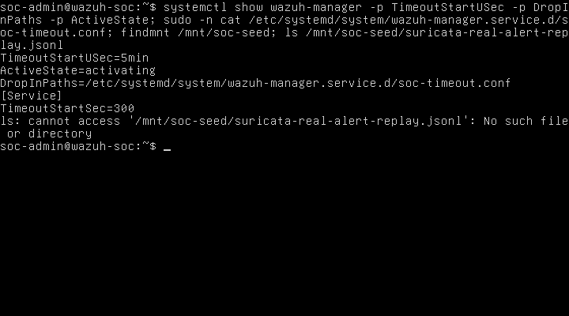
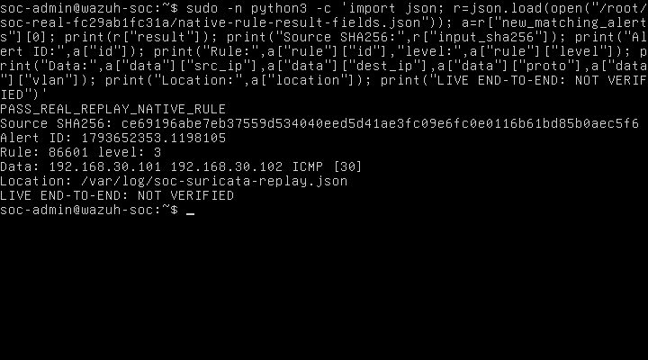
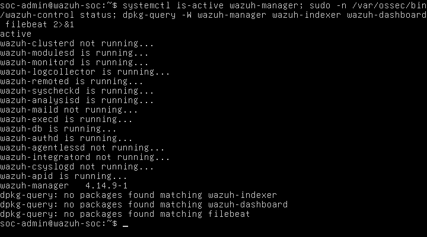

# 5. Kiểm tra Wazuh Manager và chuẩn bị demo SOC

## 5.1. Phạm vi và mốc tiếp quản

Ngày 02/11/2026, lúc 20:33:51 UTC+07:00, kiểm kê SSH trên EVE-NG 192.168.220.143 không tìm thấy tiến trình QEMU đang chạy. Đây là trạng thái mới, khác với thông tin ba node chạy trong checkpoint trước. Wazuh-SOC có RAM khai báo 4096 MiB, một NIC và chưa có attachment segment. Tệp kiểm kê: `docs/evidence/M5/continuation-20261102/inventory-initial.json`.

Người dùng đã cho phép bật riêng Wazuh-SOC. Receipt khởi động: `docs/evidence/M2/topology-first-20261102/start-Wazuh-SOC-203444.json`. Ảnh boot và kiểm tra đầu trong thư mục M5 mới là ảnh thật lấy từ framebuffer QEMU VNC. Lần kiểm tra đầu lúc 20:36 cho thấy Manager đang `activating`; không sử dụng trạng thái này để kết luận dịch vụ đã hoạt động.

Không cài lại Wazuh, OPNsense hoặc Core; không thay RAM, đĩa, image, seed hoặc dây mạng trong lần tiếp quản này. Các kết quả runtime phía dưới chỉ được cập nhật sau khi có JSON kiểm tra guest và ảnh tương ứng.

## 5.2. Phương pháp kiểm chứng

`automation/wazuh_pipeline_verify.py` có ba chế độ. `audit` đọc phiên bản, trạng thái systemd, timeout hiệu lực, override trên đĩa, boot_id, tiến trình logcollector, localfile, rule 100101 và thống kê tệp replay/cảnh báo trước thử. Script sao lưu cấu hình đầy đủ vào thư mục riêng `/root/soc-<che-do>-<dinh-danh>/`; raw cấu hình không xuất khỏi guest.

`synthetic` tạo một JSON có `soc_test_id` riêng và nhãn `soc_test_kind=synthetic`. `real` sử dụng một dòng JSON Suricata thật đã lưu, xác nhận SHA-256 với nguồn Windows và kiểm tra SID 1000001/VLAN 30. Hai chế độ này lưu bản sao tệp replay trước thay đổi và chỉ append một dòng. Script không restart dịch vụ hoặc sửa rule.

Trước append, lấy kích thước `alerts.json` làm mốc byte. Chỉ tìm ở phần mới sau mốc, location đúng tệp replay và dữ liệu bằng sự kiện đầu vào. Với JSON mô phỏng, đối chiếu `full_log`; với alert Suricata tích hợp không có trường này, đối chiếu các trường đã giải mã: timestamp, event_type, capture interface, IP nguồn/đích, giao thức, VLAN, SID và signature; kiểm tra bổ sung flow ID. JSON mô phỏng khớp Rule 100101; JSON Suricata đầy đủ thực tế khớp rule tích hợp 86601. Nếu không tìm thấy, ghi chưa kiểm chứng; nếu tệp alert bị xoay, dừng kết luận và kiểm tra thủ công. `wazuh-logtest` là bằng chứng riêng về giải mã/rule, không thay cho bài kiểm tra thu thập tự động.

Bản verifier v1 đã chạy được giữ nguyên ở `docs/evidence/M5/continuation-20261102/verifier-executed-v1.py`. V1 chỉ tìm 100101 nên lần replay thật đầu tiên ghi `NOT_VERIFIED_NO_NEW_MATCH`. Ảnh logtest thật xác nhận rule 86601 level 3; bộ thu dẫn xuất đầu tiên vẫn đòi `full_log` nên cũng chưa khớp. Sau khi xem alert thật, bộ thu dẫn xuất tiếp theo chỉ đọc lại vùng sau mốc byte của chính lần replay đó, lọc theo rule/location/timestamp rồi xuất alert JSON. Không append lại. Đối chiếu đủ trường trên Windows xác nhận kết quả trong `decoded-field-validation.json`, gồm cả kiểm tra từ chối IP/SID sai. Mã hiện hành đã điều chỉnh tiêu chí theo dữ liệu này và giữ cả stdout/stderr của logtest; chưa chạy lại toàn bộ verifier mới. Hàm so khớp đã được kiểm tra trên alert thật và mô phỏng đã lưu; toàn bộ mã đã qua kiểm tra cú pháp. Giữ nguyên các kết quả thiếu khớp ban đầu để thể hiện đầy đủ quá trình chẩn đoán.

Kết quả công khai được guest ghi ra serial với tiền tố riêng. `automation/collect_wazuh_verification.py` chỉ lấy các JSON có tiền tố đó; không thu raw serial có thể chứa thông tin riêng tư. Thời điểm máy thu dùng UTC+07:00; timestamp guest ghi rõ chưa tin cậy.

## 5.3. Trạng thái trước khi hoàn thành lượt thử mới

Audit thu lúc 20:41:48 UTC+07:00: gói Manager 4.14.9-1 đã có, service `failed`, `TimeoutStartUSec=45s`, `DropInPaths` rỗng, không có tệp `.conf` trong thư mục override `/etc/systemd/system/wazuh-manager.service.d`. Replay là tệp root:root mode 0644, 0 byte/0 dòng; có localfile JSON đúng đường dẫn và rule 100101 level 8. Chưa có alert 100101; logcollector không chạy. Ảnh journal lần boot hiện tại xác nhận “start operation timed out” và “Failed with result 'timeout'”. Minh chứng: `soc-audit-04b085ca9029.json` và `timeout-diagnostic-20261102T204159+0700.png` trong thư mục M5 mới. Chưa xác định nguyên nhân thay đổi thủ công trước đó không hiện diện; không suy là người dùng chưa làm hoặc đĩa đã hỏng.

| Chức năng | Kết luận có thể sử dụng | Minh chứng/giới hạn |
|---|---|---|
| Core VLAN/trunk/mirror và sau reboot | Đã đạt trong bộ M2 lịch sử 95/95 ca | `docs/evidence/M2/live-tests-20261101/final-collection/frame-cases.csv`; không kiểm thử lại toàn suite |
| Core → sensor → Suricata alert | Đã có cảnh báo thật lịch sử SID 1000001 | M4 `live-mirror-frames.json`, `sensor-public-after-marker.json`; frame bơm từ host vào TAP Core, không phải Data-Center ping |
| SYNC ICMP/TCP443 | Đã có bằng chứng kết nối lịch sử | M3 `primary-sync-after-rules-20261102T153822+0700.png`, `primary-sync-https-api-20261102T154234+0700.png` |
| Pfsync hai chiều | Đã quan sát gói giao thức 240 | M3 `pfsync-packets.json`; chưa nghiệm thu đồng bộ state table và giữ phiên |
| XMLRPC Aliases | Đã có bằng chứng thêm và xóa alias thử trên Secondary | M3 ảnh `xmlrpc-target-probe-check` và `xmlrpc-target-cleanup-verified`; không suy các nhóm cấu hình khác đã đồng bộ |
| CARP failover | Chưa nghiệm thu | Chưa có bài chuyển VIP, gián đoạn và hồi phục có lưu lượng |
| Manager/timeout sau sửa | Đạt trạng thái active và timeout hiệu lực 300 giây; chưa thử reboot sau sửa | `soc-audit-141cfe755e9d.json`, ảnh `timeout-effective`, `manager-components-packages` |
| JSON mô phỏng → alert mới | Đạt thu thập tự động, rule 100101 level 8 | `soc-synthetic-fd76fcab059c.json`; đúng soc_test_id, full_log và location; mã kết quả chung v1 là PASS_REPLAY_ONLY nhưng mode=synthetic |
| Cảnh báo Suricata thật replay → alert mới | Đạt replay, rule 86601 level 3; chưa phải truyền trực tiếp | `soc-real-native-fields-fc29ab1fc31a.json`, `decoded-field-validation.json` và ảnh tóm tắt replay |
| Truyền log trực tiếp sensor → Manager | Chưa triển khai/kiểm chứng | Wazuh chưa nối segment, chưa có vận chuyển tự động được kiểm tra |
| Toàn chuỗi live Core → SOC Alert | Chưa kiểm chứng | Hai đoạn kiểm thử vào hai thời điểm không thay nghiệm thu live |
| Indexer, Dashboard và Filebeat trên Wazuh-SOC | Chưa cài các gói tương ứng theo dpkg-query | Ảnh `manager-components-packages-20261102T204613+0700.png`; không trình bày giao diện đã vận hành |
| Gateway/NAT/DHCP/firewall liên VLAN | Chưa có nghiệm thu toàn diện trong lượt này | SYNC và thử frame Layer 2 không thay kiểm thử chính sách liên VLAN |

## 5.4. Diễn giải kết quả Suricata đã có

Sau khi journal xác nhận timeout, đã lưu `systemctl cat wazuh-manager` vào `/root/soc-timeout-20261102-2042/unit.before`, tạo mới `/etc/systemd/system/wazuh-manager.service.d/soc-timeout.conf` bằng cơ chế không ghi đè tệp có sẵn. Nội dung `[Service]` và `TimeoutStartSec=300` kéo dài thời gian systemd chờ khởi động Manager. Sau daemon-reload/start, audit mới ghi `active`, `SubState=running`, timeout 5 phút, drop-in đúng đường dẫn; SHA-256 override `f888cff58438850a6c7416e313e4e2fbe69c2b327c6e8d53ecc4b6c7f4a5dd64`. Tệp nằm trong `/etc` và dịch vụ enabled; **chưa kiểm chứng qua reboot sau sửa**.

Các thành phần analysisd, logcollector, remoted, db và apid đang chạy theo audit/ảnh mới. Những thành phần tùy chọn không chạy được giữ nguyên trong output; không gọi toàn bộ daemon đã chạy. `wazuh-control status` trả rc=1 khi có thành phần không chạy, nên không chỉ dựa mã thoát này để kết luận Manager hỏng. Logcollector chạy dưới root, nhóm wazuh và đọc được replay root:root mode 0644; không cần nới quyền. Mẫu 500 dòng ossec.log gần audit không ghi ERROR/WARNING cho logcollector/analysisd; đây là quan sát mẫu, không bảo đảm mọi thành phần không có lỗi.

M4 ghi nhận một sự kiện `event_type=alert`, SID 1000001, nguồn 192.168.30.101, đích 192.168.30.102, ICMP và `vlan=[30]`. `live-mirror-frames.json` ghi frame dương và âm đều tới sensor TAP; sự kiện công khai sau marker ghi một alert. Trường `vlan=null` trong bản tóm tắt TAP không được đổi thành “TAP đã xác minh tag VLAN 30”; VLAN 30 được quan sát trong JSON Suricata. Không sửa bằng chứng gốc để loại khác biệt này.

Thời gian thu từ máy Windows là khoảng 17:01–17:02 UTC+07:00. Timestamp bên trong sự kiện mang `+0000` nhưng đồng hồ guest chưa được tin cậy; không quy đổi nó rồi coi đó là thời điểm thu chính xác. Khi replay phải giữ nguyên sự kiện nguồn và ghi riêng thời điểm nạp lại.

## 5.5. Nội dung và hình cho báo cáo

Hình 5.1. Timeout 300 giây và drop-in systemd trên đĩa.

Mục đích là kiểm tra cấu hình timeout. Ảnh cho thấy TimeoutStartUSec=5min, đường dẫn drop-in và nội dung TimeoutStartSec=300 trong `/etc`. Dịch vụ tại thời điểm ảnh còn activating; trạng thái active được kiểm tra sau đó ở Hình 5.4. Dòng báo thiếu tệp seed là kết quả trước khi mount seed chỉ đọc, không phải lỗi rule/Manager. Kết quả xác nhận cấu hình trên đĩa và hiệu lực runtime, chưa chứng minh persistence qua reboot.

Hình 5.2. Cảnh báo Wazuh từ JSON mô phỏng có định danh riêng.

Mục đích là kiểm chứng thu thập tự động. Ảnh hiển thị dịch vụ active, replay có hai dòng sau cả hai bài thử, session mô phỏng, alert ID, Rule 100101 level 8 và location. Kết quả đạt khi đối chiếu thêm full_log trong JSON minh chứng với soc_test_id; ý nghĩa giới hạn ở đường thu thập cục bộ, không phải cảnh báo sensor mới truyền trực tiếp.

Hình 5.3. Cảnh báo Wazuh từ replay sự kiện Suricata thật.

Mục đích là nối bằng chứng phát hiện M4 với xử lý M5 bằng nạp lại có kiểm soát. Ảnh hiển thị hash nguồn, alert ID, Rule 86601 level 3, IP, ICMP, VLAN [30] và location. Đối chiếu dữ liệu giải mã trong JSON xác nhận cùng sự kiện. Kết quả đạt replay; dòng NOT VERIFIED cho live nêu rõ không nghiệm thu vận chuyển trực tiếp hay Dashboard.

Hình 5.4. Các thành phần Manager và phạm vi gói đã cài.

Mục đích là kiểm kê mức hoàn thiện Wazuh. Ảnh xác nhận Manager active, analysisd/logcollector/remoted/db/apid đang chạy và phiên bản 4.14.9-1; một số thành phần tùy chọn không chạy vẫn hiện nguyên trạng. Dpkg-query không tìm thấy gói Indexer, Dashboard và Filebeat. Kết quả chứng minh Manager đang vận hành, đồng thời cho thấy chưa có bộ Wazuh đầy đủ trên node này.

Ảnh topology mới chưa tồn tại không được đưa vào danh mục “đã thu”. Khi ghép Word: A4, Times New Roman 12–13, lề trái 3 cm, còn lại 2 cm; đánh số hình theo chương, chú thích dưới hình. Tài liệu này chuẩn bị nội dung, chưa phải tệp Word đã xuất và rà phân trang.

## 5.6. Demo và hạng mục tiếp theo

Kịch bản 13 phút, nhóm node, lời thoại, ảnh/log, phương án dự phòng và hướng dẫn chụp topology thủ công: [SOC-video-demo-20261102.md](SOC-video-demo-20261102.md).

Đề xuất truyền log live và điều kiện tài nguyên, chưa triển khai: [M5-live-pipeline-proposal-20261102.md](M5-live-pipeline-proposal-20261102.md). Thuật ngữ đầy đủ dùng chung: [TOPOLOGY_TERMS.md](TOPOLOGY_TERMS.md); trạng thái cũ trong ví dụ thuật ngữ phải được đọc cùng kết quả kiểm chứng mới.

## 5.7. Nguồn tham khảo

Theo [Wazuh localfile](https://documentation.wazuh.com/current/user-manual/reference/ossec-conf/localfile.html), cấu hình `log_format=json` dùng cho tệp JSON; trong đồ án location kiểm thử là `/var/log/soc-suricata-replay.json`. [Wazuh Data analysis](https://documentation.wazuh.com/current/user-manual/ruleset/) mô tả bộ giải mã/rule và tệp cảnh báo `alerts.json`. [Network IDS integration](https://documentation.wazuh.com/current/proof-of-concept-guide/integrate-network-ids-suricata.html) cung cấp cơ sở cho phương án agent đọc `eve.json` trên sensor; chưa phải kết quả triển khai của đồ án.

## 5.8. Kết quả nghiệm thu replay và giới hạn cuối lượt

JSON mô phỏng có session `soc-synthetic-fd76fcab059c` tạo alert ID `1793652317.1196039`, rule 100101 level 8. Replay thật tạo alert ID `1793652353.1198105`, rule 86601 level 3, nhóm ids/suricata. Hai alert đều có location `/var/log/soc-suricata-replay.json` và nằm sau mốc byte trước lần ghi tương ứng; alert thật được đối chiếu từ mốc 743737 byte. Timestamp/ID bên trong alert theo đồng hồ guest, không tự suy là thời điểm UTC chính xác.

Nguồn replay thật có SHA-256 `ce69196abe7eb37559d534040eed5d41ae3fc09e6fc0e0116b61bd85b0aec5f6`, khớp tệp M4 và nội dung alert công khai của sensor. Dữ liệu Wazuh giữ IP 192.168.30.101 → 192.168.30.102, ICMP, VLAN [30], capture0, SID 1000001, signature “SOC M4 benign ICMP marker” và flow ID 9396033340943; các số có thể được lưu thành chuỗi thập phân. Trường category rỗng của nguồn không xuất hiện trong data alert; không tuyên bố JSON đầu ra giống nguyên byte JSON nguồn. Rule 86601 không có full_log trong alert quan sát, nên dùng dữ liệu giải mã để tương quan. SID của Suricata và rule ID/level của Wazuh là các trường khác nhau; không coi level 3 là thất bại chỉ vì rule tùy chỉnh có level 8.

Kết luận: đã kiểm chứng thu thập tự động tệp replay → phân tích Manager → ghi SOC Alert; đã có bằng chứng lịch sử Core → Suricata tạo sự kiện thật. Hai chặng dùng ở hai thời điểm, có bước nạp lại có kiểm soát giữa chúng. **Chưa nghiệm thu toàn chuỗi live Core → Suricata → vận chuyển log → Manager → SOC Alert.** Chỉ Wazuh-SOC được phép bật trong lượt này; không thay dây mạng để mở rộng thử nghiệm.

Ưu tiên tiếp theo: phê duyệt cửa sổ shutdown/boot để thử persistence timeout; chốt kết nối/IP và cơ chế vận chuyển log; đánh giá RAM cho live hoặc quay theo nhóm; nghiệm thu state replication/CARP với luồng kiểm thử liên tục; hoàn thiện chính sách gateway/NAT/DHCP và cuối cùng đánh giá Indexer/Dashboard. Không khởi động node khác, reboot Wazuh, cài agent/Indexer/Dashboard hoặc đổi tài nguyên nếu chưa có quyền cần thiết.

Danh mục tệp và hash: `docs/evidence/M5/continuation-20261102/evidence-index-final.csv` và bản Markdown cùng tên. Tệp danh mục chỉ được lập từ tệp thực tế đã thu; ảnh topology thủ công trong kịch bản vẫn là việc cần làm, chưa có minh chứng mới.
