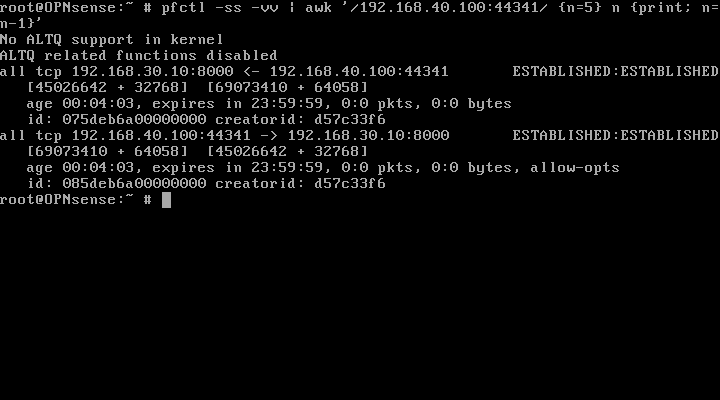
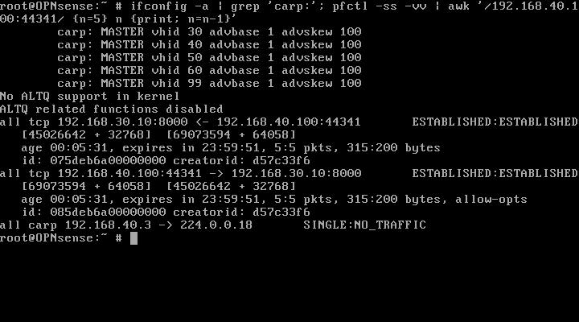
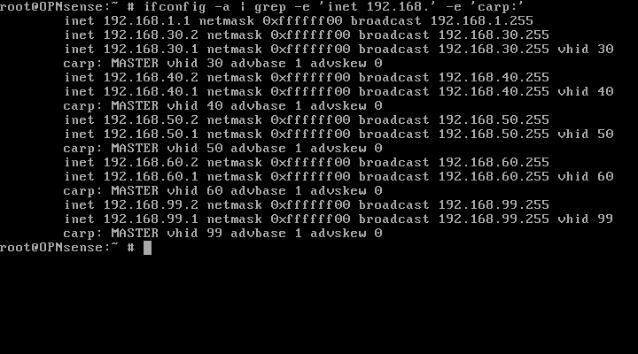

# CHƯƠNG 3. KIỂM THỬ PFSYNC STATE FAILOVER — M3.4B

## 3.4.1. Kết luận và phạm vi

**DONE/PASS**, tổng hợp lúc 2026-11-04T17:12:50.875586+07:00 (UTC+07:00). Phân biệt A. State synchronization PASS và B. Connection continuity PASS. Primary đã được boot và tự trở lại MASTER, Secondary BACKUP đủ năm VLAN, pfsync READY hai phía; Core Layer2/VLAN và endpoint hoạt động.

Phạm vi là một IPv4 TCP/HTTP session lành tính dưới policy có sẵn, không suy thành nghiệm thu mọi flow, UDP/IPv6, tải dài hạn hoặc zero packet loss. HTTP đã hoàn tất qua Secondary trước recovery; không tuyên bố session đã đóng vẫn giữ qua recovery.

## 3.4.2. Phương pháp, thuật ngữ và nhận diện session

Trong SOC (Security Operations Center — trung tâm giám sát/vận hành an toàn thông tin), tính sẵn sàng của gateway cần được kiểm chứng ở cả vai trò firewall và state của lưu lượng. CARP (Common Address Redundancy Protocol — giao thức dự phòng địa chỉ chung) điều phối MASTER/BACKUP của Virtual IP address (VIP — địa chỉ IP ảo). pfsync là tên cơ chế/giao diện đồng bộ state của Packet Filter (PF), không tự tạo dạng khai triển; hai firewall dùng SYNC10.255.255.1/30 ↔ .2/30.

TCP (Transmission Control Protocol — giao thức điều khiển truyền vận) theo dõi sequence/acknowledgement. HTTP (Hypertext Transfer Protocol — giao thức truyền siêu văn bản) được dùng trên dịch vụ DC hiện có. Một request được giữ mở ở phần header để đọc state; sau failover mới gửi dòng trống kết thúc chính request đó và nhận response. Không tạo HTTP request mới làm bằng chứng continuity.

| Thuộc tính | Giá trị thực tế |
|---|---|
| Client | Host EVE hiện có, TCP client AF_PACKET; access TAP vunl0_3_1, không thêm NIC/link hoặc gán IP vào network stack host |
| Client IP/MAC | 192.168.40.100, 02:53:4f:43:04:35; VPCS Employee không chạy, có ARP conflict probe |
| Server | VM Data-Center có sẵn,192.168.30.10:8000 |
| TCP tuple | 192.168.40.100:44341 → 192.168.30.10:8000 |
| Initial sequence numbers | Client69072772; server45026641 |
| Request | GET /?soc_m34=state-retest-b HTTP/1.0; một request trên một session |
| Gateway | Client VIP192.168.40.1, chiều về qua VIP192.168.30.1 |

Default route DC vẫn192.168.30.2; sau backup0600 chỉ thêm host route `.40.100/32 via .30.1`. Không sửa IP/default route/netplan, Core, topology, NAT/DHCP hoặc firewall rule. Rule Primary hiện có cho phép đúng nguồn .40.100 tới .30.10 TCP8000; Secondary không có rule tạo flow mới tương ứng. Client là bộ thực thi TCP qua raw socket, không báo đây là VPCS hoặc TCP socket kernel Linux.

Core là Open vSwitch (OVS — tên sản phẩm), chỉ Layer2, chuyển frame theo Virtual Local Area Network (VLAN — mạng LAN ảo) và trunk IEEE802.1Q. Gói thực tế trước/sau đều đi VLAN40↔30 và TTL64→63 tại firewall, không có đường tắt inter-VLAN trên Core.

## 3.4.3. A — State synchronization và native failover

| Pha | Native state | CARP | Minh chứng |
|---|---|---|---|
| Primary BEFORE | Hai entry ESTABLISHED, ID075deb6a00000000/085deb6a00000000, creator d57c33f6; counter có traffic | MASTER năm VLAN | primary-state-before.json; ảnh native trước |
| Secondary BEFORE | Cùng hai ID/creator, sequence window khớp; counter0:0 | BACKUP năm VLAN | secondary-state-before.json; state-sync-acceptance.json |
| Secondary ngay khi tiếp quản | Hai ID/creator không đổi, ESTABLISHED; snapshot sớm có counter0:0 | MASTER năm VLAN, VIP đúng | secondary-state-after-immediate.json; failover-acceptance.json |
| Secondary sau khi chuyển dữ liệu | Cùng ID/creator; counter đã tăng, ví dụ5:5 tại ảnh đọc native | MASTER năm VLAN | secondary-after-native-readable; wire/client logs |

Hai entry thuộc cùng TCP tuple (ingress VLAN40/egress VLAN30), không phải hai session. Creator ID và state ID được đối chiếu trực tiếp từ `pfctl -ss -vv`. pfsync protocol240 có gói hai chiều; không tuyên bố đã giải mã state ID từ payload pfsync khi chỉ thu metadata.

Watcher có hạn300 giây chỉ đọc CARP và PF; không tạo/xóa state hoặc đổi vai. Khi quan sát đủ năm MASTER, nó gọi native PF ngay và lưu snapshot atomically kèm fsync trước khi console truyền dữ liệu. Khoảng observer→read-start là 0.00002629 giây; đây không phải thời gian gián đoạn hoặc CARP convergence. Thời điểm snapshot trong guest và thời điểm collector nhận JSON là hai mốc khác nhau. Counter0 trong snapshot đầu không bị diễn giải thành state không hoạt động: marker tiếp theo và ảnh native sau đó chứng minh state được sử dụng.

## 3.4.4. B — Connection continuity

| Kiểm tra | Kết quả |
|---|---|
| Một SYN, không reconnect, ISN/tuple giữ nguyên | PASS |
| Marker ACK sau host xác nhận Primary OFF | 11 marker |
| Hoàn tất request đã mở từ BEFORE qua Secondary | HTTP/1.0 200 OK,350 byte |
| Tái lắp response từ PCAP | Khớp SHA-256 0bb359fd124e711c0a8346c78e307aa2318dafe747e861bebe9941724e0c0f80 |
| TCP RST quan sát tại client | 0 |
| Retry counter của client | 0 |
| Duplicate TCP payload tại điểm capture client | 0 |
| Mất gói toàn hệ thống | Không đo; không tuyên bố zero packet loss |

`packet-analysis.json` đối chiếu tuple/sequence/payload length, VLAN40→30, TTL64→63 và MAC forwarding: trước qua trunk Primary (`50:00:00:01:00:00`), sau Primary OFF qua trunk Secondary (`50:00:00:02:00:00`). PCAP được giữ nguyên byte, không dựng lại packet. Client PCAP có106 TCP packet records, một GET, không TCP RST; response tái lắp khớp kết quả client. Capture có phạm vi/điểm quan sát hữu hạn nên0 retry/duplicate không chứng minh0 loss.

## 3.4.5. Recovery và điểm dừng

Primary được soft shutdown rồi boot lại đúng node1; Core/Secondary/DC giữ PID, không stop/reboot. Recovery native xác nhận Primary MASTER, Secondary BACKUP trên VLAN30/40/50/60/99; VIP .1, VHID/advbase/skew và config SHA-256 giữ nguyên. Pfsync hai phía UP/RUNNING, đúng vtnet2/peer, syncok1, demotion0; SYNC ping2/2. Hook cùng boot hoạt động, không gọi lại native pfsync hoặc đặt demotion thủ công. Core OVS active, đúng access/trunk, flow NORMAL, không IP ngoài loopback và forwarding0/0; ARP năm VLAN nhận đủ .2/.3/.1.

Giữ bốn node chạy và các helper/backup/evidence; không cleanup host route runtime. Client/capture và watcher kết thúc bình thường theo vòng đời phép thử, không tái khởi động session cũ. M3.4B hoàn tất, không làm M3.5/M4/M5. Evidence M3.4 cũ137 tệp và M3.4A119 tệp được kiểm tra lại SHA-256 và giữ nguyên; kết quả cũ bị gián đoạn vẫn là lịch sử riêng.

Thời điểm thu dùng collector chuyển sang UTC+07:00. Giờ EVE/guest được ghi là untrusted; các delta watcher dùng monotonic cùng guest, không dùng thay downtime. Tệp artifacts được chép sau phép thử, mtime lúc sao chép không phải timestamp phát packet.

## 3.4.6. Ảnh minh chứng thực tế

Hình 3.1. Native state Primary trước failover.

Mục đích, nội dung, kết quả và ý nghĩa: Đọc tuple, hai ID/creator, ESTABLISHED và counter để thiết lập nguồn state.

Hình 3.2. Native state Secondary BACKUP trước failover.

Mục đích, nội dung, kết quả và ý nghĩa: Cùng ID/creator/window, counter0:0; đối chiếu JSON native và vai trò BACKUP.

Hình 3.3. Soft shutdown riêng Primary.

Mục đích, nội dung, kết quả và ý nghĩa: Xác nhận lệnh shutdown -p now; host xác nhận Primary OFF trước marker continuity.

Hình 3.4. Secondary MASTER và state cũ sau tiếp quản.

Mục đích, nội dung, kết quả và ý nghĩa: Đọc năm MASTER và ID/creator giữ nguyên, counter tăng; đối chiếu snapshot watcher sớm hơn.

Hình 3.5. Server ghi request retest trả HTTP200.

Mục đích, nội dung, kết quả và ý nghĩa: Chỉ dòng URI state-retest-b là request hiện tại; journal có boot lịch sử. Kết hợp một SYN/một GET trong PCAP để chứng minh không reconnect.

Hình 3.6. Primary MASTER sau boot mới.

Mục đích, nội dung, kết quả và ý nghĩa: Đọc năm VIP .1 và MASTER/VHID; xác nhận tự recovery.

Hình 3.7. Secondary BACKUP sau recovery.

Mục đích, nội dung, kết quả và ý nghĩa: Đọc năm VIP .1, BACKUP và skew100; không ép tham số.

Hình 3.8. Pfsync và SYNC Primary sau recovery.

Mục đích, nội dung, kết quả và ý nghĩa: Đọc syncok1/demotion0, đúng peer và ping thành công.

Hình 3.9. Pfsync và SYNC Secondary sau recovery.

Mục đích, nội dung, kết quả và ý nghĩa: Đối chiếu UP/RUNNING, syncok1/demotion0 và peer ngược.

Hình 3.10. Core vẫn Layer2 sau recovery.

Mục đích, nội dung, kết quả và ý nghĩa: OVS active, không IP ngoài loopback và forwarding0/0; port/flow/ARP xem core-recovery.json và recovery-arp.json.

## 3.4.7. Danh mục minh chứng

| Tệp | Nội dung | Thời điểm thu (múi giờ) | Đường dẫn | Vị trí dự kiến trong báo cáo |
|---|---|---|---|---|
| artifact-manifest.json | Runtime/metadata hoặc backup tài liệu; xem pha trong tên tệp | 2026-11-04T17:01:01.066604+07:00 | docs/evidence/M3/M3.4B-pfsync-state-20261104/artifact-manifest.json | M3.4B — pha tương ứng/phụ lục truy vết |
| artifacts/client-events.jsonl | Log/PCAP byte gốc sao chép sau test; thời điểm này là lúc sao chép | 2026-11-04T17:01:01.062997+07:00 | docs/evidence/M3/M3.4B-pfsync-state-20261104/artifacts/client-events.jsonl | M3.4B — pha tương ứng/phụ lục truy vết |
| artifacts/client-result.json | Log/PCAP byte gốc sao chép sau test; thời điểm này là lúc sao chép | 2026-11-04T17:01:01.062502+07:00 | docs/evidence/M3/M3.4B-pfsync-state-20261104/artifacts/client-result.json | M3.4B — pha tương ứng/phụ lục truy vết |
| artifacts/client.pcap | Log/PCAP byte gốc sao chép sau test; thời điểm này là lúc sao chép | 2026-11-04T17:01:01.064023+07:00 | docs/evidence/M3/M3.4B-pfsync-state-20261104/artifacts/client.pcap | M3.4B — pha tương ứng/phụ lục truy vết |
| artifacts/daemon.log | Log/PCAP byte gốc sao chép sau test; thời điểm này là lúc sao chép | 2026-11-04T17:01:01.065594+07:00 | docs/evidence/M3/M3.4B-pfsync-state-20261104/artifacts/daemon.log | M3.4B — pha tương ứng/phụ lục truy vết |
| artifacts/vunl0_3_5-flow.pcap | Log/PCAP byte gốc sao chép sau test; thời điểm này là lúc sao chép | 2026-11-04T17:01:01.065094+07:00 | docs/evidence/M3/M3.4B-pfsync-state-20261104/artifacts/vunl0_3_5-flow.pcap | M3.4B — pha tương ứng/phụ lục truy vết |
| artifacts/vunl0_3_6-flow.pcap | Log/PCAP byte gốc sao chép sau test; thời điểm này là lúc sao chép | 2026-11-04T17:01:01.065594+07:00 | docs/evidence/M3/M3.4B-pfsync-state-20261104/artifacts/vunl0_3_6-flow.pcap | M3.4B — pha tương ứng/phụ lục truy vết |
| artifacts/wire-daemon.log | Log/PCAP byte gốc sao chép sau test; thời điểm này là lúc sao chép | 2026-11-04T17:01:01.065594+07:00 | docs/evidence/M3/M3.4B-pfsync-state-20261104/artifacts/wire-daemon.log | M3.4B — pha tương ứng/phụ lục truy vết |
| artifacts/wire-result.json | Log/PCAP byte gốc sao chép sau test; thời điểm này là lúc sao chép | 2026-11-04T17:01:01.064023+07:00 | docs/evidence/M3/M3.4B-pfsync-state-20261104/artifacts/wire-result.json | M3.4B — pha tương ứng/phụ lục truy vết |
| artifacts/wire.jsonl | Log/PCAP byte gốc sao chép sau test; thời điểm này là lúc sao chép | 2026-11-04T17:01:01.064599+07:00 | docs/evidence/M3/M3.4B-pfsync-state-20261104/artifacts/wire.jsonl | M3.4B — pha tương ứng/phụ lục truy vết |
| before-acceptance.json | Runtime/metadata hoặc backup tài liệu; xem pha trong tên tệp | 2026-11-04T16:47:12.412988+07:00 | docs/evidence/M3/M3.4B-pfsync-state-20261104/before-acceptance.json | M3.4B — pha tương ứng/phụ lục truy vết |
| client-after-off.json | Runtime/metadata hoặc backup tài liệu; xem pha trong tên tệp | 2026-11-04T16:58:13.255169+07:00 | docs/evidence/M3/M3.4B-pfsync-state-20261104/client-after-off.json | M3.4B — pha tương ứng/phụ lục truy vết |
| client-complete-original-request.json | Runtime/metadata hoặc backup tài liệu; xem pha trong tên tệp | 2026-11-04T16:59:28.933140+07:00 | docs/evidence/M3/M3.4B-pfsync-state-20261104/client-complete-original-request.json | M3.4B — pha tương ứng/phụ lục truy vết |
| client-completed-request.json | Runtime/metadata hoặc backup tài liệu; xem pha trong tên tệp | 2026-11-04T16:59:50.890818+07:00 | docs/evidence/M3/M3.4B-pfsync-state-20261104/client-completed-request.json | M3.4B — pha tương ứng/phụ lục truy vết |
| client-failover-start.json | Runtime/metadata hoặc backup tài liệu; xem pha trong tên tệp | 2026-11-04T16:55:54.215088+07:00 | docs/evidence/M3/M3.4B-pfsync-state-20261104/client-failover-start.json | M3.4B — pha tương ứng/phụ lục truy vết |
| client-handshake.json | Runtime/metadata hoặc backup tài liệu; xem pha trong tên tệp | 2026-11-04T16:51:53.932868+07:00 | docs/evidence/M3/M3.4B-pfsync-state-20261104/client-handshake.json | M3.4B — pha tương ứng/phụ lục truy vết |
| client-pre-cutover.json | Runtime/metadata hoặc backup tài liệu; xem pha trong tên tệp | 2026-11-04T16:55:12.141658+07:00 | docs/evidence/M3/M3.4B-pfsync-state-20261104/client-pre-cutover.json | M3.4B — pha tương ứng/phụ lục truy vết |
| client-primary-off.json | Runtime/metadata hoặc backup tài liệu; xem pha trong tên tệp | 2026-11-04T16:57:32.092921+07:00 | docs/evidence/M3/M3.4B-pfsync-state-20261104/client-primary-off.json | M3.4B — pha tương ứng/phụ lục truy vết |
| client-secondary-master.json | Runtime/metadata hoặc backup tài liệu; xem pha trong tên tệp | 2026-11-04T16:59:27.370558+07:00 | docs/evidence/M3/M3.4B-pfsync-state-20261104/client-secondary-master.json | M3.4B — pha tương ứng/phụ lục truy vết |
| client-start.json | Runtime/metadata hoặc backup tài liệu; xem pha trong tên tệp | 2026-11-04T16:51:42.612903+07:00 | docs/evidence/M3/M3.4B-pfsync-state-20261104/client-start.json | M3.4B — pha tương ứng/phụ lục truy vết |
| continuity-acceptance.json | Runtime/metadata hoặc backup tài liệu; xem pha trong tên tệp | 2026-11-04T17:01:01.132846+07:00 | docs/evidence/M3/M3.4B-pfsync-state-20261104/continuity-acceptance.json | M3.4B — pha tương ứng/phụ lục truy vết |
| core-before-20261104T164421+0700.json | Runtime/metadata hoặc backup tài liệu; xem pha trong tên tệp | 2026-11-04T16:44:32.233483+07:00 | docs/evidence/M3/M3.4B-pfsync-state-20261104/core-before-20261104T164421+0700.json | M3.4B — pha tương ứng/phụ lục truy vết |
| core-before-20261104T164421+0700.png | Ảnh console thực tế, nguyên nội dung | 2026-11-04T16:44:32.234483+07:00 | docs/evidence/M3/M3.4B-pfsync-state-20261104/core-before-20261104T164421+0700.png | M3.4B — pha tương ứng/phụ lục truy vết |
| core-recovery-execute-20261104T170534+0700.json | Runtime/metadata hoặc backup tài liệu; xem pha trong tên tệp | 2026-11-04T17:06:15.357127+07:00 | docs/evidence/M3/M3.4B-pfsync-state-20261104/core-recovery-execute-20261104T170534+0700.json | M3.4B — pha tương ứng/phụ lục truy vết |
| core-recovery-execute-20261104T170534+0700.png | Ảnh console thực tế, nguyên nội dung | 2026-11-04T17:06:15.359505+07:00 | docs/evidence/M3/M3.4B-pfsync-state-20261104/core-recovery-execute-20261104T170534+0700.png | M3.4B — pha tương ứng/phụ lục truy vết |
| core-recovery-header-20261104T170615+0700.json | Runtime/metadata hoặc backup tài liệu; xem pha trong tên tệp | 2026-11-04T17:06:40.893020+07:00 | docs/evidence/M3/M3.4B-pfsync-state-20261104/core-recovery-header-20261104T170615+0700.json | M3.4B — pha tương ứng/phụ lục truy vết |
| core-recovery-header-20261104T170615+0700.png | Ảnh console thực tế, nguyên nội dung | 2026-11-04T17:06:40.894472+07:00 | docs/evidence/M3/M3.4B-pfsync-state-20261104/core-recovery-header-20261104T170615+0700.png | M3.4B — pha tương ứng/phụ lục truy vết |
| core-recovery-page-0-20261104T170641+0700.json | Runtime/metadata hoặc backup tài liệu; xem pha trong tên tệp | 2026-11-04T17:07:04.879524+07:00 | docs/evidence/M3/M3.4B-pfsync-state-20261104/core-recovery-page-0-20261104T170641+0700.json | M3.4B — pha tương ứng/phụ lục truy vết |
| core-recovery-page-0-20261104T170641+0700.png | Ảnh console thực tế, nguyên nội dung | 2026-11-04T17:07:04.880539+07:00 | docs/evidence/M3/M3.4B-pfsync-state-20261104/core-recovery-page-0-20261104T170641+0700.png | M3.4B — pha tương ứng/phụ lục truy vết |
| core-recovery-readable-20261104T170924+0700.json | Runtime/metadata hoặc backup tài liệu; xem pha trong tên tệp | 2026-11-04T17:09:35.120580+07:00 | docs/evidence/M3/M3.4B-pfsync-state-20261104/core-recovery-readable-20261104T170924+0700.json | M3.4B — pha tương ứng/phụ lục truy vết |
| core-recovery-readable-20261104T170924+0700.png | Ảnh console thực tế, nguyên nội dung | 2026-11-04T17:09:35.122603+07:00 | docs/evidence/M3/M3.4B-pfsync-state-20261104/core-recovery-readable-20261104T170924+0700.png | M3.4B — pha tương ứng/phụ lục truy vết |
| core-recovery.json | Runtime/metadata hoặc backup tài liệu; xem pha trong tên tệp | 2026-11-04T17:07:05.004448+07:00 | docs/evidence/M3/M3.4B-pfsync-state-20261104/core-recovery.json | M3.4B — pha tương ứng/phụ lục truy vết |
| dc-before-20261104T164644+0700.json | Runtime/metadata hoặc backup tài liệu; xem pha trong tên tệp | 2026-11-04T16:46:55.449556+07:00 | docs/evidence/M3/M3.4B-pfsync-state-20261104/dc-before-20261104T164644+0700.json | M3.4B — pha tương ứng/phụ lục truy vết |
| dc-before-20261104T164644+0700.png | Ảnh console thực tế, nguyên nội dung | 2026-11-04T16:46:55.451778+07:00 | docs/evidence/M3/M3.4B-pfsync-state-20261104/dc-before-20261104T164644+0700.png | M3.4B — pha tương ứng/phụ lục truy vết |
| dc-http-success-journal-20261104T170836+0700.json | Runtime/metadata hoặc backup tài liệu; xem pha trong tên tệp | 2026-11-04T17:08:44.477670+07:00 | docs/evidence/M3/M3.4B-pfsync-state-20261104/dc-http-success-journal-20261104T170836+0700.json | M3.4B — pha tương ứng/phụ lục truy vết |
| dc-http-success-journal-20261104T170836+0700.png | Ảnh console thực tế, nguyên nội dung | 2026-11-04T17:08:44.478679+07:00 | docs/evidence/M3/M3.4B-pfsync-state-20261104/dc-http-success-journal-20261104T170836+0700.png | M3.4B — pha tương ứng/phụ lục truy vết |
| endpoint-recovery-execute-20261104T170534+0700.json | Runtime/metadata hoặc backup tài liệu; xem pha trong tên tệp | 2026-11-04T17:06:20.813861+07:00 | docs/evidence/M3/M3.4B-pfsync-state-20261104/endpoint-recovery-execute-20261104T170534+0700.json | M3.4B — pha tương ứng/phụ lục truy vết |
| endpoint-recovery-execute-20261104T170534+0700.png | Ảnh console thực tế, nguyên nội dung | 2026-11-04T17:06:20.815238+07:00 | docs/evidence/M3/M3.4B-pfsync-state-20261104/endpoint-recovery-execute-20261104T170534+0700.png | M3.4B — pha tương ứng/phụ lục truy vết |
| endpoint-recovery-header-20261104T170621+0700.json | Runtime/metadata hoặc backup tài liệu; xem pha trong tên tệp | 2026-11-04T17:06:45.566143+07:00 | docs/evidence/M3/M3.4B-pfsync-state-20261104/endpoint-recovery-header-20261104T170621+0700.json | M3.4B — pha tương ứng/phụ lục truy vết |
| endpoint-recovery-header-20261104T170621+0700.png | Ảnh console thực tế, nguyên nội dung | 2026-11-04T17:06:45.567377+07:00 | docs/evidence/M3/M3.4B-pfsync-state-20261104/endpoint-recovery-header-20261104T170621+0700.png | M3.4B — pha tương ứng/phụ lục truy vết |
| endpoint-recovery-page-0-20261104T170645+0700.json | Runtime/metadata hoặc backup tài liệu; xem pha trong tên tệp | 2026-11-04T17:07:09.089765+07:00 | docs/evidence/M3/M3.4B-pfsync-state-20261104/endpoint-recovery-page-0-20261104T170645+0700.json | M3.4B — pha tương ứng/phụ lục truy vết |
| endpoint-recovery-page-0-20261104T170645+0700.png | Ảnh console thực tế, nguyên nội dung | 2026-11-04T17:07:09.090775+07:00 | docs/evidence/M3/M3.4B-pfsync-state-20261104/endpoint-recovery-page-0-20261104T170645+0700.png | M3.4B — pha tương ứng/phụ lục truy vết |
| endpoint-recovery.json | Runtime/metadata hoặc backup tài liệu; xem pha trong tên tệp | 2026-11-04T17:07:09.197624+07:00 | docs/evidence/M3/M3.4B-pfsync-state-20261104/endpoint-recovery.json | M3.4B — pha tương ứng/phụ lục truy vết |
| endpoint-test-route-execute-20261104T164913+0700.json | Runtime/metadata hoặc backup tài liệu; xem pha trong tên tệp | 2026-11-04T16:50:07.988749+07:00 | docs/evidence/M3/M3.4B-pfsync-state-20261104/endpoint-test-route-execute-20261104T164913+0700.json | M3.4B — pha tương ứng/phụ lục truy vết |
| endpoint-test-route-execute-20261104T164913+0700.png | Ảnh console thực tế, nguyên nội dung | 2026-11-04T16:50:07.990921+07:00 | docs/evidence/M3/M3.4B-pfsync-state-20261104/endpoint-test-route-execute-20261104T164913+0700.png | M3.4B — pha tương ứng/phụ lục truy vết |
| endpoint-test-route-header-20261104T165008+0700.json | Runtime/metadata hoặc backup tài liệu; xem pha trong tên tệp | 2026-11-04T16:50:36.421887+07:00 | docs/evidence/M3/M3.4B-pfsync-state-20261104/endpoint-test-route-header-20261104T165008+0700.json | M3.4B — pha tương ứng/phụ lục truy vết |
| endpoint-test-route-header-20261104T165008+0700.png | Ảnh console thực tế, nguyên nội dung | 2026-11-04T16:50:36.423537+07:00 | docs/evidence/M3/M3.4B-pfsync-state-20261104/endpoint-test-route-header-20261104T165008+0700.png | M3.4B — pha tương ứng/phụ lục truy vết |
| endpoint-test-route-page-0-20261104T165036+0700.json | Runtime/metadata hoặc backup tài liệu; xem pha trong tên tệp | 2026-11-04T16:50:59.918703+07:00 | docs/evidence/M3/M3.4B-pfsync-state-20261104/endpoint-test-route-page-0-20261104T165036+0700.json | M3.4B — pha tương ứng/phụ lục truy vết |
| endpoint-test-route-page-0-20261104T165036+0700.png | Ảnh console thực tế, nguyên nội dung | 2026-11-04T16:50:59.919713+07:00 | docs/evidence/M3/M3.4B-pfsync-state-20261104/endpoint-test-route-page-0-20261104T165036+0700.png | M3.4B — pha tương ứng/phụ lục truy vết |
| endpoint-test-route.json | Runtime/metadata hoặc backup tài liệu; xem pha trong tên tệp | 2026-11-04T16:51:00.026697+07:00 | docs/evidence/M3/M3.4B-pfsync-state-20261104/endpoint-test-route.json | M3.4B — pha tương ứng/phụ lục truy vết |
| failover-acceptance.json | Runtime/metadata hoặc backup tài liệu; xem pha trong tên tệp | 2026-11-04T16:59:24.133954+07:00 | docs/evidence/M3/M3.4B-pfsync-state-20261104/failover-acceptance.json | M3.4B — pha tương ứng/phụ lục truy vết |
| failover-confirmed-arp.json | Runtime/metadata hoặc backup tài liệu; xem pha trong tên tệp | 2026-11-04T16:58:16.734145+07:00 | docs/evidence/M3/M3.4B-pfsync-state-20261104/failover-confirmed-arp.json | M3.4B — pha tương ứng/phụ lục truy vết |
| failover-confirmed-carp.json | Runtime/metadata hoặc backup tài liệu; xem pha trong tên tệp | 2026-11-04T16:58:16.965995+07:00 | docs/evidence/M3/M3.4B-pfsync-state-20261104/failover-confirmed-carp.json | M3.4B — pha tương ứng/phụ lục truy vết |
| failover-off-host.json | Runtime/metadata hoặc backup tài liệu; xem pha trong tên tệp | 2026-11-04T16:57:10.545161+07:00 | docs/evidence/M3/M3.4B-pfsync-state-20261104/failover-off-host.json | M3.4B — pha tương ứng/phụ lục truy vết |
| host-before.json | Runtime/metadata hoặc backup tài liệu; xem pha trong tên tệp | 2026-11-04T16:43:42.258457+07:00 | docs/evidence/M3/M3.4B-pfsync-state-20261104/host-before.json | M3.4B — pha tương ứng/phụ lục truy vết |
| initial-shell-0-20261104T164343+0700.json | Runtime/metadata hoặc backup tài liệu; xem pha trong tên tệp | 2026-11-04T16:43:45.946042+07:00 | docs/evidence/M3/M3.4B-pfsync-state-20261104/initial-shell-0-20261104T164343+0700.json | M3.4B — pha tương ứng/phụ lục truy vết |
| initial-shell-0-20261104T164343+0700.png | Ảnh console thực tế, nguyên nội dung | 2026-11-04T16:43:45.948238+07:00 | docs/evidence/M3/M3.4B-pfsync-state-20261104/initial-shell-0-20261104T164343+0700.png | M3.4B — pha tương ứng/phụ lục truy vết |
| initial-shell-1-20261104T164343+0700.json | Runtime/metadata hoặc backup tài liệu; xem pha trong tên tệp | 2026-11-04T16:43:45.905708+07:00 | docs/evidence/M3/M3.4B-pfsync-state-20261104/initial-shell-1-20261104T164343+0700.json | M3.4B — pha tương ứng/phụ lục truy vết |
| initial-shell-1-20261104T164343+0700.png | Ảnh console thực tế, nguyên nội dung | 2026-11-04T16:43:45.907487+07:00 | docs/evidence/M3/M3.4B-pfsync-state-20261104/initial-shell-1-20261104T164343+0700.png | M3.4B — pha tương ứng/phụ lục truy vết |
| initial-shell-2-20261104T164343+0700.json | Runtime/metadata hoặc backup tài liệu; xem pha trong tên tệp | 2026-11-04T16:43:45.819209+07:00 | docs/evidence/M3/M3.4B-pfsync-state-20261104/initial-shell-2-20261104T164343+0700.json | M3.4B — pha tương ứng/phụ lục truy vết |
| initial-shell-2-20261104T164343+0700.png | Ảnh console thực tế, nguyên nội dung | 2026-11-04T16:43:45.822858+07:00 | docs/evidence/M3/M3.4B-pfsync-state-20261104/initial-shell-2-20261104T164343+0700.png | M3.4B — pha tương ứng/phụ lục truy vết |
| initial-shell-3-20261104T164343+0700.json | Runtime/metadata hoặc backup tài liệu; xem pha trong tên tệp | 2026-11-04T16:43:45.874902+07:00 | docs/evidence/M3/M3.4B-pfsync-state-20261104/initial-shell-3-20261104T164343+0700.json | M3.4B — pha tương ứng/phụ lục truy vết |
| initial-shell-3-20261104T164343+0700.png | Ảnh console thực tế, nguyên nội dung | 2026-11-04T16:43:45.876448+07:00 | docs/evidence/M3/M3.4B-pfsync-state-20261104/initial-shell-3-20261104T164343+0700.png | M3.4B — pha tương ứng/phụ lục truy vết |
| M3.4-acceptance.json | Runtime/metadata hoặc backup tài liệu; xem pha trong tên tệp | 2026-11-04T17:12:50.875586+07:00 | docs/evidence/M3/M3.4B-pfsync-state-20261104/M3.4-acceptance.json | M3.4B — pha tương ứng/phụ lục truy vết |
| packet-analysis.json | Runtime/metadata hoặc backup tài liệu; xem pha trong tên tệp | 2026-11-04T17:03:51.391374+07:00 | docs/evidence/M3/M3.4B-pfsync-state-20261104/packet-analysis.json | M3.4B — pha tương ứng/phụ lục truy vết |
| pfsync-during-state-creation.json | Runtime/metadata hoặc backup tài liệu; xem pha trong tên tệp | 2026-11-04T16:52:08.031706+07:00 | docs/evidence/M3/M3.4B-pfsync-state-20261104/pfsync-during-state-creation.json | M3.4B — pha tương ứng/phụ lục truy vết |
| previous-evidence-integrity.json | Runtime/metadata hoặc backup tài liệu; xem pha trong tên tệp | 2026-11-04T17:12:50.875586+07:00 | docs/evidence/M3/M3.4B-pfsync-state-20261104/previous-evidence-integrity.json | M3.4B — pha tương ứng/phụ lục truy vết |
| primary-before-execute-20261104T164411+0700.json | Runtime/metadata hoặc backup tài liệu; xem pha trong tên tệp | 2026-11-04T16:45:30.567273+07:00 | docs/evidence/M3/M3.4B-pfsync-state-20261104/primary-before-execute-20261104T164411+0700.json | M3.4B — pha tương ứng/phụ lục truy vết |
| primary-before-execute-20261104T164411+0700.png | Ảnh console thực tế, nguyên nội dung | 2026-11-04T16:45:30.569183+07:00 | docs/evidence/M3/M3.4B-pfsync-state-20261104/primary-before-execute-20261104T164411+0700.png | M3.4B — pha tương ứng/phụ lục truy vết |
| primary-before-header-20261104T164530+0700.json | Runtime/metadata hoặc backup tài liệu; xem pha trong tên tệp | 2026-11-04T16:45:56.920756+07:00 | docs/evidence/M3/M3.4B-pfsync-state-20261104/primary-before-header-20261104T164530+0700.json | M3.4B — pha tương ứng/phụ lục truy vết |
| primary-before-header-20261104T164530+0700.png | Ảnh console thực tế, nguyên nội dung | 2026-11-04T16:45:56.923361+07:00 | docs/evidence/M3/M3.4B-pfsync-state-20261104/primary-before-header-20261104T164530+0700.png | M3.4B — pha tương ứng/phụ lục truy vết |
| primary-before-page-0-20261104T164557+0700.json | Runtime/metadata hoặc backup tài liệu; xem pha trong tên tệp | 2026-11-04T16:46:19.702572+07:00 | docs/evidence/M3/M3.4B-pfsync-state-20261104/primary-before-page-0-20261104T164557+0700.json | M3.4B — pha tương ứng/phụ lục truy vết |
| primary-before-page-0-20261104T164557+0700.png | Ảnh console thực tế, nguyên nội dung | 2026-11-04T16:46:19.705173+07:00 | docs/evidence/M3/M3.4B-pfsync-state-20261104/primary-before-page-0-20261104T164557+0700.png | M3.4B — pha tương ứng/phụ lục truy vết |
| primary-before-page-1440-20261104T164619+0700.json | Runtime/metadata hoặc backup tài liệu; xem pha trong tên tệp | 2026-11-04T16:46:42.516460+07:00 | docs/evidence/M3/M3.4B-pfsync-state-20261104/primary-before-page-1440-20261104T164619+0700.json | M3.4B — pha tương ứng/phụ lục truy vết |
| primary-before-page-1440-20261104T164619+0700.png | Ảnh console thực tế, nguyên nội dung | 2026-11-04T16:46:42.516973+07:00 | docs/evidence/M3/M3.4B-pfsync-state-20261104/primary-before-page-1440-20261104T164619+0700.png | M3.4B — pha tương ứng/phụ lục truy vết |
| primary-before.json | Runtime/metadata hoặc backup tài liệu; xem pha trong tên tệp | 2026-11-04T16:46:42.572627+07:00 | docs/evidence/M3/M3.4B-pfsync-state-20261104/primary-before.json | M3.4B — pha tương ứng/phụ lục truy vết |
| primary-native-stage-execute-20261104T164811+0700.json | Runtime/metadata hoặc backup tài liệu; xem pha trong tên tệp | 2026-11-04T16:50:12.609443+07:00 | docs/evidence/M3/M3.4B-pfsync-state-20261104/primary-native-stage-execute-20261104T164811+0700.json | M3.4B — pha tương ứng/phụ lục truy vết |
| primary-native-stage-execute-20261104T164811+0700.png | Ảnh console thực tế, nguyên nội dung | 2026-11-04T16:50:12.610448+07:00 | docs/evidence/M3/M3.4B-pfsync-state-20261104/primary-native-stage-execute-20261104T164811+0700.png | M3.4B — pha tương ứng/phụ lục truy vết |
| primary-native-stage-header-20261104T165012+0700.json | Runtime/metadata hoặc backup tài liệu; xem pha trong tên tệp | 2026-11-04T16:50:37.785371+07:00 | docs/evidence/M3/M3.4B-pfsync-state-20261104/primary-native-stage-header-20261104T165012+0700.json | M3.4B — pha tương ứng/phụ lục truy vết |
| primary-native-stage-header-20261104T165012+0700.png | Ảnh console thực tế, nguyên nội dung | 2026-11-04T16:50:37.785973+07:00 | docs/evidence/M3/M3.4B-pfsync-state-20261104/primary-native-stage-header-20261104T165012+0700.png | M3.4B — pha tương ứng/phụ lục truy vết |
| primary-native-stage-page-0-20261104T165038+0700.json | Runtime/metadata hoặc backup tài liệu; xem pha trong tên tệp | 2026-11-04T16:51:00.755061+07:00 | docs/evidence/M3/M3.4B-pfsync-state-20261104/primary-native-stage-page-0-20261104T165038+0700.json | M3.4B — pha tương ứng/phụ lục truy vết |
| primary-native-stage-page-0-20261104T165038+0700.png | Ảnh console thực tế, nguyên nội dung | 2026-11-04T16:51:00.755598+07:00 | docs/evidence/M3/M3.4B-pfsync-state-20261104/primary-native-stage-page-0-20261104T165038+0700.png | M3.4B — pha tương ứng/phụ lục truy vết |
| primary-native-stage.json | Runtime/metadata hoặc backup tài liệu; xem pha trong tên tệp | 2026-11-04T16:51:00.805913+07:00 | docs/evidence/M3/M3.4B-pfsync-state-20261104/primary-native-stage.json | M3.4B — pha tương ứng/phụ lục truy vết |
| primary-recovery-carp-readable-20261104T170827+0700.json | Runtime/metadata hoặc backup tài liệu; xem pha trong tên tệp | 2026-11-04T17:08:35.771764+07:00 | docs/evidence/M3/M3.4B-pfsync-state-20261104/primary-recovery-carp-readable-20261104T170827+0700.json | M3.4B — pha tương ứng/phụ lục truy vết |
| primary-recovery-carp-readable-20261104T170827+0700.png | Ảnh console thực tế, nguyên nội dung | 2026-11-04T17:08:35.773690+07:00 | docs/evidence/M3/M3.4B-pfsync-state-20261104/primary-recovery-carp-readable-20261104T170827+0700.png | M3.4B — pha tương ứng/phụ lục truy vết |
| primary-recovery-execute-20261104T170534+0700.json | Runtime/metadata hoặc backup tài liệu; xem pha trong tên tệp | 2026-11-04T17:06:54.776969+07:00 | docs/evidence/M3/M3.4B-pfsync-state-20261104/primary-recovery-execute-20261104T170534+0700.json | M3.4B — pha tương ứng/phụ lục truy vết |
| primary-recovery-execute-20261104T170534+0700.png | Ảnh console thực tế, nguyên nội dung | 2026-11-04T17:06:54.779565+07:00 | docs/evidence/M3/M3.4B-pfsync-state-20261104/primary-recovery-execute-20261104T170534+0700.png | M3.4B — pha tương ứng/phụ lục truy vết |
| primary-recovery-header-20261104T170655+0700.json | Runtime/metadata hoặc backup tài liệu; xem pha trong tên tệp | 2026-11-04T17:07:19.325466+07:00 | docs/evidence/M3/M3.4B-pfsync-state-20261104/primary-recovery-header-20261104T170655+0700.json | M3.4B — pha tương ứng/phụ lục truy vết |
| primary-recovery-header-20261104T170655+0700.png | Ảnh console thực tế, nguyên nội dung | 2026-11-04T17:07:19.326466+07:00 | docs/evidence/M3/M3.4B-pfsync-state-20261104/primary-recovery-header-20261104T170655+0700.png | M3.4B — pha tương ứng/phụ lục truy vết |
| primary-recovery-page-0-20261104T170719+0700.json | Runtime/metadata hoặc backup tài liệu; xem pha trong tên tệp | 2026-11-04T17:07:42.943990+07:00 | docs/evidence/M3/M3.4B-pfsync-state-20261104/primary-recovery-page-0-20261104T170719+0700.json | M3.4B — pha tương ứng/phụ lục truy vết |
| primary-recovery-page-0-20261104T170719+0700.png | Ảnh console thực tế, nguyên nội dung | 2026-11-04T17:07:42.945498+07:00 | docs/evidence/M3/M3.4B-pfsync-state-20261104/primary-recovery-page-0-20261104T170719+0700.png | M3.4B — pha tương ứng/phụ lục truy vết |
| primary-recovery-page-1440-20261104T170743+0700.json | Runtime/metadata hoặc backup tài liệu; xem pha trong tên tệp | 2026-11-04T17:08:07.585257+07:00 | docs/evidence/M3/M3.4B-pfsync-state-20261104/primary-recovery-page-1440-20261104T170743+0700.json | M3.4B — pha tương ứng/phụ lục truy vết |
| primary-recovery-page-1440-20261104T170743+0700.png | Ảnh console thực tế, nguyên nội dung | 2026-11-04T17:08:07.585764+07:00 | docs/evidence/M3/M3.4B-pfsync-state-20261104/primary-recovery-page-1440-20261104T170743+0700.png | M3.4B — pha tương ứng/phụ lục truy vết |
| primary-recovery-pfsync-readable-20261104T170914+0700.json | Runtime/metadata hoặc backup tài liệu; xem pha trong tên tệp | 2026-11-04T17:09:24.155339+07:00 | docs/evidence/M3/M3.4B-pfsync-state-20261104/primary-recovery-pfsync-readable-20261104T170914+0700.json | M3.4B — pha tương ứng/phụ lục truy vết |
| primary-recovery-pfsync-readable-20261104T170914+0700.png | Ảnh console thực tế, nguyên nội dung | 2026-11-04T17:09:24.156340+07:00 | docs/evidence/M3/M3.4B-pfsync-state-20261104/primary-recovery-pfsync-readable-20261104T170914+0700.png | M3.4B — pha tương ứng/phụ lục truy vết |
| primary-recovery.json | Runtime/metadata hoặc backup tài liệu; xem pha trong tên tệp | 2026-11-04T17:08:07.650232+07:00 | docs/evidence/M3/M3.4B-pfsync-state-20261104/primary-recovery.json | M3.4B — pha tương ứng/phụ lục truy vết |
| primary-soft-shutdown-20261104T165555+0700.json | Runtime/metadata hoặc backup tài liệu; xem pha trong tên tệp | 2026-11-04T16:56:01.545337+07:00 | docs/evidence/M3/M3.4B-pfsync-state-20261104/primary-soft-shutdown-20261104T165555+0700.json | M3.4B — pha tương ứng/phụ lục truy vết |
| primary-soft-shutdown-20261104T165555+0700.png | Ảnh console thực tế, nguyên nội dung | 2026-11-04T16:56:01.548321+07:00 | docs/evidence/M3/M3.4B-pfsync-state-20261104/primary-soft-shutdown-20261104T165555+0700.png | M3.4B — pha tương ứng/phụ lục truy vết |
| primary-state-before-execute-20261104T165154+0700.json | Runtime/metadata hoặc backup tài liệu; xem pha trong tên tệp | 2026-11-04T16:52:19.668277+07:00 | docs/evidence/M3/M3.4B-pfsync-state-20261104/primary-state-before-execute-20261104T165154+0700.json | M3.4B — pha tương ứng/phụ lục truy vết |
| primary-state-before-execute-20261104T165154+0700.png | Ảnh console thực tế, nguyên nội dung | 2026-11-04T16:52:19.669284+07:00 | docs/evidence/M3/M3.4B-pfsync-state-20261104/primary-state-before-execute-20261104T165154+0700.png | M3.4B — pha tương ứng/phụ lục truy vết |
| primary-state-before-header-20261104T165219+0700.json | Runtime/metadata hoặc backup tài liệu; xem pha trong tên tệp | 2026-11-04T16:52:44.144872+07:00 | docs/evidence/M3/M3.4B-pfsync-state-20261104/primary-state-before-header-20261104T165219+0700.json | M3.4B — pha tương ứng/phụ lục truy vết |
| primary-state-before-header-20261104T165219+0700.png | Ảnh console thực tế, nguyên nội dung | 2026-11-04T16:52:44.147871+07:00 | docs/evidence/M3/M3.4B-pfsync-state-20261104/primary-state-before-header-20261104T165219+0700.png | M3.4B — pha tương ứng/phụ lục truy vết |
| primary-state-before-page-0-20261104T165244+0700.json | Runtime/metadata hoặc backup tài liệu; xem pha trong tên tệp | 2026-11-04T16:53:08.675533+07:00 | docs/evidence/M3/M3.4B-pfsync-state-20261104/primary-state-before-page-0-20261104T165244+0700.json | M3.4B — pha tương ứng/phụ lục truy vết |
| primary-state-before-page-0-20261104T165244+0700.png | Ảnh console thực tế, nguyên nội dung | 2026-11-04T16:53:08.676543+07:00 | docs/evidence/M3/M3.4B-pfsync-state-20261104/primary-state-before-page-0-20261104T165244+0700.png | M3.4B — pha tương ứng/phụ lục truy vết |
| primary-state-before-readable-20261104T165356+0700.json | Runtime/metadata hoặc backup tài liệu; xem pha trong tên tệp | 2026-11-04T16:54:06.185159+07:00 | docs/evidence/M3/M3.4B-pfsync-state-20261104/primary-state-before-readable-20261104T165356+0700.json | M3.4B — pha tương ứng/phụ lục truy vết |
| primary-state-before-readable-20261104T165356+0700.png | Ảnh console thực tế, nguyên nội dung | 2026-11-04T16:54:06.187839+07:00 | docs/evidence/M3/M3.4B-pfsync-state-20261104/primary-state-before-readable-20261104T165356+0700.png | M3.4B — pha tương ứng/phụ lục truy vết |
| primary-state-before.json | Runtime/metadata hoặc backup tài liệu; xem pha trong tên tệp | 2026-11-04T16:53:08.768923+07:00 | docs/evidence/M3/M3.4B-pfsync-state-20261104/primary-state-before.json | M3.4B — pha tương ứng/phụ lục truy vết |
| PROGRESS.md.before | Runtime/metadata hoặc backup tài liệu; xem pha trong tên tệp | 2026-11-04T16:39:50.154395+07:00 | docs/evidence/M3/M3.4B-pfsync-state-20261104/PROGRESS.md.before | M3.4B — pha tương ứng/phụ lục truy vết |
| recovery-acceptance.json | Runtime/metadata hoặc backup tài liệu; xem pha trong tên tệp | 2026-11-04T17:08:27.138168+07:00 | docs/evidence/M3/M3.4B-pfsync-state-20261104/recovery-acceptance.json | M3.4B — pha tương ứng/phụ lục truy vết |
| recovery-arp.json | Runtime/metadata hoặc backup tài liệu; xem pha trong tên tệp | 2026-11-04T17:06:51.891803+07:00 | docs/evidence/M3/M3.4B-pfsync-state-20261104/recovery-arp.json | M3.4B — pha tương ứng/phụ lục truy vết |
| recovery-boot-1-20261104T170311+0700.json | Runtime/metadata hoặc backup tài liệu; xem pha trong tên tệp | 2026-11-04T17:03:15.362626+07:00 | docs/evidence/M3/M3.4B-pfsync-state-20261104/recovery-boot-1-20261104T170311+0700.json | M3.4B — pha tương ứng/phụ lục truy vết |
| recovery-boot-1-20261104T170311+0700.png | Ảnh console thực tế, nguyên nội dung | 2026-11-04T17:03:15.366808+07:00 | docs/evidence/M3/M3.4B-pfsync-state-20261104/recovery-boot-1-20261104T170311+0700.png | M3.4B — pha tương ứng/phụ lục truy vết |
| recovery-booting-host.json | Runtime/metadata hoặc backup tài liệu; xem pha trong tên tệp | 2026-11-04T17:03:19.111093+07:00 | docs/evidence/M3/M3.4B-pfsync-state-20261104/recovery-booting-host.json | M3.4B — pha tương ứng/phụ lục truy vết |
| recovery-carp.json | Runtime/metadata hoặc backup tài liệu; xem pha trong tên tệp | 2026-11-04T17:06:51.326626+07:00 | docs/evidence/M3/M3.4B-pfsync-state-20261104/recovery-carp.json | M3.4B — pha tương ứng/phụ lục truy vết |
| recovery-host.json | Runtime/metadata hoặc backup tài liệu; xem pha trong tên tệp | 2026-11-04T17:06:33.116602+07:00 | docs/evidence/M3/M3.4B-pfsync-state-20261104/recovery-host.json | M3.4B — pha tương ứng/phụ lục truy vết |
| recovery-pfsync.json | Runtime/metadata hoặc backup tài liệu; xem pha trong tên tệp | 2026-11-04T17:07:06.736697+07:00 | docs/evidence/M3/M3.4B-pfsync-state-20261104/recovery-pfsync.json | M3.4B — pha tương ứng/phụ lục truy vết |
| recovery-primary-shell-20261104T170515+0700.json | Runtime/metadata hoặc backup tài liệu; xem pha trong tên tệp | 2026-11-04T17:05:17.991427+07:00 | docs/evidence/M3/M3.4B-pfsync-state-20261104/recovery-primary-shell-20261104T170515+0700.json | M3.4B — pha tương ứng/phụ lục truy vết |
| recovery-primary-shell-20261104T170515+0700.png | Ảnh console thực tế, nguyên nội dung | 2026-11-04T17:05:17.994526+07:00 | docs/evidence/M3/M3.4B-pfsync-state-20261104/recovery-primary-shell-20261104T170515+0700.png | M3.4B — pha tương ứng/phụ lục truy vết |
| secondary-after-native-readable-20261104T165711+0700.json | Runtime/metadata hoặc backup tài liệu; xem pha trong tên tệp | 2026-11-04T16:57:21.106168+07:00 | docs/evidence/M3/M3.4B-pfsync-state-20261104/secondary-after-native-readable-20261104T165711+0700.json | M3.4B — pha tương ứng/phụ lục truy vết |
| secondary-after-native-readable-20261104T165711+0700.png | Ảnh console thực tế, nguyên nội dung | 2026-11-04T16:57:21.108245+07:00 | docs/evidence/M3/M3.4B-pfsync-state-20261104/secondary-after-native-readable-20261104T165711+0700.png | M3.4B — pha tương ứng/phụ lục truy vết |
| secondary-before-execute-20261104T164411+0700.json | Runtime/metadata hoặc backup tài liệu; xem pha trong tên tệp | 2026-11-04T16:45:30.385849+07:00 | docs/evidence/M3/M3.4B-pfsync-state-20261104/secondary-before-execute-20261104T164411+0700.json | M3.4B — pha tương ứng/phụ lục truy vết |
| secondary-before-execute-20261104T164411+0700.png | Ảnh console thực tế, nguyên nội dung | 2026-11-04T16:45:30.388413+07:00 | docs/evidence/M3/M3.4B-pfsync-state-20261104/secondary-before-execute-20261104T164411+0700.png | M3.4B — pha tương ứng/phụ lục truy vết |
| secondary-before-header-20261104T164530+0700.json | Runtime/metadata hoặc backup tài liệu; xem pha trong tên tệp | 2026-11-04T16:45:56.940359+07:00 | docs/evidence/M3/M3.4B-pfsync-state-20261104/secondary-before-header-20261104T164530+0700.json | M3.4B — pha tương ứng/phụ lục truy vết |
| secondary-before-header-20261104T164530+0700.png | Ảnh console thực tế, nguyên nội dung | 2026-11-04T16:45:56.941360+07:00 | docs/evidence/M3/M3.4B-pfsync-state-20261104/secondary-before-header-20261104T164530+0700.png | M3.4B — pha tương ứng/phụ lục truy vết |
| secondary-before-page-0-20261104T164557+0700.json | Runtime/metadata hoặc backup tài liệu; xem pha trong tên tệp | 2026-11-04T16:46:19.777367+07:00 | docs/evidence/M3/M3.4B-pfsync-state-20261104/secondary-before-page-0-20261104T164557+0700.json | M3.4B — pha tương ứng/phụ lục truy vết |
| secondary-before-page-0-20261104T164557+0700.png | Ảnh console thực tế, nguyên nội dung | 2026-11-04T16:46:19.778091+07:00 | docs/evidence/M3/M3.4B-pfsync-state-20261104/secondary-before-page-0-20261104T164557+0700.png | M3.4B — pha tương ứng/phụ lục truy vết |
| secondary-before.json | Runtime/metadata hoặc backup tài liệu; xem pha trong tên tệp | 2026-11-04T16:46:19.878319+07:00 | docs/evidence/M3/M3.4B-pfsync-state-20261104/secondary-before.json | M3.4B — pha tương ứng/phụ lục truy vết |
| secondary-native-stage-execute-20261104T164811+0700.json | Runtime/metadata hoặc backup tài liệu; xem pha trong tên tệp | 2026-11-04T16:50:12.498601+07:00 | docs/evidence/M3/M3.4B-pfsync-state-20261104/secondary-native-stage-execute-20261104T164811+0700.json | M3.4B — pha tương ứng/phụ lục truy vết |
| secondary-native-stage-execute-20261104T164811+0700.png | Ảnh console thực tế, nguyên nội dung | 2026-11-04T16:50:12.501248+07:00 | docs/evidence/M3/M3.4B-pfsync-state-20261104/secondary-native-stage-execute-20261104T164811+0700.png | M3.4B — pha tương ứng/phụ lục truy vết |
| secondary-native-stage-header-20261104T165012+0700.json | Runtime/metadata hoặc backup tài liệu; xem pha trong tên tệp | 2026-11-04T16:50:37.782297+07:00 | docs/evidence/M3/M3.4B-pfsync-state-20261104/secondary-native-stage-header-20261104T165012+0700.json | M3.4B — pha tương ứng/phụ lục truy vết |
| secondary-native-stage-header-20261104T165012+0700.png | Ảnh console thực tế, nguyên nội dung | 2026-11-04T16:50:37.783297+07:00 | docs/evidence/M3/M3.4B-pfsync-state-20261104/secondary-native-stage-header-20261104T165012+0700.png | M3.4B — pha tương ứng/phụ lục truy vết |
| secondary-native-stage-page-0-20261104T165038+0700.json | Runtime/metadata hoặc backup tài liệu; xem pha trong tên tệp | 2026-11-04T16:51:01.846137+07:00 | docs/evidence/M3/M3.4B-pfsync-state-20261104/secondary-native-stage-page-0-20261104T165038+0700.json | M3.4B — pha tương ứng/phụ lục truy vết |
| secondary-native-stage-page-0-20261104T165038+0700.png | Ảnh console thực tế, nguyên nội dung | 2026-11-04T16:51:01.847149+07:00 | docs/evidence/M3/M3.4B-pfsync-state-20261104/secondary-native-stage-page-0-20261104T165038+0700.png | M3.4B — pha tương ứng/phụ lục truy vết |
| secondary-native-stage.json | Runtime/metadata hoặc backup tài liệu; xem pha trong tên tệp | 2026-11-04T16:51:01.883376+07:00 | docs/evidence/M3/M3.4B-pfsync-state-20261104/secondary-native-stage.json | M3.4B — pha tương ứng/phụ lục truy vết |
| secondary-recovery-carp-readable-20261104T170827+0700.json | Runtime/metadata hoặc backup tài liệu; xem pha trong tên tệp | 2026-11-04T17:08:35.731426+07:00 | docs/evidence/M3/M3.4B-pfsync-state-20261104/secondary-recovery-carp-readable-20261104T170827+0700.json | M3.4B — pha tương ứng/phụ lục truy vết |
| secondary-recovery-carp-readable-20261104T170827+0700.png | Ảnh console thực tế, nguyên nội dung | 2026-11-04T17:08:35.732426+07:00 | docs/evidence/M3/M3.4B-pfsync-state-20261104/secondary-recovery-carp-readable-20261104T170827+0700.png | M3.4B — pha tương ứng/phụ lục truy vết |
| secondary-recovery-execute-20261104T170534+0700.json | Runtime/metadata hoặc backup tài liệu; xem pha trong tên tệp | 2026-11-04T17:06:54.581695+07:00 | docs/evidence/M3/M3.4B-pfsync-state-20261104/secondary-recovery-execute-20261104T170534+0700.json | M3.4B — pha tương ứng/phụ lục truy vết |
| secondary-recovery-execute-20261104T170534+0700.png | Ảnh console thực tế, nguyên nội dung | 2026-11-04T17:06:54.584420+07:00 | docs/evidence/M3/M3.4B-pfsync-state-20261104/secondary-recovery-execute-20261104T170534+0700.png | M3.4B — pha tương ứng/phụ lục truy vết |
| secondary-recovery-header-20261104T170654+0700.json | Runtime/metadata hoặc backup tài liệu; xem pha trong tên tệp | 2026-11-04T17:07:19.399563+07:00 | docs/evidence/M3/M3.4B-pfsync-state-20261104/secondary-recovery-header-20261104T170654+0700.json | M3.4B — pha tương ứng/phụ lục truy vết |
| secondary-recovery-header-20261104T170654+0700.png | Ảnh console thực tế, nguyên nội dung | 2026-11-04T17:07:19.400062+07:00 | docs/evidence/M3/M3.4B-pfsync-state-20261104/secondary-recovery-header-20261104T170654+0700.png | M3.4B — pha tương ứng/phụ lục truy vết |
| secondary-recovery-page-0-20261104T170719+0700.json | Runtime/metadata hoặc backup tài liệu; xem pha trong tên tệp | 2026-11-04T17:07:42.623812+07:00 | docs/evidence/M3/M3.4B-pfsync-state-20261104/secondary-recovery-page-0-20261104T170719+0700.json | M3.4B — pha tương ứng/phụ lục truy vết |
| secondary-recovery-page-0-20261104T170719+0700.png | Ảnh console thực tế, nguyên nội dung | 2026-11-04T17:07:42.625907+07:00 | docs/evidence/M3/M3.4B-pfsync-state-20261104/secondary-recovery-page-0-20261104T170719+0700.png | M3.4B — pha tương ứng/phụ lục truy vết |
| secondary-recovery-pfsync-readable-20261104T170914+0700.json | Runtime/metadata hoặc backup tài liệu; xem pha trong tên tệp | 2026-11-04T17:09:24.150478+07:00 | docs/evidence/M3/M3.4B-pfsync-state-20261104/secondary-recovery-pfsync-readable-20261104T170914+0700.json | M3.4B — pha tương ứng/phụ lục truy vết |
| secondary-recovery-pfsync-readable-20261104T170914+0700.png | Ảnh console thực tế, nguyên nội dung | 2026-11-04T17:09:24.153578+07:00 | docs/evidence/M3/M3.4B-pfsync-state-20261104/secondary-recovery-pfsync-readable-20261104T170914+0700.png | M3.4B — pha tương ứng/phụ lục truy vết |
| secondary-recovery.json | Runtime/metadata hoặc backup tài liệu; xem pha trong tên tệp | 2026-11-04T17:07:42.801693+07:00 | docs/evidence/M3/M3.4B-pfsync-state-20261104/secondary-recovery.json | M3.4B — pha tương ứng/phụ lục truy vết |
| secondary-state-after-immediate-execute-20261104T165721+0700.json | Runtime/metadata hoặc backup tài liệu; xem pha trong tên tệp | 2026-11-04T16:57:46.160485+07:00 | docs/evidence/M3/M3.4B-pfsync-state-20261104/secondary-state-after-immediate-execute-20261104T165721+0700.json | M3.4B — pha tương ứng/phụ lục truy vết |
| secondary-state-after-immediate-execute-20261104T165721+0700.png | Ảnh console thực tế, nguyên nội dung | 2026-11-04T16:57:46.162598+07:00 | docs/evidence/M3/M3.4B-pfsync-state-20261104/secondary-state-after-immediate-execute-20261104T165721+0700.png | M3.4B — pha tương ứng/phụ lục truy vết |
| secondary-state-after-immediate-header-20261104T165746+0700.json | Runtime/metadata hoặc backup tài liệu; xem pha trong tên tệp | 2026-11-04T16:58:10.782419+07:00 | docs/evidence/M3/M3.4B-pfsync-state-20261104/secondary-state-after-immediate-header-20261104T165746+0700.json | M3.4B — pha tương ứng/phụ lục truy vết |
| secondary-state-after-immediate-header-20261104T165746+0700.png | Ảnh console thực tế, nguyên nội dung | 2026-11-04T16:58:10.784431+07:00 | docs/evidence/M3/M3.4B-pfsync-state-20261104/secondary-state-after-immediate-header-20261104T165746+0700.png | M3.4B — pha tương ứng/phụ lục truy vết |
| secondary-state-after-immediate-page-0-20261104T165811+0700.json | Runtime/metadata hoặc backup tài liệu; xem pha trong tên tệp | 2026-11-04T16:58:35.735700+07:00 | docs/evidence/M3/M3.4B-pfsync-state-20261104/secondary-state-after-immediate-page-0-20261104T165811+0700.json | M3.4B — pha tương ứng/phụ lục truy vết |
| secondary-state-after-immediate-page-0-20261104T165811+0700.png | Ảnh console thực tế, nguyên nội dung | 2026-11-04T16:58:35.736899+07:00 | docs/evidence/M3/M3.4B-pfsync-state-20261104/secondary-state-after-immediate-page-0-20261104T165811+0700.png | M3.4B — pha tương ứng/phụ lục truy vết |
| secondary-state-after-immediate.json | Runtime/metadata hoặc backup tài liệu; xem pha trong tên tệp | 2026-11-04T16:58:35.855730+07:00 | docs/evidence/M3/M3.4B-pfsync-state-20261104/secondary-state-after-immediate.json | M3.4B — pha tương ứng/phụ lục truy vết |
| secondary-state-before-execute-20261104T165154+0700.json | Runtime/metadata hoặc backup tài liệu; xem pha trong tên tệp | 2026-11-04T16:52:19.669283+07:00 | docs/evidence/M3/M3.4B-pfsync-state-20261104/secondary-state-before-execute-20261104T165154+0700.json | M3.4B — pha tương ứng/phụ lục truy vết |
| secondary-state-before-execute-20261104T165154+0700.png | Ảnh console thực tế, nguyên nội dung | 2026-11-04T16:52:19.671166+07:00 | docs/evidence/M3/M3.4B-pfsync-state-20261104/secondary-state-before-execute-20261104T165154+0700.png | M3.4B — pha tương ứng/phụ lục truy vết |
| secondary-state-before-header-20261104T165219+0700.json | Runtime/metadata hoặc backup tài liệu; xem pha trong tên tệp | 2026-11-04T16:52:45.304204+07:00 | docs/evidence/M3/M3.4B-pfsync-state-20261104/secondary-state-before-header-20261104T165219+0700.json | M3.4B — pha tương ứng/phụ lục truy vết |
| secondary-state-before-header-20261104T165219+0700.png | Ảnh console thực tế, nguyên nội dung | 2026-11-04T16:52:45.306219+07:00 | docs/evidence/M3/M3.4B-pfsync-state-20261104/secondary-state-before-header-20261104T165219+0700.png | M3.4B — pha tương ứng/phụ lục truy vết |
| secondary-state-before-page-0-20261104T165245+0700.json | Runtime/metadata hoặc backup tài liệu; xem pha trong tên tệp | 2026-11-04T16:53:09.917398+07:00 | docs/evidence/M3/M3.4B-pfsync-state-20261104/secondary-state-before-page-0-20261104T165245+0700.json | M3.4B — pha tương ứng/phụ lục truy vết |
| secondary-state-before-page-0-20261104T165245+0700.png | Ảnh console thực tế, nguyên nội dung | 2026-11-04T16:53:09.918416+07:00 | docs/evidence/M3/M3.4B-pfsync-state-20261104/secondary-state-before-page-0-20261104T165245+0700.png | M3.4B — pha tương ứng/phụ lục truy vết |
| secondary-state-before-readable-20261104T165544+0700.json | Runtime/metadata hoặc backup tài liệu; xem pha trong tên tệp | 2026-11-04T16:55:52.803381+07:00 | docs/evidence/M3/M3.4B-pfsync-state-20261104/secondary-state-before-readable-20261104T165544+0700.json | M3.4B — pha tương ứng/phụ lục truy vết |
| secondary-state-before-readable-20261104T165544+0700.png | Ảnh console thực tế, nguyên nội dung | 2026-11-04T16:55:52.804973+07:00 | docs/evidence/M3/M3.4B-pfsync-state-20261104/secondary-state-before-readable-20261104T165544+0700.png | M3.4B — pha tương ứng/phụ lục truy vết |
| secondary-state-before.json | Runtime/metadata hoặc backup tài liệu; xem pha trong tên tệp | 2026-11-04T16:53:09.982431+07:00 | docs/evidence/M3/M3.4B-pfsync-state-20261104/secondary-state-before.json | M3.4B — pha tương ứng/phụ lục truy vết |
| secondary-watcher-arm-execute-20261104T165346+0700.json | Runtime/metadata hoặc backup tài liệu; xem pha trong tên tệp | 2026-11-04T16:54:24.629684+07:00 | docs/evidence/M3/M3.4B-pfsync-state-20261104/secondary-watcher-arm-execute-20261104T165346+0700.json | M3.4B — pha tương ứng/phụ lục truy vết |
| secondary-watcher-arm-execute-20261104T165346+0700.png | Ảnh console thực tế, nguyên nội dung | 2026-11-04T16:54:24.633404+07:00 | docs/evidence/M3/M3.4B-pfsync-state-20261104/secondary-watcher-arm-execute-20261104T165346+0700.png | M3.4B — pha tương ứng/phụ lục truy vết |
| secondary-watcher-arm-header-20261104T165424+0700.json | Runtime/metadata hoặc backup tài liệu; xem pha trong tên tệp | 2026-11-04T16:54:49.561665+07:00 | docs/evidence/M3/M3.4B-pfsync-state-20261104/secondary-watcher-arm-header-20261104T165424+0700.json | M3.4B — pha tương ứng/phụ lục truy vết |
| secondary-watcher-arm-header-20261104T165424+0700.png | Ảnh console thực tế, nguyên nội dung | 2026-11-04T16:54:49.563182+07:00 | docs/evidence/M3/M3.4B-pfsync-state-20261104/secondary-watcher-arm-header-20261104T165424+0700.png | M3.4B — pha tương ứng/phụ lục truy vết |
| secondary-watcher-arm-page-0-20261104T165449+0700.json | Runtime/metadata hoặc backup tài liệu; xem pha trong tên tệp | 2026-11-04T16:55:12.778137+07:00 | docs/evidence/M3/M3.4B-pfsync-state-20261104/secondary-watcher-arm-page-0-20261104T165449+0700.json | M3.4B — pha tương ứng/phụ lục truy vết |
| secondary-watcher-arm-page-0-20261104T165449+0700.png | Ảnh console thực tế, nguyên nội dung | 2026-11-04T16:55:12.779951+07:00 | docs/evidence/M3/M3.4B-pfsync-state-20261104/secondary-watcher-arm-page-0-20261104T165449+0700.png | M3.4B — pha tương ứng/phụ lục truy vết |
| secondary-watcher-arm.json | Runtime/metadata hoặc backup tài liệu; xem pha trong tên tệp | 2026-11-04T16:55:12.849688+07:00 | docs/evidence/M3/M3.4B-pfsync-state-20261104/secondary-watcher-arm.json | M3.4B — pha tương ứng/phụ lục truy vết |
| shutdown-action.json | Runtime/metadata hoặc backup tài liệu; xem pha trong tên tệp | 2026-11-04T16:55:54.971047+07:00 | docs/evidence/M3/M3.4B-pfsync-state-20261104/shutdown-action.json | M3.4B — pha tương ứng/phụ lục truy vết |
| SOC_TO_DO.md.before | Runtime/metadata hoặc backup tài liệu; xem pha trong tên tệp | 2026-11-04T16:39:50.153346+07:00 | docs/evidence/M3/M3.4B-pfsync-state-20261104/SOC_TO_DO.md.before | M3.4B — pha tương ứng/phụ lục truy vết |
| start-OPNsense-Primary.json | Runtime/metadata hoặc backup tài liệu; xem pha trong tên tệp | 2026-11-04T17:01:10.735355+07:00 | docs/evidence/M3/M3.4B-pfsync-state-20261104/start-OPNsense-Primary.json | M3.4B — pha tương ứng/phụ lục truy vết |
| state-sync-acceptance.json | Runtime/metadata hoặc backup tài liệu; xem pha trong tên tệp | 2026-11-04T16:53:46.163082+07:00 | docs/evidence/M3/M3.4B-pfsync-state-20261104/state-sync-acceptance.json | M3.4B — pha tương ứng/phụ lục truy vết |
| wire-start.json | Runtime/metadata hoặc backup tài liệu; xem pha trong tên tệp | 2026-11-04T16:51:31.229021+07:00 | docs/evidence/M3/M3.4B-pfsync-state-20261104/wire-start.json | M3.4B — pha tương ứng/phụ lục truy vết |
